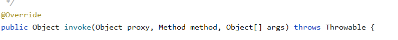
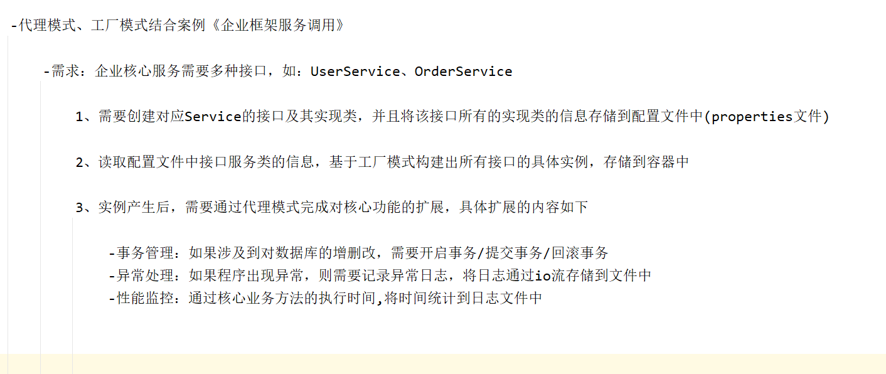

# 设计模式的七大原则

### 1. **单一职责原则（Single Responsibility Principle, SRP）**：

一个类只应该有一个引起它变化的原因，即一个类只负责一项职责。

这有助于提高类的内聚性，减少因需求变更导致的影响范围。

### 2. **开闭原则（Open/Closed Principle, OCP）**：

- 软件实体（类、模块、函数等）应该对扩展开放，对修改关闭。
- 意味着在不修改已有代码的前提下能够扩展功能，通常通过多态、接口或抽象类实现。

### 3. **里氏替换原则（Liskov Substitution Principle, LSP）**：

- 子类型必须能够替换掉它们的基类型而不影响程序的正确性。
- 强调继承关系中子类的设计应保持与父类一致，确保使用父类的地方都能透明地使用子类。

### 4. **依赖倒置原则（Dependency Inversion Principle, DIP）**：

- 高层模块不应该依赖于低层模块，二者都应该依赖于抽象；抽象不应该依赖于细节，细节应该依赖于抽象。
- 提倡使用接口或抽象类来防止具体实现之间的直接耦合。

### 5. **接口隔离原则（Interface Segregation Principle, ISP）**：

- 不应该强迫客户依赖于他们不使用的接口。
- 大而全的接口应被分割成更小的、具体的接口，使实现类只需关注自己需要的方法。

### 6. **迪米特法则（Law of Demeter, LoD）**：

- 又称最少知识原则（Least Knowledge Principle），一个对象应当尽可能少地了解其他对象。
- 对象间交互应尽量限制在最小范围内，减少对象间的耦合度。

### 7. **组合/聚合复用原则（Composite/Aggregate Reuse Principle, CARP）**：

- 尽量使用对象组合/聚合而不是继承来达到复用的目的。
- 继承往往破坏封装性，并可能导致脆弱的基类问题，而通过组合可以构建更为灵活和稳定的系统架构。

# 饿汉式

**饿汉式**是单例模式的一种实现方式，它在类加载时就创建了实例。

## 什么是饿汉式？

"饿汉式"这个名称形象地描述了它的特点：

- **饿**：急切地、迫不及待地
- **汉**：创建实例的"人"

就像一个饥饿的人看到食物就立刻吃掉一样，饿汉式在类加载时就立即创建实例。

## 基本实现

```plain
public class Singleton {
    // 在类加载时就创建实例
    private static final Singleton INSTANCE = new Singleton();
    
    // 私有构造函数，防止外部创建实例
    private Singleton() {}
    
    // 提供全局访问点
    public static Singleton getInstance() {
        return INSTANCE;
    }
}
```

## 饿汉式的特点

### 优点

1. **线程安全**

- 实例在类加载时创建，JVM保证类加载过程的线程安全性
- 不需要额外的同步机制

2. **实现简单**

- 代码简洁，易于理解和实现
- 没有复杂的同步控制

3. **获取实例速度快**

- `getInstance()`方法只是简单的返回引用
- 没有同步开销

### 缺点

1. **资源浪费**

- 无论是否使用，实例都会被创建
- 如果实例占用大量资源，会造成浪费

2. **无法传递参数**

- 实例创建时无法传递参数
- 不适合需要动态配置的场景

## 变体实现

### 1. 静态代码块方式

```java
public class Singleton {
    private static final Singleton INSTANCE;

    static {
        // 可以在静态代码块中进行复杂的初始化
        INSTANCE = new Singleton();
    }

    private Singleton() {}
  // 提供全局访问点
    public static Singleton getInstance() {
        return INSTANCE;
    }
}
```

### 2. 枚举方式（推荐）

```java
public enum Singleton {
    INSTANCE;

    // 可以添加方法
    public void doSomething() {
        System.out.println("执行操作");
    }
}

// 使用方式
Singleton.INSTANCE.doSomething();
```

## 适用场景

**适合使用饿汉式的场景：**

- 实例创建开销小
- 程序启动时就需要使用的对象
- 配置信息管理器
- 工具类

**不适合使用饿汉式的场景：**

- 实例创建开销大（如数据库连接池）
- 资源消耗大的对象
- 需要根据参数动态创建的实例

## 与其他单例模式的对比

|  |  |  |  |  |
| --- | --- | --- | --- | --- |
| **特性** | **饿汉式** | **懒汉式** | **双重检查锁** | **静态内部类** |
| 线程安全 | ✅ | ❌ | ✅ | ✅ |
| 延迟加载 | ❌ | ✅ | ✅ | ✅ |
| 实现复杂度 | 简单 | 简单 | 复杂 | 中等 |
| 性能 | 高 | 中 | 高 | 高 |

## 最佳实践

1. **优先考虑枚举实现**：

```java
public enum ConfigManager {
    INSTANCE;

    // 配置属性
    private String config;

    ConfigManager() {
        // 初始化配置
        this.config = "default";
    }

    public String getConfig() {
        return config;
    }
}
```

2. **如果不用枚举，使用静态常量方式**：

```java
public class Logger {
    private static final Logger INSTANCE = new Logger();

    private Logger() {}

    public static Logger getInstance() {
        return INSTANCE;
    }
}
```

## 总结

饿汉式单例模式是一种简单可靠的实现方式，特别适合那些：

- 创建成本低
- 程序运行期间一定会用到
- 不需要参数化配置

的场景。虽然它不具备延迟加载的特性，但其线程安全性和简单性使其成为许多场景下的首选方案。

# 懒汉式

**懒汉式**是单例模式的一种实现方式，它在**第一次使用时才创建实例**，体现了"懒加载"的思想。

## 什么是懒汉式？

"懒汉式"这个名称形象地描述了它的特点：

- **懒**：不着急，等到需要时才做
- **汉**：创建实例的"人"

就像一个懒惰的人，不到最后一刻不会行动，懒汉式在第一次调用 `getInstance()` 时才创建实例。

## 基本实现（线程不安全）

```java
public class Singleton {
    private static Singleton instance;

    private Singleton() {}

    public static Singleton getInstance() {
        if (instance == null) {
            instance = new Singleton();
        }
        return instance;
    }
}
```

⚠️ **注意**：这是最简单的实现，但**线程不安全**！如果没有 synchronized 没有加锁，那么当ti、t2两个线程同时进入getInstance，如果都为空将会直接创建两个实例，最后导致实例不单一。并且每次进行只要是为空的都会创建实例！！

## 线程安全的实现方式

### 1. 同步方法（简单但性能差）

```java
public class Singleton {
    private static Singleton instance;

    private Singleton() {}

    // 整个方法加锁，性能较差
    public static synchronized Singleton getInstance() {
        if (instance == null) {
            instance = new Singleton();
        }
        return instance;
    }
}
```

**缺点**：每次调用都要加锁，影响性能。

### 2. 双重检查锁定（Double-Checked Locking）

```java
public class Singleton {
    // 必须用 volatile 保证可见性和禁止指令重排序
    private static volatile Singleton instance;

    private Singleton() {}

    public static Singleton getInstance() {
        // 第一次检查
        if (instance == null) {
            0(Singleton.class) {
                // 第二次检查
                if (instance == null) {
                    instance = new Singleton();
                }
            }
        }
        return instance;
    }
}
```

双重检查就会使得如果不为空将不再进去直接 return instance;否则就进入。如果没有双重检查将会导致不管是不是为空都会进入竞争锁里面进行检查

**关键点**：

- `volatile` 关键字确保：

1. 可见性：一个线程修改后，其他线程立即可见
2. 禁止指令重排序：防止对象未完全初始化就被其他线程使用

### 3. 静态内部类（推荐）

```java
public class Singleton {
    private Singleton() {}

    // 静态内部类
    private static class SingletonHolder {
        private static final Singleton INSTANCE = new Singleton();
    }

    public static Singleton getInstance() {
        return SingletonHolder.INSTANCE;
    }
}
```

**原理**：

- JVM保证类的初始化是线程安全的
- 内部类在第一次被使用时才加载
- 兼顾了延迟加载和线程安全

## 懒汉式的特点

### 优点

1. **延迟加载**

- 实例在第一次使用时才创建
- 节省内存资源

2. **按需创建**

- 如果程序运行期间从未使用，就不会创建实例
- 特别适合创建开销大的对象

### 缺点

1. **实现复杂**

- 需要考虑线程安全问题
- 正确实现需要理解 `volatile`、内存模型等概念

2. **反射攻击**

- 可以通过反射破坏单例

```java
// 可以通过反射创建新实例
Constructor<Singleton> constructor = Singleton.class.getDeclaredConstructor();
constructor.setAccessible(true);
Singleton newInstance = constructor.newInstance();
```

## 适用场景

**适合使用懒汉式的场景：**

- 实例创建开销大（如数据库连接池）
- 资源消耗大的对象
- 程序可能不会用到的对象
- 需要延迟初始化的配置管理器

**不适合使用懒汉式的场景：**

- 需要频繁创建和销毁的对象
- 对性能要求极高且一定会用到的对象

## 与其他单例模式的对比

|  |  |  |  |  |
| --- | --- | --- | --- | --- |
| **特性** | **饿汉式** | **懒汉式** | **双重检查锁** | **静态内部类** |
| 线程安全 | ✅ | ❌ | ✅ | ✅ |
| 延迟加载 | ❌ | ✅ | ✅ | ✅ |
| 实现复杂度 | 简单 | 简单 | 复杂 | 中等 |
| 性能 | 高 | 中 | 高 | 高 |
| 资源利用 | 可能浪费 | 按需创建 | 按需创建 | 按需创建 |

## 最佳实践

### 推荐使用静态内部类方式：

```java
public class DatabaseConnection {
    private DatabaseConnection() {
        // 模拟耗时的数据库连接
        try {
            Thread.sleep(100);
        } catch (InterruptedException e) {
            Thread.currentThread().interrupt();
        }
    }

    private static class ConnectionHolder {
        private static final DatabaseConnection INSTANCE = new DatabaseConnection();
    }

    public static DatabaseConnection getInstance() {
        return ConnectionHolder.INSTANCE;
    }

    public void connect() {
        System.out.println("数据库连接已建立");
    }
}
```

### 使用示例：

```java
public class Main {
    public static void main(String[] args) {
        // 第一次调用时才创建实例
        DatabaseConnection conn1 = DatabaseConnection.getInstance();
        DatabaseConnection conn2 = DatabaseConnection.getInstance();

        // 两个引用指向同一个实例
        System.out.println(conn1 == conn2); // true
        conn1.connect();
    }
}
```

## 防止反射破坏单例

如果需要更高安全性，可以在构造函数中添加检查：

```java
private static boolean instanceCreated = false;

private Singleton() {
    synchronized (Singleton.class) {
        if (instanceCreated) {
            throw new RuntimeException("单例对象已经存在");
        }
        instanceCreated = true;
    }
}
```

## 总结

懒汉式单例模式的核心价值在于**延迟加载**，它让资源的创建更加智能和高效。虽然实现上比饿汉式复杂，但通过"静态内部类"这种优雅的方式，可以完美平衡线程安全、延迟加载和性能。

**选择建议**：

- 如果创建成本低且一定会用到：用**饿汉式**
- 如果创建成本高或可能不用：用**静态内部类懒汉式**

以及两个方法是否有线程安全问题

# 静态代理

静态代理是设计模式中的一种代理模式实现方式，它在**编译时期**就确定了代理类和被代理类的关系。

## 什么是代理模式？

代理模式为其他对象提供一种代理，以控制对这个对象的访问。就像现实生活中的：

- 明星 → 经纪人
- 用户 → 网络代理
- 客户 → 房产中介

## 静态代理的核心结构

静态代理需要三个角色：

1. **公共接口**：定义要代理的方法
2. **目标对象（被代理类）**：真正执行业务逻辑的类
3. **代理对象**：包装目标对象，可以添加额外功能

## 基本实现

### 1. 定义公共接口

```java
// 公共接口
public interface Moveable {
    void move();
}
```

### 2. 目标对象（被代理类）

```java
// 真正要代理的对象
public class Tank implements Moveable {

    @Override
    public void move() {
        System.out.println("坦克正在移动...");
        try {
            Thread.sleep(1000); // 模拟耗时操作
        } catch (InterruptedException e) {
            e.printStackTrace();
        }
    }
}
```

### 3. 代理对象

```java
// 代理类
public class TankProxy implements Moveable {

    private Moveable tank;

    public TankProxy(Moveable tank) {
        this.tank = tank;
    }

    @Override
    public void move() {
        // 代理可以添加额外功能
        System.out.println("记录开始时间");
        long start = System.currentTimeMillis();

        // 调用目标对象的方法
        tank.move();

        // 代理添加的额外功能
        long end = System.currentTimeMillis();
        System.out.println("记录结束时间，耗时：" + (end - start) + "ms");
        System.out.println("日志记录完成");
    }
}
```

## 使用示例

```java
public class Main {
    public static void main(String[] args) {
        // 创建目标对象
        Tank tank = new Tank();

        // 创建代理对象，包装目标对象
        TankProxy proxy = new TankProxy(tank);

        // 通过代理调用方法
        proxy.move();
    }
}
```

**输出结果：**

```plain
记录开始时间
坦克正在移动...
记录结束时间，耗时：1000ms
日志记录完成
```

## 静态代理的特点

### 优点

1. **职责分离**

- 业务逻辑（Tank）和附加功能（日志、权限等）分离
- 符合单一职责原则

2. **增强功能**

- 可以在不修改目标对象的前提下，添加额外功能
- 如：日志记录、性能监控、事务管理、权限控制

3. **控制访问**

- 代理可以决定是否调用目标对象
- 可以进行权限验证

4. **代码复用**

- 代理逻辑可以复用到多个目标对象

### 缺点

1. **类数量爆炸**

- 一个接口需要一个代理类
- 接口增多时，代理类数量急剧增加

2. **维护困难**

- 如果接口方法改变，所有代理类都需要修改
- 代码重复度高

3. **灵活性差**

- 代理关系在编译期确定
- 无法动态改变

## 实际应用场景

### 1. 日志记录

```java
public class LoggingProxy implements Service {
    private Service target;

    public LoggingProxy(Service target) {
        this.target = target;
    }

    @Override
    public void doSomething() {
        System.out.println("开始执行：" + new Date());
        target.doSomething();
        System.out.println("执行完成：" + new Date());
    }
}
```

### 2. 性能监控

```java
public class PerformanceProxy implements Service {
    private Service target;

    @Override
    public void doSomething() {
        long start = System.nanoTime();
        target.doSomething();
        long end = System.nanoTime();
        System.out.println("执行耗时：" + (end - start) + "ns");
    }
}
```

### 3. 权限控制

```java
public class SecurityProxy implements Service {
    private Service target;
    private String userRole;

    public SecurityProxy(Service target, String userRole) {
        this.target = target;
        this.userRole = userRole;
    }

    @Override
    public void doSomething() {
        if ("ADMIN".equals(userRole)) {
            target.doSomething();
        } else {
            System.out.println("权限不足！");
        }
    }
}
```

## 与动态代理的对比

|  |  |  |
| --- | --- | --- |
| **特性** | **静态代理** | **动态代理** |
| 创建时机 | 编译期 | 运行期 |
| 类文件 | 需要手动编写代理类 | 运行时动态生成 |
| 灵活性 | 低 | 高 |
| 维护性 | 差（修改接口需改多个类） | 好（统一处理） |
| 性能 | 高 | 稍低（反射开销） |
| 实现复杂度 | 简单 | 复杂 |

## 最佳实践

### 1. 通用代理基类

```java
// 通用代理模板
public abstract class BaseProxy<T> {
    protected T target;

    public BaseProxy(T target) {
        this.target = target;
    }

    // 模板方法
    public final void execute() {
        before();
        target.execute();
        after();
    }

    protected abstract void before();
    protected abstract void after();
}
```

### 2. 组合使用多个代理

```java
// 可以组合多个代理功能
Service service = new RealService();
Service loggingProxy = new LoggingProxy(service);
Service performanceProxy = new PerformanceProxy(loggingProxy);
Service securityProxy = new SecurityProxy(performanceProxy);

// 调用时会依次经过所有代理
securityProxy.doSomething();
```

## 总结

静态代理是一种简单有效的设计模式，它：

1. **在编译期确定代理关系**
2. **通过组合方式增强对象功能**
3. **实现了业务逻辑与横切关注点的分离**

**适用场景：**

- 功能相对固定
- 代理逻辑简单
- 性能要求高
- 不需要频繁修改

# 动态代理

动态代理是Java中一种强大的运行时技术，它允许在**程序运行期间动态创建代理对象**，而不需要在编译期就写好代理类。

## 什么是动态代理？

与静态代理不同，动态代理：

- **不需要提前编写代理类**
- **在运行时动态生成代理对象**
- **可以代理实现了相同接口的多个类**

就像一个"万能经纪人"，可以根据需要代理任何明星，而不需要为每个明星单独雇一个经纪人。

## Java中的两种动态代理

### 1. JDK动态代理（基于接口）

#### 核心类

- `java.lang.reflect.Proxy`
- `java.lang.reflect.InvocationHandler`

#### 实现步骤

```java
// 1. 定义公共接口
public interface Moveable {
    void move();
    void stop();
}

// 2. 目标对象
public class Tank implements Moveable {
    @Override
    public void move() {
        System.out.println("坦克正在移动...");
    }

    @Override
    public void stop() {
        System.out.println("坦克停止");
    }
}
```

#### 创建动态代理

```java
import java.lang.reflect.InvocationHandler;
import java.lang.reflect.Method;
import java.lang.reflect.Proxy;

// 3. 创建InvocationHandler
public class LogHandler implements InvocationHandler {
    private Object target; // 目标对象

    public LogHandler(Object target) {
        this.target = target;
    }

    @Override
    public Object invoke(Object proxy, Method method, Object[] args) throws Throwable {
        // 代理逻辑：方法执行前
        System.out.println("=== 开始执行 " + method.getName() + " ===");
        long start = System.currentTimeMillis();

        // 调用目标对象的方法
        Object result = method.invoke(target, args);

        // 代理逻辑：方法执行后
        long end = System.currentTimeMillis();
        System.out.println("=== " + method.getName() + " 执行完成，耗时：" + (end - start) + "ms ===");

        return result;
    }
}
```

#### 使用动态代理

```java
public class Main {
    public static void main(String[] args) {
        // 创建目标对象
        Tank tank = new Tank();

        // 创建代理处理器
        LogHandler handler = new LogHandler(tank);

        // 动态生成代理对象
        Moveable proxy = (Moveable) Proxy.newProxyInstance(
            tank.getClass().getClassLoader(),      // 类加载器
            tank.getClass().getInterfaces(),       // 实现的接口
            handler                               // 代理处理器
        );

        // 通过代理调用方法
        proxy.move();
        proxy.stop();
    }
}
```

**输出结果：**

```plain
=== 开始执行 move ===
坦克正在移动...
=== move 执行完成，耗时：10ms ===
=== 开始执行 stop ===
坦克停止
=== stop 执行完成，耗时：5ms ===
```

### 为什么类型是 `Object`？

这是代码中最关键的设计！使用 `Object` 类型有以下几个重要原因：

#### 1. **通用性（最重要）**

```java
// 因为Object是所有类的父类
String str = "hello";
Integer num = 123;
List list = new ArrayList();
// 所有这些都可以赋值给 Object 类型的变量
Object obj1 = str;
Object obj2 = num; 
Object obj3 = list;
```

这意味着 `CreateProxy` 类可以代理**任何类型的对象**，无论是 `UserService`、`OrderService` 还是 `ProductDao`。

#### 2. **解耦设计**

```java
// 如果写成：
// private UserService userService; 
// 那就只能代理 UserService

// 但写成：
private Object object;
// 可以代理任何服务类，完全解耦
```

#### 3. **符合代理模式的本质**

代理模式的核心思想是：**代理对象应该能够代理任何实现了特定接口的对象**。

### `object` 在代码中的作用流程

让我们看它是如何工作的：

```java
public class CreateProxy {
    private Object object;  // ← 存储目标对象的"容器"

    public CreateProxy(Object object) {
        this.object = object;  // ← 把目标对象存进来
    }

    public Object getProxy() {
        return Proxy.newProxyInstance(
            object.getClass().getClassLoader(),
            object.getClass().getInterfaces(),
            new InvocationHandler() {
                @Override
                public Object invoke(Object proxy, Method method, Object[] args) throws Throwable {
                    System.out.println("前置通知~~");

                    // ← 在这里使用 object 调用目标对象的方法
                    Object invok = method.invoke(object, args);

                    System.out.println("后置通知~~");
                    return invok;
                }
            }
        );
    }
}
```

#### 执行过程：

1. **创建代理时**：

```java
UserService userService = new UserServiceImpl();
CreateProxy proxyCreator = new CreateProxy(userService); // userService 被存入 object
```

2. **调用方法时**：

- 代理拦截调用
- 通过 `object` 找到原始的 `userService` 对象
- 使用反射 `method.invoke(object, args)` 调用真正的方法

### 为什么这样设计很巧妙？

#### 对比：如果不用 `Object`

```java
// ❌ 方案1：为每个类写一个代理创建器
public class UserServiceProxyCreator {
    private UserService userService;
}

public class OrderServiceProxyCreator {
    private OrderService orderService;
}
// → 代码重复，维护困难

// ❌ 方案2：使用具体接口类型
private Moveable moveable; // 只能代理实现了Moveable接口的对象
```

#### 使用 `Object` 的优势：

```java
// ✅ 一个类搞定所有代理
CreateProxy proxy1 = new CreateProxy(userService);
CreateProxy proxy2 = new CreateProxy(orderService); 
CreateProxy proxy3 = new CreateProxy(productDao);
// → 通用、灵活、可复用
```

### 实际使用示例

```java
// 1. 创建目标对象
UserService userService = new UserServiceImpl();

// 2. 创建代理创建器，传入目标对象
CreateProxy proxyCreator = new CreateProxy(userService); // userService → object

// 3. 获取代理对象
UserService proxy = (UserService) proxyCreator.getProxy();

// 4. 通过代理调用方法
proxy.saveUser(user); // 实际执行流程：
// 前置通知 → userService.saveUser() → 后置通知
```

### 需要注意的点

虽然 `Object` 类型很通用，但也有一些注意事项：

```java
// 1. 需要确保目标对象实现了接口（JDK代理的要求）
Object object = new Object(); // ❌ 这样不行，Object没有有用的方法

// 2. 使用时需要强制类型转换
UserService proxy = (UserService) proxyCreator.getProxy(); // 需要强转

// 3. 可以添加泛型改进（更现代的写法）
public class CreateProxy<T> {
    private T object; // 使用泛型更安全

    public CreateProxy(T object) {
        this.object = object;
    }

    public T getProxy() { // 返回泛型类型，避免强转
        // ...
    }
}
```

### 总结

`private Object object;` 的作用是：

**创建一个通用的"容器"，用来存储任何类型的被代理对象，实现动态代理的通用性和灵活性。**

老师讲解案例：

```java
package com.eagles.proxy.jdk;
/*
*接口
*/
public interface JdkProxy {
    String method();
}
```

```java
package com.eagles.proxy.jdk;

/**
 * 目标类
 */
public class ProxyImpl implements JdkProxy{
    @Override
    public String method() {

        System.out.println("需要增强的内容~~");

        return "success";
    }
}
```

```java
package com.eagles.proxy.jdk;

import java.lang.reflect.InvocationHandler;
import java.lang.reflect.Method;
import java.lang.reflect.Proxy;

/**
 * 不是代理类 是创建代理类的类
 */
public class CreateProxy {

    //目标对象 这里没有用目标对象是因为Object可以去接收一切对象的实例，所以直接聚合一个Object
    private Object object;

    //写一个方法

    public CreateProxy(Object object) {
        this.object = object;
    }

    /**
     * 该方法的返回值就是内存中构建出来的代理对象
     * @return
     */
    public  Object getProxy(){
        /**
         * ClassLoader loader 目标对象的类加载器  object.getClass().getClassLoader() 固定写法
         *  Class[] interfaces 目标对象的接口字节码对象 object.getClass().getInterfaces()
         *  InvocationHandler h
         */
        return Proxy.newProxyInstance(object.getClass().getClassLoader(), object.getClass().getInterfaces(), new InvocationHandler() {
            /**
       *
       * 该方法会通过反射机制来调用目标对象中的方法，完成对目标方法的增强，所有增强的过程，都在这个方法中
       *
       * @param proxy 从内存中构建出来的代理对象的实例
       *
       * @param method 从内存中构建出来的代理对象的方法字节码对象
       *
       * @param args 调用方法所需要的参数
       *
       * @return
       * @throws Throwable
       */
            @Override
            public Object invoke(Object proxy, Method method, Object[] args) throws Throwable {

                System.out.println("前置通知~~");

                //调用目标对象的方法
                Object invok = method.invoke(object, args);

                System.out.println("后置通知~~");

                return invok;
            }
        });
    }
}
```

**如果不想new InvocationHandler（）**

```java
package com.eagles.proxy.jdk02;

import com.eagles.proxy.jdk.ProxyImpl;

import java.lang.reflect.InvocationHandler;
import java.lang.reflect.Method;

/**
 * 写一个这个的实例去继承InvocationHandler，这样就可以不用去匿名内部类
 */
public class InvocationHandlerImpl implements InvocationHandler {

    @Override
    public Object invoke(Object proxy, Method method, Object[] args) throws Throwable {

        System.out.println("开启前置通知~~");
        //调用目标方法
        Object invoke = method.invoke(new ProxyImpl(), args);

        System.out.println("开启后置通知~~");

        return invoke;
    }

}
```

```java
package com.eagles.proxy.jdk02;

import com.eagles.proxy.jdk.JdkProxy;

import java.lang.reflect.InvocationHandler;

public class ReflectProxy implements JdkProxy {

    private InvocationHandler invocationHandler;

    public ReflectProxy(InvocationHandler invocationHandler) {
        this.invocationHandler = invocationHandler;
    }

    @Override
    public String method() {

        Object m = null;
        try {
            invocationHandler.invoke(this,JdkProxy.class.getDeclaredMethod("method"),new Object[]{});
        } catch (Throwable e) {
            throw new RuntimeException(e);
        }
        return null;
    }
}
```

原理差不多，就是有一点点不一样，一个是匿名内部类，一个是写一个子类继承它

##### 错误理解

- `getProxy()` 返回的不是"代理类"
- `Object` 类型不是代理类的类型

##### 正确理解

- `getProxy()` 返回的是**代理类的实例对象**
- 这个对象是**运行时动态生成的代理对象**
- 它实现了目标对象所实现的所有接口

创建代理类的类里面的实现细节：

Object invok = method.invoke(object, args); 它实现了动态代理最关键的功能：**调用目标对象（被代理对象）的真正方法**。

- `method`：是 `java.lang.reflect.Method` 类型的对象
- `.invoke()`：是Method类的一个方法，用来**执行**这个Method对象所代表的方法
- 英文"invoke"的意思就是"调用"或"执行"

**第一个参数** `object`：要调用该方法的**目标对象实例**

- 在你的代码中，`object` 是通过构造函数传入的目标对象（如 `UserService` 实例）
- 相当于：`目标对象.方法名(...)`

**第二个参数** `args`：调用方法时需要的**参数数组**

- 如果方法不需要参数，`args` 就是 `null` 或空数组
- 如果方法需要参数，`args` 就包含这些参数

- `invok` 是变量名（可以改成 `result`、`returnValue` 等）
- 存储的是被调用方法的**返回值**
- 因为方法返回值类型不确定，所以用 `Object` 类型

假设我们代理的是一个 `UserService类`：

```java
public class UserService {
    public String saveUser(User user) {
        System.out.println("保存用户：" + user.getName());
        return "success";
    }
}
```

当通过代理调用 `saveUser方法` 时：

```java
// 代理中的invoke方法
public Object invoke(Object proxy, Method method, Object[] args) throws Throwable {
    System.out.println("前置通知~~"); // 输出：前置通知~~

    // 这行代码的实际执行：
    Object invok = method.invoke(object, args);
    // 相当于：
    // String result = userService.saveUser(user);
    // 具体分解：
    // - method: 代表saveUser方法
    // - object: userService实例
    // - args: 包含User对象的数组
    // 执行结果：输出"保存用户..."，返回"success"

    System.out.println("后置通知~~"); // 输出：后置通知~~

    return invok; // 返回"success"
}
```

测试中的向上转型是为了父类调用子类的方法，从而通过接口实现目标对象的方法

```java
package com.eagles.proxy.jdk;

import java.net.Proxy;

public class Test02 {
    public static void main(String[] args) {
        //创建目标对象
        ProxyImpl proxy = new ProxyImpl();

        //创建代理类对象
        CreateProxy createProxy = new CreateProxy(proxy);

        //代理对象 向上转型为接口
        JdkProxy jdkProxy = (JdkProxy)createProxy.getProxy();

        jdkProxy.method();

    }
}
```

```java
前置通知~~
需要增强的内容~~
后置通知~~
```

总结：

所以我们创建一个创建代理类的类创建的是一个形式，创建的是一个永远根据目标类而转换的代理类（是多元的），根据ProxyImpl proxy = new ProxyImpl();创建目标对象的不同，CreateProxy createProxy = new CreateProxy(proxy);动态的产生代理类的一个过程，而最后这个jdkProxy.method();



则是**调用的内存中创建出来的代理类**的method方法，与**目标函数**里面的method方法不同的是，代理类里面的方法对目标函数的方法进行了加强

### 2. CGLIB动态代理（基于继承）

当目标类没有实现接口时，可以使用CGLIB。

#### 添加依赖

```xml
<dependency>
  <groupId>cglib</groupId>
  <artifactId>cglib</artifactId>
  <version>3.3.0</version>
</dependency>
```

#### CGLIB实现

```java
import net.sf.cglib.proxy.Enhancer;
import net.sf.cglib.proxy.MethodInterceptor;
import net.sf.cglib.proxy.MethodProxy;

public class CglibProxy implements MethodInterceptor {
    private Object target;

    public CglibProxy(Object target) {
        this.target = target;
    }

    @SuppressWarnings("unchecked")
    public <T> T getProxy() {
        Enhancer enhancer = new Enhancer();
        // 设置父类（要代理的类）
        enhancer.setSuperclass(target.getClass());
        // 设置回调
        enhancer.setCallback(this);
        // 创建代理对象
        return (T) enhancer.create();
    }

    @Override
    public Object intercept(Object obj, Method method, Object[] args, MethodProxy proxy) throws Throwable {
        System.out.println("=== CGLIB: 开始执行 " + method.getName() + " ===");
        long start = System.currentTimeMillis();

        // 调用父类方法
        Object result = proxy.invokeSuper(obj, args);

        long end = System.currentTimeMillis();
        System.out.println("=== CGLIB: " + method.getName() + " 执行完成，耗时：" + (end - start) + "ms ===");

        return result;
    }
}
```

#### 使用CGLIB代理

```java
// 没有实现接口的类
public class Car {
    public void run() {
        System.out.println("汽车在行驶...");
    }
}

// 使用
Car car = new Car();
CglibProxy cglibProxy = new CglibProxy(car);
Car proxy = cglibProxy.getProxy();
proxy.run();
```

#### 简单的使用案例：
```java
package com.eagles.proxy.cglib;

public class CglibProxy {
    public void getMethod(){
        System.out.println("核心逻辑~~");
    }
}
```

```java
package com.eagles.proxy.cglib;

import net.sf.cglib.proxy.Enhancer;
import net.sf.cglib.proxy.MethodInterceptor;
import net.sf.cglib.proxy.MethodProxy;

import java.lang.reflect.Method;

public class CreateCglib implements MethodInterceptor {

    private Object object;

    public CreateCglib(Object object) {
        this.object = object;
    }

    public Object getProxy(){

        //创建cglib对象
        Enhancer enhancer = new Enhancer();

        //指定代理对象的实例
        enhancer.setSuperclass(object.getClass());

        //设置回调函数
        enhancer.setCallback(this);

        return enhancer.create();
    }

    @Override
    public Object intercept(Object o, Method method, Object[] objects, MethodProxy methodProxy) throws Throwable {

        System.out.println("开启事务");

        //调用目标方法
        Object invoke = method.invoke(object, objects);

        System.out.println("提交事务");

        return invoke;
    }
}
```

```java
package com.eagles.proxy.cglib;

public class Test {
    public static void main(String[] args) {

        //创建目标对象
        CglibProxy cglibProxy = new CglibProxy();

        //创建代理对象
        CglibProxy proxy = (CglibProxy)new CreateCglib(cglibProxy).getProxy();

        proxy.getMethod();

    }

}
```

这段 Java 代码使用了 **CGLIB** 库实现了一个 **动态代理**，具体来说是 **基于子类继承的动态代理**。它的作用是为目标对象创建一个代理对象，在调用目标方法的前后自动添加额外的逻辑（比如“开启事务”和“提交事务”），常用于 **AOP（面向切面编程）** 场景。

---

#### 下面我们逐行解析代码的含义：

---

##### 包和导入

```java
package com.eagles.proxy.cglib;

import net.sf.cglib.proxy.Enhancer;
import net.sf.cglib.proxy.MethodInterceptor;
import net.sf.cglib.proxy.MethodProxy;

import java.lang.reflect.Method;
```

- 使用了 CGLIB 第三方库（`net.sf.cglib`）来实现动态代理。
- `Enhancer`：CGLIB 的核心类，用于生成代理类。
- `MethodInterceptor`：方法拦截器接口，定义拦截逻辑。
- `MethodProxy`：对原方法的代理，用于高效调用原方法。
- `Method`：Java 反射中的方法对象。

---

##### 类定义

```java
public class CreateCglib implements MethodInterceptor {
```

- `CreateCglib` 是一个代理工厂类。
- 它实现了 `MethodInterceptor` 接口，表示它可以“拦截”方法调用。

---

#### 成员变量

```java
private Object object;
```

- 这是**被代理的目标对象**（比如一个 `UserService` 实例）。
- 代理对象会在这个对象的基础上添加额外功能。

---

#### 构造函数

```java
public CreateCglib(Object object) {
this.object = object;
}
```

- 通过构造函数传入要代理的真实对象。

---

#### 获取代理对象的方法

```java
public Object getProxy(){
    Enhancer enhancer = new Enhancer();                  // 创建 Enhancer 对象

    enhancer.setSuperclass(object.getClass());          // 设置代理类的父类（即目标类）

    enhancer.setCallback(this);                         // 设置拦截器（this 就是当前类，实现了 MethodInterceptor）

    return enhancer.create();                           // 创建并返回代理实例
}
```

#### 详细解释：

1. `Enhancer`：CGLIB 提供的工具类，用来动态生成一个继承自目标类的子类。
2. `setSuperclass(...)`：指定生成的代理类继承自哪个类（即目标对象的类）。
3. `setCallback(this)`：当代理对象的方法被调用时，会跳转到 `this.intercept(...)` 方法执行。
4. `enhancer.create()`：创建代理对象实例。

所以：**生成的代理对象 = 继承自目标类的子类 + 拦截逻辑**

---

#### 核心拦截方法

```java
@Override
public Object intercept(Object o, Method method, Object[] objects, MethodProxy methodProxy) throws Throwable {
    System.out.println("开启事务");

    // 调用目标方法
    Object invoke = method.invoke(object, objects);

    System.out.println("提交事务");

    return invoke;
}
```

#### 参数说明：

|  |  |
| --- | --- |
| **参数** | **含义** |
| `o` | 生成的代理对象（子类实例） |
| `method` | 被调用的方法（反射对象） |
| `objects` | 方法的参数数组 |
| `methodProxy` | CGLIB 提供的方法代理，可更高效地调用原方法 |

#### 执行流程：

1. **前置操作**：打印 “开启事务”
2. **执行原方法**：通过 `method.invoke(object, objects)` 调用真实对象的方法
3. **后置操作**：打印 “提交事务”
4. **返回结果**：将原方法的返回值返回

这就是典型的 **AOP 环绕通知（Around Advice）**

---

#### 使用示例（假设有一个 UserService）

```java
// 目标对象
UserService userService = new UserService();

// 创建代理
CreateCglib proxy = new CreateCglib(userService);
UserService proxyInstance = (UserService) proxy.getProxy();

// 调用方法
proxyInstance.saveUser(); 
// 输出：
// 开启事务
// 正在保存用户... （这是 UserService 的实际逻辑）
// 提交事务
```

---

### CGLIB 动态代理 vs JDK 动态代理

|  |  |  |
| --- | --- | --- |
| **对比项** | **CGLIB** | **JDK 动态代理** |
| 原理 | 继承（生成子类） | 接口（实现接口） |
| 要求 | 目标类不需要实现接口 | 目标类必须实现接口 |
| 性能 | 较高（MethodProxy） | 一般 |
| 限制 | 不能代理 `final`  类或方法 | 只能代理接口方法 |

## 动态代理的核心原理

### JDK动态代理的工作流程

1. **创建代理类**：`Proxy.newProxyInstance()` 会动态生成一个代理类
2. **生成字节码**：这个代理类实现了目标对象的所有接口
3. **重写方法**：代理类中的所有方法都会调用 `InvocationHandler.invoke()`
4. **反射调用**：通过 `Method.invoke()` 调用目标对象的实际方法

### 生成的代理类大致结构

```java
// 这是JDK动态生成的代理类的伪代码
public class $Proxy0 extends Proxy implements Moveable {
    private InvocationHandler handler;

    public $Proxy0(InvocationHandler handler) {
        this.handler = handler;
    }

    @Override
    public void move() {
        handler.invoke(this, Moveable.class.getMethod("move"), null);
    }

    @Override
    public void stop() {
        handler.invoke(this, Moveable.class.getMethod("stop"), null);
    }
}
```

## 动态代理的优势

### 优点

1. **高度灵活**

- 可以代理任何实现了接口的类
- 无需为每个类编写代理类

2. **易于维护**

- 代理逻辑集中在 `InvocationHandler` 中
- 修改代理逻辑只需改一个地方

3. **解耦**

- 业务代码与横切关注点（日志、事务等）分离

4. **运行时决定**

- 可以根据运行时条件决定是否创建代理

### 缺点

1. **JDK代理只能代理接口**

- 目标类必须实现至少一个接口
- 对于没有接口的类，需要使用CGLIB

2. **性能开销**

- 反射调用有一定性能损失
- 但通常可以接受

3. **调试困难**

- 代理类是运行时生成的，调试时看不到源码

## 实际应用场景

### 1. Spring AOP

```java
// Spring中的事务管理就是基于动态代理
@Service
public class UserService {

    @Transactional
    public void saveUser(User user) {
        // 业务逻辑
        userRepository.save(user);
        // 如果这里抛异常，事务会回滚
    }
}
```

### 2. RPC远程调用

```java
// 动态生成远程服务的代理
UserService userService = rpcClient.getProxy(UserService.class);
// 调用远程方法就像调用本地方法
userService.saveUser(user);
```

### 3. 缓存代理

```java
public class CacheHandler implements InvocationHandler {
    private Object target;
    private Map<String, Object> cache = new ConcurrentHashMap<>();

    @Override
    public Object invoke(Object proxy, Method method, Object[] args) throws Throwable {
        // 生成缓存key
        String key = method.getName() + Arrays.toString(args);

        // 先查缓存
        if (cache.containsKey(key)) {
            System.out.println("从缓存获取数据");
            return cache.get(key);
        }

        // 调用实际方法
        Object result = method.invoke(target, args);

        // 存入缓存
        cache.put(key, result);
        return result;
    }
}
```

### 4. 权限控制

```java
public class SecurityHandler implements InvocationHandler {
    private Object target;
    private Set<String> allowedMethods;

    @Override
    public Object invoke(Object proxy, Method method, Object[] args) throws Throwable {
        if (!allowedMethods.contains(method.getName())) {
            throw new SecurityException("无权执行方法: " + method.getName());
        }
        return method.invoke(target, args);
    }
}
```

## 与静态代理对比

|  |  |  |
| --- | --- | --- |
| **特性** | **静态代理** | **动态代理** |
| 创建时机 | 编译期 | 运行期 |
| 类文件 | 需要手动编写 | 动态生成 |
| 灵活性 | 低 | 高 |
| 维护性 | 差 | 好 |
| 性能 | 高 | 稍低 |
| 适用范围 | 有接口的类 | JDK：有接口；CGLIB：任何类 |

## 最佳实践

### 1. 通用代理工厂

```java
public class ProxyFactory {

    public static <T> T createProxy(T target, Advice advice) {
        return (T) Proxy.newProxyInstance(
            target.getClass().getClassLoader(),
            target.getClass().getInterfaces(),
            new UniversalHandler(target, advice)
        );
    }
}

// 通用的Advice接口
public interface Advice {
    void before(Method method, Object[] args);
    void after(Method method, Object result);
    void exception(Method method, Exception e);
}
```

### 2. 链式代理

```java
// 可以组合多个切面
Object proxy = target;
proxy = new TransactionHandler(proxy).getProxy();
proxy = new LoggingHandler(proxy).getProxy();
proxy = new SecurityHandler(proxy).getProxy();
```

## 总结

动态代理是Java中一项强大的技术，它：

1. **在运行时动态创建代理对象**
2. **实现了AOP（面向切面编程）的基础**
3. **是Spring框架的核心技术之一**

**选择建议：**

- 如果目标类实现了接口：优先使用 **JDK动态代理**
- 如果目标类没有实现接口：使用 **CGLIB动态代理**
- 在Spring环境中：让Spring框架自动选择合适的代理方式

# 工厂模式

### 工厂模式的基本组成

1. **Creator（抽象工厂角色）**：声明了工厂方法的接口，通常会定义一个用于返回产品的抽象方法。这个角色可以是接口、抽象类或具体类。
2. **ConcreteCreator（具体工厂角色）**：实现Creator中定义的工厂方法以完成具体产品的创建。
3. **Product（抽象产品角色）**：定义了工厂方法所创建的对象的接口。
4. **ConcreteProduct（具体产品角色）**：实现了Product接口，代表一个具体的可生成的产品对象

### 工厂模式的三种类型

### 1. **简单工厂模式(Simple Factory)**

不直接向客户端暴露对象创建的逻辑，而是通过一个静态方法来封装创建对象的过程。尽管称为“简单工厂”，但它实际上并不属于GoF 23种设计模式之一。

### 披萨工厂
**简单工厂模式--披萨店**

#### 1. 定义披萨抽象类（产品接口）

```java
public abstract class Pizza {
    public abstract void prepare();
    public abstract void bake();

    public void cut() {
        System.out.println("Cutting the pizza");
    }
}
```

#### 2. 具体披萨类（具体产品）

```java
public class CheesePizza extends Pizza {
    @Override
    public void prepare() {
        System.out.println("Preparing cheese pizza with mozzarella...");
    }

    @Override
    public void bake() {
        System.out.println("Baking cheese pizza at 350°F...");
    }
}

public class VeggiePizza extends Pizza {
    @Override
    public void prepare() {
        System.out.println("Preparing veggie pizza with mushrooms, onions...");
    }

    @Override
    public void bake() {
        System.out.println("Baking veggie pizza at 375°F...");
    }
}
```

#### 3. 创建“简单工厂”类（核心！）

```java
public class PizzaFactory {

    // 🚀 静态方法：根据类型创建对应的披萨
    public static Pizza createPizza(String type) {
        Pizza pizza = null;

        if ("cheese".equals(type)) {
            pizza = new CheesePizza();
        } else if ("veggie".equals(type)) {
            pizza = new VeggiePizza();
        } else if ("pepperoni".equals(type)) {
            pizza = new PepperoniPizza(); // 新增口味只需改这里
        }
        // 可以加日志、异常处理等
        if (pizza == null) {
            throw new IllegalArgumentException("Unknown pizza type: " + type);
        }
        return pizza;
    }
}
```

#### 4. 客户端使用（点餐）

```java
public class PizzaStore {
    public void orderPizza(String type) {
        //  不再关心如何创建，只管使用
        Pizza pizza = PizzaFactory.createPizza(type);

        pizza.prepare();
        pizza.bake();
        pizza.cut();
    }

    public static void main(String[] args) {
        PizzaStore store = new PizzaStore();
        store.orderPizza("cheese"); // 点一个芝士披萨
        store.orderPizza("veggie");  // 点一个蔬菜披萨
    }
}
```

---

**简单工厂模式的优点**

|  |  |
| --- | --- |
| **优点** | **说明** |
| **封装创建逻辑** | 客户端不需要知道 `new`  了哪个类，只需告诉工厂要什么 |
| **易于维护** | 如果要新增 `PepperoniPizza`  ，只需修改 `PizzaFactory`  ，其他代码不用动 |
| **集中管理** | 所有对象创建集中在工厂类，便于统一处理（如日志、异常、缓存等） |

### 2. **工厂方法模式(Factory Method Pattern)**

定义了一个创建对象的接口，但由子类决定要实例化的类是哪一个。工厂方法使得类的实例化推迟到子类。

**普通工厂方法模式--手机厂**

```java
package com.eagles.factory03;

public class Huawei implements Phone {
}
```

```java
package com.eagles.factory03;

public class Iphone implements Phone {
}
```

```java
package com.eagles.factory03;

public class Mi implements Phone {
}
```

```java
package com.eagles.factory03;

public interface Phone {
}
```

```java
package com.eagles.factory03;
/**
 * 工厂方法模式
 *      -普通工厂方法模式
 *
 */
public class PhoneFactory02 {
    public Phone getMi(){

        return new Mi();
    }

    public Phone getHuaWei(){

        return new Huawei();
    }

    public Phone getIphone(){

        return new Iphone();
    }

}
```

```java
package com.eagles.factory03;

public class Test02 {
    public static void main(String[] args) {

        //创建工厂对象
        PhoneFactory02 phoneFactory02 = new PhoneFactory02();
        Phone phone = phoneFactory02.getHuaWei();
        System.out.println(phone);
    }
}
```

### 披萨店升级版（使用工厂方法模式）

#### 1. 抽象产品：Pizza

```java
public abstract class Pizza {
    public abstract void prepare();
    public abstract void bake();
}
```

#### 2. 具体产品

```java
public class NYCheesePizza extends Pizza {
    @Override
    public void prepare() {
        System.out.println("纽约风味：用新鲜马苏里拉奶酪准备芝士披萨");
    }
    @Override
    public void bake() {
        System.out.println("在纽约烤箱中慢烤");
    }
}

public class ChicagoVeggiePizza extends Pizza {
    @Override
    public void prepare() {
        System.out.println("芝加哥风味：用厚皮和多种蔬菜准备蔬菜披萨");
    }
    @Override
    public void bake() {
        System.out.println("在芝加哥高温烤箱中烘烤");
    }
}
```

#### 3. 抽象工厂（Creator）：PizzaStore

```java
public abstract class PizzaStore {

    // 🚀 工厂方法（抽象方法）：由子类决定创建哪种披萨
    protected abstract Pizza createPizza();

    // 模板方法：定义点餐流程
    public final void orderPizza() {
        Pizza pizza = createPizza(); // 工厂方法创建对象

        pizza.prepare();
        pizza.bake();
    }
}
```

#### 4. 具体工厂（ConcreteCreator）

```java
// 纽约披萨店
public class NYPizzaStore extends PizzaStore {
    @Override
    protected Pizza createPizza() {
        return new NYCheesePizza(); // 纽约店做纽约风味披萨
    }
}

// 芝加哥披萨店
public class ChicagoPizzaStore extends PizzaStore {
    @Override
    protected Pizza createPizza() {
        return new ChicagoVeggiePizza(); // 芝加哥店做芝加哥风味披萨
    }
}
```

#### 5. 客户端使用

```java
public class Client {
    public static void main(String[] args) {
        PizzaStore nyStore = new NYPizzaStore();
        PizzaStore chicagoStore = new ChicagoPizzaStore();

        System.out.println("=== 纽约顾客点餐 ===");
        nyStore.orderPizza();

        System.out.println("\n=== 芝加哥顾客点餐 ===");
        chicagoStore.orderPizza();
    }
}
```

---

**工厂方法模式 vs 简单工厂模式**

|  |  |  |
| --- | --- | --- |
| **对比项** | **简单工厂模式** | **工厂方法模式** |
| **是否属于 GoF 模式** | 不是 | 是 |
| **核心实现** | 一个静态方法 + if/else | 抽象方法 + 子类实现 |
| **扩展性** | 新增产品需修改工厂类 | 新增工厂子类即可，**符合开闭原则** |
| **灵活性** | 较低 | 高，适合多变的产品族 |
| **使用场景** | 产品种类固定、简单场景 | 产品种类多、需要灵活扩展 |

**静态工厂方法模式**

```java
package com.eagles.factory02;

public class Huawei implements Phone{
}
```

```java
package com.eagles.factory02;

public class Iphone implements Phone{
}
```

```java
package com.eagles.factory02;

public class Mi implements Phone{
}
```

```java
package com.eagles.factory02;

public interface Phone {
}
```

```java
package com.eagles.factory02;
/*
工厂方法模式
   -静态工厂方法模式
 */
public class PhoneFactory03 {

    public static Phone getMi(){
        return new Mi();
    }
    public static Phone getHuawei(){
        return new Huawei();
    }
    public static  Phone getIphone(){
        return  new Iphone();
    }

}
```

```java
package com.eagles.factory02;

public class Test3 {
    public static void main(String[] args) {
        //静态方法可直接调用
        Phone iphone = PhoneFactory03.getIphone();
        System.out.println(iphone);
    }
}
```

仍然以披萨店为例（静态方法版本）

```java
// 抽象产品角色
abstract class Pizza {
    public abstract void prepare();
    public abstract void bake();
}

// 具体产品A
class CheesePizza extends Pizza {
    @Override
    public void prepare() {
        System.out.println("Preparing Cheese Pizza");
    }

    @Override
    public void bake() {
        System.out.println("Baking Cheese Pizza");
    }
}

// 具体产品B
class VeggiePizza extends Pizza {
    @Override
    public void prepare() {
        System.out.println("Preparing Veggie Pizza");
    }

    @Override
    public void bake() {
        System.out.println("Baking Veggie Pizza");
    }
}

// 工厂角色（包含静态工厂方法）
class PizzaFactory {

    // 静态工厂方法
    public static Pizza createPizza(String type) {
        if ("cheese".equals(type)) {
            return new CheesePizza();
        } else if ("veggie".equals(type)) {
            return new VeggiePizza();
        } else {
            throw new IllegalArgumentException("No such pizza type: " + type);
        }
    }
}

// 客户端代码
public class PizzaStore {
    public static void main(String[] args) {
        Pizza pizza = PizzaFactory.createPizza("cheese"); // 使用静态工厂方法创建对象
        pizza.prepare();
        pizza.bake();
    }
}
```

在这个例子中，`PizzaFactory` 类中的 `createPizza` 方法是静态的，这意味着我们可以通过类名直接调用这个方法来创建 `Pizza` 对象，而无需实例化工厂类。这种方式虽然方便了客户端的使用，但它与传统的工厂方法模式有所区别，因为它没有利用继承和多态性来实现对象的创建。

**注意事项**

- **静态工厂方法**虽然提供了便利，但与传统的工厂方法模式相比，它减少了灵活性，并且不支持开闭原则（即对扩展开放，对修改关闭），因为每次添加新产品类型时都需要修改工厂类。
- 在选择是否使用静态工厂方法时，应考虑项目的具体需求和未来可能的变化。如果产品种类固定且不太可能频繁变化，那么静态工厂方法可能是一个不错的选择；否则，应该考虑使用更加灵活的工厂方法模式或抽象工厂模式。

### 3. **抽象工厂模式(Abstract Factory Pattern)**

提供了一组接口用于创建相关或依赖对象的家族，而无需明确指定具体类。它涉及到多个抽象产品类型，并且每个抽象产品类型都有多个不同的具体产品实现。

```java
package com.eagles.factory;

public class Huawei implements Phone {

}
```

```java
package com.eagles.factory;

public interface Phone {
}
```

```java
package com.eagles.factory;

public interface Factory {

    /**
     * 生产手机实例的方法
     */
    Phone make(String className);
}
```

```java
package com.eagles.factory;

public class PhoneFactory04 implements  Factory{
    @Override
    public Phone make(String className) {

        try {
            //获取字节码对象
            Class aClass = Class.forName(className);

            //创建实例
            Object instance = aClass.newInstance();

            Phone phone = null;//写在外面是为了防止空指针异常

            //判断instance是不是手机实例
            if (instance instanceof Phone){
                phone=(Phone) instance;
            }
            return phone;
        } catch (ClassNotFoundException e) {
            throw new RuntimeException(e);
        } catch (InstantiationException e) {
            throw new RuntimeException(e);
        } catch (IllegalAccessException e) {
            throw new RuntimeException(e);
        }
    }
}
```

```java
package com.eagles.factory;

public class Test04 {
    public static void main(String[] args) {

        Factory factory = new PhoneFactory04();

        Huawei huawei = (Huawei)factory.make("com.eagles.factory.Huawei");

        System.out.println(huawei);
    }
}
```

### 家具工厂

#### 1. 抽象产品：椅子 和 沙发

```java
// 抽象产品：椅子
interface Chair {
    void sitOn();
}

// 抽象产品：沙发
interface Sofa {
    void lieOn();
}
```

#### 2. 具体产品：现代风格 & 古典风格

```java
// 现代椅子
class ModernChair implements Chair {
    public void sitOn() {
        System.out.println("坐在现代风格的椅子上，很酷！");
    }
}

// 古典椅子
class ClassicChair implements Chair {
    public void sitOn() {
        System.out.println("坐在古典风格的椅子上，很有韵味！");
    }
}

// 现代沙发
class ModernSofa implements Sofa {
    public void lieOn() {
        System.out.println("躺在现代沙发上，很舒服！");
    }
}

// 古典沙发
class ClassicSofa implements Sofa {
    public void lieOn() {
        System.out.println("躺在古典沙发上，很有历史感！");
    }
}
```

#### 3. 抽象工厂：可以创建椅子和沙发

```java
// 抽象工厂：能生产椅子和沙发
interface FurnitureFactory {
    Chair createChair();   // 创建椅子
    Sofa  createSofa();    // 创建沙发
}
```

#### 4. 具体工厂：现代风格工厂 & 古典风格工厂

```java
// 现代风格家具工厂
class ModernFurnitureFactory implements FurnitureFactory {
    public Chair createChair() {
        return new ModernChair();
    }
    public Sofa createSofa() {
        return new ModernSofa();
    }
}

// 古典风格家具工厂
class ClassicFurnitureFactory implements FurnitureFactory {
    public Chair createChair() {
        return new ClassicChair();
    }
    public Sofa createSofa() {
        return new ClassicSofa();
    }
}
```

#### 5. 客户端使用

```java
public class Client {
    public static void main(String[] args) {
        // 想买一套现代风格家具
        FurnitureFactory factory = new ModernFurnitureFactory();

        Chair chair = factory.createChair();
        Sofa sofa = factory.createSofa();

        chair.sitOn();  // 输出：坐在现代风格的椅子上，很酷！
        sofa.lieOn();   // 输出：躺在现代沙发上，很舒服！

        // 换成古典风格也只需换工厂
        // factory = new ClassicFurnitureFactory();
    }
}
```

---

#### 优点

|  |  |
| --- | --- |
| **优点** | **说明** |
| **保证产品族的一致性** | 客户端总是使用同一个工厂创建的产品，风格统一，不会混搭 |
| **符合开闭原则** | 新增一种风格（如“北欧风”），只需添加新的具体工厂和产品，无需修改现有代码 |
| **隔离具体类** | 客户端只依赖抽象接口，不关心具体实现 |

---

#### 缺点

|  |  |
| --- | --- |
| **缺点** | **说明** |
| **系统复杂度高** | 类的数量多（每个产品都要有抽象+具体，每个风格都要有工厂） |
| **扩展产品等级困难** | 如果要新增一个产品（如“茶几”），**所有工厂类都要修改**，违反开闭原则 |

💡 所以：**抽象工厂适合“产品族稳定，但风格/系列经常变”** 的场景。

---

#### 与工厂方法模式对比

|  |  |  |
| --- | --- | --- |
| **对比项** | **工厂方法模式** | **抽象工厂模式** |
| 创建对象数量 | 单个对象 | 一组相关对象（产品族） |
| 核心 | 一个工厂方法 | 多个工厂方法（接口） |
| 扩展性 | 新增产品需新增工厂 | 新增产品族只需新增工厂 |
| 复杂度 | 简单 | 更复杂 |
| 适用场景 | 创建单一类型对象 | 创建一系列配套对象 |



要实现这个需求，我们可以按照以下步骤进行：

### 1. 创建Service接口及其实现类，并将信息存储到配置文件中

首先，我们需要定义 `UserService` 和 `OrderService` 接口以及它们的实现类。

#### 定义接口

```java
public interface UserService {
    void addUser();
}

public interface OrderService {
    void placeOrder();
}
```

#### 实现接口

```java
public class UserServiceImpl implements UserService {
    @Override
    public void addUser() {
        System.out.println("Adding user...");
    }
}

public class OrderServiceImpl implements OrderService {
    @Override
    public void placeOrder() {
        System.out.println("Placing order...");
    }
}
```

#### 配置文件（services.properties）

在项目的资源目录下创建一个 `services.properties` 文件，内容如下：

```properties
userService=com.eagles.proxy.UserServiceImpl
orderService=com.eagles.proxy.OrderServiceImpl
```

### 2. 读取配置文件并基于工厂模式构建实例

创建一个工厂类来读取配置文件并创建服务实例。

#### 工厂类

```java
import java.io.IOException;
import java.util.HashMap;
import java.util.Map;
import java.util.Properties;

public class ServiceFactory {
    private static Map<String, Object> serviceInstances = new HashMap<>();

    static {
        Properties properties = new Properties();
        try {
            properties.load(ServiceFactory.class.getClassLoader().getResourceAsStream("services.properties"));
            for (String key : properties.stringPropertyNames()) {
                String className = properties.getProperty(key);
                Object instance = Class.forName(className).newInstance();
                serviceInstances.put(key, instance);
            }
        } catch (IOException | InstantiationException | IllegalAccessException | ClassNotFoundException e) {
            e.printStackTrace();
        }
    }

    public static <T> T getService(String serviceName) {
        return (T) serviceInstances.get(serviceName);
    }
}
```

### 3. 使用代理模式扩展核心功能

为了实现事务管理、异常处理和性能监控，我们可以使用动态代理。这里以JDK动态代理为例。

#### 代理处理器

```java
import java.lang.reflect.InvocationHandler;
import java.lang.reflect.Method;
import java.lang.reflect.Proxy;

public class ServiceProxy implements InvocationHandler {

    private final Object target;

    public ServiceProxy(Object target) {
        this.target = target;
    }

    @Override
    public Object invoke(Object proxy, Method method, Object[] args) throws Throwable {
        long startTime = System.currentTimeMillis();

        try {
            // 开启事务
            System.out.println("Starting transaction...");

            // 执行方法
            Object result = method.invoke(target, args);

            // 提交事务
            System.out.println("Committing transaction...");

            return result;
        } catch (Exception e) {
            // 回滚事务
            System.out.println("Rolling back transaction...");

            // 记录异常日志
            logError(e);

            throw e;
        } finally {
            // 性能监控
            long endTime = System.currentTimeMillis();
            System.out.println("Method " + method.getName() + " took " + (endTime - startTime) + " ms");
        }
    }

    private void logError(Exception e) {
        // 将异常信息写入日志文件
        System.out.println("Logging error: " + e.getMessage());
    }

    public static <T> T createProxy(T target) {
        return (T) Proxy.newProxyInstance(
            target.getClass().getClassLoader(),
            target.getClass().getInterfaces(),
            new ServiceProxy(target)
        );
    }
}
```

### 4. 使用示例

现在我们可以使用工厂模式获取服务实例，并通过代理模式增强其功能。

```java
public class Main {
    public static void main(String[] args) {
        UserService userService = ServiceFactory.getService("userService");
        OrderService orderService = ServiceFactory.getService("orderService");

        UserService proxyUserService = ServiceProxy.createProxy(userService);
        OrderService proxyOrderService = ServiceProxy.createProxy(orderService);

        proxyUserService.addUser();
        proxyOrderService.placeOrder();
    }
}
```

这样我们就完成了企业框架服务调用的需求，实现了多种接口的服务，并通过工厂模式和代理模式对核心功能进行了扩展。

**对于这个工厂类我们详细说一下：**

```java
import java.io.IOException;
import java.util.HashMap;
import java.util.Map;
import java.util.Properties;

public class ServiceFactory {
    private static Map<String, Object> serviceInstances = new HashMap<>();

    static {
        Properties properties = new Properties();
        try {
            properties.load(ServiceFactory.class.getClassLoader().getResourceAsStream("services.properties"));
            for (String key : properties.stringPropertyNames()) {
                String className = properties.getProperty(key);
                Object instance = Class.forName(className).newInstance();
                serviceInstances.put(key, instance);
            }
        } catch (IOException | InstantiationException | IllegalAccessException | ClassNotFoundException e) {
            e.printStackTrace();
        }
    }

    public static <T> T getService(String serviceName) {
        return (T) serviceInstances.get(serviceName);
    }
}
```

这段代码是一个 **服务工厂类（ServiceFactory）**，它使用了 **工厂模式 + 配置文件 + 反射机制** 来动态创建和管理对象实例。我们来逐行详细解析：

---

## 整体功能概述

这个 `ServiceFactory` 类的作用是：

**读取配置文件** `services.properties`**，根据配置自动创建对象实例，并提供统一的获取方式。**

这在企业级开发中非常常见，比如 Spring 框架的 IOC 容器就是类似原理。

---

## 逐行代码解析

### 1. 导入必要的类

```java
import java.io.IOException;
import java.util.HashMap;
import java.util.Map;
import java.util.Properties;
```

- `Properties`：用于读取 `.properties` 配置文件
- `HashMap` 和 `Map`：用来存储创建好的对象实例（缓存）
- `IOException`：处理文件读取异常

---

### 2. 定义静态缓存 map

```java
private static Map<String, Object> serviceInstances = new HashMap<>();
```

- 这是一个 **静态集合**，用来保存所有创建过的服务对象
- `String`：配置文件中的 key（如 `"userService"`）
- `Object`：对应的对象实例（如 `UserServiceImpl` 实例）
- 因为是 `static`，所以整个程序运行期间只有一份，实现了**单例缓存**

---

### 3. 静态代码块（核心初始化逻辑）

```java
static {
    Properties properties = new Properties();
    try {
        properties.load(ServiceFactory.class.getClassLoader().getResourceAsStream("services.properties"));
        ...
    } catch (IOException | InstantiationException | IllegalAccessException | ClassNotFoundException e) {
        e.printStackTrace();
    }
}
```

### 这个 `static {}` 块会在类第一次被使用时自动执行一次（只执行一次）。

#### 分解执行流程：

#### 第一步：创建 Properties 对象

```java
Properties properties = new Properties();
```

- `Properties` 是 Java 中专门用来读取 `.properties` 文件的工具类
- 类似于 `Map<String, String>`

#### 第二步：加载配置文件

```java
properties.load(ServiceFactory.class.getClassLoader().getResourceAsStream("services.properties"));
```

- 从 classpath（通常是 `src/main/resources`）中加载名为 `services.properties` 的文件
- 示例配置文件内容：

```properties
userService=com.eagles.service.UserServiceImpl
orderService=com.eagles.service.OrderServiceImpl
```

#### 第三步：遍历配置并创建对象

```java
for (String key : properties.stringPropertyNames()) {
    String className = properties.getProperty(key);  // 获取类的全限定名
    Object instance = Class.forName(className).newInstance();  // 反射创建对象
    serviceInstances.put(key, instance);  // 存入缓存
}
```

##### 举个例子：

如果配置是：

```properties
userService=com.eagles.service.UserServiceImpl
```

那么：

- `key = "userService"`
- `className = "com.eagles.service.UserServiceImpl"`
- `Class.forName(className)` → 找到这个类
- `.newInstance()` → 调用无参构造函数创建实例（相当于 `new UserServiceImpl()`）
- 放进 `serviceInstances` 缓存：`"userService" -> UserServiceImpl实例`

---

### 4. 提供对外获取服务的方法

```java
public static <T> T getService(String serviceName) {
    return (T) serviceInstances.get(serviceName);
}
```

- 这是一个泛型方法，可以根据名字获取对应的服务对象
- 使用示例：

```java
UserService userService = ServiceFactory.getService("userService");
OrderService orderService = ServiceFactory.getService("orderService");
```

- `(T)` 是强制类型转换，因为存的是 `Object`
- 虽然不完美（有类型安全风险），但在这种简单工厂中很常见

---

## 配置文件示例（`services.properties`）

你需要在 `src/main/resources/services.properties` 创建这个文件：

```properties
userService=com.eagles.proxy.UserServiceImpl
orderService=com.eagles.proxy.OrderServiceImpl
```

注意：类名必须是**全限定名（包名+类名）**

---

## 执行流程图解

```plain
程序启动
    ↓
加载 ServiceFactory 类
    ↓
执行 static {} 静态块
    ↓
读取 services.properties 文件
    ↓
循环每个配置项（key=value）
    ↓
通过反射 Class.forName(value).newInstance() 创建对象
    ↓
放入 serviceInstances 缓存中
    ↓
后续调用 ServiceFactory.getService("userService") 
    → 直接从缓存返回对象（不会重复创建）
```

---

## 注意事项 & 改进建议

### 1. `newInstance()` 已过时（Java 9+）

现代写法应使用：

```java
Object instance = Class.forName(className).getDeclaredConstructor().newInstance();
```

### 2. 异常处理可以更精细

目前是简单打印堆栈，生产环境应该记录日志或抛出有意义的异常。

### 3. 线程安全问题

`HashMap` 不是线程安全的，多线程环境下建议用：

```java
private static Map<String, Object> serviceInstances = new ConcurrentHashMap<>();
```

### 4. 支持接口类型返回（更安全）

改进版泛型方法：

```java
public static <T> T getService(String serviceName, Class<T> type) {
    return type.cast(serviceInstances.get(serviceName));
}
```

使用：

```java
UserService us = ServiceFactory.getService("userService", UserService.class);
```

---

## 总结

|  |  |
| --- | --- |
| **代码** | **含义** |
| `Properties` | 读取 `.properties`  配置文件 |
| `static {}` | 类加载时自动执行，初始化所有服务 |
| `Class.forName().newInstance()` | 反射创建对象（无需 new） |
| `Map<String, Object>` | 缓存已创建的对象，避免重复创建 |
| `getService()` | 提供统一方式获取服务对象 |

---

## 类比 Spring

这其实就是简化版的 **Spring IOC 容器**：

|  |  |  |
| --- | --- | --- |
| **对比项** | **你的代码** | **Spring** |
| 配置方式 | `services.properties` | `applicationContext.xml`  或 注解 |
| 对象创建 | 反射 `Class.forName()` | 反射 + BeanFactory |
| 对象管理 | `serviceInstances`  Map | Spring 容器（ConcurrentHashMap） |
| 获取对象 | `ServiceFactory.getService()` | `applicationContext.getBean()` |
