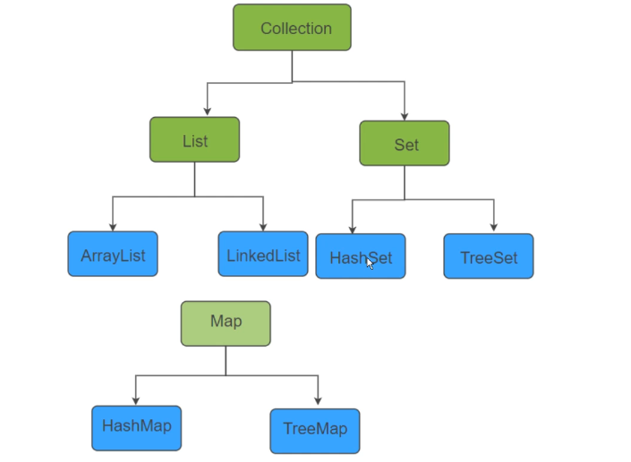
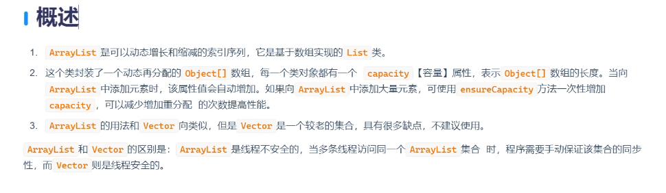
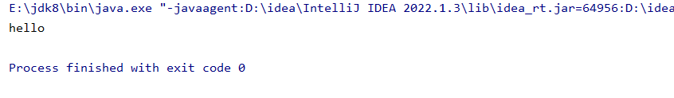
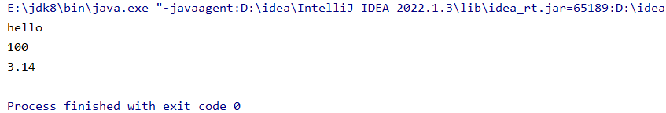

  
ArratList封装的是数组的数据结构，LinkList底层封装的是链表的数据结构，HashEet封装的是哈希散列，TreeSet封装的是二叉数，每一个集合的底层都会封装对应的数据结构，也就是说他们存储的机制是不一样的。

数组查询效率高，但是随机增删效率会比较低

链表查询效率低，但是随机增删效率会比较高



```java
package com.collection;

import java.util.ArrayList;

public class ArrayListTest01 {

    public static void main(String[] args) {
        ArrayList arrayList = new ArrayList();//默认情况下arraylist里面也是存放Objecct类型的数据
        arrayList.add("hello");
        arrayList.add(100);
        //可以根据上标索引来获取对应的元素
        Object obj = arrayList.get(0);//从0开始的，下标为0的是第一个元素
        System.out.println(obj);
    }
}
```



打印的是第一个数据，是hello

```java
package com.collection;

import java.util.ArrayList;
/*
arraylist是一个有序可重复的集合，有序体现在存入元素和取出的顺序是一样的
*/
public class ArrayListTest01 {

    public static void main(String[] args) {
        ArrayList arrayList = new ArrayList();
        //默认情况下arraylist里面也是存放Objecct类型的数据
        //底层封装的是数组，数组就是查询效率高
        arrayList.add("hello");
        arrayList.add(100);
        arrayList.add(3.14);
        //可以根据上标索引来获取对应的元素
        // Object obj = arrayList.get(0);//从0开始的，下标为0的是第一个元素
        // System.out.println(obj);
        //可以用传统方法进行一个遍历
        for (int i = 0; i < arrayList.size() ; i++) {
            //想遍历每一个元素
            System.out.println(arrayList.get(i));

        }
    }
}
```



Vector是一个线程安全版的arraylist集合，效率低，原因是每次都会加一个关键字synchonized（同步的关键字），在多线程的情况下只能保证有一个线程去访问这个方法
