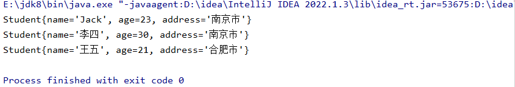
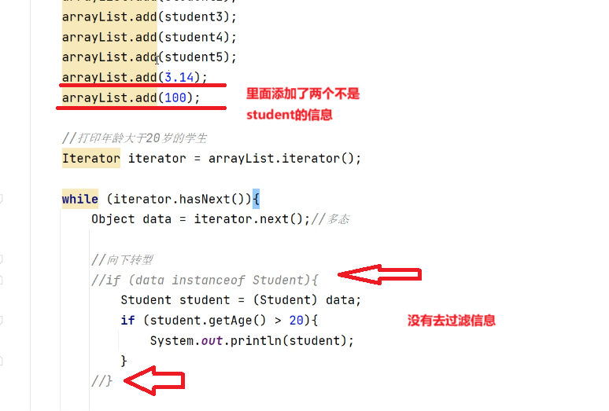
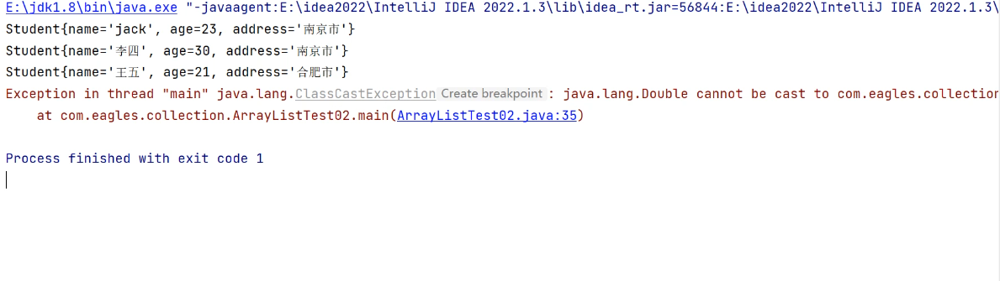
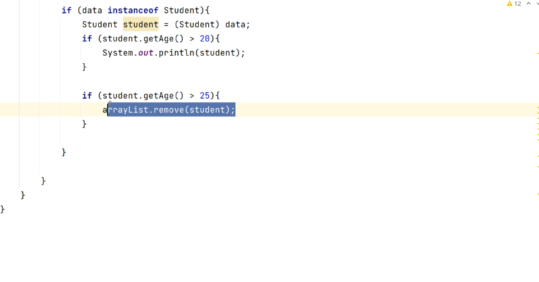
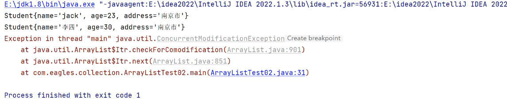
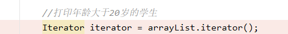
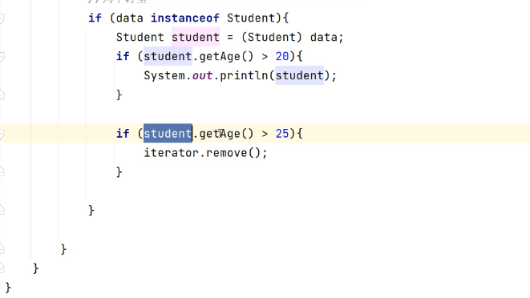
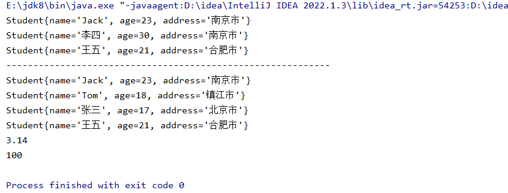

## 创建五个学生对象，存入ArrayList集合中，打印年龄大于20的学生

```java
package com.collection;

import java.util.ArrayList;
import java.util.Iterator;

public class ArrayListTest02 {
    public static void main(String[] args) {
        //创建集合对象
        ArrayList arrayList = new ArrayList();
        //ArrayList存放的是Object所以默认情况下是可以存入Student类的

        //创建学生对象
        Student student01 = new Student("Jack", 23, "南京市");
        Student student02 = new Student("Tom", 18, "镇江市");
        Student student03 = new Student("张三", 17, "北京市");
        Student student04 = new Student("李四", 30, "南京市");
        Student student05 = new Student("王五", 21, "合肥市");

        //将五个学生对象添加到集合中
        arrayList.add(student01);
        arrayList.add(student02);
        arrayList.add(student03);
        arrayList.add(student04);
        arrayList.add(student05);

        //System.out.println(arrayList.size());

        //打印年龄大于20岁的学生
        Iterator iterator = arrayList.iterator();
        while (iterator.hasNext()){

            Object data = iterator.next();//多态

            //向下转型 因为会用到student私有的方法
            if (data instanceof Student){ //如果data属于Student 向下转型
                Student student = (Student) data;
                if (student.getAge() >20){
                    System.out.println(student);
                }
            }

        }
    }
}
```



##### 如果没有进行过滤data instanceof Student，前面存在不是Student里面的数据，直接向下转型，将会出现类型转换异常，100和3.14没法转成student。





# 通过迭代器删除元素

删除年龄大于25的学生



这样看起来没什么问题，但是会报一个异常



这个异常你可以把他理解为一个快照异常



当我们在这边去获取一个迭代器对象，就相当于给这个集合保存了一个快照，如果你在while遍历的过程当中，你删除了集合当中的元素，他会导致这个数据，快照的数据和之前不一样，如果想删除怎么做呢？注意：不能用集合里面本身含有的remove的方法进行一个删除，这个会破坏原有的快照，用迭代器里面的方法



删除完之后进行重新遍历，注意重新遍历需要重新去生成一个迭代器对象（类似重新拍一个快照），不能直接再通过while进行遍历，再进行遍历他这个指针已经指向了元素的最末尾，所以重新遍历

```java
package com.collection;

import java.util.ArrayList;
import java.util.Iterator;

public class ArrayListTest02 {
    public static void main(String[] args) {
        //创建集合对象
        ArrayList arrayList = new ArrayList();
        //ArrayList存放的是Object所以默认情况下是可以存入Student类的

        //创建学生对象
        Student student01 = new Student("Jack", 23, "南京市");
        Student student02 = new Student("Tom", 18, "镇江市");
        Student student03 = new Student("张三", 17, "北京市");
        Student student04 = new Student("李四", 30, "南京市");
        Student student05 = new Student("王五", 21, "合肥市");

        //将五个学生对象添加到集合中
        arrayList.add(student01);
        arrayList.add(student02);
        arrayList.add(student03);
        arrayList.add(student04);
        arrayList.add(student05);

        //System.out.println(arrayList.size());

        //打印年龄大于20岁的学生
        Iterator iterator = arrayList.iterator();
        while (iterator.hasNext()){

            Object data = iterator.next();//多态

            //向下转型 因为会用到student私有的方法
            if (data instanceof Student){ //如果data属于Student 向下转型
                Student student = (Student) data;
                if (student.getAge() >20){
                    System.out.println(student);

                    if (student.getAge() > 25){
                        iterator.remove();
                    }
                }
            }

        }

        System.out.println("------------------------------------------------------------");

        //重新获取迭代器对象
        Iterator iterator1 = arrayList.iterator();
        while (iterator1.hasNext()){
            System.out.println(iterator1.next());//这里不用校验了
        }
    }
}
```


