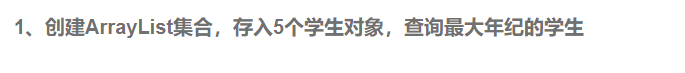
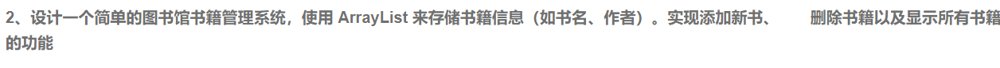

```java
import java.util.ArrayList;
import java.util.Collections;

class Student {
    private String name;
    private int age;

    public Student(String name, int age) {
        this.name = name;
        this.age = age;
    }

    public String getName() {
        return name;
    }

    public int getAge() {
        return age;
    }

    @Override
    public String toString() {
        return "Student{name='" + name + "', age=" + age + "}";
    }
}

public class Main {
    public static void main(String[] args) {
        ArrayList<Student> students = new ArrayList<>();
        students.add(new Student("Alice", 20));
        students.add(new Student("Bob", 22));
        students.add(new Student("Charlie", 19));
        students.add(new Student("David", 21));
        students.add(new Student("Eve", 23));

        Student oldestStudent = findOldestStudent(students);
        System.out.println("The oldest student is: " + oldestStudent);
    }
```



```java
import java.util.ArrayList;
import java.util.Scanner;

class Book {
    private String title;
    private String author;

    public Book(String title, String author) {
        this.title = title;
        this.author = author;
    }

    public String getTitle() {
        return title;
    }

    public String getAuthor() {
        return author;
    }

    @Override
    public String toString() {
        return "Book{title='" + title + "', author='" + author + "'}";
    }
}

public class LibrarySystem {
    private ArrayList<Book> books = new ArrayList<>();

    public void addBook(String title, String author) {
        books.add(new Book(title, author));
        System.out.println("Book added successfully.");
    }

    public void removeBook(String title) {
        books.removeIf(book -> book.getTitle().equals(title));
        System.out.println("Book removed successfully.");
    }

    public void displayBooks() {
        if (books.isEmpty()) {
            System.out.println("No books in the library.");
        } else {
            for (Book book : books) {
                System.out.println(book);
            }
        }
    }

    public static void main(String[] args) {
        LibrarySystem library = new LibrarySystem();
        Scanner scanner = new Scanner(System.in);

        while (true) {
            System.out.println("Library Management System");
            System.out.println("1. Add a book");
            System.out.println("2. Remove a book");
            System.out.println("3. Display all books");
            System.out.println("4. Exit");
            System.out.print("Choose an option: ");
            int choice = scanner.nextInt();
            scanner.nextLine(); // Consume newline

            switch (choice) {
                case 1:
                    System.out.print("Enter book title: ");
                    String title = scanner.nextLine();
                    System.out.print("Enter book author: ");
                    String author = scanner.nextLine();
                    library.addBook(title, author);
                    break;
                case 2:
                    System.out.print("Enter book title to remove: ");
                    String removeTitle = scanner.nextLine();
                    library.removeBook(removeTitle);
                    break;
                case 3:
                    library.displayBooks();
                    break;
                case 4:
                    System.out.println("Exiting...");
                    scanner.close();
                    return;
                default:
                    System.out.println("Invalid option. Please try again.");
            }
        }
    }
}
```
