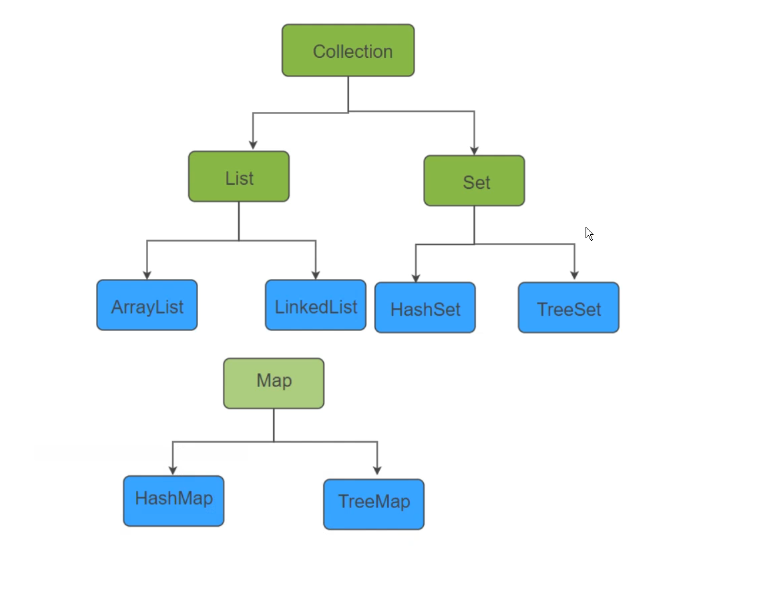
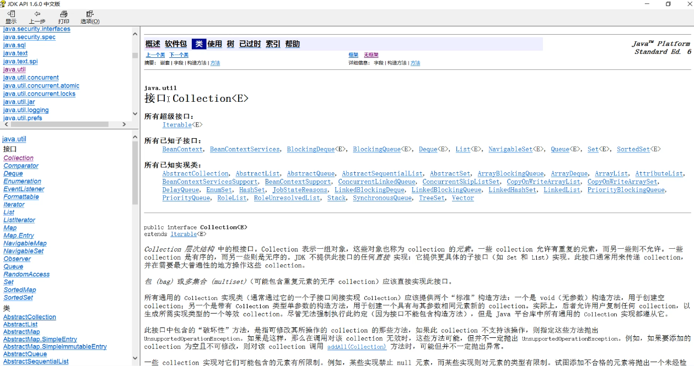
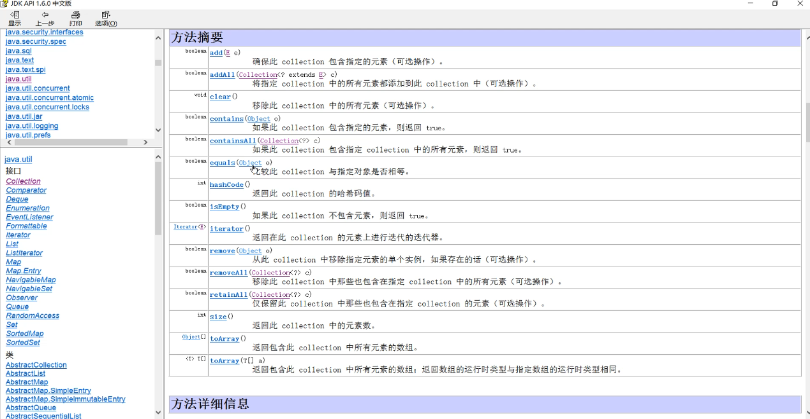
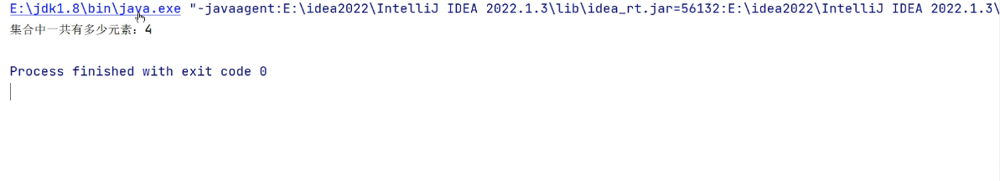
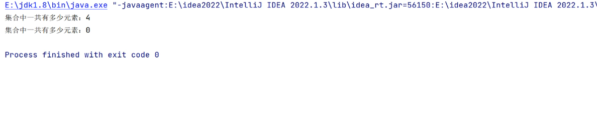
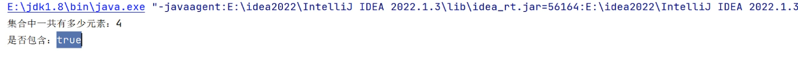
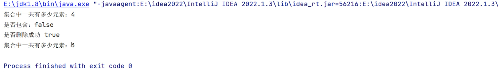
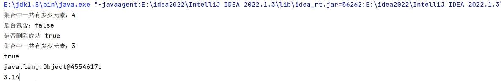

最大的父接口Collection，下面有两个子接口List、Set。（绿色的都是接口）



上面显示的流程图只是子接口里面的一部分，且还有一个父接口Iterable（迭代器接口）。在collection上面，算collection的父类 。

这里面所包含的方法：



Add方法：

```java
package com.collection;

import java.util.ArrayList;
import java.util.Collection;

public class CollectionTest01 {
    //接口不能实例化对象，所以去找一个他的子类，运用多态去进行实例化对象
    //创建一个集合对象
    public static void main(String[] args) {
        Collection  collection = new  ArrayList();

        //往集合中去添加元素
        collection.add(100);  //集合里面只能放引用数据类型，可以存放基本数据类型的原因是，存在自动装箱
        collection.add(true);  //自动装箱
        collection.add(new Object()); //自动装箱
        collection.add("3.14"); //自动装箱
        System.out.println("集合中一共有多少个元素："+ collection.size());
    }
}
```



Claer方法：

```java
package com.collection;

import java.util.ArrayList;
import java.util.Collection;

public class CollectionTest01 {
    //接口不能实例化对象，所以去找一个他的子类，运用多态去进行实例化对象
    //创建一个集合对象
    public static void main(String[] args) {
        Collection  collection = new  ArrayList();

        //往集合中去添加元素
        collection.add(100);  //集合里面只能放引用数据类型，可以存放基本数据类型的原因是，存在自动装箱
        collection.add(true);  //自动装箱
        collection.add(new Object()); //自动装箱
        collection.add("3.14"); //自动装箱
        System.out.println("集合中一共有多少个元素："+ collection.size());

        //清除集合中的元素
        collection.clear();
        System.out.println("集合中一共有多少个元素："+ collection.size());
    }
}
```



Contains方法：

```java
package com.collection;

import java.util.ArrayList;
import java.util.Collection;

public class CollectionTest01 {
    //接口不能实例化对象，所以去找一个他的子类，运用多态去进行实例化对象
    //创建一个集合对象
    public static void main(String[] args) {
        Collection  collection = new  ArrayList();

        //往集合中去添加元素
        collection.add(100);  //集合里面只能放引用数据类型，可以存放基本数据类型的原因是，存在自动装箱
        collection.add(true);  //自动装箱
        collection.add(new Object()); //自动装箱
        collection.add("3.14"); //自动装箱
        System.out.println("集合中一共有多少个元素："+ collection.size());

        //判断集合中是否存在某一个元素
        boolean contains = collection.contains(100);
        System.out.println("是否包含："+contains);
    }
}
```



```java
boolean contains = collection.contains(101);

boolean contains = collection.contains(new Object());

在后面写这两个都会显示false，原因是因为该元素里面没有101元素，而new Object()
也显示fales是因为new Object()是因为开辟了新的空间所对应的内存地址不一样。
```

Remove方法：

```java
package com.collection;

import java.util.ArrayList;
import java.util.Collection;

public class CollectionTest01 {
    //接口不能实例化对象，所以去找一个他的子类，运用多态去进行实例化对象
    //创建一个集合对象
    public static void main(String[] args) {
        Collection  collection = new  ArrayList();

        //往集合中去添加元素
        collection.add(100);  //集合里面只能放引用数据类型，可以存放基本数据类型的原因是，存在自动装箱
        collection.add(true);  //自动装箱
        collection.add(new Object()); //自动装箱
        collection.add("3.14"); //自动装箱
        System.out.println("集合中一共有多少个元素："+ collection.size());

        //判断集合中是否存在某一个元素
        boolean contains = collection.contains(101);
        System.out.println("是否包含："+contains);

        boolean contains02 = collection.contains(new Object());
        System.out.println("是否包含："+contains02);

        //删除元素
        boolean remove = collection.remove(100);
        System.out.println("是否删除成功："+remove);
        System.out.println("集合中一共有多少个元素："+ collection.size());
    }
}
```



```java
package com.collection;

import java.util.ArrayList;
import java.util.Collection;

public class CollectionTest01 {
    //接口不能实例化对象，所以去找一个他的子类，运用多态去进行实例化对象
    //创建一个集合对象
    public static void main(String[] args) {
        Collection  collection = new  ArrayList();

        //往集合中去添加元素
        collection.add(100);  //集合里面只能放引用数据类型，可以存放基本数据类型的原因是，存在自动装箱
        collection.add(true);  //自动装箱
        collection.add(new Object()); //自动装箱
        collection.add("3.14"); //自动装箱
        System.out.println("集合中一共有多少个元素："+ collection.size());

        //将集合转成数组
        //会自动返回成一个Object的数组,Object可以去接收所有的元素
        Object[] objects = collection.toArray();
        //用加强for循环来对他进行一个遍历
        for (Object obj:objects){
            System.out.println(obj);
        }

    }
}
```

java.lang.Object@4554617c是new Object（）的内存地址
