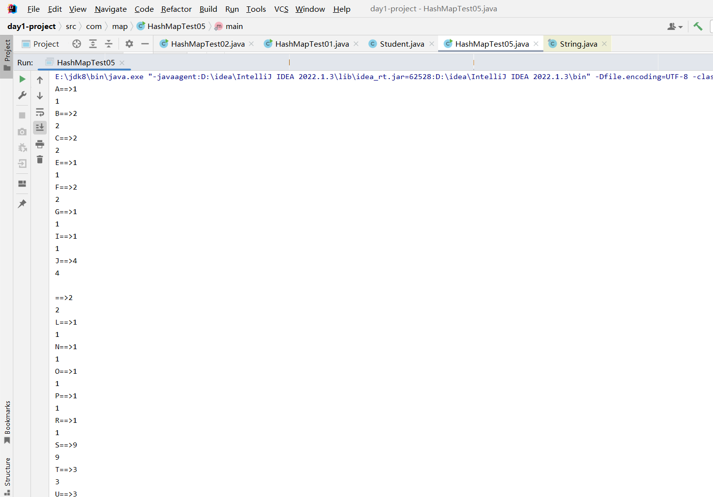

需求：求出该字符串中每一个字符出现的次数

```java
package com.map;

import java.util.HashMap;

public class HashMapTest05 {
    public static void main(String[] args) {

        String str = "The Java language provides special support for the string concatenation operator ( + ), and for con" +
        "version of other objects to strings. String concatenation is implemented through the StringBuilder(or StringBuffe" +
        "r) class and its append method. String conversions are implemented through the method toString, defined by Object " +
        "and inherited by all classes in Java. For additional information on string concatenation and conversion, see Gosli" +
        "ng, Joy, and Steele, The Java Language Specification.\n" +
        "Unless otherwise noted, passing a null argument to a constructor or method in this class will cause a NullPointerE" +
        "xception to be thrown.\n" +
        "A String represents a string in the UTF-16 format in which supplementary characters are represented by surroga" +
        "te pairs (see the section Unicode Character Representations in the Character class for more information). I" +
        "ndex values refer to char code units, so a supplementary character uses two positions in a String.";

        /*
        需求：求出该字符串中每一个字符出现的次数
         */

        //创建Map集合  （集合里面只能存放引用数据类型，不能存放基本数据类型，所以char不能存放，所以用它的封装类）
        HashMap<Character, Object> HashMap = new HashMap<>();
        char[] chars = str.toCharArray();//字符串转换成对应的字符数组
        for (char aChar : chars) {
            System.out.println(aChar );
        }

    }
}
```

运行程序，将会获得每一个字符（包括空格或者特殊符合 ）


```java
package com.map;

import java.util.HashMap;
import java.util.Map;
import java.util.Set;

public class HashMapTest05 {
    public static void main(String[] args) {

        String str = "The Java language provides special support for the string concatenation ope con" +
        "version of other objects to strings. String concatenation is implemented through the StringBuilder(or StringBuffe" +
        "r) class and its append method. String conversions are implemented through the method toString, defined by Object " +
        "and inherited by all classes in Java. For additional information on string concatenation and conversion, see Gosli" +
        "ng, Joy, and Steele, The Java Language Specification.\n" +
        "Unless otherwise noted, passing a null argument to a constructor or method in this class will cause a NullPointerE" +
        "xception to be thrown.\n" +
        "A String represents a string in the UTF-16 format in which supplementary characters are represented by surroga" +
        "te pairs (see the section Unicode Character Representations in the Character class for more information). I" +
        "ndex values refer to char code units, so a supplementary character uses two positions in a String.";

        /*
        需求：求出该字符串中每一个字符出现的次数
         */

        //创建Map集合  （集合里面只能存放引用数据类型，不能存放基本数据类型，所以char不能存放，所以用它的封装类）
        HashMap<Character, Integer> hashMap = new HashMap<>();
        char[] chars = str.toCharArray();//字符串转换成对应的字符数组
        for (char aChar : chars) {
            if (hashMap.containsKey(aChar)){
                //判断key是否存在，如果已经存在，那么次数在之前的基础上+1
                hashMap.put(aChar,hashMap.get(aChar) + 1);
            }else {
                //如果不存在，那么次数设置为1
                hashMap.put(aChar,1);
            }
        }
        //遍历集合
        Set<Map.Entry<Character,Integer>> entries = hashMap.entrySet();
        for (Map.Entry<Character, Integer> entry : entries) {
            System.out.println(entry.getKey() + "==>" +entry.getValue());
            System.out.println(entry.getValue());
        }
    }
}
```

每个出现的次数都有成功遍历出


