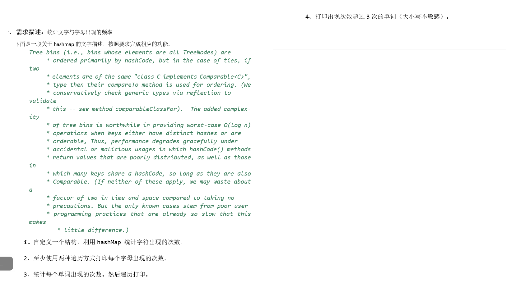

```java
package com.map;

import java.util.HashMap;
import java.util.Map;
import java.util.Set;

public class HashMapTest06 {
    public static void main(String[] args) {

        String str = "Tree bins (i.e., bins whose elements are all TreeNodes) are\n" +
        "     * ordered primarily by hashCode, but in the case of ties, if two\n" +
        "     * elements are of the same \"class C implements Comparable<C>\",\n" +
        "     * type then their compareTo method is used for ordering. (We\n" +
        "     * conservatively check generic types via reflection to validate\n" +
        "     * this -- see method comparableClassFor).  The added complexity\n" +
        "     * of tree bins is worthwhile in providing worst-case O(log n)\n" +
        "     * operations when keys either have distinct hashes or are\n" +
        "     * orderable, Thus, performance degrades gracefully under\n" +
        "     * accidental or malicious usages in which hashCode() methods\n" +
        "     * return values that are poorly distributed, as well as those in\n" +
        "     * which many keys share a hashCode, so long as they are also\n" +
        "     * Comparable. (If neither of these apply, we may waste about a\n" +
        "     * factor of two in time and space compared to taking no\n" +
        "     * precautions. But the only known cases stem from poor user\n" +
        "     * programming practices that are already so slow that this makes\n" +
        "     * little difference.)";

        HashMap<Character, Integer> hashMap = new HashMap<>();

        //spilt 根据某一个符号来分割字符串的方法
        String str2 = "2,3,4,5,6,235,1008";
        String[] split = str2.split(",");
        for (String s : split) {
            System.out.println(s);
        }

    }
}
```

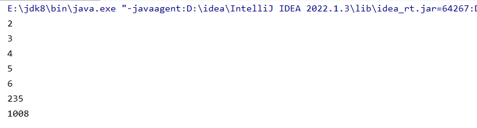

通过转化成字符串数组

```java
package com.map;

import java.util.HashMap;
import java.util.Map;
import java.util.Set;

public class HashMapTest06 {
    public static void main(String[] args) {

        String str = "Tree bins (i.e., bins whose elements are all TreeNodes) are\n" +
        "     * ordered primarily by hashCode, but in the case of ties, if two\n" +
        "     * elements are of the same \"class C implements Comparable<C>\",\n" +
        "     * type then their compareTo method is used for ordering. (We\n" +
        "     * conservatively check generic types via reflection to validate\n" +
        "     * this -- see method comparableClassFor).  The added complexity\n" +
        "     * of tree bins is worthwhile in providing worst-case O(log n)\n" +
        "     * operations when keys either have distinct hashes or are\n" +
        "     * orderable, Thus, performance degrades gracefully under\n" +
        "     * accidental or malicious usages in which hashCode() methods\n" +
        "     * return values that are poorly distributed, as well as those in\n" +
        "     * which many keys share a hashCode, so long as they are also\n" +
        "     * Comparable. (If neither of these apply, we may waste about a\n" +
        "     * factor of two in time and space compared to taking no\n" +
        "     * precautions. But the only known cases stem from poor user\n" +
        "     * programming practices that are already so slow that this makes\n" +
        "     * little difference.)";

        HashMap<Character, Integer> hashMap = new HashMap<>();

        String[] split = str.split("");
        for (String s : split) {
            System.out.println(s);
        }

    }
}
```

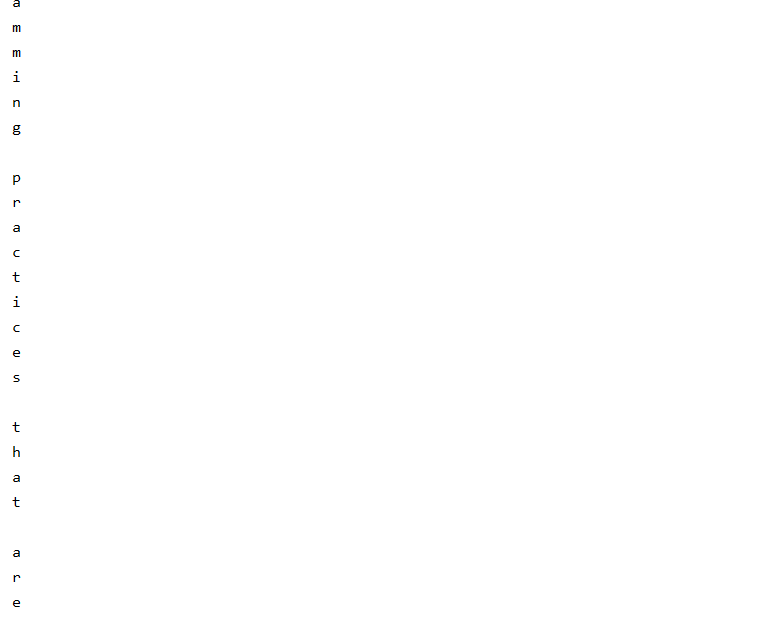

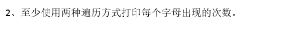

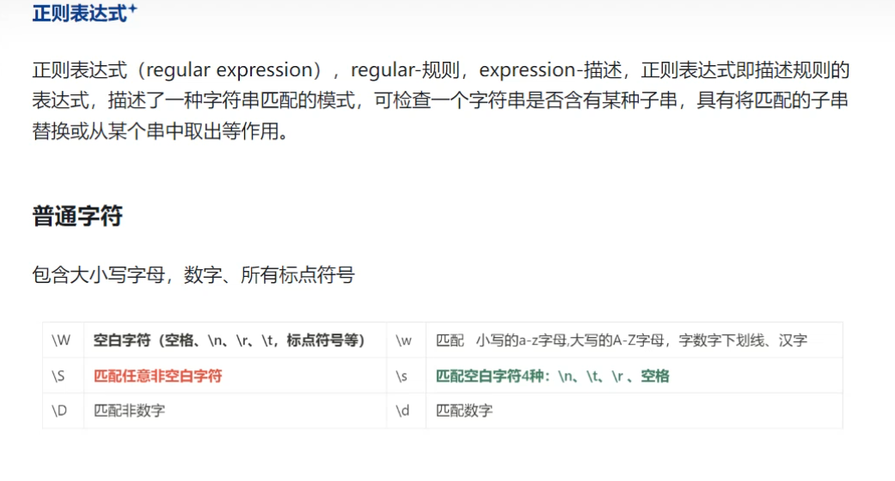

```java
package com.map;

import com.sun.deploy.security.SelectableSecurityManager;

import java.util.HashMap;
import java.util.Map;
import java.util.Set;

public class HashMapTest06 {
    public static void main(String[] args) {

        String str = "Tree bins (i.e., bins whose elements are all TreeNodes) are\n" +
        "     * ordered primarily by hashCode, but in the case of ties, if two\n" +
        "     * elements are of the same \"class C implements Comparable<C>\",\n" +
        "     * type then their compareTo method is used for ordering. (We\n" +
        "     * conservatively check generic types via reflection to validate\n" +
        "     * this -- see method comparableClassFor).  The added complexity\n" +
        "     * of tree bins is worthwhile in providing worst-case O(log n)\n" +
        "     * operations when keys either have distinct hashes or are\n" +
        "     * orderable, Thus, performance degrades gracefully under\n" +
        "     * accidental or malicious usages in which hashCode() methods\n" +
        "     * return values that are poorly distributed, as well as those in\n" +
        "     * which many keys share a hashCode, so long as they are also\n" +
        "     * Comparable. (If neither of these apply, we may waste about a\n" +
        "     * factor of two in time and space compared to taking no\n" +
        "     * precautions. But the only known cases stem from poor user\n" +
        "     * programming practices that are already so slow that this makes\n" +
        "     * little difference.)";

        //创建Map集合
        HashMap<String , Integer> hashMap = new HashMap<>();

        //分割字符串
        String[] split = str.split("");
        for (String s : split) {
            //进行正则校验，将符合条件的字母筛选出来 matches就是一个校验的方法，在里面放校验的规则
            if (s.matches("\\w") && hashMap.containsKey(s)) {
                //要求切割的这个字符串不仅要存在且属于字母
                hashMap.put(s, hashMap.get(s) + 1);  //s是它的key，key存在value+1
            }
                //是字母但是不存在这个String里面，意思就是 是字母且第一次出现，将vlue设置为1
            else if (s.matches("\\w") && ! hashMap.containsKey(s)) {
                hashMap.put(s, 1);
            }

        }
        System.out.println("--------------------打印第一次----------------------------");
        Set<Map.Entry<String, Integer>> entries = hashMap.entrySet();
        for (Map.Entry<String, Integer> entry : entries) {
            System.out.println(entry.getKey() + "==>" +entry.getValue());
        }
    }System.out.println("--------------------打印第二次----------------------------");
        Set<String> stringSet = hashMap.keySet();
        for (String s : stringSet) {
            System.out.println(s+ "==>" +hashMap.get(s));
        }

}
```

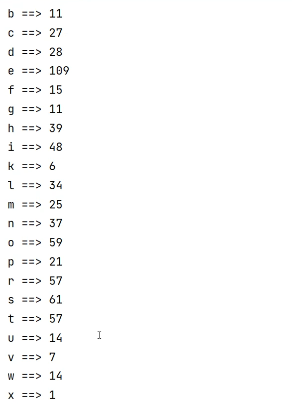

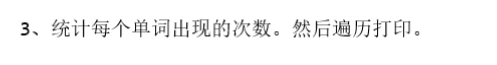

字母之间都是靠小空格或者大空格分开

//分割字符串

String[] strings = str.split("\\s");

//分割出来的东西里面有很多不是字母，比如字母 \* (6n, 等等 所以叫进行过滤

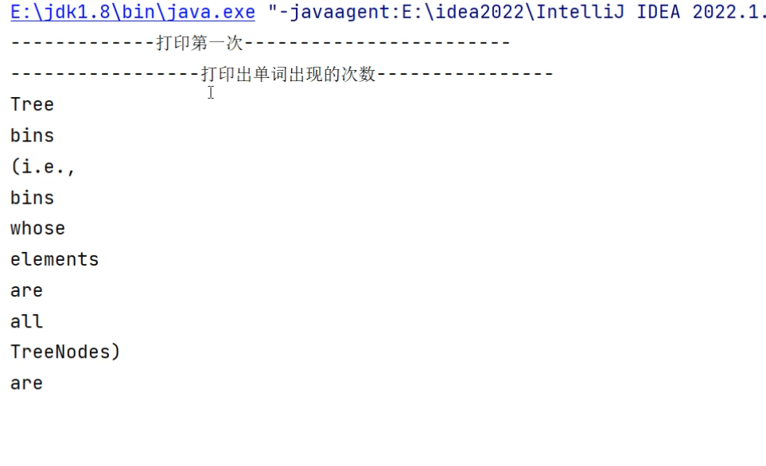

for (String string1 : strings) {

if (string1.matches("\\w+") && hashMap2.containsKey(string1)){ //"\\W"表示是大小写字母且连续 +号表示连续

hashMap2.put(string1, hashMap2.get(string1) + 1); //s是它的key，key存在value+1

}

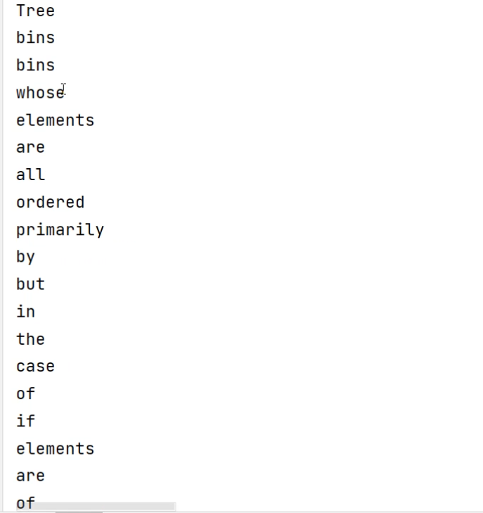

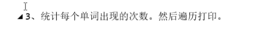

```java
package com.map;

import com.sun.deploy.security.SelectableSecurityManager;

import java.util.HashMap;
import java.util.Map;
import java.util.Set;

public class HashMapTest06 {
    public static void main(String[] args) {

        String str = "Tree bins (i.e., bins whose elements are all TreeNodes) are\n" +
        "     * ordered primarily by hashCode, but in the case of ties, if two\n" +
        "     * elements are of the same \"class C implements Comparable<C>\",\n" +
        "     * type then their compareTo method is used for ordering. (We\n" +
        "     * conservatively check generic types via reflection to validate\n" +
        "     * this -- see method comparableClassFor).  The added complexity\n" +
        "     * of tree bins is worthwhile in providing worst-case O(log n)\n" +
        "     * operations when keys either have distinct hashes or are\n" +
        "     * orderable, Thus, performance degrades gracefully under\n" +
        "     * accidental or malicious usages in which hashCode() methods\n" +
        "     * return values that are poorly distributed, as well as those in\n" +
        "     * which many keys share a hashCode, so long as they are also\n" +
        "     * Comparable. (If neither of these apply, we may waste about a\n" +
        "     * factor of two in time and space compared to taking no\n" +
        "     * precautions. But the only known cases stem from poor user\n" +
        "     * programming practices that are already so slow that this makes\n" +
        "     * little difference.)";

        //创建Map集合
        HashMap<String , Integer> hashMap = new HashMap<>();

        //分割字符串
        String[] string  = str.split("");
        for (String s : string) {
            //进行正则校验，将符合条件的字母筛选出来 matches就是一个校验的方法，在里面放校验的规则
            if (s.matches("\\w") && hashMap.containsKey(s)) {
                //要求切割的这个字符串不仅要存在且属于字母
                hashMap.put(s, hashMap.get(s) + 1);  //s是它的key，key存在value+1
            }
                //是字母但是不存在这个String里面，意思就是 是字母且第一次出现，将vlue设置为1
            else if (s.matches("\\w") && ! hashMap.containsKey(s)) {
                hashMap.put(s, 1);
            }

        }
        System.out.println("--------------------打印第一次----------------------------");
        Set<Map.Entry<String, Integer>> entries = hashMap.entrySet();
        for (Map.Entry<String, Integer> entry : entries) {
            System.out.println(entry.getKey() + "==>" +entry.getValue());
        }

        //创建Map集合
        HashMap<String , Integer> hashMap2 = new HashMap<>();

        //分割字符串
        String[] strings = str.split("\\s");
        //分割出来的东西里面有很多不是字母，比如字母 * (6n, 等等 所以叫进行过滤
        for (String string1 : strings) {
            if (string1.matches("\\w+") && hashMap2.containsKey(string1)){ //"\\W"表示是大小写字母且连续 +号表示连续
                hashMap2.put(string1, hashMap2.get(string1) + 1);  //s是它的key，key存在value+1
            }
            //是字母但是不存在这个String里面，意思就是 是字母且第一次出现，将vlue设置为1
            else if (string1.matches("\\w+") && ! hashMap2.containsKey(string1)) {
                hashMap2.put(string1, 1);
            }

        } System.out.println("--------------------单词所出现的次数----------------------------");
        Set<Map.Entry<String, Integer>> entries2 = hashMap2.entrySet();
        for (Map.Entry<String, Integer> entry : entries2) {
            System.out.println(entry.getKey() + "==>" +entry.getValue());
            }
     }
}
```

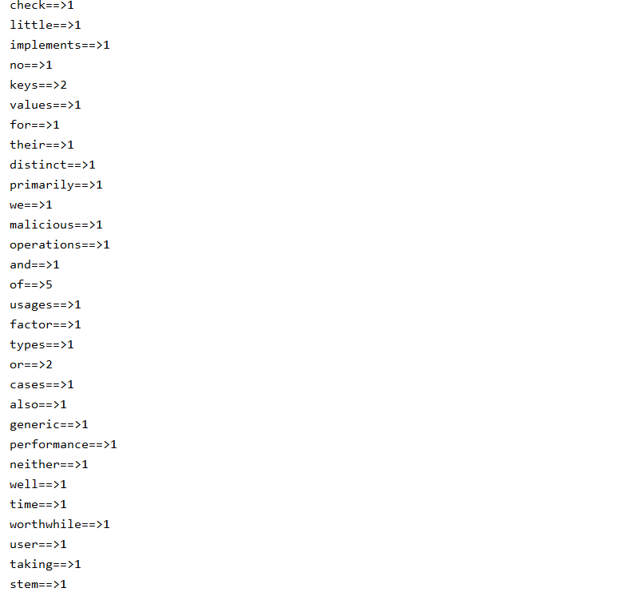

```java
package com.map;

import com.sun.deploy.security.SelectableSecurityManager;

import java.util.HashMap;
import java.util.Locale;
import java.util.Map;
import java.util.Set;

public class HashMapTest06 {
    public static void main(String[] args) {

        String str = "Tree bins (i.e., bins whose elements are all TreeNodes) are\n" +
        "     * ordered primarily by hashCode, but in the case of ties, if two\n" +
        "     * elements are of the same \"class C implements Comparable<C>\",\n" +
        "     * type then their compareTo method is used for ordering. (We\n" +
        "     * conservatively check generic types via reflection to validate\n" +
        "     * this -- see method comparableClassFor).  The added complexity\n" +
        "     * of tree bins is worthwhile in providing worst-case O(log n)\n" +
        "     * operations when keys either have distinct hashes or are\n" +
        "     * orderable, Thus, performance degrades gracefully under\n" +
        "     * accidental or malicious usages in which hashCode() methods\n" +
        "     * return values that are poorly distributed, as well as those in\n" +
        "     * which many keys share a hashCode, so long as they are also\n" +
        "     * Comparable. (If neither of these apply, we may waste about a\n" +
        "     * factor of two in time and space compared to taking no\n" +
        "     * precautions. But the only known cases stem from poor user\n" +
        "     * programming practices that are already so slow that this makes\n" +
        "     * little difference.)";

        //创建Map集合
        HashMap<String , Integer> hashMap = new HashMap<>();

        //分割字符串
        String[] string  = str.split("");
        for (String s : string) {
            //进行正则校验，将符合条件的字母筛选出来 matches就是一个校验的方法，在里面放校验的规则
            if (s.matches("\\w") && hashMap.containsKey(s)) {
                //要求切割的这个字符串不仅要存在且属于字母
                hashMap.put(s, hashMap.get(s) + 1);  //s是它的key，key存在value+1
            }
                //是字母但是不存在这个String里面，意思就是 是字母且第一次出现，将vlue设置为1
            else if (s.matches("\\w") && ! hashMap.containsKey(s)) {
                hashMap.put(s, 1);
            }

        //创建Map集合
        HashMap<String , Integer> hashMap2 = new HashMap<>();

        //分割字符串
        String[] strings = str.split("\\s");
        //分割出来的东西里面有很多不是字母，比如字母 * (6n, 等等 所以叫进行过滤
        for (String string1 : strings) {
            if (string1.matches("\\w+") && hashMap2.containsKey(string1)){ //"\\W"表示是大小写字母且连续 +号表示连续
                hashMap2.put(string1.toLowerCase(), hashMap2.get(string1) + 1);  //s是它的key，key存在value+1
            }
            //是字母但是不存在这个String里面，意思就是 是字母且第一次出现，将vlue设置为1
            else if (string1.matches("\\w+") && ! hashMap2.containsKey(string1)) {
                hashMap2.put(string1.toLowerCase(), 1);     //toLoweCase 是大写转小写的一个方法
            }

        }

        System.out.println("--------------------单词所出现的次数超过三次的----------------------------");
        Set<Map.Entry<String, Integer>> entries1 = hashMap2.entrySet();
        for (Map.Entry<String, Integer> entry : entries1) {
            if (entry.getValue()>3){
                System.out.println(entry.getKey());//打印次数大于三的value，通过getKey获得value
            }
        }
    }
}
```

```java
package com.map;

import com.sun.deploy.security.SelectableSecurityManager;

import java.util.HashMap;
import java.util.Locale;
import java.util.Map;
import java.util.Set;

public class HashMapTest06 {
    public static void main(String[] args) {

        String str = "Tree bins (i.e., bins whose elements are all TreeNodes) are\n" +
        "     * ordered primarily by hashCode, but in the case of ties, if two\n" +
        "     * elements are of the same \"class C implements Comparable<C>\",\n" +
        "     * type then their compareTo method is used for ordering. (We\n" +
        "     * conservatively check generic types via reflection to validate\n" +
        "     * this -- see method comparableClassFor).  The added complexity\n" +
        "     * of tree bins is worthwhile in providing worst-case O(log n)\n" +
        "     * operations when keys either have distinct hashes or are\n" +
        "     * orderable, Thus, performance degrades gracefully under\n" +
        "     * accidental or malicious usages in which hashCode() methods\n" +
        "     * return values that are poorly distributed, as well as those in\n" +
        "     * which many keys share a hashCode, so long as they are also\n" +
        "     * Comparable. (If neither of these apply, we may waste about a\n" +
        "     * factor of two in time and space compared to taking no\n" +
        "     * precautions. But the only known cases stem from poor user\n" +
        "     * programming practices that are already so slow that this makes\n" +
        "     * little difference.)";

        //创建Map集合
        HashMap<String , Integer> hashMap = new HashMap<>();

        //分割字符串
        String[] string  = str.split("");
        for (String s : string) {
            //进行正则校验，将符合条件的字母筛选出来 matches就是一个校验的方法，在里面放校验的规则
            if (s.matches("\\w") && hashMap.containsKey(s)) {
                //要求切割的这个字符串不仅要存在且属于字母
                hashMap.put(s, hashMap.get(s) + 1);  //s是它的key，key存在value+1
            }
                //是字母但是不存在这个String里面，意思就是 是字母且第一次出现，将vlue设置为1
            else if (s.matches("\\w") && ! hashMap.containsKey(s)) {
                hashMap.put(s, 1);
            }

        }
        System.out.println("--------------------打印第一次----------------------------");
        Set<Map.Entry<String, Integer>> entries = hashMap.entrySet();
        for (Map.Entry<String, Integer> entry : entries) {
            System.out.println(entry.getKey() + "==>" +entry.getValue());
        }
        System.out.println("--------------------打印第二次----------------------------");
        Set<String> stringSet = hashMap.keySet();
        for (String s : stringSet) {
            System.out.println(s+ "==>" +hashMap.get(s));
        }

        //创建Map集合
        HashMap<String , Integer> hashMap2 = new HashMap<>();

        //分割字符串
        String[] strings = str.split("\\s");
        //分割出来的东西里面有很多不是字母，比如字母 * (6n, 等等 所以叫进行过滤
        for (String string1 : strings) {
            if (string1.matches("\\w+") && hashMap2.containsKey(string1)){ //"\\W"表示是大小写字母且连续 +号表示连续
                hashMap2.put(string1.toLowerCase(), hashMap2.get(string1) + 1);  //s是它的key，key存在value+1
            }
            //是字母但是不存在这个String里面，意思就是 是字母且第一次出现，将vlue设置为1
            else if (string1.matches("\\w+") && ! hashMap2.containsKey(string1)) {
                hashMap2.put(string1.toLowerCase(), 1);     //toLoweCase 是大写转小写的一个方法
            }

        } System.out.println("--------------------单词所出现的次数----------------------------");
        Set<Map.Entry<String, Integer>> entries2 = hashMap2.entrySet();
        for (Map.Entry<String, Integer> entry : entries2) {
            System.out.println(entry.getKey() + "==>" +entry.getValue());
            }

        System.out.println("--------------------单词所出现的次数超过三次的----------------------------");
        Set<Map.Entry<String, Integer>> entries1 = hashMap2.entrySet();
        for (Map.Entry<String, Integer> entry : entries1) {
            if (entry.getValue()>3){
                System.out.println(entry.getKey());//打印次数大于三的value，通过getKey获得value
            }
        }
    }
}
```

作业2

```java
package com.map;

import java.util.HashMap;
import java.util.Map;
import java.util.Set;

public class HashMapTest05 {
    public static void main(String[] args) {

        String str = "package org.springframework.beans.factory.annotation;\n" +
        "import java.lang.annotation.Documented;\n" +
        "import java.lang.annotation.ElementType;\n" +
        "import java.lang.annotation.Retention;\n" +
        "import java.lang.annotation.RetentionPolicy;\n" +
        "import java.lang.annotation.Target;\n" +
        "\n" +
        "@Target({ElementType.FIELD, ElementType.METHOD, ElementType.PARAMETER, ElementType.ANNOTATION_TYPE})\n" +
        "@Retention(RetentionPolicy.RUNTIME)\n" +
        "@Documented\n" +
        "public @interface Value {\n" +
        "    String value();\n" +
        "}";

        /*
        需求：求出该字符串中每一个字符出现的次数
         */

        //创建Map集合  （集合里面只能存放引用数据类型，不能存放基本数据类型，所以char不能存放，所以用它的封装类）
        HashMap<Character, Integer> hashMap = new HashMap<>();
        char[] chars = str.toCharArray();//字符串转换成对应的字符数组
        for (char aChar : chars) {
            if (hashMap.containsKey(aChar)){
                //判断key是否存在，如果已经存在，那么次数在之前的基础上+1
                hashMap.put(aChar,hashMap.get(aChar) + 1);
            }else {
                //如果不存在，那么次数设置为1
                hashMap.put(aChar,1);
            }
        }
        //遍历集合
        Set<Map.Entry<Character,Integer>> entries = hashMap.entrySet();
        for (Map.Entry<Character, Integer> entry : entries) {
            System.out.println(entry.getKey() + "==>" +entry.getValue());
            System.out.println(entry.getValue());
        }
    }
}
```
