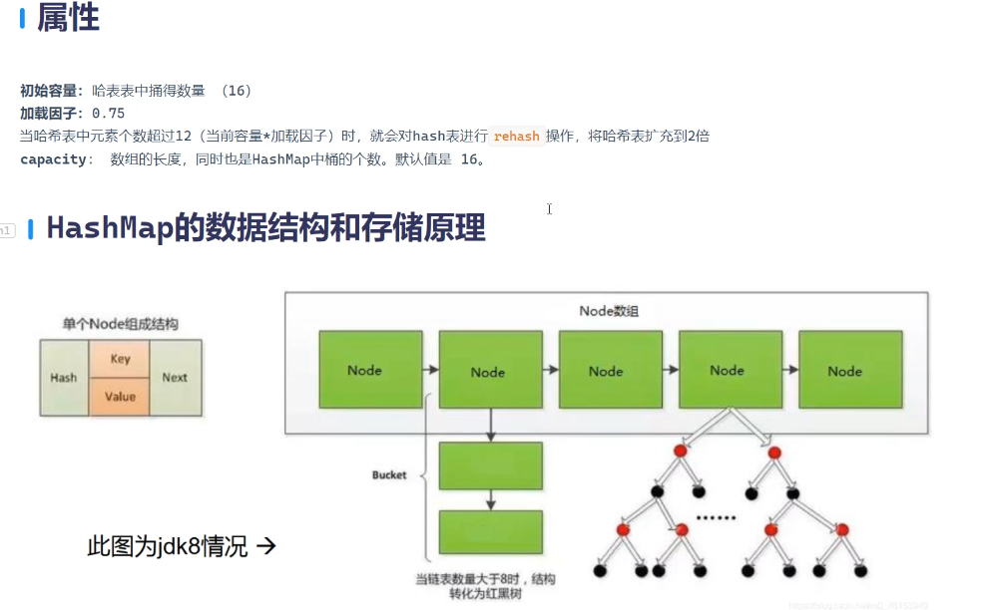
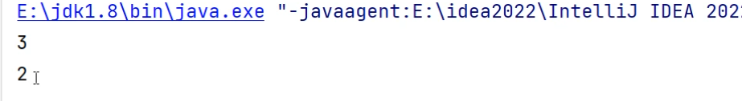
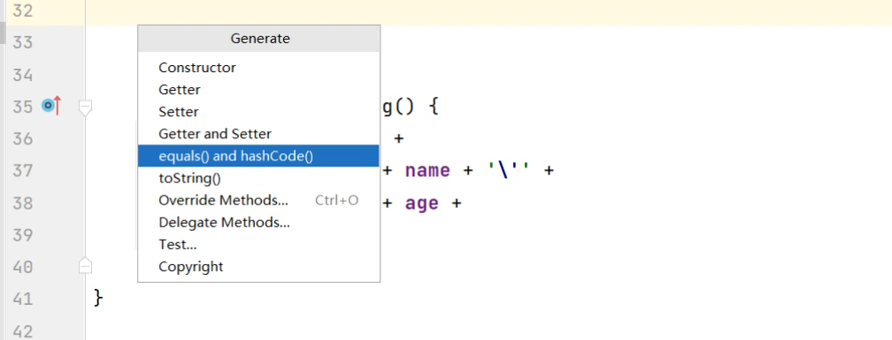
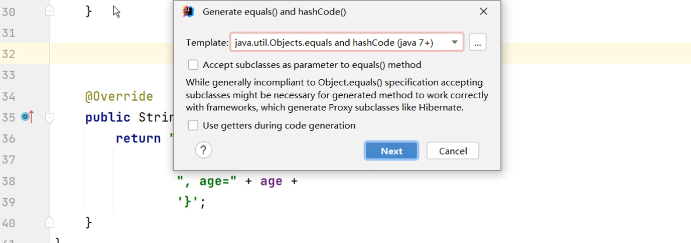
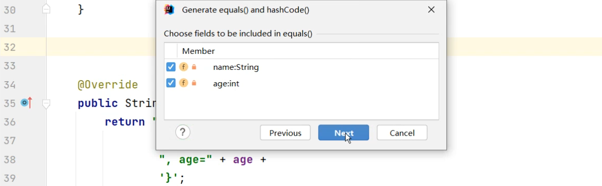
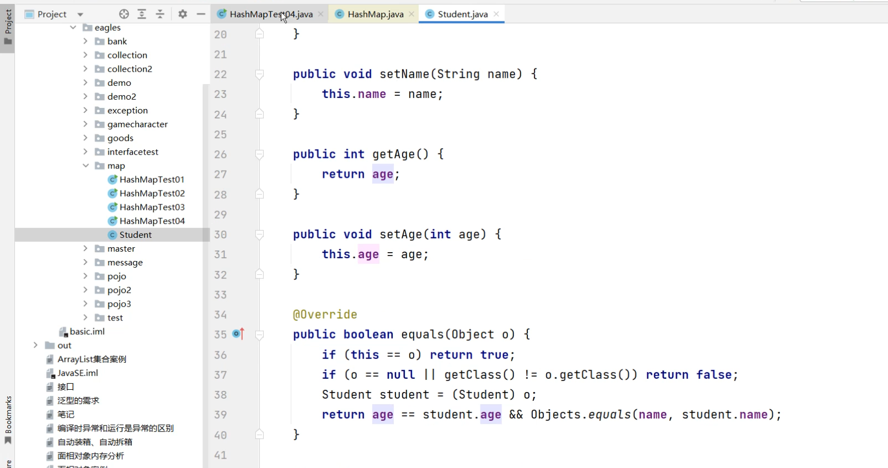
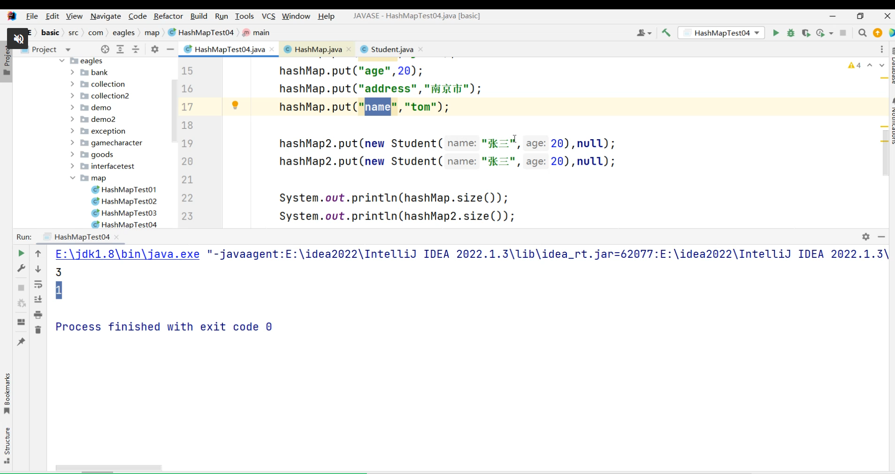
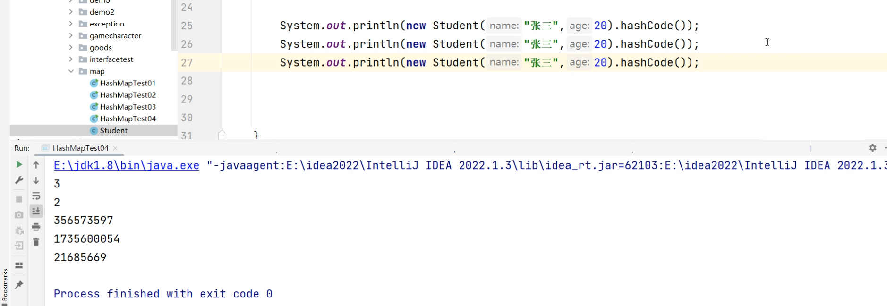
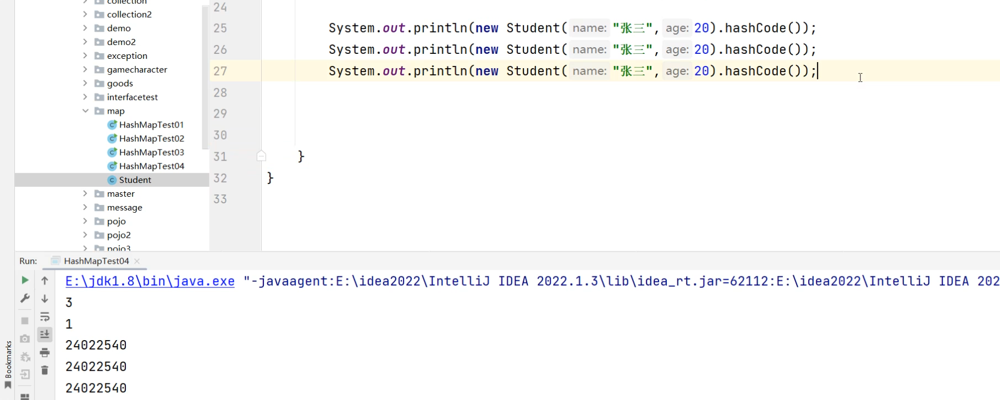

```java
package com.map;

import java.util.HashMap;

public class HashMapTest02 {
    public static void main(String[] args) {

        HashMap<String, Object> HashMap = new HashMap<>();
        HashMap<Student, Object> HashMap2 = new HashMap<>();

        //HashMap底层是Hash表，数组+链表
        HashMap.put("name", "jack");
        HashMap.put("age", 20);
        HashMap.put("address", "南京市");
        HashMap.put("name","Tom");//下面默认会覆盖上面 此时HashMap看上去长度为4，实际的长度只有3

        HashMap2.put(new Student("张三",10),null);
        HashMap2.put(new Student("张三",10),null);

        System.out.println(HashMap.size());
        System.out.println(HashMap2.size()); //此时HashMap2看上去长度为2，实际的长度为2
        //之所以会被覆盖掉是因为put的底层也是调用的equals方法

    }
}
```



Stuednt类没有去重写equals所以比较的是内存地址（new出来的内存地址是不一样的），而String方法重写了equals所以比较的是内容

也可以通过快捷键重写equals方法





重写了Student的equals方法，只有当名字和年龄都一样的情况下，返回值才是true



重写了之后，size的值就是1了，下面的new student默认会覆盖上面的那个new student



HashCode创造出来的字符序列都不一样

但是重写了HashCode之后就会出现不一样的效果，为什么是重写呢，因为HahCode是Object里面的方法



重写HahCode之后字符序列都一样，只要名字和年龄是一样的，字符序列就不变

HashMap储存原理总结

1.hashmap底层是hash表（数组+链表的结合）

2.当调用put方法对数据进行存储的时候，首先要决定数据存储在上面位置

-有hashCode来决定，hashCode会通过hash算法生成一个随机数

-存储位置由这个随机数来决定，存储的数据要存在hash表上该随机数对应的节点（Node）上面

3.hashmap底层会先根据equals方法将存储的key来进行判断，通过equals方法跟对应位置所有的节点进行equals比较

-如果返回的结果是true，那么将会对前面的值进行覆盖

-直接创造一个新的节点，生成的新的节点将会覆盖旧的节点（Node）

-如果返回的结果是false，那么将不会对前面的值进行覆盖

-那么直接创造一个新的节点在对应的位置
