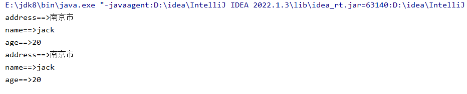

```java
package com.map;

import java.util.Collection;
import java.util.HashMap;
import java.util.Map;
import java.util.Set;

public class HashMapTest01 {
    public static void main(String[] args) {
        //创建一个HashMap的集合对象
        HashMap<String, Object> HashMap = new HashMap<>();

        //储存元素
        HashMap.put("name", "jack");
        HashMap.put("age", 20);
        HashMap.put("address", "南京市");

        //遍历集合

        //1.获取该集合所有key的集合  再通过get方法将value给遍历出来
        Set<String> keys = HashMap.keySet();

        for (String key : keys) {
            System.out.println(key +"==>"+ HashMap.get(key));
        }

        //2.存在一个遍历集合的方法entryset  getkey和getvalue直接获取到数据
        Set<Map.Entry<String, Object>> entries = HashMap.entrySet();
        for (Map.Entry<String, Object> entry : entries) {
            System.out.println(entry.getKey() +"==>" + entry.getValue());
        }

    }
}
```


