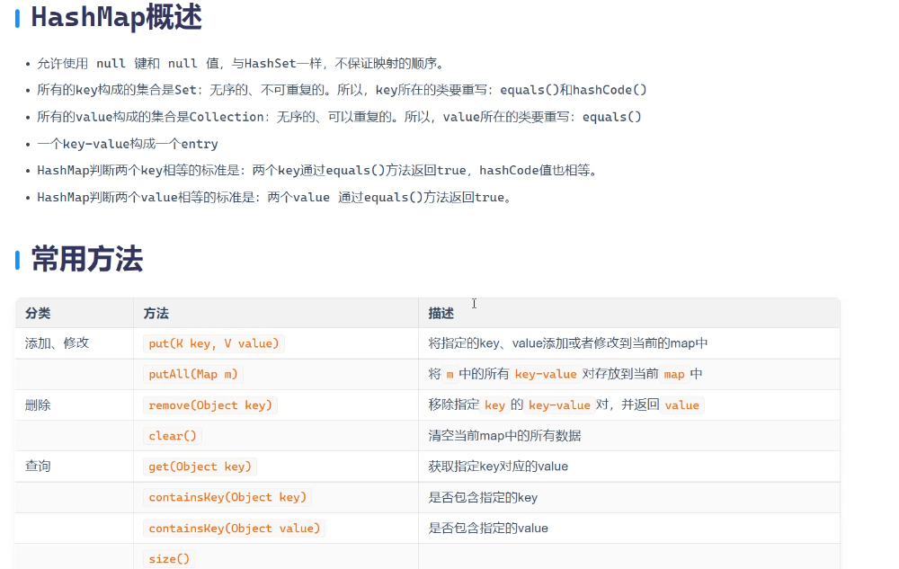
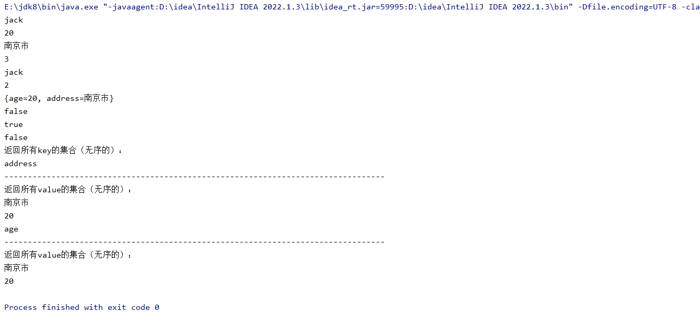

```java
package com.map;

import java.util.Collection;
import java.util.HashMap;
import java.util.Set;

public class HashMapTest01 {
    public static void main(String[] args) {
        //创建一个HashMap的集合对象
        HashMap<String , Object> HashMap = new HashMap<>();

        //储存元素
        HashMap.put("name","jack");
        HashMap.put("age",20);
        HashMap.put("address","南京市");

        //通过key来获取value
        System.out.println(HashMap.get("name"));
        System.out.println(HashMap.get("age"));
        System.out.println(HashMap.get("address"));

        //获取集合是个数
        System.out.println(HashMap.size());
        System.out.println(HashMap.remove("name"));//这个输入的是key，返回的信息是value，并且改行数组已经被删除
        System.out.println(HashMap.size());

        //对数组两者对应关系之间进行一个打印
        System.out.println(HashMap.clone());

        //判断集合是否包含某一个key  返回值blooean
        System.out.println(HashMap.containsKey("naem"));

        //判断集合是否包含某一个value 返回值blooean
        System.out.println(HashMap.containsValue(20));

        //判断是否为空数组
        System.out.println(HashMap.isEmpty());

        //返回这个msp集合所有的key，这个key会形成一个set集合
        Set<String> strings = HashMap.keySet();

        System.out.println("返回所有key的集合（无序的）：");

        for (String string : strings) {
            System.out.println(string);

            System.out.println("---------------------------------------------------------------------------------");
            System.out.println("返回所有value的集合（无序的）：");

            Collection<Object> values = HashMap.values();
            for (Object value : values) {
                System.out.println(value);
            }
        }
    }
}
```


