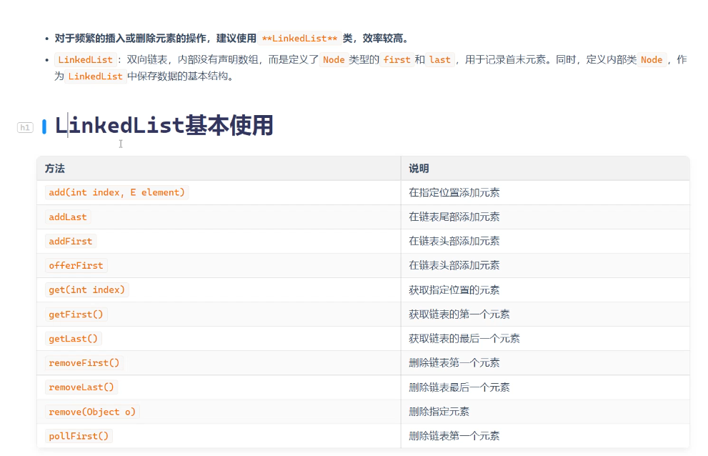
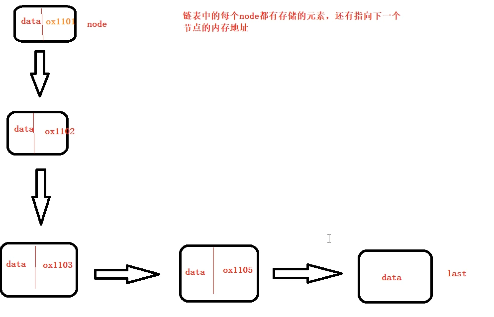
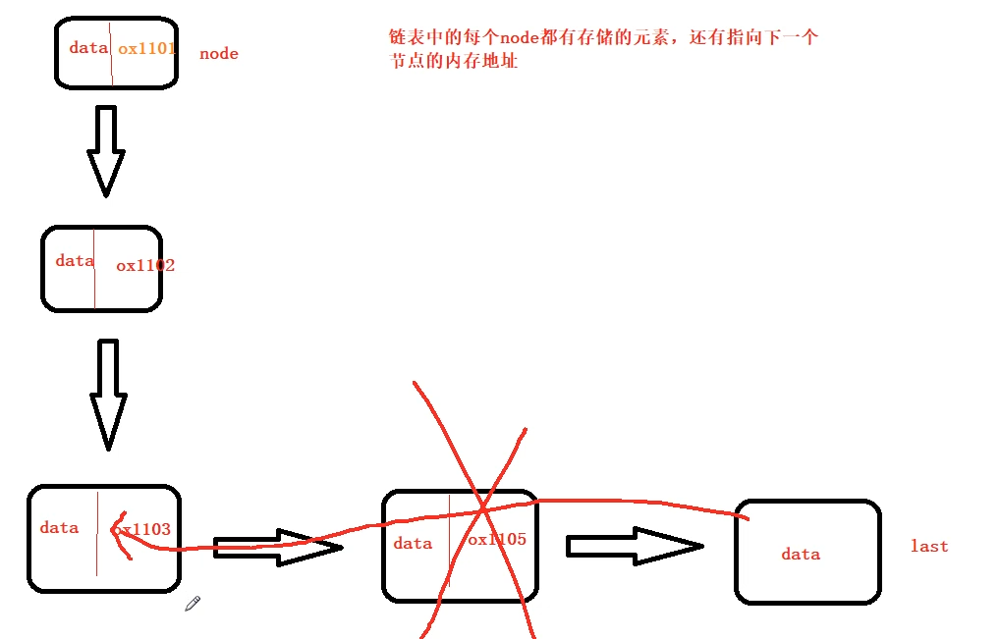

Node就是节点，每一个Node有一个首元素和一个尾元素，每一个节点都会存储相应的数据data和下一个节点的内存地址

最后一个节点里面只存储了数据，没有存储下一个节点的内存地址。

查询效率低的原因是：你要在链表里面去进行查询的话，每次查询的时候都会把每一个节点都过一遍。

随机增删效率高的原因是：删除某一个元素只需要删除节点就好了，如何删除的呢，拿上图演示：直接删除节点，然后把最后一个的内存地址赋值给删除前的那个节点即可
