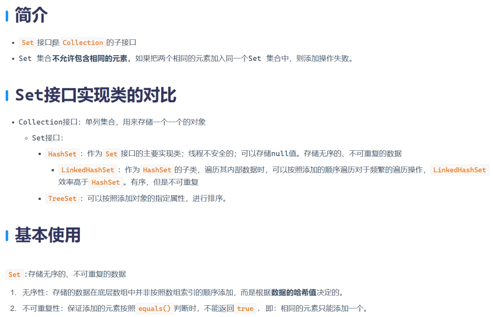
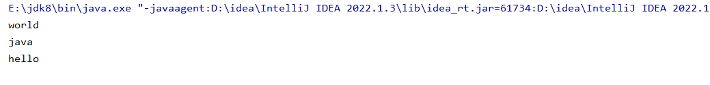
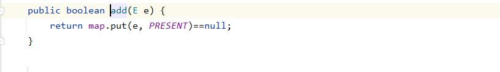
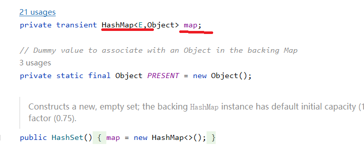
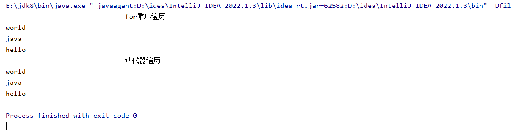
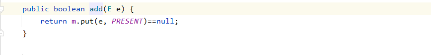
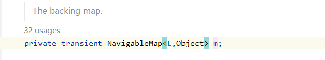
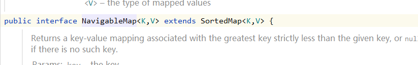
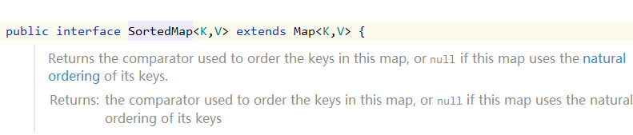
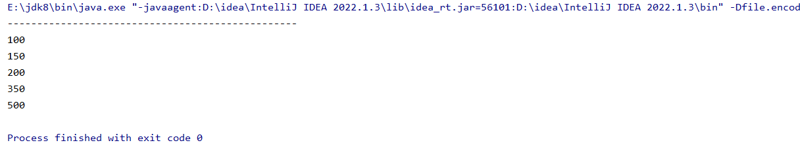

Set：无序不可重复

# HashSet

```java
package com.map;

import java.util.HashSet;

public class HashSetTest01 {
    public static void main(String[] args) {
        HashSet<String> hashSet = new HashSet<>();
        hashSet.add("hello");
        hashSet.add("world");
        hashSet.add("java");
        hashSet.add("java");

        for (String s : hashSet) {
            System.out.println(s);
        }
    }
}
```

两个"java"字符只打印了一个



按住Alt点进去，你会发现他会把数据用字母e来代替，e放在map里面的key的位置





```java
package com.map;

import java.util.HashSet;
import java.util.Iterator;

public class HashSetTest01 {
    public static void main(String[] args) {
        //创建一个map集合
        //HashSet底层是封装的是HashMap，我们添加数据，实际上数据存储在map集合的key部分
        HashSet<String> hashSet = new HashSet<>(); //无序，不可重复
        hashSet.add("hello");
        hashSet.add("world");
        hashSet.add("java");
        hashSet.add("java");
        System.out.println("------------------------------for循环遍历----------------------------------");
        for (String s : hashSet) {
            System.out.println(s);
        }
        System.out.println("------------------------------迭代器遍历----------------------------------");
        Iterator<String> iterator = hashSet.iterator();
        while (iterator.hasNext()){
            String data = iterator.next();
            System.out.println(data);
        }
    }
}
```



# TreeSet

 



输入的数据e间接的继承到了Map下面，Integer里面继承了comparable方法，其原理和HashSet一样，只是继承的Map子类不一样

```java
package com.map;

import java.util.TreeSet;

public class TreeSetTest {
    public static void main(String[] args) {
        //创建TreeMap集合
        TreeSet<Integer> treeSet = new TreeSet<>();

        //往集合中添加数据
        treeSet.add(100);
        treeSet.add(200);
        treeSet.add(500);
        treeSet.add(350);
        treeSet.add(150);

        //通过for循环遍历
        System.out.println("-------------------------------------------------");
        for (Integer data : treeSet) {
            System.out.println(data);
        }
    }
}
```


