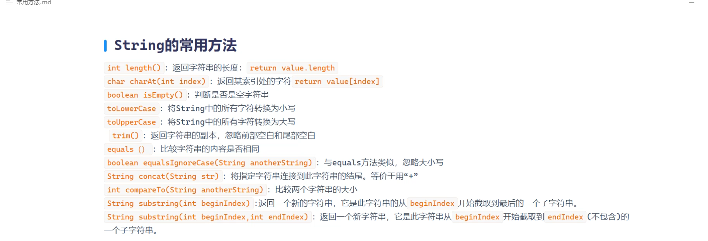
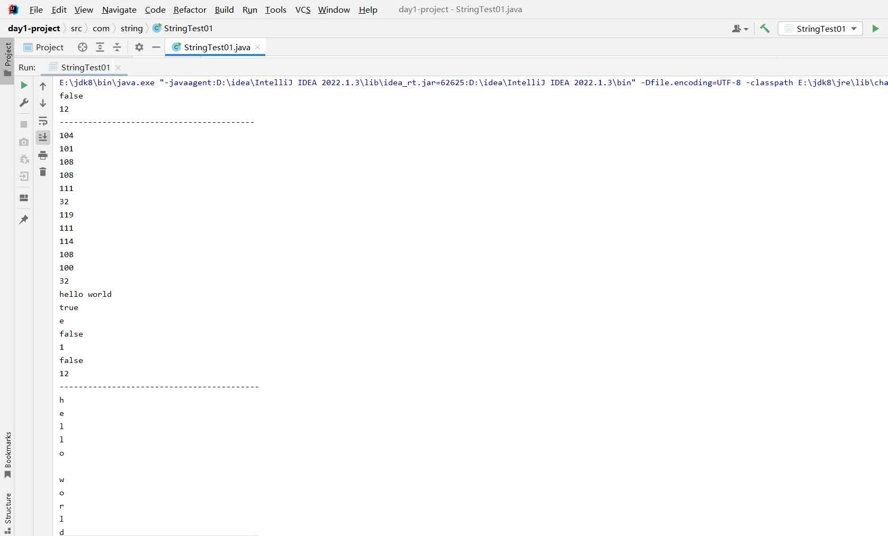
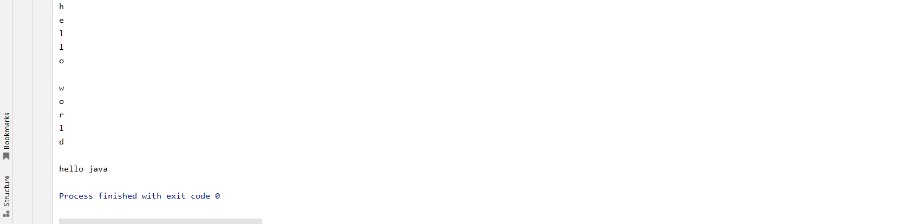

```java
package com.string;

import java.util.Arrays;

public class StringTest01 {
    public static void main(String[] args) {
        //创建一个String对象
        String str = "hello world ";
        String str2 = "HELLO WORLD";
        String str3 = "hhhhhhhhhhhhhee";

        //判断字符串内容是否相等
        System.out.println(str.equals("hello"));

        //字符串的长度
        System.out.println(str.length());

        //转化成字节数组
        System.out.println("-----------------------------------------");
        byte[] bytes = str.getBytes();

        for (byte aByte : bytes) {
            System.out.println(aByte);
        } //打印出来的数字就是每一个字母所对应的Ascll码

        //将所有大写字母转换成小写字母
        System.out.println(str2.toLowerCase());

        //字符串中是否包含某一段字符
        System.out.println(str.contains("he")); //很明显返回true

        //返回指定索引下对应的字符（索引从0开始）
        System.out.println(str.charAt(1));

        //判断字符串是否以某一个字符结尾
        System.out.println(str.endsWith("ld"));//很明显返回true

        //返回字符对应的索引
        System.out.println(str.indexOf("e")); //索引为1

        //判断这个字符串是否为空
        System.out.println(str.isEmpty());

        //判断字符最后一次出现的位置索引
        System.out.println(str3.lastIndexOf("h"));

        //切割（）里面放具体的规则
        String[] split = str.split("");
        System.out.println("------------------------------------------ ");
        for (String s : split) {
            System.out.println(s);
        }

        //把字符串直接切割成一个字符数组
        char[] chars = str.toCharArray();
        for (char aChar : chars) {
            System.out.println(aChar);
        }

        //将字符串替换
        System.out.println(str.replace("world","java"));

    }
}
```


