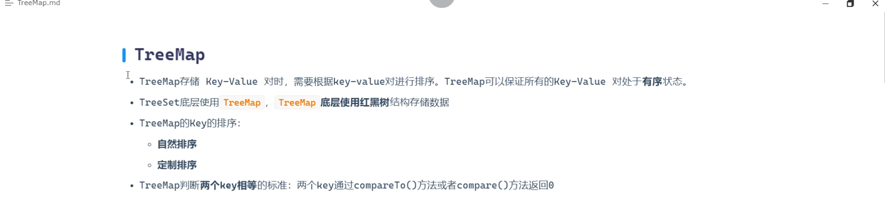
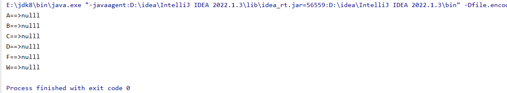
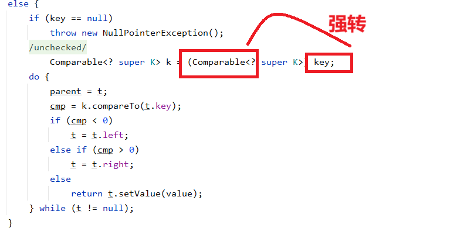
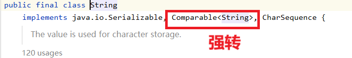
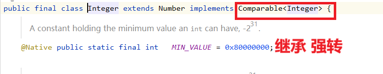
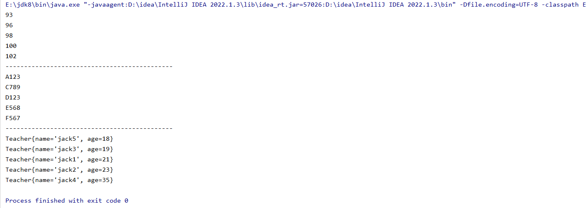
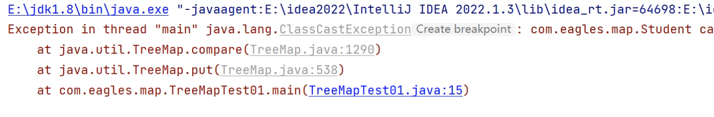
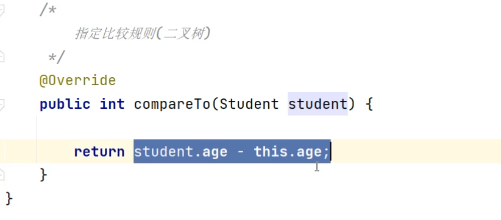

```plain
package com.map;

import java.util.Map;
import java.util.Set;
import java.util.TreeMap;

public class TreeMapTeat01 {
    public static void main(String[] args) {
        //可以排序的集合，主要根据key来排序
        TreeMap<String, Object> treeMap = new TreeMap<>();

        treeMap.put("A","nulll");
        treeMap.put("C","nulll");
        treeMap.put("D","nulll");
        treeMap.put("B","nulll");
        treeMap.put("F","nulll");
        treeMap.put("W","nulll");

        Set<Map.Entry<String, Object>> entries = treeMap.entrySet();
        for (Map.Entry<String, Object> entry : entries) {
            System.out.println(entry.getKey() + "==>" + entry.getValue());
        }
    }
}
```

顺序由A C D B F W 变成了A B C D F W



来看一下源代码，最主要的是put的用法，底层将key的类型强转成了comparable，在用二叉树进行比较



然而Integer和String都是comparable的实现类



如果类是我们自定义了，没有出现comparable看看会出现什么问题

```java
package com.map;

public class Teacher implements Comparable<Teacher> {

    private String name;
    private int age;

    public Teacher(String name, int age) {
        this.name = name;
        this.age = age;
    }

    public Teacher() {
    }

    public String getName() {
        return name;
    }

    public void setName(String name) {
        this.name = name;
    }

    public int getAge() {
        return age;
    }

    public void setAge(int age) {
        this.age = age;
    }

    @Override
    public String toString() {
        return "Teacher{" +
        "name='" + name + '\'' +
        ", age=" + age +
        '}';
    }
     //重写compareTo方法
    @Override
    public int compareTo(Teacher teacher) {

        return this.getAge() - teacher.getAge();
    }
}
```

```java
package com.map;

import com.map.Teacher;

import java.util.Map;
import java.util.Set;
import java.util.TreeMap;

public class TreeMapTest01 {

    public static void main(String[] args) {

        //创建treeMap对象
        TreeMap<Integer, Object> treeMap = new TreeMap<>();
        TreeMap<String, Object> treeMap2 = new TreeMap<>();
        TreeMap<Teacher, Object> treeMap3 = new TreeMap<>();

        treeMap.put(100,null);
        treeMap.put(98,null);
        treeMap.put(102,null);
        treeMap.put(96,null);
        treeMap.put(93,null);

        treeMap2.put("A123",null);
        treeMap2.put("F567",null);
        treeMap2.put("D123",null);
        treeMap2.put("E568",null);
        treeMap2.put("C789",null);

        treeMap3.put(new Teacher("jack1",21),null);
        treeMap3.put(new Teacher("jack2",23),null);
        treeMap3.put(new Teacher("jack3",19),null);
        treeMap3.put(new Teacher("jack4",35),null);
        treeMap3.put(new Teacher("jack5",18),null);

        Set<Map.Entry<Integer, Object>> entries = treeMap.entrySet();

        for (Map.Entry<Integer, Object> entry : entries) {
            System.out.println(entry.getKey());
        }

        System.out.println("---------------------------------------------");

        Set<Map.Entry<String, Object>> entries1 = treeMap2.entrySet();

        for (Map.Entry<String, Object> entry : entries1) {
            System.out.println(entry.getKey());
        }

        System.out.println("---------------------------------------------");

        Set<Map.Entry<Teacher, Object>> entries2 = treeMap3.entrySet();

        for (Map.Entry<Teacher, Object> entry : entries2) {
            System.out.println(entry.getKey());
        }

    }

}
```

都进行了有序排序，前两个是系统自己的comparable规则，后面是我们对年龄自定义的一个规则，可以看到年龄有规律的排序了





传入的Teacher并不是comparable的实现类，所以报出类型转换异常，只需要去实现一下comparable接口就可以了 implant comparable

二叉树是int类型的，原理是将两数进行相减，如果大于0应该放在什么位置（右子树），如果小于0 应该放在什么位置（左子树），如果等于0应该放在什么位置（中子数）

如果你想自己写比较的规则，就重写compareTo（参数），返回值的判断条件


