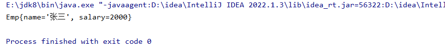

```java
package com.map;

public class Emp implements Comparable{
    private  String name;
    private  Integer salary;

    @Override
    public String toString() {
        return "Emp{" +
        "name='" + name + '\'' +
        ", salary=" + salary +
        '}';
    }

    public String getName() {
        return name;
    }

    public void setName(String name) {
        this.name = name;
    }

    public Integer getSalary() {
        return salary;
    }

    public void setSalary(Integer salary) {
        this.salary = salary;
    }

    public Emp(String name) {
        this.name = name;
    }

    public Emp(String name, Integer salary) {
        this.name = name;
        this.salary = salary;
    }

    @Override
    public int compareTo(Object o) {
        return 0;
    }
}
```

```java
package com.map;

import java.util.Iterator;
import java.util.TreeSet;

public class TreeSetTest {
    public static void main(String[] args) {
        //创建TreeMap集合
        TreeSet<Emp>  treeSet = new TreeSet<>();
        Emp emp1 = new Emp("张三", 2000);
        Emp emp2 = new Emp("李四", 6000);
        Emp emp3 = new Emp("王五", 4000);
        treeSet.add(emp1);
        treeSet.add(emp2);
        treeSet.add(emp3);

        Iterator<Emp> iterator = treeSet.iterator();
        while (iterator.hasNext()){
            Emp data  = iterator.next();
            System.out.println(data);
        }
    }
}
```


