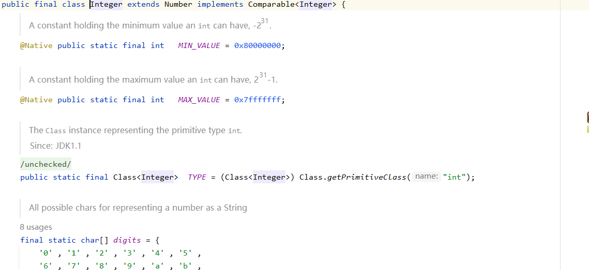
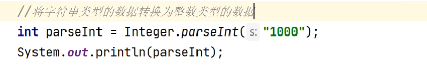
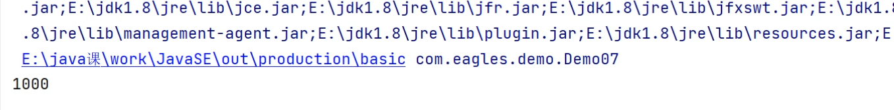
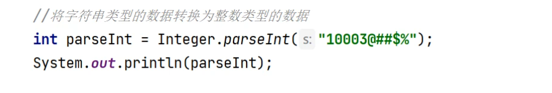
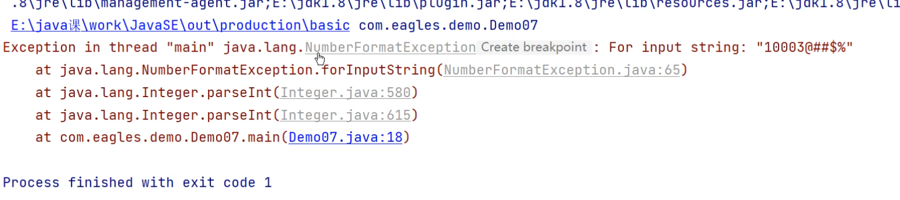
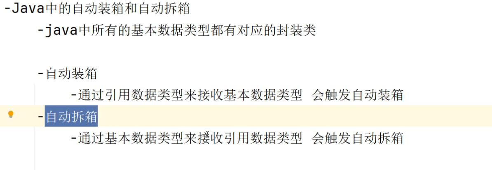

# 自动拆箱&&自动装箱

```java
package com.Demo;

public class Demo07 {

    public static void main(String[] args) {

        //创建当前类对象
        Demo07 demo07 = new Demo07();
        demo07.getMethod(100);//int 基本数据类型 自动转换成引用数据类型
        demo07.getMethod(3.14);//double  基本数据类型 自动转换成引用数据类型
        demo07.getMethod(true);//boolean 基本数据类型 自动转换成引用数据类型
        demo07.getMethod("t");// char基本数据类型 自动转换成引用数据类型
        //int所对应的引用数据类型，对应的封装类是Integer，Integer是java.lang下面的，使用时不需要导包

        //Object 他是所有类的父类，当一个类没有去继承父类的时候默认继承Object类，又名超类
        //Object是引用数据类型 可以用引用数据来接受基本数据的数据，自动装箱

        //所有基本类型在java中都有对应的封装类

        //int对应的封装类
        Integer i = 100;
        System.out.println(i);
        //自动装箱 左边是int类型 左边为引用数据类型，引用数据类型接受基本数据类型原本来说是不符合规范的，
        // 但是语法可以走通，就是因为有自动装箱，将基本数据类型转化为引用数据类型(Object是这些引用数据的父类，所有接受java中所有引用数据类型)

        //double对应的封装类
        Double d = 3.14; //自动装箱

        //boolean对应的引用数据类型
        Boolean b = false;

        //char的引用数据类型
        Character c  = '中';

        Byte b2 = 100;//自动装箱
        short s  =1000;//自动装箱
        Long l = 1000l;//自动装箱
        Float F = 3.14f;//自动装箱
        //以上是八大基本类型对应的封装类，除了int、char其他的都是首字母大写

        //自动拆箱
        int i2 = i;//i在前面是引用数据类型，现在用int去接受，那么就变成了基本数据类型去接收引用数据类型

        char c2 = c;
        System.out.println(i2);
        System.out.println(c2);
        //数据不会发生改变，数据全部都能够出来
    }

    public  void getMethod(Object obj){

        System.out.println(obj);

    }
}
```

### 这些引用数据类型里面其实也封装了对应方法，点进去也就是一个类



### 其他方法:

 

#### 必须保证这个里面是一个可以转换成整型的字符串



# 总结：


