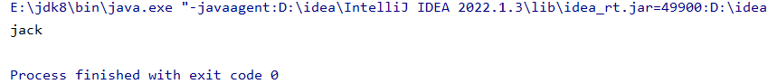
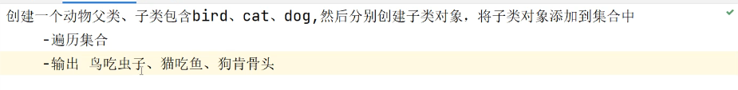

其主要目的是为了解决ClassCastException的问题，在进行对象的向下转型时都可能存在安全隐患，而Java希望通过泛型可以慢慢解决掉此类问题

```java
package com.collection;
import java.util.ArrayList;
import java.util.LinkedList;

/*
泛型：强制集合只能存放某一种数据类型的数据
自定义泛型
 */
public class ArrayListTest03 {

    public static void main(String[] args) {

        //创建一个集合对象
        ArrayList arrayList = new ArrayList();
        //<>被称作为钻石表达式，在后面放<>数据类型，
        // 那么这个你的集合只能放该数据类型的数据
        //后面那个<>可以不用写，可省略

        arrayList.add("hello");
        arrayList.add("1234");

        //创建User对象
        User<String> stringUser = new User<>();//类型是什么才可以传什么
        stringUser.setName("jack");

        String method = stringUser.method();
        System.out.println(method);
    }

}
```

# 自定义泛型：

```java
package com.collection;

public class User <Type>//名字随便
{
    public User<Object> stringUser;
    private     Type name;
    public  Type  method(){
        return  name;

    }

    public void setName(Type name) {
        this.name = name;
    }
}
```



# 案例：



```java
package com.collection;

import java.util.ArrayList;
import java.util.Iterator;

public class ArrayListTest04 {
    public static void main(String[] args) {

        //基于泛型创建一个集合对象
        ArrayList<Animal> animal = new ArrayList<>();//泛型也支持多态

        //将animal的子类实例添加到集合中
        animal.add(new Bird());
        animal.add(new Cat());
        animal.add(new Dog());
        //存进去的要么是Animal要么是Animal子类类型的

        //对集合进行遍历
        Iterator<Animal> iterator = animal.iterator();
        while (iterator.hasNext()){
            Animal aniaml = iterator.next();//aniaml里面也有吃的方法 所以是不用向下转型的
            aniaml.eat();
        }
    }
}
```

```java
package com.collection;

public class Animal {

    public void eat(){
        System.out.println("所有动物都有吃的特性");

    }
}
```

```java
package com.collection;

public class Bird extends  Animal{
    @Override
    public void eat() {
        System.out.println("鸟吃虫子！");
    }
}
```

```java
package com.collection;

public class Cat extends  Animal{
    @Override
    public void eat() {
        System.out.println("猫喜欢吃鱼！");
    }
}
```

```java
package com.collection;

public class Dog extends Animal{
    @Override
    public void eat() {
        System.out.println("狗啃骨头！");
    }
}
```
