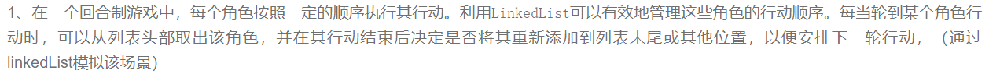
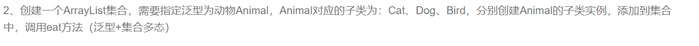

```plain
import java.util.LinkedList;

class Character {
    private String name;
    private int actionPoints;

    public Character(String name, int actionPoints) {
        this.name = name;
        this.actionPoints = actionPoints;
    }

    public String getName() {
        return name;
    }

    public int getActionPoints() {
        return actionPoints;
    }

    public void performAction() {
        System.out.println(name + " is performing an action.");
        // Decrease action points after performing an action
        actionPoints--;
    }

    @Override
    public String toString() {
        return "Character{name='" + name + "', actionPoints=" + actionPoints + "}";
    }
}

public class GameTurnSystem {
    public static void main(String[] args) {
        LinkedList<Character> characters = new LinkedList<>();
        characters.add(new Character("Hero", 3));
        characters.add(new Character("Villain", 2));
        characters.add(new Character("NPC", 4));

        while (!characters.isEmpty()) {
            Character currentCharacter = characters.removeFirst();
            currentCharacter.performAction();

            if (currentCharacter.getActionPoints() > 0) {
                // Add the character back to the end of the list if they still have action points
                characters.addLast(currentCharacter);
            } else {
                System.out.println(currentCharacter.getName() + " has no more action points and is removed from the game.");
            }

            if (characters.isEmpty()) {
                System.out.println("All characters have finished their actions.");
                break;
            }
        }
    }
}
```



```plain
import java.util.ArrayList;

abstract class Animal {
    abstract void eat();
}

class Cat extends Animal {
    @Override
    void eat() {
        System.out.println("Cat is eating fish.");
    }
}

class Dog extends Animal {
    @Override
    void eat() {
        System.out.println("Dog is eating bone.");
    }
}

class Bird extends Animal {
    @Override
    void eat() {
        System.out.println("Bird is eating seeds.");
    }
}

public class AnimalFeedingSystem {
    public static void main(String[] args) {
        ArrayList<Animal> animals = new ArrayList<>();
        animals.add(new Cat());
        animals.add(new Dog());
        animals.add(new Bird());

        for (Animal animal : animals) {
            animal.eat();
        }
    }
}
```
