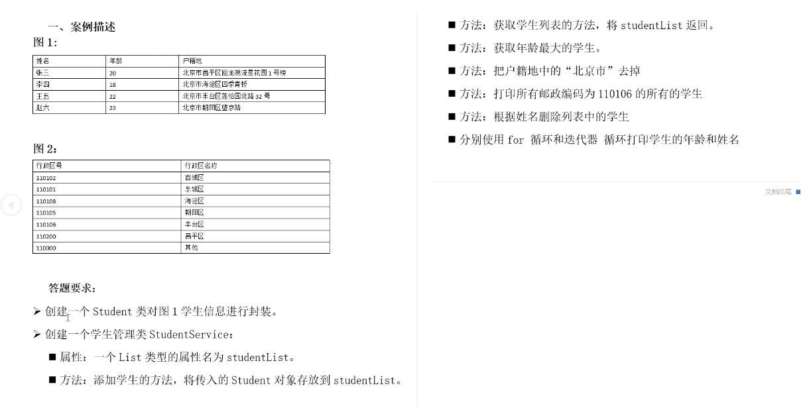
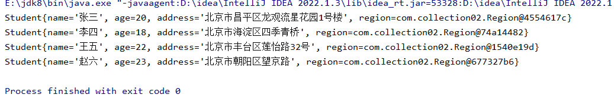
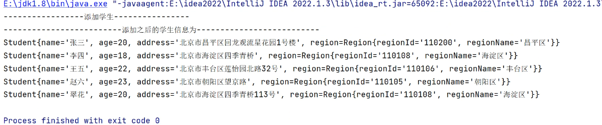
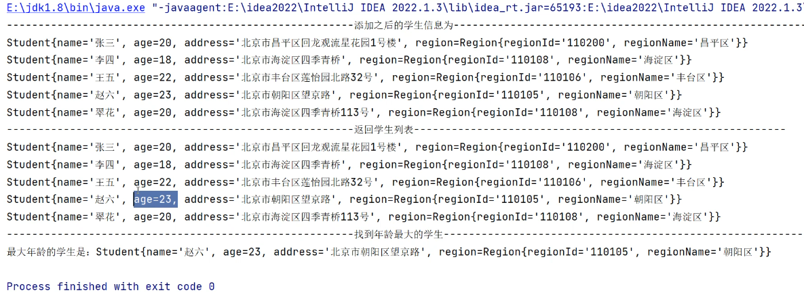
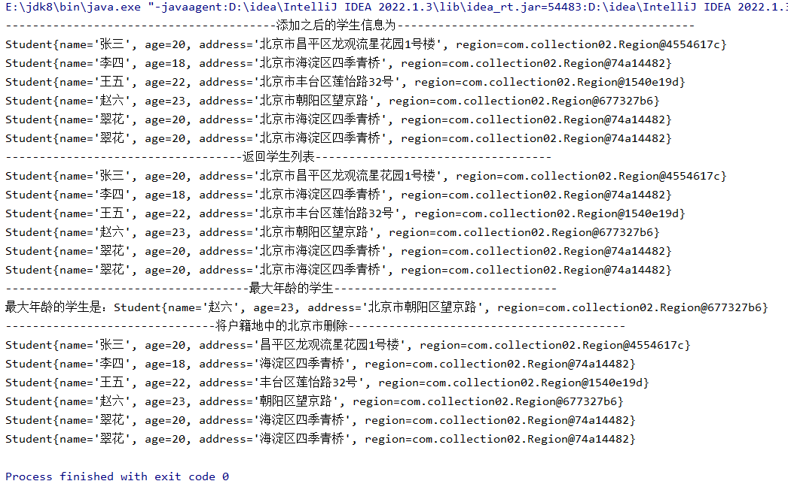
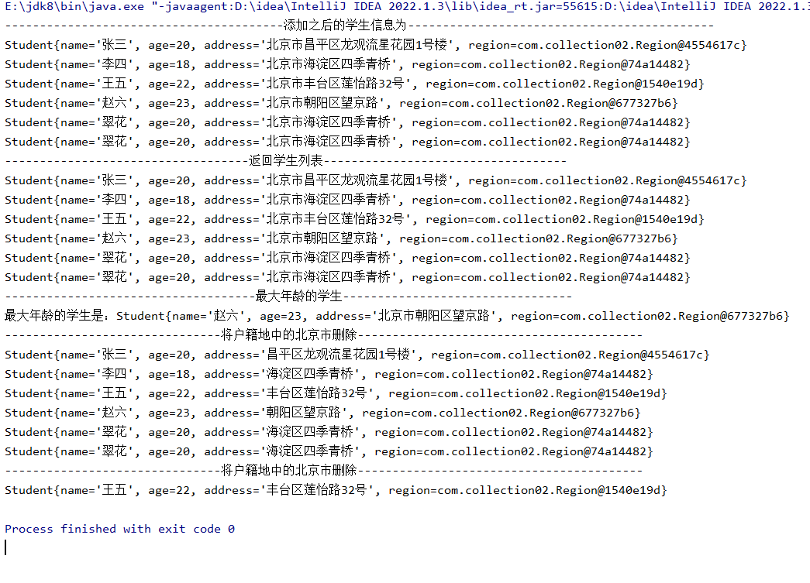
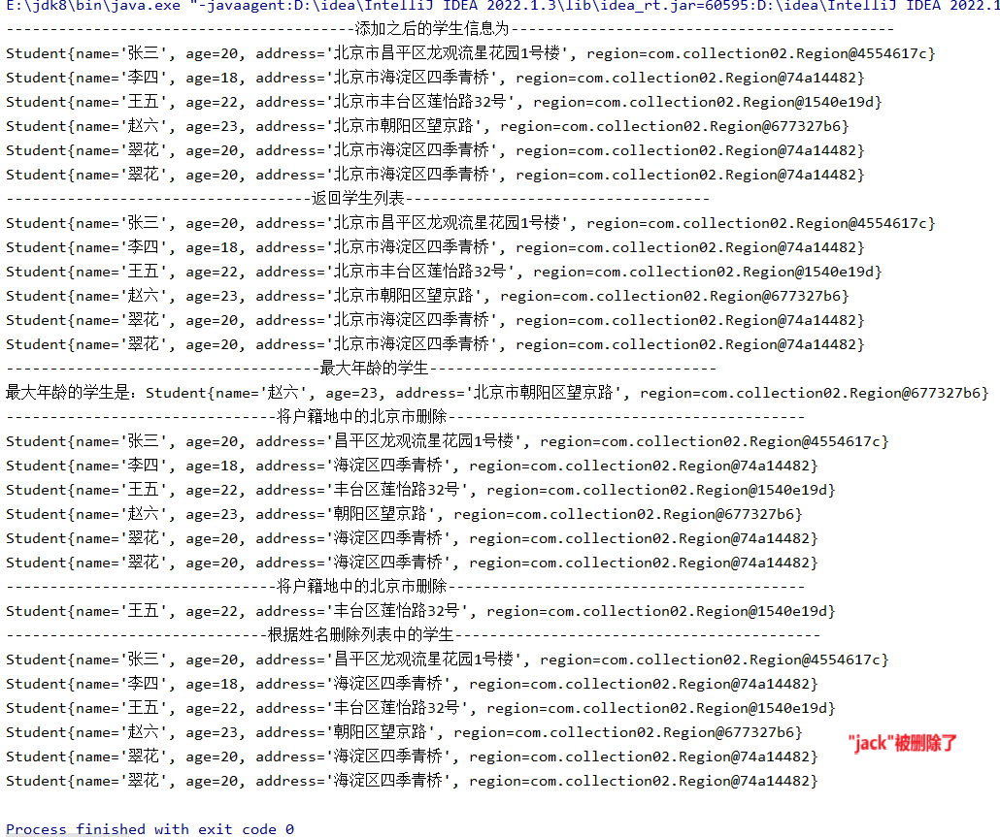
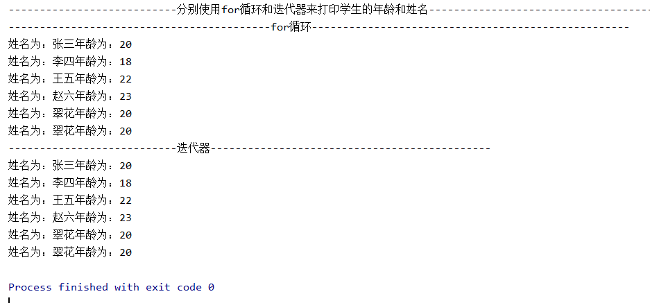

```java
package com.collection02;

public class Student {

    private  String name;
    private    Integer age;
    private  String address;
    private  Region region; //聚合一个行政区的引用，建立起图一和图二的桥梁

    public Student(String name, Integer age, String address, Region region) {
        this.name = name;
        this.age = age;
        this.address = address;
        this.region = region;
    }

    public Student(String name, Integer age, String address) {
        this.name = name;
        this.age = age;
        this.address = address;
    }

    public Student() {
    }

    public String getName() {
        return name;
    }

    public void setName(String name) {
        this.name = name;
    }

    public Integer getAge() {
        return age;
    }

    public void setAge(Integer age) {
        this.age = age;
    }

    public String getAddress() {
        return address;
    }

    public void setAddress(String address) {
        this.address = address;
    }

    public Region getRegion() {
        return region;
    }

    public void setRegion(Region region) {
        this.region = region;
    }
    @Override
    public String toString() {
        return "Student{" +
        "name='" + name + '\'' +
        ", age=" + age +
        ", address='" + address + '\'' +
        ", region=" + region +
        '}';
    }

}
```

```java
package com.collection02;

import java.util.List;

public class StudentService {
    private List<Student> studentList; //只能存放Student类的数据

    //生成一个有参构造，他会把默认覆盖掉有参构造，也就是说在创建StudentService这个类的实例的时候
    //必须要传一个集合对象进去才可以，这边的引用是一个接口List，接口可以去接收一个对应的实例，
    // 到时候我们去创建一个arrayList,这里面体现了java的一个多态

    public StudentService(List<Student> studentList) {
        this.studentList = studentList;
    }

    public List<Student> getStudentList() {
        return studentList;
    }

    public void setStudentList(List<Student> studentList) {
        this.studentList = studentList;
    }
}
```

```java
package com.collection02;

public class Region {

    private String regionId;
    private String regionName;

    public Region(String regionId, String regionName) {
        this.regionId = regionId;
        this.regionName = regionName;
    }

    public Region() {
    }

    public String getRegionId() {
        return regionId;
    }

    public void setRegionId(String regionId) {
        this.regionId = regionId;
    }

    public String getRegionName() {
        return regionName;
    }

    public void setRegionName(String regionName) {
        this.regionName = regionName;
    }
}
```

```java
package com.collection02;

import java.util.ArrayList;

public class StudentTest {
    public static void main(String[] args) {

        //创建学生集合对象
        ArrayList<Student> studentArrayList = new ArrayList<>();
        //创建学生管理类
        StudentService studentService = new StudentService(studentArrayList);//用无参构造会报错 ，所以得把集合的实例放进去

        //最开始去建立图一和图二的一个关联
        Student student1 = new Student("张三",20,"北京市昌平区龙观流星花园1号楼");
        Student student2 = new Student("李四",18,"北京市海淀区四季青桥");
        Student student3 = new Student("王五",22,"北京市丰台区莲怡路32号");
        Student student4 = new Student("赵六",23,"北京市朝阳区望京路");

        //将所有的学生添加到集合中
        studentService.getStudentList().add(student1);
        studentService.getStudentList().add(student2);
        studentService.getStudentList().add(student3);
        studentService.getStudentList().add(student4);

        //创建一个存放行政区的集合对象
        ArrayList<Region> regions  = new ArrayList<>();

        //创建行政区对象
        Region region1 = new Region("110102","西城区");
        Region region2 = new Region("110101","西东城");
        Region region3 = new Region("110108","海淀区");
        Region region4 = new Region("110105","朝阳区");
        Region region5 = new Region("110106","丰台区");
        Region region6 = new Region("110200","昌平区");

        //将行政区对象添加到集合中
        regions.add(region1);
        regions.add(region2);
        regions.add(region3);
        regions.add(region4);
        regions.add(region5);
        regions.add(region6);

        //把行政区对象赋值给学生对象，因为我们在学生对象里面聚合了一个行政区对象，
        // 我想知道每一个学生所对应的行政区是哪个，可以用for嵌套去做一个判断

        //遍历学生集合
        for (Student student : studentService.getStudentList()) {
            for (Region region : regions) {
                //包含关系 行政区信息包含在户籍地里面的
                if (student.getAddress().contains(region.getRegionName())){
                    //contains用于比较字符串是否有包含关系的一个关键字
                    //如果当前户籍地信息中包含行政区名称，那么就把当前的行政区对象set给学生对象
                    student.setRegion(region);
                }

            }
        }
        for (Student student : studentService.getStudentList()) {
            System.out.println(student);
        }

        //        for (Student student : studentService.getStudentList()) {   //通过加强for循环去遍历
        //            System.out.println(student);
        //        }

    }
}
```




```java
package com.collection02;

import java.util.List;

public class StudentService {
    private List<Student> studentList; //只能存放Student类的数据

    //生成一个有参构造，他会把默认覆盖掉有参构造，也就是说在创建StudentService这个类的实例的时候
    //必须要传一个集合对象进去才可以，这边的引用是一个接口List，接口可以去接收一个对应的实例，
    // 到时候我们去创建一个arrayList,这里面体现了java的一个多态

    public StudentService(List<Student> studentList) {
        this.studentList = studentList;
    }

    public List<Student> getStudentList() {
        return studentList;     
    }

    public void setStudentList(List<Student> studentList) {
        this.studentList = studentList;
    }

    /**
     * 添加学生
     * @param student
     */
    public void addStudent(Student student , List<Region> regionList){//添加学生得将学生对象传进来
        this.studentList.add(student);
        //先将行政区set给学生对象
        for (Region region : regionList) {
            if (student.getAddress().contains(region.getRegionName())){//判断是否包含
                student.setRegion(region);//包含则把行政区set进去
            }
        }
        //有一个问题就是，你添加的学生Student student ，并没有包含行政区的信息。所以把行政区的集合放进去

        //再整体的把这个对象Student往集合里面进行添加

        //将学生对象添加到集合中
        this.studentList.add(student);
        System.out.println("----------------------------------------添加之后的学生信息为--------------------------------------------");

        for (Student s : this.studentList) {
            System.out.println(s);
        }

    }

}
```

```java
package com.collection02;

import java.util.ArrayList;

public class StudentTest {
    public static void main(String[] args) {

        //创建学生集合对象
        ArrayList<Student> studentArrayList = new ArrayList<>();
        //创建学生管理类
        StudentService studentService = new StudentService(studentArrayList);//用无参构造会报错 ，所以得把集合的实例放进去

        //最开始去建立图一和图二的一个关联
        Student student1 = new Student("张三",20,"北京市昌平区龙观流星花园1号楼");
        Student student2 = new Student("李四",18,"北京市海淀区四季青桥");
        Student student3 = new Student("王五",22,"北京市丰台区莲怡路32号");
        Student student4 = new Student("赵六",23,"北京市朝阳区望京路");

        //将所有的学生添加到集合中
        studentService.getStudentList().add(student1);
        studentService.getStudentList().add(student2);
        studentService.getStudentList().add(student3);
        studentService.getStudentList().add(student4);

        //创建一个存放行政区的集合对象
        ArrayList<Region> regions  = new ArrayList<>();

        //创建行政区对象
        Region region1 = new Region("110102","西城区");
        Region region2 = new Region("110101","西东城");
        Region region3 = new Region("110108","海淀区");
        Region region4 = new Region("110105","朝阳区");
        Region region5 = new Region("110106","丰台区");
        Region region6 = new Region("110200","昌平区");

        //将行政区对象添加到集合中
        regions.add(region1);
        regions.add(region2);
        regions.add(region3);
        regions.add(region4);
        regions.add(region5);
        regions.add(region6);

        //把行政区对象赋值给学生对象，因为我们在学生对象里面聚合了一个行政区对象，
        // 我想知道每一个学生所对应的行政区是哪个，可以用for嵌套去做一个判断

        //遍历学生集合
        for (Student student : studentService.getStudentList()) {
            for (Region region : regions) {
                //包含关系 行政区信息包含在户籍地里面的
                if (student.getAddress().contains(region.getRegionName())){
                    //contains用于比较字符串是否有包含关系的一个关键字
                    //如果当前户籍地信息中包含行政区名称，那么就把当前的行政区对象set给学生对象
                    student.setRegion(region);
                }

            }
        }

        Student student = new Student("翠花", 20, "北京市海淀区四季青桥");
        studentService.addStudent(student,regions);

    }
}
```




?没听懂


```java
package com.collection02;

import java.util.Iterator;
import java.util.List;

public class StudentService {
    private List<Student> studentList; //只能存放Student类的数据

    //生成一个有参构造，他会把默认覆盖掉有参构造，也就是说在创建StudentService这个类的实例的时候
    //必须要传一个集合对象进去才可以，这边的引用是一个接口List，接口可以去接收一个对应的实例，
    // 到时候我们去创建一个arrayList,这里面体现了java的一个多态

    public StudentService(List<Student> studentList) {
        this.studentList = studentList;
    }

    public List<Student> getStudentList() {
        return studentList;     
    }

    public void setStudentList(List<Student> studentList) {
        this.studentList = studentList;
    }

    /**
     * 添加学生
     * @param student
     */
    public void addStudent(Student student , List<Region> regionList){//添加学生得将学生对象传进来
        this.studentList.add(student);
        //先将行政区set给学生对象
        for (Region region : regionList) {
            if (student.getAddress().contains(region.getRegionName())){//判断是否包含
                student.setRegion(region);//包含则把行政区set进去
            }
        }
        //有一个问题就是，你添加的学生Student student ，并没有包含行政区的信息。所以把行政区的集合放进去

        //再整体的把这个对象Student往集合里面进行添加

        //将学生对象添加到集合中
        this.studentList.add(student);
        System.out.println("----------------------------------------添加之后的学生信息为--------------------------------------------");

        for (Student s : this.studentList) {
            System.out.println(s);
        }

    }
    /**
     * 找到年龄最大的学生
     */
    public void findStudentAgeMax(){
        //遍历集合
        Iterator<Student> iterator = this.studentList.iterator();

        //定义一个中间值
        int MaxAge = 0;

        while (iterator.hasNext()){
            //获取每一个学生对象
            Student student = iterator.next();
            if (student.getAge() > MaxAge){//进行一个判断
                MaxAge = student.getAge();//将最大的年龄赋值给MaxAge
            }
        }
        iterator = this.studentList.iterator();
        while (iterator.hasNext()){
            Student student = iterator.next();
            if (student.getAge() == MaxAge){
                System.out.println("最大年龄的学生是："+student);
            }
        }
    }

}
```

```java
package com.collection02;

import java.util.ArrayList;
import java.util.List;

public class StudentTest {
    public static void main(String[] args) {

        //创建学生集合对象
        ArrayList<Student> studentArrayList = new ArrayList<>();
        //创建学生管理类
        StudentService studentService = new StudentService(studentArrayList);//用无参构造会报错 ，所以得把集合的实例放进去

        //最开始去建立图一和图二的一个关联
        Student student1 = new Student("张三",20,"北京市昌平区龙观流星花园1号楼");
        Student student2 = new Student("李四",18,"北京市海淀区四季青桥");
        Student student3 = new Student("王五",22,"北京市丰台区莲怡路32号");
        Student student4 = new Student("赵六",23,"北京市朝阳区望京路");

        //将所有的学生添加到集合中
        studentService.getStudentList().add(student1);
        studentService.getStudentList().add(student2);
        studentService.getStudentList().add(student3);
        studentService.getStudentList().add(student4);

        //创建一个存放行政区的集合对象
        ArrayList<Region> regions  = new ArrayList<>();

        //创建行政区对象
        Region region1 = new Region("110102","西城区");
        Region region2 = new Region("110101","西东城");
        Region region3 = new Region("110108","海淀区");
        Region region4 = new Region("110105","朝阳区");
        Region region5 = new Region("110106","丰台区");
        Region region6 = new Region("110200","昌平区");

        //将行政区对象添加到集合中
        regions.add(region1);
        regions.add(region2);
        regions.add(region3);
        regions.add(region4);
        regions.add(region5);
        regions.add(region6);

        //把行政区对象赋值给学生对象，因为我们在学生对象里面聚合了一个行政区对象，
        // 我想知道每一个学生所对应的行政区是哪个，可以用for嵌套去做一个判断

        //遍历学生集合
        for (Student student : studentService.getStudentList()) {
            for (Region region : regions) {
                //包含关系 行政区信息包含在户籍地里面的
                if (student.getAddress().contains(region.getRegionName())){
                    //contains用于比较字符串是否有包含关系的一个关键字
                    //如果当前户籍地信息中包含行政区名称，那么就把当前的行政区对象set给学生对象
                    student.setRegion(region);
                }

            }
        }

        Student student = new Student("翠花", 20, "北京市海淀区四季青桥");
        studentService.addStudent(student,regions);

        System.out.println("-----------------------------------返回学生列表-----------------------------------");
        List<Student> studentList = studentService.getStudentList();
        for (Student s : studentList) {
            System.out.println(s);
        }
        System.out.println("------------------------------------最大年龄的学生---------------------------------");
        //找到年龄最大的学生
        studentService.findStudentAgeMax();
    }
}
```




```java
package com.collection02;

import java.util.Iterator;
import java.util.List;

public class StudentService {
    private List<Student> studentList; //只能存放Student类的数据

    //生成一个有参构造，他会把默认覆盖掉有参构造，也就是说在创建StudentService这个类的实例的时候
    //必须要传一个集合对象进去才可以，这边的引用是一个接口List，接口可以去接收一个对应的实例，
    // 到时候我们去创建一个arrayList,这里面体现了java的一个多态

    public StudentService(List<Student> studentList) {
        this.studentList = studentList;
    }

    public List<Student> getStudentList() {
        return studentList;     
    }

    public void setStudentList(List<Student> studentList) {
        this.studentList = studentList;
    }

    /**
     * 添加学生
     * @param student
     */
    public void addStudent(Student student , List<Region> regionList){//添加学生得将学生对象传进来
        this.studentList.add(student);
        //先将行政区set给学生对象
        for (Region region : regionList) {
            if (student.getAddress().contains(region.getRegionName())){//判断是否包含
                student.setRegion(region);//包含则把行政区set进去
            }
        }
        //有一个问题就是，你添加的学生Student student ，并没有包含行政区的信息。所以把行政区的集合放进去

        //再整体的把这个对象Student往集合里面进行添加

        //将学生对象添加到集合中
        this.studentList.add(student);
        System.out.println("----------------------------------------添加之后的学生信息为--------------------------------------------");

        for (Student s : this.studentList) {
            System.out.println(s);
        }

    }
    /**
     * 找到年龄最大的学生
     */
    public void findStudentAgeMax(){
        //遍历集合
        Iterator<Student> iterator = this.studentList.iterator();

        //定义一个中间值
        int MaxAge = 0;

        while (iterator.hasNext()){
            //获取每一个学生对象
            Student student = iterator.next();
            if (student.getAge() > MaxAge){//进行一个判断
                MaxAge = student.getAge();//将最大的年龄赋值给MaxAge
            }
        }
        iterator = this.studentList.iterator();
        while (iterator.hasNext()){
            Student student = iterator.next();
            if (student.getAge() == MaxAge){
                System.out.println("最大年龄的学生是："+student);
            }
        }
    }
    /**
     * 将户籍地中的北京市删除
     */
    public void daleteAddressBJ(){
        System.out.println("-------------------------------将户籍地中的北京市删除-----------------------------------------");
        for (Student student : this.studentList) {
            student.setAddress(student.getAddress().replace("北京市",""));//将北京市换成空字符
        }
        for (Student student : this.studentList) {
            System.out.println(student);
        }
    }
}
```

```java
package com.collection02;

import java.util.ArrayList;
import java.util.List;

public class StudentTest {
    public static void main(String[] args) {

        //创建学生集合对象
        ArrayList<Student> studentArrayList = new ArrayList<>();
        //创建学生管理类
        StudentService studentService = new StudentService(studentArrayList);//用无参构造会报错 ，所以得把集合的实例放进去

        //最开始去建立图一和图二的一个关联
        Student student1 = new Student("张三",20,"北京市昌平区龙观流星花园1号楼");
        Student student2 = new Student("李四",18,"北京市海淀区四季青桥");
        Student student3 = new Student("王五",22,"北京市丰台区莲怡路32号");
        Student student4 = new Student("赵六",23,"北京市朝阳区望京路");

        //将所有的学生添加到集合中
        studentService.getStudentList().add(student1);
        studentService.getStudentList().add(student2);
        studentService.getStudentList().add(student3);
        studentService.getStudentList().add(student4);

        //创建一个存放行政区的集合对象
        ArrayList<Region> regions  = new ArrayList<>();

        //创建行政区对象
        Region region1 = new Region("110102","西城区");
        Region region2 = new Region("110101","西东城");
        Region region3 = new Region("110108","海淀区");
        Region region4 = new Region("110105","朝阳区");
        Region region5 = new Region("110106","丰台区");
        Region region6 = new Region("110200","昌平区");

        //将行政区对象添加到集合中
        regions.add(region1);
        regions.add(region2);
        regions.add(region3);
        regions.add(region4);
        regions.add(region5);
        regions.add(region6);

        //把行政区对象赋值给学生对象，因为我们在学生对象里面聚合了一个行政区对象，
        // 我想知道每一个学生所对应的行政区是哪个，可以用for嵌套去做一个判断

        //遍历学生集合
        for (Student student : studentService.getStudentList()) {
            for (Region region : regions) {
                //包含关系 行政区信息包含在户籍地里面的
                if (student.getAddress().contains(region.getRegionName())){
                    //contains用于比较字符串是否有包含关系的一个关键字
                    //如果当前户籍地信息中包含行政区名称，那么就把当前的行政区对象set给学生对象
                    student.setRegion(region);
                }

            }
        }

        Student student = new Student("翠花", 20, "北京市海淀区四季青桥");
        studentService.addStudent(student,regions);

        System.out.println("-----------------------------------返回学生列表-----------------------------------");
        List<Student> studentList = studentService.getStudentList();
        for (Student s : studentList) {
            System.out.println(s);
        }
        System.out.println("------------------------------------最大年龄的学生---------------------------------");
        //找到年龄最大的学生
        studentService.findStudentAgeMax();

        //将户籍地的北京市删除
        studentService.daleteAddressBJ();

    }
}
```




```java
package com.collection02;

import java.util.Iterator;
import java.util.List;

public class StudentService {
    private List<Student> studentList; //只能存放Student类的数据

    //生成一个有参构造，他会把默认覆盖掉有参构造，也就是说在创建StudentService这个类的实例的时候
    //必须要传一个集合对象进去才可以，这边的引用是一个接口List，接口可以去接收一个对应的实例，
    // 到时候我们去创建一个arrayList,这里面体现了java的一个多态

    public StudentService(List<Student> studentList) {
        this.studentList = studentList;
    }

    public List<Student> getStudentList() {
        return studentList;     
    }

    public void setStudentList(List<Student> studentList) {
        this.studentList = studentList;
    }

    /**
     * 添加学生
     * @param student
     */
    public void addStudent(Student student , List<Region> regionList){//添加学生得将学生对象传进来
        this.studentList.add(student);
        //先将行政区set给学生对象
        for (Region region : regionList) {
            if (student.getAddress().contains(region.getRegionName())){//判断是否包含
                student.setRegion(region);//包含则把行政区set进去
            }
        }
        //有一个问题就是，你添加的学生Student student ，并没有包含行政区的信息。所以把行政区的集合放进去

        //再整体的把这个对象Student往集合里面进行添加

        //将学生对象添加到集合中
        this.studentList.add(student);
        System.out.println("----------------------------------------添加之后的学生信息为--------------------------------------------");

        for (Student s : this.studentList) {
            System.out.println(s);
        }

    }
    /**
     * 找到年龄最大的学生
     */
    public void findStudentAgeMax(){
        //遍历集合
        Iterator<Student> iterator = this.studentList.iterator();

        //定义一个中间值
        int MaxAge = 0;

        while (iterator.hasNext()){
            //获取每一个学生对象
            Student student = iterator.next();
            if (student.getAge() > MaxAge){//进行一个判断
                MaxAge = student.getAge();//将最大的年龄赋值给MaxAge
            }
        }
        iterator = this.studentList.iterator();
        while (iterator.hasNext()){
            Student student = iterator.next();
            if (student.getAge() == MaxAge){
                System.out.println("最大年龄的学生是："+student);
            }
        }
    }
    /**
     * 将户籍地中的北京市删除
     */
    public void daleteAddressBJ(){
        System.out.println("-------------------------------将户籍地中的北京市删除-----------------------------------------");
        for (Student student : this.studentList) {
            student.setAddress(student.getAddress().replace("北京市",""));//将北京市换成空字符
        }
        for (Student student : this.studentList) {
            System.out.println(student);
        }
    }
    /**
     * 打印所有邮政编码为110106的学生
     */
    public void printRegionId() {
        System.out.println("-------------------------------将户籍地中的北京市删除-----------------------------------------");
        for (Student student : this.studentList) {
            if (student.getRegion().getRegionId().equals("110106")){
                System.out.println(student);
            }
        }
    }
}
```

```java
package com.collection02;

import java.util.ArrayList;
import java.util.List;

public class StudentTest {
    public static void main(String[] args) {

        //创建学生集合对象
        ArrayList<Student> studentArrayList = new ArrayList<>();
        //创建学生管理类
        StudentService studentService = new StudentService(studentArrayList);//用无参构造会报错 ，所以得把集合的实例放进去

        //最开始去建立图一和图二的一个关联
        Student student1 = new Student("张三",20,"北京市昌平区龙观流星花园1号楼");
        Student student2 = new Student("李四",18,"北京市海淀区四季青桥");
        Student student3 = new Student("王五",22,"北京市丰台区莲怡路32号");
        Student student4 = new Student("赵六",23,"北京市朝阳区望京路");

        //将所有的学生添加到集合中
        studentService.getStudentList().add(student1);
        studentService.getStudentList().add(student2);
        studentService.getStudentList().add(student3);
        studentService.getStudentList().add(student4);

        //创建一个存放行政区的集合对象
        ArrayList<Region> regions  = new ArrayList<>();

        //创建行政区对象
        Region region1 = new Region("110102","西城区");
        Region region2 = new Region("110101","西东城");
        Region region3 = new Region("110108","海淀区");
        Region region4 = new Region("110105","朝阳区");
        Region region5 = new Region("110106","丰台区");
        Region region6 = new Region("110200","昌平区");

        //将行政区对象添加到集合中
        regions.add(region1);
        regions.add(region2);
        regions.add(region3);
        regions.add(region4);
        regions.add(region5);
        regions.add(region6);

        //把行政区对象赋值给学生对象，因为我们在学生对象里面聚合了一个行政区对象，
        // 我想知道每一个学生所对应的行政区是哪个，可以用for嵌套去做一个判断

        //遍历学生集合
        for (Student student : studentService.getStudentList()) {
            for (Region region : regions) {
                //包含关系 行政区信息包含在户籍地里面的
                if (student.getAddress().contains(region.getRegionName())){
                    //contains用于比较字符串是否有包含关系的一个关键字
                    //如果当前户籍地信息中包含行政区名称，那么就把当前的行政区对象set给学生对象
                    student.setRegion(region);
                }

            }
        }

        Student student = new Student("翠花", 20, "北京市海淀区四季青桥");
        studentService.addStudent(student,regions);

        System.out.println("-----------------------------------返回学生列表-----------------------------------");
        List<Student> studentList = studentService.getStudentList();
        for (Student s : studentList) {
            System.out.println(s);
        }
        System.out.println("------------------------------------最大年龄的学生---------------------------------");
        //找到年龄最大的学生
        studentService.findStudentAgeMax();

        //将户籍地的北京市删除
        studentService.daleteAddressBJ();

        //打印所有邮政编码为110106的学生
        studentService.printRegionId();
    }

}
```




```java
package com.collection02;

import java.util.Iterator;
import java.util.List;

public class StudentService {
    private List<Student> studentList; //只能存放Student类的数据

    //生成一个有参构造，他会把默认覆盖掉有参构造，也就是说在创建StudentService这个类的实例的时候
    //必须要传一个集合对象进去才可以，这边的引用是一个接口List，接口可以去接收一个对应的实例，
    // 到时候我们去创建一个arrayList,这里面体现了java的一个多态

    public StudentService(List<Student> studentList) {
        this.studentList = studentList;
    }

    public List<Student> getStudentList() {
        return studentList;     
    }

    public void setStudentList(List<Student> studentList) {
        this.studentList = studentList;
    }

    /**
     * 添加学生
     * @param student
     */
    public void addStudent(Student student , List<Region> regionList){//添加学生得将学生对象传进来
        this.studentList.add(student);
        //先将行政区set给学生对象
        for (Region region : regionList) {
            if (student.getAddress().contains(region.getRegionName())){//判断是否包含
                student.setRegion(region);//包含则把行政区set进去
            }
        }
        //有一个问题就是，你添加的学生Student student ，并没有包含行政区的信息。所以把行政区的集合放进去

        //再整体的把这个对象Student往集合里面进行添加

        //将学生对象添加到集合中
        this.studentList.add(student);
        System.out.println("----------------------------------------添加之后的学生信息为--------------------------------------------");

        for (Student s : this.studentList) {
            System.out.println(s);
        }

    }
    /**
     * 找到年龄最大的学生
     */
    public void findStudentAgeMax(){
        //遍历集合
        Iterator<Student> iterator = this.studentList.iterator();

        //定义一个中间值
        int MaxAge = 0;

        while (iterator.hasNext()){
            //获取每一个学生对象
            Student student = iterator.next();
            if (student.getAge() > MaxAge){//进行一个判断
                MaxAge = student.getAge();//将最大的年龄赋值给MaxAge
            }
        }
        iterator = this.studentList.iterator();
        while (iterator.hasNext()){
            Student student = iterator.next();
            if (student.getAge() == MaxAge){
                System.out.println("最大年龄的学生是："+student);
            }
        }
    }
    /**
     * 将户籍地中的北京市删除
     */
    public void daleteAddressBJ(){
        System.out.println("-------------------------------将户籍地中的北京市删除-----------------------------------------");
        for (Student student : this.studentList) {
            student.setAddress(student.getAddress().replace("北京市",""));//将北京市换成空字符
        }
        for (Student student : this.studentList) {
            System.out.println(student);
        }
    }
    /**
     * 打印所有邮政编码为110106的学生
     */
    public void printRegionId() {
        System.out.println("-------------------------------将户籍地中的北京市删除-----------------------------------------");
        for (Student student : this.studentList) {
            if (student.getRegion().getRegionId().equals("110106")){
                System.out.println(student);
            }
        }
    }
    /**
     * 根据姓名删除列表中的学生
     */
    public void deleteStudentByName(String name) {
        System.out.println("------------------------------根据姓名删除列表中的学生------------------------------------------");
        Iterator<Student> iterator = this.studentList.iterator();
        while (iterator.hasNext()){
            Student student = iterator.next();
            if (student.getName().equals(name)){
             iterator.remove(); //调用遍历里面删除的方法，删除当前遍历到的学生对象
            }
        }
       //重新获取迭代器对象
        iterator = this.studentList.iterator();
        while (iterator.hasNext()){

            System.out.println(iterator.next());
        }
    }
}
```

```java
package com.collection02;

import java.util.ArrayList;
import java.util.List;

public class StudentTest {
    public static void main(String[] args) {

        //创建学生集合对象
        ArrayList<Student> studentArrayList = new ArrayList<>();
        //创建学生管理类
        StudentService studentService = new StudentService(studentArrayList);//用无参构造会报错 ，所以得把集合的实例放进去

        //最开始去建立图一和图二的一个关联
        Student student1 = new Student("张三",20,"北京市昌平区龙观流星花园1号楼");
        Student student2 = new Student("李四",18,"北京市海淀区四季青桥");
        Student student3 = new Student("王五",22,"北京市丰台区莲怡路32号");
        Student student4 = new Student("赵六",23,"北京市朝阳区望京路");

        //将所有的学生添加到集合中
        studentService.getStudentList().add(student1);
        studentService.getStudentList().add(student2);
        studentService.getStudentList().add(student3);
        studentService.getStudentList().add(student4);

        //创建一个存放行政区的集合对象
        ArrayList<Region> regions  = new ArrayList<>();

        //创建行政区对象
        Region region1 = new Region("110102","西城区");
        Region region2 = new Region("110101","西东城");
        Region region3 = new Region("110108","海淀区");
        Region region4 = new Region("110105","朝阳区");
        Region region5 = new Region("110106","丰台区");
        Region region6 = new Region("110200","昌平区");

        //将行政区对象添加到集合中
        regions.add(region1);
        regions.add(region2);
        regions.add(region3);
        regions.add(region4);
        regions.add(region5);
        regions.add(region6);

        //把行政区对象赋值给学生对象，因为我们在学生对象里面聚合了一个行政区对象，
        // 我想知道每一个学生所对应的行政区是哪个，可以用for嵌套去做一个判断

        //遍历学生集合
        for (Student student : studentService.getStudentList()) {
            for (Region region : regions) {
                //包含关系 行政区信息包含在户籍地里面的
                if (student.getAddress().contains(region.getRegionName())){
                    //contains用于比较字符串是否有包含关系的一个关键字
                    //如果当前户籍地信息中包含行政区名称，那么就把当前的行政区对象set给学生对象
                    student.setRegion(region);
                }

            }
        }

        Student student = new Student("翠花", 20, "北京市海淀区四季青桥");
        studentService.addStudent(student,regions);

        System.out.println("-----------------------------------返回学生列表-----------------------------------");
        List<Student> studentList = studentService.getStudentList();
        for (Student s : studentList) {
            System.out.println(s);
        }
        System.out.println("------------------------------------最大年龄的学生---------------------------------");
        //找到年龄最大的学生
        studentService.findStudentAgeMax();

        //将户籍地的北京市删除
        studentService.daleteAddressBJ();

        //打印所有邮政编码为110106的学生
        studentService.printRegionId();

        //根据姓名删除列表中的学生
        studentService.deleteStudentByName("jack");
    }

}
```




```java
package com.collection02;

import java.util.Iterator;
import java.util.List;

public class StudentService {
    private List<Student> studentList; //只能存放Student类的数据

    //生成一个有参构造，他会把默认覆盖掉有参构造，也就是说在创建StudentService这个类的实例的时候
    //必须要传一个集合对象进去才可以，这边的引用是一个接口List，接口可以去接收一个对应的实例，
    // 到时候我们去创建一个arrayList,这里面体现了java的一个多态

    public StudentService(List<Student> studentList) {
        this.studentList = studentList;
    }

    public List<Student> getStudentList() {
        return studentList;     
    }

    public void setStudentList(List<Student> studentList) {
        this.studentList = studentList;
    }

    /**
     * 添加学生
     * @param student
     */
    public void addStudent(Student student , List<Region> regionList){//添加学生得将学生对象传进来
        this.studentList.add(student);
        //先将行政区set给学生对象
        for (Region region : regionList) {
            if (student.getAddress().contains(region.getRegionName())){//判断是否包含
                student.setRegion(region);//包含则把行政区set进去
            }
        }
        //有一个问题就是，你添加的学生Student student ，并没有包含行政区的信息。所以把行政区的集合放进去

        //再整体的把这个对象Student往集合里面进行添加

        //将学生对象添加到集合中
        this.studentList.add(student);
        System.out.println("----------------------------------------添加之后的学生信息为--------------------------------------------");

        for (Student s : this.studentList) {
            System.out.println(s);
        }

    }
    /**
     * 找到年龄最大的学生
     */
    public void findStudentAgeMax(){
        //遍历集合
        Iterator<Student> iterator = this.studentList.iterator();

        //定义一个中间值
        int MaxAge = 0;

        while (iterator.hasNext()){
            //获取每一个学生对象
            Student student = iterator.next();
            if (student.getAge() > MaxAge){//进行一个判断
                MaxAge = student.getAge();//将最大的年龄赋值给MaxAge
            }
        }
        iterator = this.studentList.iterator();
        while (iterator.hasNext()){
            Student student = iterator.next();
            if (student.getAge() == MaxAge){
                System.out.println("最大年龄的学生是："+student);
            }
        }
    }
    /**
     * 将户籍地中的北京市删除
     */
    public void daleteAddressBJ(){
        System.out.println("-------------------------------将户籍地中的北京市删除-----------------------------------------");
        for (Student student : this.studentList) {
            student.setAddress(student.getAddress().replace("北京市",""));//将北京市换成空字符
        }
        for (Student student : this.studentList) {
            System.out.println(student);
        }
    }
    /**
     * 打印所有邮政编码为110106的学生
     */
    public void printRegionId() {
        System.out.println("-------------------------------将户籍地中的北京市删除-----------------------------------------");
        for (Student student : this.studentList) {
            if (student.getRegion().getRegionId().equals("110106")){
                System.out.println(student);
            }
        }
    }
    /**
     * 根据姓名删除列表中的学生
     */
    public void deleteStudentByName(String name) {
        System.out.println("------------------------------根据姓名删除列表中的学生------------------------------------------");
        Iterator<Student> iterator = this.studentList.iterator();
        while (iterator.hasNext()){
            Student student = iterator.next();
            if (student.getName().equals(name)){
             iterator.remove(); //调用遍历里面删除的方法，删除当前遍历到的学生对象
            }
        }
       //重新获取迭代器对象
        iterator = this.studentList.iterator();
        while (iterator.hasNext()){

            System.out.println(iterator.next());
        }
    }
    /**
     * 分别使用for循环和迭代器来打印学生的年龄和姓名
     */
    public void printStudent() {
        System.out.println("---------------------------分别使用for循环和迭代器来打印学生的年龄和姓名---------------------------------------------");
        System.out.println("------------------------------------------for循环---------------------------------------------------");
        for (Student student : this.studentList) {
            System.out.println("姓名为：" + student.getName() + "年龄为：" + student.getAge());
        }
        System.out.println("---------------------------迭代器---------------------------------------------");
        Iterator<Student> iterator = this.studentList.iterator();
        while (iterator.hasNext()){
            Student student = iterator.next();
            System.out.println("姓名为：" + student.getName() + "年龄为：" + student.getAge());
        }

    }
}
```

```java
package com.collection02;

import java.util.ArrayList;
import java.util.List;

public class StudentTest {
    public static void main(String[] args) {

        //创建学生集合对象
        ArrayList<Student> studentArrayList = new ArrayList<>();
        //创建学生管理类
        StudentService studentService = new StudentService(studentArrayList);//用无参构造会报错 ，所以得把集合的实例放进去

        //最开始去建立图一和图二的一个关联
        Student student1 = new Student("张三", 20, "北京市昌平区龙观流星花园1号楼");
        Student student2 = new Student("李四", 18, "北京市海淀区四季青桥");
        Student student3 = new Student("王五", 22, "北京市丰台区莲怡路32号");
        Student student4 = new Student("赵六", 23, "北京市朝阳区望京路");

        //将所有的学生添加到集合中
        studentService.getStudentList().add(student1);
        studentService.getStudentList().add(student2);
        studentService.getStudentList().add(student3);
        studentService.getStudentList().add(student4);

        //创建一个存放行政区的集合对象
        ArrayList<Region> regions = new ArrayList<>();

        //创建行政区对象
        Region region1 = new Region("110102", "西城区");
        Region region2 = new Region("110101", "西东城");
        Region region3 = new Region("110108", "海淀区");
        Region region4 = new Region("110105", "朝阳区");
        Region region5 = new Region("110106", "丰台区");
        Region region6 = new Region("110200", "昌平区");

        //将行政区对象添加到集合中
        regions.add(region1);
        regions.add(region2);
        regions.add(region3);
        regions.add(region4);
        regions.add(region5);
        regions.add(region6);

        //把行政区对象赋值给学生对象，因为我们在学生对象里面聚合了一个行政区对象，
        // 我想知道每一个学生所对应的行政区是哪个，可以用for嵌套去做一个判断

        //遍历学生集合
        for (Student student : studentService.getStudentList()) {
            for (Region region : regions) {
                //包含关系 行政区信息包含在户籍地里面的
                if (student.getAddress().contains(region.getRegionName())) {
                    //contains用于比较字符串是否有包含关系的一个关键字
                    //如果当前户籍地信息中包含行政区名称，那么就把当前的行政区对象set给学生对象
                    student.setRegion(region);
                }

            }
        }

        Student student = new Student("翠花", 20, "北京市海淀区四季青桥");
        studentService.addStudent(student, regions);

        System.out.println("-----------------------------------返回学生列表-----------------------------------");
        List<Student> studentList = studentService.getStudentList();
        for (Student s : studentList) {
            System.out.println(s);
        }
        System.out.println("------------------------------------最大年龄的学生---------------------------------");
        //找到年龄最大的学生
        studentService.findStudentAgeMax();

        //将户籍地的北京市删除
        studentService.daleteAddressBJ();

        //打印所有邮政编码为110106的学生
        studentService.printRegionId();

        //根据姓名删除列表中的学生
        studentService.deleteStudentByName("jack");

        //分别使用for循环和迭代器来打印学生的年龄和姓名
        studentService.printStudent();
    }

}
```


