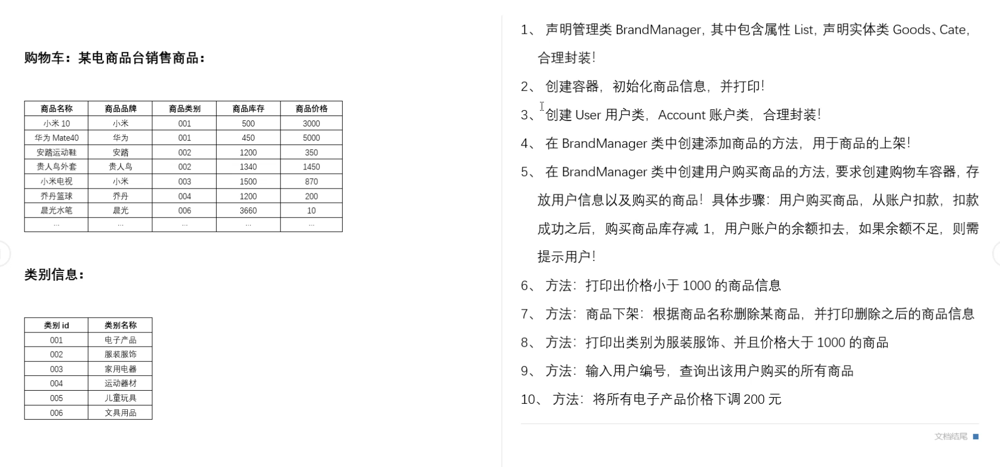

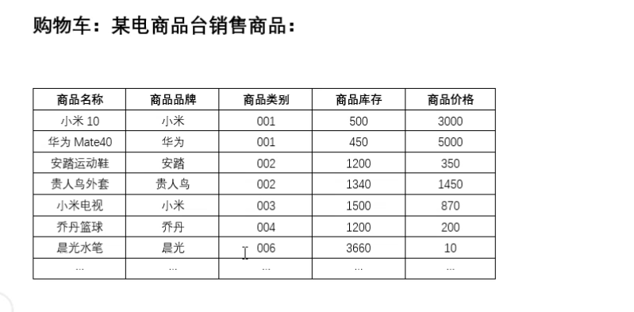

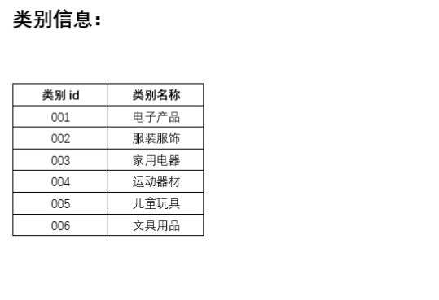

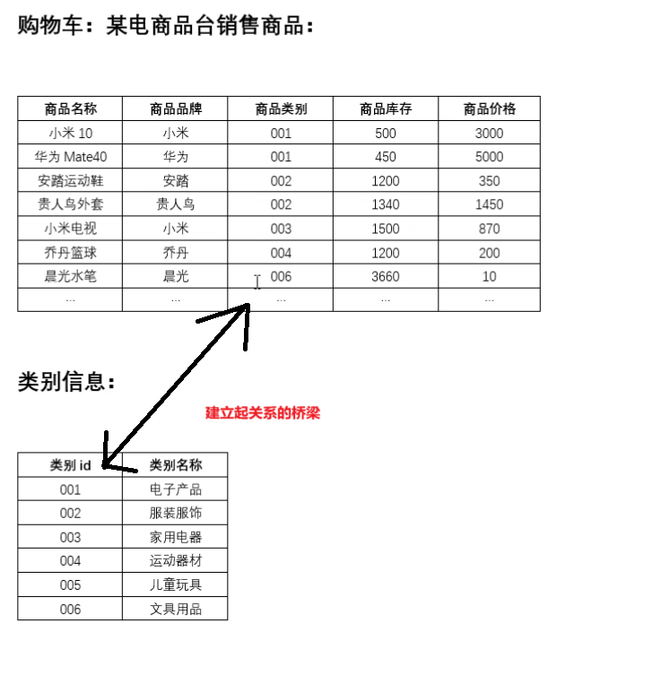

这个相较于前面的Student这个可以直接靠id编号建立联系，就不需要在一个类里面去集合另外一个类的引用

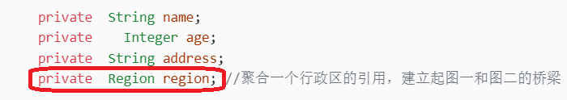

# 问题1、2

```java
package com.goods;

import jdk.nashorn.internal.ir.SplitReturn;

public class Goods {
    private  String goodsName;
    private  String brandName;
    private  String cateId;
    private  int num;
    private  double price;

    public Goods(String goodsName, String brandName, String cateId, int num, double price) {
        this.goodsName = goodsName;
        this.brandName = brandName;
        this.cateId = cateId;
        this.num = num;
        this.price = price;
    }

    public Goods() {
    }

    public String getGoodsName() {
        return goodsName;
    }

    public void setGoodsName(String goodsName) {
        this.goodsName = goodsName;
    }

    public String getBrandName() {
        return brandName;
    }

    public void setBrandName(String brandName) {
        this.brandName = brandName;
    }

    public String getCateId() {
        return cateId;
    }

    public void setCateId(String cateId) {
        this.cateId = cateId;
    }

    public int getNum() {
        return num;
    }

    public void setNum(int num) {
        this.num = num;
    }

    public double getPrice() {
        return price;
    }

    public void setPrice(double price) {
        this.price = price;
    }

    @Override
    public String toString() {
        return "Goods{" +
        "goodsName='" + goodsName + '\'' +
        ", brandName='" + brandName + '\'' +
        ", cateId='" + cateId + '\'' +
        ", num=" + num +
        ", price=" + price +
        '}';
    }
}
```

```java
package com.goods;

public class Cate {
    private  String CateId;
    public  String CateName;

    public Cate(String cateId, String cateName) {
        CateId = cateId;
        CateName = cateName;
    }

    public Cate() {
    }

    public String getCateId() {
        return CateId;
    }

    public void setCateId(String cateId) {
        CateId = cateId;
    }

    public String getCateName() {
        return CateName;
    }

    public void setCateName(String cateName) {
        CateName = cateName;
    }

    @Override
    public String toString() {
        return "Cate{" +
        "CateId='" + CateId + '\'' +
        ", CateName='" + CateName + '\'' +
        '}';
    }
}
```

```java
package com.goods;

import java.util.ArrayList;
import java.util.List;

public class GoodsManger {
    private static List<Goods> goodsList;
    private static List<Cate>  cateList;

    public GoodsManger() {
    }

    //创建一个static想让在类加载的时候商品的内容就被加载出来且只加载一次
    //但是要在static静态代码块里面去调用该类里面的方法，所有就把上面的goodsList方法转化为静态方法
    static{
        goodsList = new ArrayList<>();
        cateList = new ArrayList<>();

        //创建goods对象
        Goods  goods1 = new Goods("小米10","小米","001",500,3000);
        Goods  goods2 = new Goods("华为Mate70","华为","001",450,5000);
        Goods  goods3 = new Goods("安踏运动鞋","安踏","002",1200,350);
        Goods  goods4 = new Goods("贵人鸟外套","贵人鸟","002",1340,1450);
        Goods  goods5 = new Goods("小米电视","小米","003",1500,870);
        Goods  goods6 = new Goods("乔丹篮球","乔丹","004",1200,200);
        Goods  goods7 = new Goods("、晨光水笔","晨光","006",3660,10);

        //创建类别信息
        Cate cate1 = new Cate("001","电子产品");
        Cate cate2 = new Cate("002","服装服饰");
        Cate cate3 = new Cate("003","家用电器");
        Cate cate4 = new Cate("004","运动器械");
        Cate cate5 = new Cate("005","儿童玩具");
        Cate cate6 = new Cate("006","文具用品");

        //将所有的对象都添加到集合中
        goodsList.add(goods1);
        goodsList.add(goods2);
        goodsList.add(goods3);
        goodsList.add(goods4);
        goodsList.add(goods5);
        goodsList.add(goods6);
        goodsList.add(goods7);

        cateList.add(cate1);
        cateList.add(cate2);
        cateList.add(cate3);
        cateList.add(cate4);
        cateList.add(cate5);
        cateList.add(cate6);

    }
    //上面的变量是静态变量，想要获取他得通过静态方法去获取
    public static List<Goods> getGoodsList() {
        return goodsList;
    }

    public static void setGoodsList(List<Goods> goodsList) {
        GoodsManger.goodsList = goodsList;
    }

    public static List<Cate> getCateList() {
        return cateList;
    }

    public static void setCateList(List<Cate> cateList) {
        GoodsManger.cateList = cateList;
    }
}
//创建一个有参构造来覆盖无参构造，这样当你创建GoodsManger实例的时候你必须创建goodslist的实例进去（开发技巧）
//    public GoodsManger(List<Goods> goodsList) {
//        this.goodsList = goodsList;
//    }

//发现在静态代码块里面创建了实例，所以就不需要有参构造了
```

```java
package com.goods;

import java.util.List;

public class GoodsTest {
    public static void main(String[] args) {
        //创建管理类对象
        //        GoodsManger goodsManger = new GoodsManger();
        //其实也不用去创建实例，因为他所有方法都是静态方法

        List<Goods> goodsList = GoodsManger.getGoodsList();
        List<Cate> cateList = GoodsManger.getCateList();
        for (Goods goods : goodsList) {
            System.out.println(goods);

        }
        for (Cate cate : cateList) {
            System.out.println(cate);
        }

    }
}
```

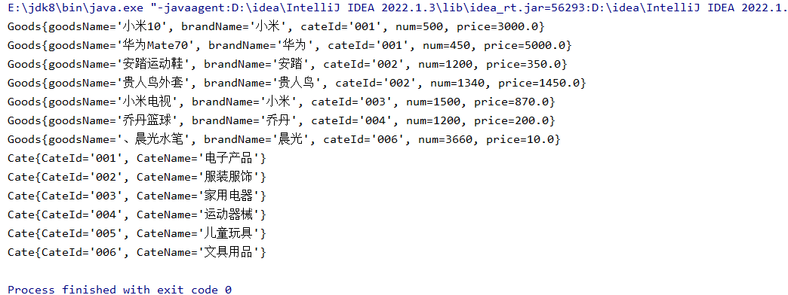

# 问题3、4

```java
package com.goods;

import java.util.List;

public class GoodsTest {
    public static void main(String[] args) {
        //创建管理类对象
        //        GoodsManger goodsManger = new GoodsManger();
        //其实也不用去创建实例，因为他所有方法都是静态方法

        //        List<Goods> goodsList = GoodsManger.getGoodsList();
        //        List<Cate> cateList = GoodsManger.getCateList();
        //        for (Goods goods : goodsList) {
        //            System.out.println(goods);
        //
        //        }
        //        for (Cate cate : cateList) {
        //            System.out.println(cate);
        //        }

        //商品的上架
        GoodsManger.addGoods(new Goods("小米13","小米","001",200,5000));
    }
}
```

```java
package com.goods;

import java.util.ArrayList;
import java.util.List;

public class GoodsManger {
    private static List<Goods> goodsList;
    private static List<Cate>  cateList;

    public GoodsManger() {
    }

    //创建一个static想让在类加载的时候商品的内容就被加载出来且只加载一次
    //但是要在static静态代码块里面去调用该类里面的方法，所有就把上面的goodsList方法转化为静态方法
    static{
        goodsList = new ArrayList<>();
        cateList = new ArrayList<>();

        //创建goods对象
        Goods  goods1 = new Goods("小米10","小米","001",500,3000);
        Goods  goods2 = new Goods("华为Mate70","华为","001",450,5000);
        Goods  goods3 = new Goods("安踏运动鞋","安踏","002",1200,350);
        Goods  goods4 = new Goods("贵人鸟外套","贵人鸟","002",1340,1450);
        Goods  goods5 = new Goods("小米电视","小米","003",1500,870);
        Goods  goods6 = new Goods("乔丹篮球","乔丹","004",1200,200);
        Goods  goods7 = new Goods("、晨光水笔","晨光","006",3660,10);

        //创建类别信息
        Cate cate1 = new Cate("001","电子产品");
        Cate cate2 = new Cate("002","服装服饰");
        Cate cate3 = new Cate("003","家用电器");
        Cate cate4 = new Cate("004","运动器械");
        Cate cate5 = new Cate("005","儿童玩具");
        Cate cate6 = new Cate("006","文具用品");

        //将所有的对象都添加到集合中
        goodsList.add(goods1);
        goodsList.add(goods2);
        goodsList.add(goods3);
        goodsList.add(goods4);
        goodsList.add(goods5);
        goodsList.add(goods6);
        goodsList.add(goods7);

        cateList.add(cate1);
        cateList.add(cate2);
        cateList.add(cate3);
        cateList.add(cate4);
        cateList.add(cate5);
        cateList.add(cate6);

    }
    //上面的变量是静态变量，想要获取他得通过静态方法去获取
    public static List<Goods> getGoodsList() {
        return goodsList;
    }

    public static void setGoodsList(List<Goods> goodsList) {
        GoodsManger.goodsList = goodsList;
    }

    public static List<Cate> getCateList() {
        return cateList;
    }

    public static void setCateList(List<Cate> cateList) {
        GoodsManger.cateList = cateList;
    }
    /*
    商品的上架
     */
    public static void addGoods(Goods goods){
        System.out.println("--------------------------------------商品的上架-------------------------------");
        goodsList.add(goods);
        System.out.println("---------------------商品上架之后的信息为-------------------------------------------");
        for (Goods g : goodsList) {
            System.out.println(g);
        }
    }
}
//创建一个有参构造来覆盖无参构造，这样当你创建GoodsManger实例的时候你必须创建goodslist的实例进去（开发技巧）
//    public GoodsManger(List<Goods> goodsList) {
//        this.goodsList = goodsList;
//    }

//发现在静态代码块里面创建了实例，所以就不需要有参构造了
```

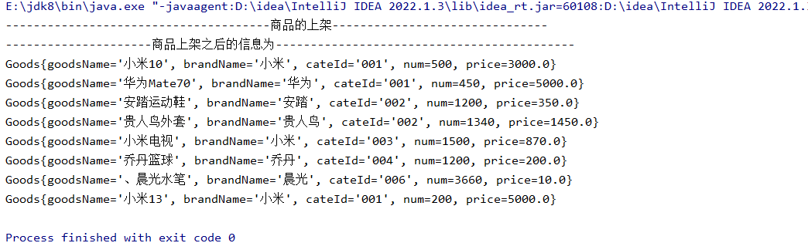

成功添加小米13商品，但是这样会感觉太死板，所以改为用scanner进行输入加入商品

```java
package com.goods;

import java.util.ArrayList;
import java.util.List;
import java.util.Scanner;

public class GoodsManger {
    private static List<Goods> goodsList;
    private static List<Cate>  cateList;

    private  static Scanner scanner = new Scanner(System.in);

    public GoodsManger() {
    }

    //创建一个static想让在类加载的时候商品的内容就被加载出来且只加载一次
    //但是要在static静态代码块里面去调用该类里面的方法，所有就把上面的goodsList方法转化为静态方法
    static{
        goodsList = new ArrayList<>();
        cateList = new ArrayList<>();

        //创建goods对象
        Goods  goods1 = new Goods("小米10","小米","001",500,3000);
        Goods  goods2 = new Goods("华为Mate70","华为","001",450,5000);
        Goods  goods3 = new Goods("安踏运动鞋","安踏","002",1200,350);
        Goods  goods4 = new Goods("贵人鸟外套","贵人鸟","002",1340,1450);
        Goods  goods5 = new Goods("小米电视","小米","003",1500,870);
        Goods  goods6 = new Goods("乔丹篮球","乔丹","004",1200,200);
        Goods  goods7 = new Goods("、晨光水笔","晨光","006",3660,10);

        //创建类别信息
        Cate cate1 = new Cate("001","电子产品");
        Cate cate2 = new Cate("002","服装服饰");
        Cate cate3 = new Cate("003","家用电器");
        Cate cate4 = new Cate("004","运动器械");
        Cate cate5 = new Cate("005","儿童玩具");
        Cate cate6 = new Cate("006","文具用品");

        //将所有的对象都添加到集合中
        goodsList.add(goods1);
        goodsList.add(goods2);
        goodsList.add(goods3);
        goodsList.add(goods4);
        goodsList.add(goods5);
        goodsList.add(goods6);
        goodsList.add(goods7);

        cateList.add(cate1);
        cateList.add(cate2);
        cateList.add(cate3);
        cateList.add(cate4);
        cateList.add(cate5);
        cateList.add(cate6);

    }
    //上面的变量是静态变量，想要获取他得通过静态方法去获取
    public static List<Goods> getGoodsList() {
        return goodsList;
    }

    public static void setGoodsList(List<Goods> goodsList) {
        GoodsManger.goodsList = goodsList;
    }

    public static List<Cate> getCateList() {
        return cateList;
    }

    public static void setCateList(List<Cate> cateList) {
        GoodsManger.cateList = cateList;
    }
    /*
   商品的上架
    */
    public static void addGoods(){
        System.out.println("--------------------------------------商品的上架-------------------------------");

        //创建一个goods对象
        Goods goods = new Goods();

        System.out.println("请输入商品的名称：");
        String goodName  = scanner.next();
        goods.setGoodsName(goodName);

        System.out.println("请输入商品的品牌：");
        String brandName  = scanner.next();
        goods.setGoodsName(brandName);

        System.out.println("请选择分类：");
        //  去遍历一下
        for (Cate cate : cateList) {
            System.out.println(cate.getCateId() +":" + cate.getCateName());
            String cateId = scanner.next();

            //写一个死循环，直到输对为止
            boolean flag = false;
            while (true){
                for (Cate cate1 : cateList) {
                    if (cateId.equals(cate.getCateId())){
                        goods.setCateId(cate.getCateId());//将cateList里面的Id set给goods里面的Id
                        //真的set进去了 跳出循环，跳出for循环,并不是while循环
                         flag = true;
                    }
                }
                if (flag){ //如果是true则实行break，跳出while循环
                    break;
                }else {
                    System.out.println("编号不存在，请重新选择！！");
                    String cateId2 = scanner.next();
                    continue;
                }
            }
        }

        System.out.println("请输入商品的库存：");
        int num = scanner.nextInt();
        goods.setNum(num);

        System.out.println("请输入商品的价格：");
        int price = scanner.nextInt();
        goods.setPrice(price);

        //将goods添加到集合中
        goodsList.add(goods);

        System.out.println("添加之后的商品信息为：");
        for (Goods goods1 : goodsList) {

            System.out.println(goods1);
        }

    }
}
```

```java
package com.goods;

import java.util.List;

public class GoodsTest {
    public static void main(String[] args) {

        GoodsManger.addGoods();
    }
}
```

# 问题5

```java
package com.goods;

import com.sun.scenario.effect.impl.sw.sse.SSEBlend_SRC_OUTPeer;

import java.text.SimpleDateFormat;
import java.util.*;

public class GoodsManger {
    private static List<Goods> goodsList;
    private static List<Cate> cateList;

    private static List<Order> shoppingList = new ArrayList<>();

    private static Scanner scanner = new Scanner(System.in);

    public GoodsManger() {
    }

    //创建一个static想让在类加载的时候商品的内容就被加载出来且只加载一次
    //但是要在static静态代码块里面去调用该类里面的方法，所有就把上面的goodsList方法转化为静态方法
    static {
        goodsList = new ArrayList<>();
        cateList = new ArrayList<>();

        //创建goods对象
        Goods goods1 = new Goods("小米10", "小米", "001", 500, 3000);
        Goods goods2 = new Goods("华为Mate70", "华为", "001", 450, 5000);
        Goods goods3 = new Goods("安踏运动鞋", "安踏", "002", 1200, 350);
        Goods goods4 = new Goods("贵人鸟外套", "贵人鸟", "002", 1340, 1450);
        Goods goods5 = new Goods("小米电视", "小米", "003", 1500, 870);
        Goods goods6 = new Goods("乔丹篮球", "乔丹", "004", 1200, 200);
        Goods goods7 = new Goods("、晨光水笔", "晨光", "006", 3660, 10);

        //创建类别信息
        Cate cate1 = new Cate("001", "电子产品");
        Cate cate2 = new Cate("002", "服装服饰");
        Cate cate3 = new Cate("003", "家用电器");
        Cate cate4 = new Cate("004", "运动器械");
        Cate cate5 = new Cate("005", "儿童玩具");
        Cate cate6 = new Cate("006", "文具用品");

        //将所有的对象都添加到集合中
        goodsList.add(goods1);
        goodsList.add(goods2);
        goodsList.add(goods3);
        goodsList.add(goods4);
        goodsList.add(goods5);
        goodsList.add(goods6);
        goodsList.add(goods7);

        cateList.add(cate1);
        cateList.add(cate2);
        cateList.add(cate3);
        cateList.add(cate4);
        cateList.add(cate5);
        cateList.add(cate6);

    }

    //上面的变量是静态变量，想要获取他得通过静态方法去获取
    public static List<Goods> getGoodsList() {
        return goodsList;
    }

    public static void setGoodsList(List<Goods> goodsList) {
        GoodsManger.goodsList = goodsList;
    }

    public static List<Cate> getCateList() {
        return cateList;
    }

    public static void setCateList(List<Cate> cateList) {
        GoodsManger.cateList = cateList;
    }

    /*
   购物
    */
    public static void shopping(User user) {
        System.out.println("--------------------------------------欢迎" + user.getUsername() + "购物----------------------------------");

        System.out.println("请选择你需要购买的商品名称：");
        for (Goods goods : goodsList) {
            System.out.println("商品：" + goods.getGoodsName() + "    " + "价格：" + goods.getPrice());

        }
        String goodsName = scanner.next();
        boolean flag = false;
        Goods g = null;
        while (true) {
            for (Goods goods : goodsList) {
                if (goods.getGoodsName().equals(goodsName)) {
                    flag = true;
                    g = goods;
                    System.out.println("你需要购买的商品为： " + goodsName + "价格为：" + goods.getCateId());

                }
            }
            if (flag) {
                break;
            } else {
                System.out.println("你输入的商品不存在，请重新输入！");
                goodsName = scanner.next();
                continue;
            }

        }

         //创建订单编号
         Order order = new Order();

        //1.生成一个订单编号 唯一 性
            String orderId = new SimpleDateFormat("yyyyMMhhss").format(new Date());
            order.setOrderId(orderId);

            //2.将所有信息添加到购物车集合中
           order.setUser(user);
           order.setAccount(user.getAccount());
           order.setGoods(g);

           shoppingList.add(order);

        System.out.println("-----------------------------------购物车信息--------------------------------");
        for (Order order1 : shoppingList) {
            System.out.println(order1);
        }

            System.out.println("是否确定要购买（yes/no）");
            String yes = scanner.next();
            if (yes.equals("yes")) {

            //3.扣款
            Account account = user.getAccount();
            if (g.getPrice()>account.getBalance()){
                System.out.println("余额不足");
            }else{

                //库存-1
                for (Goods goods : goodsList) {
                    if (goodsName.equals(goods.getBrandName())){
                      g.setNum(g.getNum() - 1);
                    }
                }

                account.setBalance(account.getBalance() - g.getPrice());
                System.out.println("扣款成功，你的账户余额为： " + account.getBalance());

                System.out.println("------------------------购买之后的商品信息---------------------");
                for (Goods goods : goodsList) {
                    System.out.println(goods);
                }
            }
        } else {

            System.out.println("欢迎下次光临！！！");
        }
    }
}
```

```java
package com.goods;

import com.sun.scenario.effect.impl.sw.sse.SSEBlend_SRC_OUTPeer;

import java.text.SimpleDateFormat;
import java.util.*;

public class leDateFormat;
import java.util.*;

public class GoodsManger  {
    private static List<Goods> goodsList;
    private static List<Cate> cateList;

    private static List<Order> shoppingList = new ArrayList<>();

    private static Scanner scanner = new Scanner(System.in);

    public GoodsManger() {
    }

    //创建一个static想让在类加载的时候商品的内容就被加载出来且只加载一次
    //但是要在static静态代码块里面去调用该类里面的方法，所有就把上面的goodsList方法转化为静态方法
    static {
        goodsList = new ArrayList<>();
        cateList = new ArrayList<>();

        //创建goods对象
        Goods goods1 = new Goods("小米10", "小米", "001", 500, 3000);
        Goods goods2 = new Goods("华为Mate70", "华为", "001", 450, 5000);
        Goods goods3 = new Goods("安踏运动鞋", "安踏", "002", 1200, 350);
        Goods goods4 = new Goods("贵人鸟外套", "贵人鸟", "002", 1340, 1450);
        Goods goods5 = new Goods("小米电视", "小米", "003", 1500, 870);
        Goods goods6 = new Goods("乔丹篮球", "乔丹", "004", 1200, 200);
        Goods goods7 = new Goods("、晨光水笔", "晨光", "006", 3660, 10);

        //创建类别信息
        Cate cate1 = new Cate("001", "电子产品");
        Cate cate2 = new Cate("002", "服装服饰");
        Cate cate3 = new Cate("003", "家用电器");
        Cate cate4 = new Cate("004", "运动器械");
        Cate cate5 = new Cate("005", "儿童玩具");
        Cate cate6 = new Cate("006", "文具用品");

        //将所有的对象都添加到集合中
        goodsList.add(goods1);
        goodsList.add(goods2);
        goodsList.add(goods3);
        goodsList.add(goods4);
        goodsList.add(goods5);
        goodsList.add(goods6);
        goodsList.add(goods7);

        cateList.add(cate1);
        cateList.add(cate2);
        cateList.add(cate3);
        cateList.add(cate4);
        cateList.add(cate5);
        cateList.add(cate6);

    }

    //上面的变量是静态变量，想要获取他得通过静态方法去获取
    public static List<Goods> getGoodsList() {
        return goodsList;
    }

    public static void setGoodsList(List<Goods> goodsList) {
        GoodsManger.goodsList = goodsList;
    }

    public static List<Cate> getCateList() {
        return cateList;
    }

    public static void setCateList(List<Cate> cateList) {
        GoodsManger.cateList = cateList;
    }

    /*
   购物
    */
    public static void shopping(User user) {
        System.out.println("--------------------------------------欢迎" + user.getUsername() + "购物----------------------------------");
        while (true) {
            System.out.println("请选择你需要购买的商品名称：");
            for (Goods goods : goodsList) {
                System.out.println("商品：" + goods.getGoodsName() + "    " + "价格：" + goods.getPrice());

            }
            String goodsName = scanner.next();
            boolean flag = false;
            Goods g = null;
            while (true) {
                for (Goods goods : goodsList) {
                    if (goods.getGoodsName().equals(goodsName)) {
                        flag = true;
                        g = goods;
                        System.out.println("你需要购买的商品为： " + goodsName + "价格为：" + goods.getCateId());

                    }
                }
                if (flag) {
                    break;
                } else {
                    System.out.println("你输入的商品不存在，请重新输入！");
                    goodsName = scanner.next();
                    continue;
                }

            }

            //创建订单编号
            Order order = new Order();

            //1.生成一个订单编号 唯一 性
            String orderId = new SimpleDateFormat("yyyyMMhhss").format(new Date());
            order.setOrderId(orderId);

            //2.将所有信息添加到购物车集合中
            order.setUser(user);

            order.setGoods(g);

            shoppingList.add(order);

            System.out.println("-----------------------------------购物车信息--------------------------------");
            for (Order order1 : shoppingList) {
                System.out.println(order1);
            }

            System.out.println("是否确定要购买（yes/no）");
            String yes = scanner.next();
            if (yes.equals("yes")) {

                //3.扣款
                Account account = user.getAccount();
                if (g.getPrice() > account.getBalance()) {
                    System.out.println("余额不足");
                    System.out.println("是否重新选择商品(yes/no)");
                    yes = scanner.next();
                    if (yes.equals("yes")) {
                        continue;
                    } else {
                        System.out.println("欢迎下次光临！！");
                        break;
                    }
                } else {

                    //库存-1
                    for (Goods goods : goodsList) {
                        if (goodsName.equals(goods.getBrandName())) {
                            g.setNum(g.getNum() - 1);
                        }
                    }
                    //购物车信息同步
                    for (Order o : shoppingList) {
                        if (o.getGoods().getGoodsName().equals(g.getGoodsName())) {
                            o.getGoods().setNum(o.getGoods().getNum() - 1 );
                        }

                        }
                    account.setBalance(account.getBalance() - g.getPrice());
                    //修改订单标识
                    for (Order order1 : shoppingList) {
                        if (order1.getOrderId().equals(orderId)) {
                            order1.setPay(true); //标识已经付款
                        }
                    }

                    System.out.println("扣款成功，你的账户余额为： " + account.getBalance());

                    System.out.println("------------------------购买之后的订单信息---------------------");
                    for (Goods goods : goodsList) {
                        System.out.println(goods);
                    }
                    System.out.println("是否再次购物(yes/no)");
                    yes = scanner.next();
                    if (yes.equals("yes")) {
                        continue;
                    } else {
                        System.out.println("欢迎下次光临！！！");
                        break;
                    }
                }
            } else {

                System.out.println("欢迎下次光临！！！");
            }
        }
    }
}
```

### 这个存在问题，每次删除的是两个数量不是一个数量

# 方法：打印出价格小于1000的商品信息

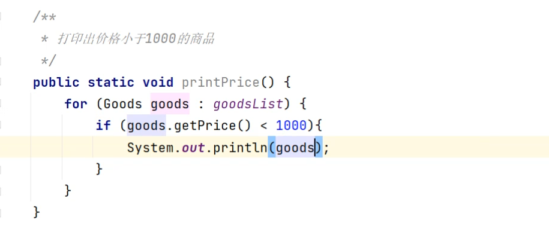

  
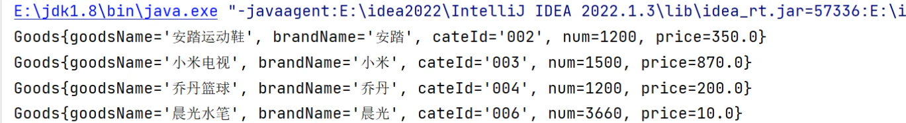

方法：商品下架：根据商品名称删除某商品，并打印删除之后的商品信息

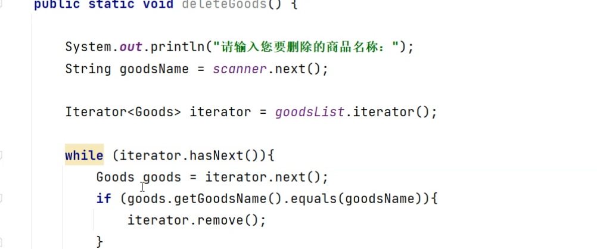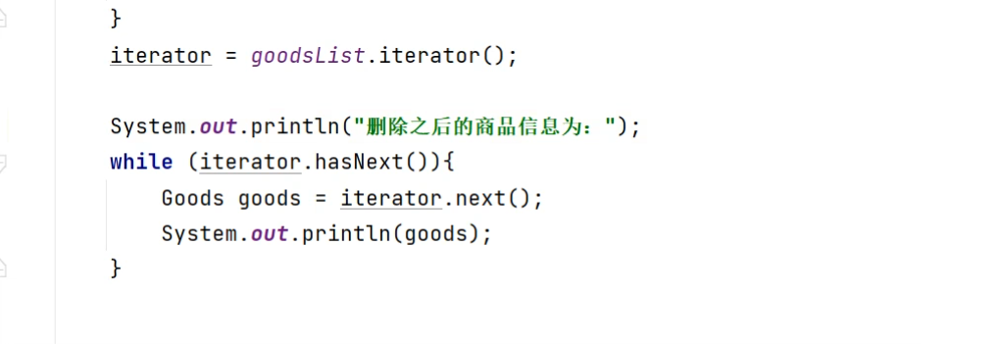


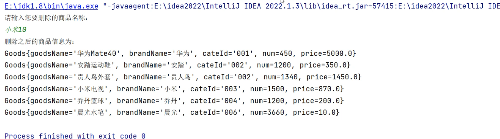

# 方法：打印出价格大于1000的服装服饰

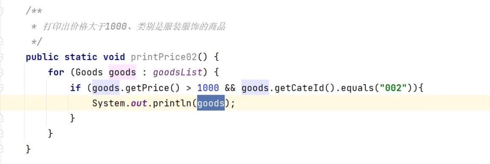


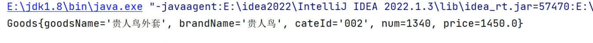

# 方法：输入用户编号，查询该用户购买的所有商品

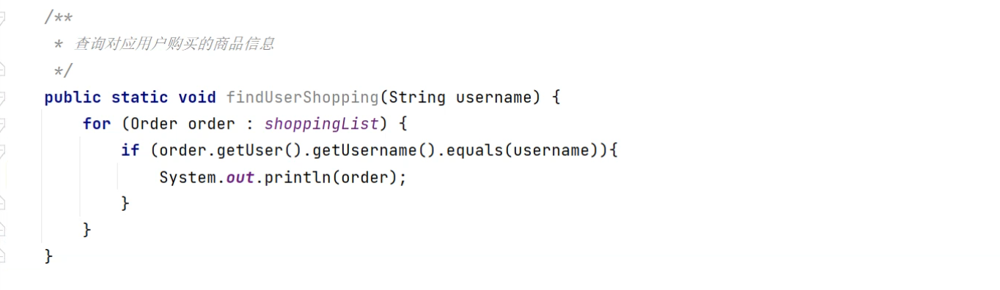

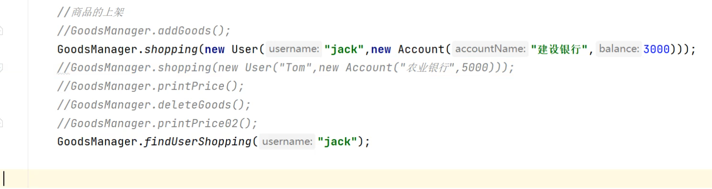

# 方法：将所有电子产品的价格下调200元

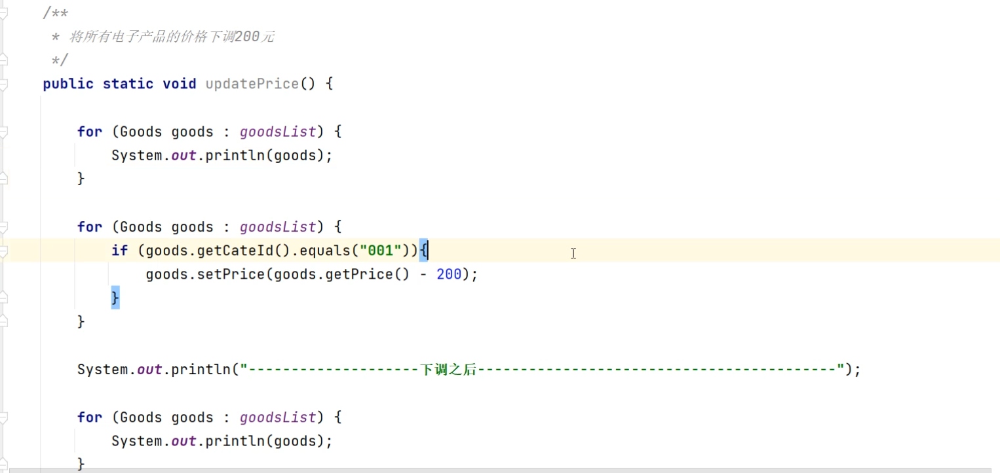


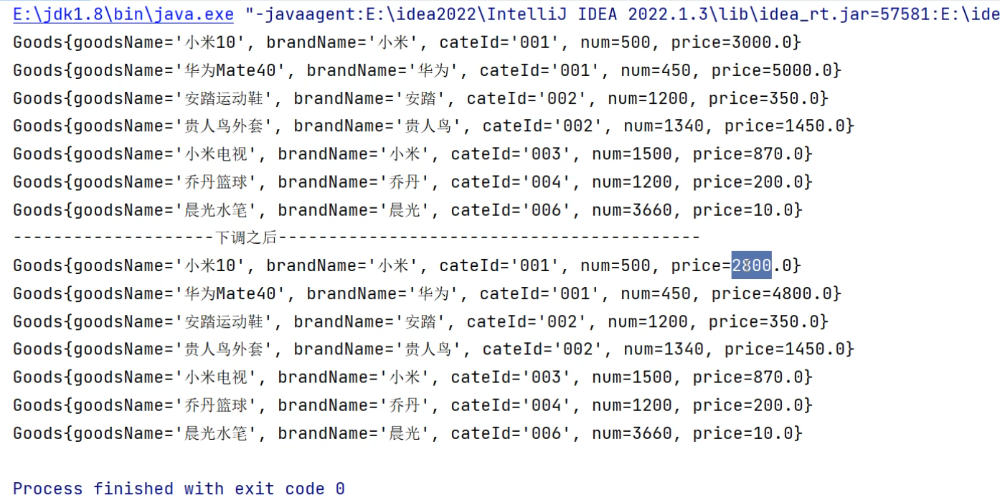
