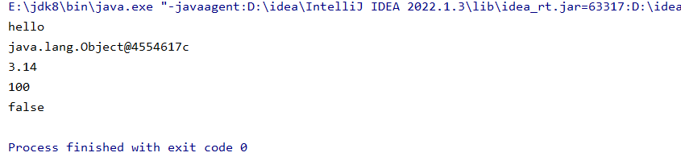
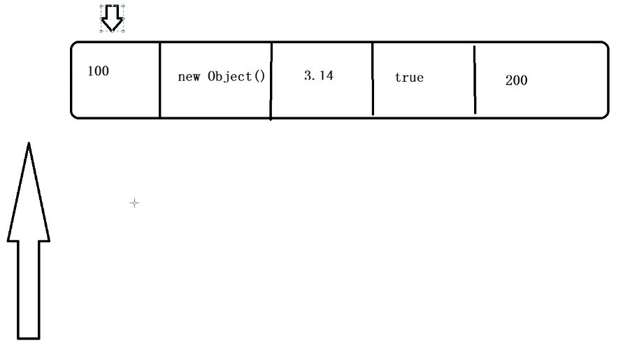
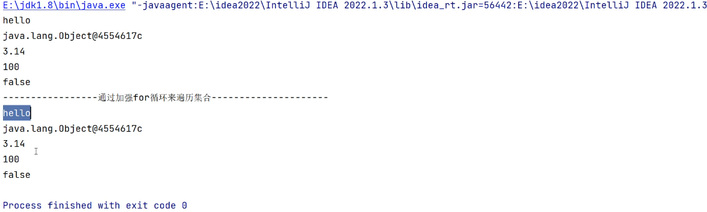

### collection上面还有一个超级父接口Iterable。作用是遍历集合中的元素，集合就是容器，我们会在容器中去添加很多的元素

```java
package com.collection;

import java.util.ArrayList;
import java.util.Collection;
import java.util.Iterator;

public class CollectionTest02 {

    public static void main(String[] args) {
        Collection collection = new ArrayList();

        //往集合中添加元素
        collection.add("hello");
        collection.add(new Object());
        collection.add(3.14);
        collection.add(100);
        collection.add(false);

        //对集合中的元素进行一个遍历
        //获取迭代器对象
        Iterator iterator = collection.iterator();

        //hasNext判断这个集合内是否存在下一个元素，如果存在返回ture，
        //当判断到最后一个元素，后面没有元素返回false，跳出循环
        while (iterator.hasNext()){

            Object data = iterator.next();//当前遍历的数据
            System.out.println(data);

        }

    }

}
```



# 图示：



### 上面小箭头表示hasnext(),判断是否存在下一个元素，有的话下面箭头移动至下一个元素，true的话进入while循环，再去调用Next方法，对指向的元素进行获取，返回的值是一个Object

```java
package com.collection;

import java.util.ArrayList;
import java.util.Collection;
import java.util.Iterator;

public class CollectionTest02 {

    public static void main(String[] args) {
        Collection collection = new ArrayList();

        //往集合中添加元素
        collection.add("hello");
        collection.add(new Object());
        collection.add(3.14);
        collection.add(100);
        collection.add(false);

        //对集合中的元素进行一个遍历
        //获取迭代器对象，目的是调用它含有的hasNext和next方法
        Iterator iterator = collection.iterator();

        //hasNext判断这个集合内是否存在下一个元素，如果存在返回ture。当判断到最后一个元素，后面没有元素返回false，跳出循环
        while (iterator.hasNext()){

            Object data = iterator.next();//当前遍历的数据
            System.out.println(data);

            System.out.println("-------------通过加强for循环来进行遍历--------------------");
            //加强for循环也可以遍历
            for (Object obj :collection){
                System.out.println(obj);
            }

        }

    }

}
```


