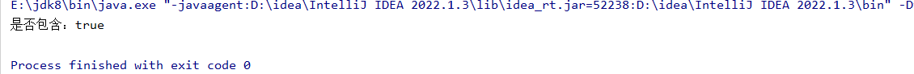
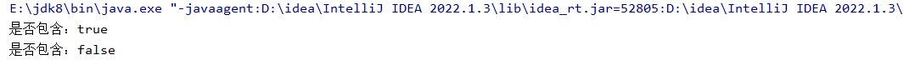

```java
package com.collection;

import java.util.ArrayList;

public class ArrayListTest05 {
    public static void main(String[] args) {

        //创建一个List集合
        ArrayList<String> stringArrayList = new ArrayList<>();

        //定义String类型的数据
        String str1 = "hello world";
        String str2 = "hello world";

        //将str1添加到集合中
        stringArrayList.add(str1);
        boolean contains = stringArrayList.contains(str2);

        System.out.println("是否包含：" + contains);
    }
}
```



```java
package com.collection;

import java.util.Objects;

public class Teacher {

    private int id;
    private String name;

    public Teacher(int id, String name) {
        this.id = id;
        this.name = name;
    }

    public Teacher() {
    }

    public int getId() {
        return id;
    }

    public void setId(int id) {
        this.id = id;
    }

    public String getName() {
        return name;
    }

    public void setName(String name) {
        this.name = name;
    }
    @Override
    public String toString() {
        return "Teacher{" +
        "id=" + id +
        ", name='" + name + '\'' +
        '}';
    }
}
```

```java
package com.collection;

import java.util.ArrayList;

public class ArrayListTest05 {
    public static void main(String[] args) {

        //创建一个List集合
        ArrayList<String> stringArrayList = new ArrayList<>();

        //定义String类型的数据
        String str1 = "hello world";
        String str2 = "hello world";

        //将str1添加到集合中
        stringArrayList.add(str1);
        boolean contains = stringArrayList.contains(str2);

        System.out.println("是否包含：" + contains);

        //创建集合
        ArrayList<Teacher> teachers = new ArrayList<>();

        //创建Teacher对象
        Teacher teacher1 = new Teacher(1001, "jack");
        Teacher teacher2 = new Teacher(1001, "jack");

        //添加到集合中
        teachers.add(teacher1);
        boolean contains1 = teachers.contains(teacher2);
        System.out.println("是否包含：" + contains1);
    }

}
```



equals默认情况下比较的是内存地址，但是在字符串里比较的是内容。如果想让引用数据类型去比较内容，可以重写他的方法

```java
package com.collection;

public class Teacher {

    private int id;
    private String name;

    public Teacher(int id, String name) {
        this.id = id;
        this.name = name;
    }

    public Teacher() {
    }

    public int getId() {
        return id;
    }

    public void setId(int id) {
        this.id = id;
    }

    public String getName() {
        return name;
    }

    public void setName(String name) {
        this.name = name;
    }

    //Teacher默认情况下会继承Object，里面有equals方法，重新写teacher里面的equals就相当于对该方法进行重写
    public boolean equals(Object obj) {

        if (obj instanceof Teacher) {
            Teacher teacher = (Teacher) obj;
            if (teacher.getId() == this.id && teacher.getName().equals(this.name)) {
                return true;
            } else {
                return false;
            }
        } else {
            return  false;
        }

    }
    @Override
    public String toString() {
        return "Teacher{" +
        "id=" + id +
        ", name='" + name + '\'' +
        '}';
    }
}
```

也可以快捷键直接生成equals方法

```java
@Override
public boolean equals(Object o) {
if (this == o) return true;
if (o == null || getClass() != o.getClass()) return false;
Teacher teacher = (Teacher) o;
return id == teacher.id && Objects.equals(name, teacher.name);
}
```
