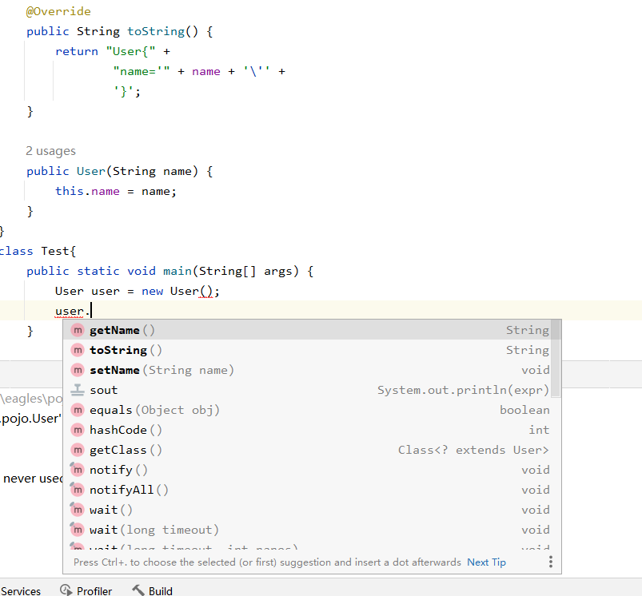

简介：

1.Object类是所有java类的根父类（超类）

2.如果在类的声明中未使用extends关键字指明其父类，则默认父类为java.lang.Object

3.Object类中的功能（属性、方法）就具有通用性

4.属性：无

方法：equals（）/toString（）/getClass（）/hashCode（）/clone（）/finalize（）、wait（）、notify（）、notifyAll（）

5.Object类只声明了一个空参的构造器。

