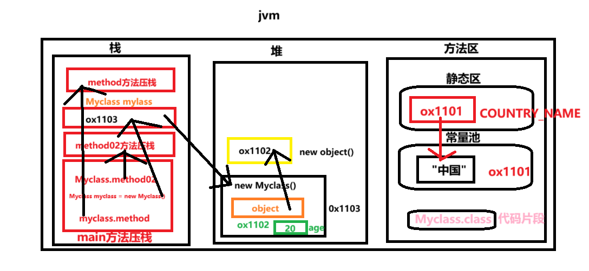

### 栈内存：

连续的储存空间，遵循后进先出的原则

当线程进入一个java方法函数的时候，就会在当前线程的栈里压入一个栈帧，用于保存当前线程的状态(参数、局部变量、中间计算过程和其他数据)，当退出函数方法时，修改栈指针就可以把栈中的内容销毁。

### 堆内存：

不连续的空间，唯一的目的就是用于存放对象实例。

初始化的对象，成员变量（那种非static的变量），字符串常量池所有的对象实例和数组都要在堆上分配。

### 方法区：

方法区中包含的都是在整个程序中永远唯一的元素，如class、static变量等静态属性（1.类的代码信息 2.静态变量和方法 3.常量池（字符串常量等，具有共享机制））

### 总结：

总的来说，堆内存保存对象的真实信息，只要是new出来的对象都在堆内存；栈内存保存的是一块堆内存的地址（基本数据类型是一个值 int age = 20），通过该地址可以找到对应的真实对象数据；方法区是保存静态属性。

# 内存分析：

```java
package com.eagles.demo;

import com.eagles.test.MyClass;

public class Myclass {
    private  Object object = new Object();
    private  int age;
    private  static final String COUNTRY_NAME = "中国";

    public void method(){

        String name = "jack" ;

    }
    public static void method02(){

    }

    public static void main(String[] args) {
        //静态变量的调用可以用当前类直接点
        Myclass.method02();

        //创建当前类对象
        //当前类的方法得创建当前类的对象，用对象的引用去.方法
        Myclass myclass = new Myclass();
        myclass.method();
    }
}
```

#### 内存图：


