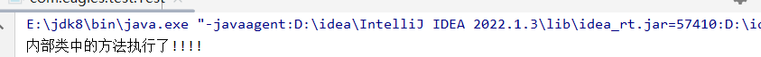

# 内部类：

#### 在java的内部创造另一个类

```java
package com.eagles.test;

public class A {

    class B{

        public void getFun(){
            System.out.println("内部类中的方法执行了!!!!");
        }
    }
}
```

```java
package com.eagles.test;

public class Test {
    public static void main(String[] args) {
        //创建内部类的对象
        A.B ab = new A().new B();//他会在堆中去开辟两份空间
        ab.getFun();
```



# 匿名内部类：

#### 就是可以创建一个类的匿名对象：

```java
package com.eagles.test;

public class Test {
    public static void main(String[] args) {

        //调用
        Myclass04 myclass04 = new Myclass04();
        MyInterface04 myInterface = Myclass04.getMyInterface();//返回值是接口MyInterface04
        myInterface.getMethod();

        //需要传一个接口所对应的对象
        myclass04.getInterface05(new MyInterface04() {
            @Override
            public void getMethod() {
                System.out.println("1234");
            }
        });

    }
}
class Myclass04{
    public static MyInterface04 getMyInterface(){
        //当前这个的返回值是一个接口
        return new MyInterface04() {
            //它new的这个接口不是说去创建接口对象，它创建的是这个接口所对应的匿名子类对象，
            // 接口本身不能实例化对象但是你可以通过匿名内部类去创建它的子类实例（这个子类没有给他命名所有说他是匿名的），它这个子类并不是真实存在的
            //在匿名内部类里面对接口的方法进行重写
            @Override
            public void getMethod() {

                System.out.println("方法重写了!!!!");

            }
        };
        // 这个方法的返回值是一个接口，那return的肯定是它的一个实例，
        // 但是在java里面他有一种就是语法定义形式叫匿名内部类 形式就是：new  接口/父类
    }
    public  void getInterface05(MyInterface04 myInterface04){

        myInterface04.getMethod();
    }
}

interface  MyInterface04{

    void getMethod();

}
```

标识的这一部分就是MyInterface04的匿名子类实例，这是一种方法。

还有就是创建一个子类，然后去实现这个接口，这是第二种方法。


