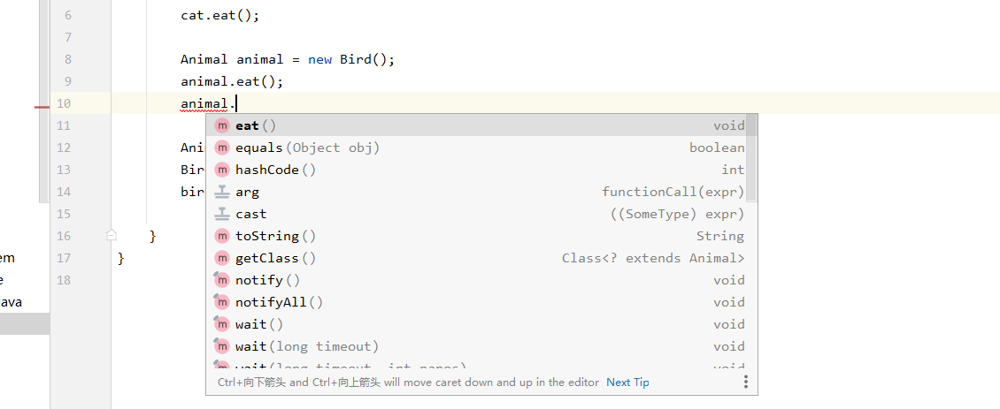
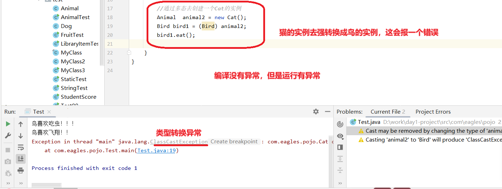

# 概念：

多态是同一个行为具有多个不同表现形式或形态功能

1.什么是多态性：父类的引用指向子类的对象（或子类的对象赋值给父类的引用）

- 一个对象的实际类型是确定的，但可以指向对象的引用可以很多
- 多态是方法的多态，没有属性的多态
- 多态的存在条件

1.有继承关系

2.子类重写父类的方法

3.父类的引用指向子类的对象

2.多态的使用：虚拟方法调用

有了对象多态性以后，我们在编译期，只能调用父类声明的方法。但在执行期实际执行的是子类重写父类的方法。\*\*简称：编译看左边，运行看右边。\*\*

若编译时类型和运行时类型不一致，就出现了对象的多态性（Polymorphism）

多态的情况下：

1.看左边：看的是父类的引用（父类中是否存在子类特有的方法）

2.看右边：看的是子类的对象（实际运行的是子类重写父类的方法）

3.作用：提高代码的扩展性，增强代码对其他类的影响降到最低

4.优点：

1. 消除类型之间的耦合性
2. 可替换性
3. 可扩展性
4. 接口性
5. 灵活性
6. 简化性

```java
package com.eagles.pojo;

public class Animal {
    public void eat(){
        System.out.println("所有动物都有吃的特性！");
    }
}
```

```java
package com.eagles.pojo;

public class Cat extends Animal {
    @Override
    public void eat() {
        //  super.eat(); 默认存在这一行，表示调用父类吃的方法，删掉就可以重写Cat类吃的方法
        System.out.println("猫喜欢吃鱼！！！");
    }
}
```

```java
package com.eagles.pojo;

public class Test {
    public static void main(String[] args) {
        Cat cat = new Cat();
        cat.eat();
       
        //父类的引用接收子类的对象
        //编译的时候看左边，运行的时候看右边
        
 //向上转型     
        //通过多态来创建Bird对象
        Animal animal = new Bird();
        animal.eat();  //此处输出的是Bird的eat方法

  //向下转型
        //使用场景：当你需要调用子类私有方法的时候，需要向下转型
        Animal animal1 = new Bird();
        Bird bird = (Bird) animal1;   
        bird.eat();
        bird.fly();
           //double d = 100.2
   类似于  //int i = (int)d;    强制转换
           //teacher.study();    
    }
}
```

```java
package com.eagles.pojo;

public class Bird extends Animal{
    @Override
    public void eat() {
        System.out.println("鸟喜欢吃虫！！！");
    }

    public void fly(){
        System.out.println("鸟喜欢飞翔！！");
    }
}
```

#### 注意：

fly是鸟特有的方法，Animal里面没有该方法，所以将animal强转换成Bird，再用Bird去.鸟方法。



#### 难点：

```java
package com.eagles.pojo;

public class Test {
    public static void main(String[] args) {
        Cat cat = new Cat();
        cat.eat();

        Animal animal = new Bird();
        animal.eat();

        //通过多态去创建一个Cat的实例
        Animal  animal2 = new Cat();
        Bird bird1 = (Bird) animal2;
        bird1.eat();

    }
}
```


