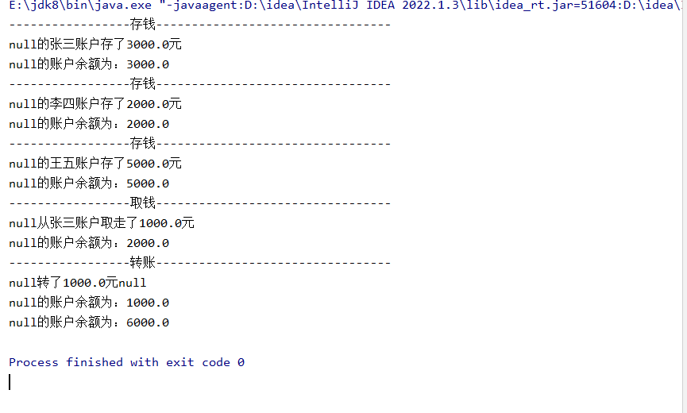

# 需求：

通过抽象类+多态完成银行转账的案例  
 -张三往建设银行存款3000元

-李四往农业银行存款2000元

-王五往招商银行存款5000元

-张三从建设银行取款1000元

-李四转账1000元给王五

多态三条件：

-有类的继承

-方法的重写

-父类的引用指向子类的对象

```java
package com.eagles.bank;

public abstract class  Bank {
    //银行名称
    private String BankName;
    //持卡人姓名
    private  String uername;
    //账户余额
    private  double balance;

    public Bank(String bankName) {
        BankName = bankName;
    }

    public Bank() {
    }

    //存钱的方法
    public  void deposit(double money){

        System.out.println("-----------------存钱---------------------------------");

        this.setBalance(this.getBalance() + money);
        System.out.println(this.getUername() + "的" + this.BankName + "账户存了" + money + "元");
        System.out.println(this.getUername() + "的账户余额为：" +this.getBalance() );
    }

    //转账的方法
    /*
    bank1可以看做转账账户
    bank2可以看做被转账账户
    要符合逻辑：
    转账的钱不能大于余额
    取款的钱不能大于余额
     */
    public  void tansfer(Bank bank1,Bank bank2,double money){

        System.out.println("-----------------转账---------------------------------");

        if(money > bank1.getBalance()){
            System.out.println("余额不足！");
        }else{
            //转账账户扣钱
            bank1.setBalance(bank1.getBalance() - money);
            //被转账账户价钱
            bank2.setBalance(bank2.getBalance() + money);

            System.out.println(bank1.getUername()+"转了"+money+"元"+bank2.getUername());
            System.out.println(bank1.getUername()+"的账户余额为："+bank1.getBalance());
            System.out.println(bank2.getUername()+"的账户余额为："+bank2.getBalance());

        }

    }
    //取钱的方法
    public  void getMoney(double money){

        System.out.println("-----------------取钱---------------------------------");
        if(money >this.getBalance()){
            System.out.println("余额不足");
        }else{
            this.setBalance(this.getBalance() - money);
            System.out.println(this.getUername() + "从" + this.BankName + "账户取走了" + money + "元");
            System.out.println(this.getUername() + "的账户余额为：" +this.getBalance() );
        }

    }

    public String getBankName() {
        return BankName;
    }

    public void setBankName(String bankName) {
        BankName = bankName;
    }

    public String getUername() {
        return uername;
    }

    public void setUername(String uername) {
        this.uername = uername;
    }

    public double getBalance() {
        return balance;
    }

    public void setBalance(double balance) {
        this.balance = balance;
    }
}
```

```java
package com.eagles.bank;

public class ZsBank extends Bank{

    public static final String BANK_NAME = "招商银行";

    public ZsBank() {
        super(BANK_NAME);
    }
}
```

```java
package com.eagles.bank;

public class NyBank extends  Bank{
    public static final String BANK_NAME = "农业银行";

    public NyBank() {
        super(BANK_NAME);
    }

}
```

```java
package com.eagles.bank;

public class JsBank extends Bank {
    public static final String BANK_NAME = "建设银行";

    public JsBank() {
        super(BANK_NAME);
    }
}
```

```java
package com.eagles.bank;

public class Test {
    public static void main(String[] args) {
        //创建张三的账户对象
        Bank bank1 = new JsBank();
        bank1.setBankName("张三");
        bank1.setBalance(0);

        //创建李四的账户对象
        Bank bank2 = new NyBank();
        bank2.setBankName("李四");
        bank2.setBalance(0);

        //创建王五的账户对象
        Bank bank3 = new ZsBank();
        bank3.setBankName("王五");
        bank3.setBalance(0);

        //调用存钱的函数
        bank1.deposit(3000);
        bank2.deposit(2000);
        bank3.deposit(5000);

        //取款
        bank1.getMoney(1000);

        //转账、
        bank2.tansfer(bank2,bank3,1000);
    }
}
```

# 运行结果：


