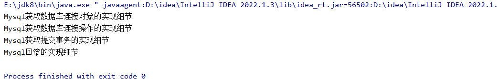

# 案例：

-理解成是一套规范，一套标准（在以后开发过程中会大量的使用到接口+多态）

-JDBC（java语言连接数据库），不管是数据库，只要是java语言链接数据库都需要这些方法

-获取链接对象的方法

-获取操作对象的方法

-提交事务的方法

-回滚的方法

```java
package com.eagles.interfacetest;

/*
          -获取链接对象的方法
          -获取操作对象的方法
          -提交事务的方法
          -回滚的方法
 */
public interface JDBC {

    void getConnection();

    void getUpdate();

    void commit();

    void rollBack();

}
```

```java
package com.eagles.interfacetest;

public class Mysaql implements JDBC{

    @Override
    public void getConnection() {
        System.out.println("Mysql获取数据库连接对象的实现细节");
    }

    @Override
    public void getUpdate() {
        System.out.println("Mysql获取数据库连接操作的实现细节");
    }

    @Override
    public void commit() {

        System.out.println("Mysql获取提交事务的实现细节");
    }

    @Override
    public void rollBack() {
        System.out.println("Mysql回滚的实现细节");
    }
}
```

```java
package com.eagles.interfacetest;

public class MysqlSever implements JDBC{
    @Override
    public void getConnection() {
        System.out.println("MysqlSever获取数据库连接对象的实现细节");
    }

    @Override
    public void getUpdate() {
        System.out.println("MysqlSever获取数据库连接操作的实现细节");
    }

    @Override
    public void commit() {

        System.out.println("MysqlSever获取提交事务的实现细节");
    }

    @Override
    public void rollBack() {
        System.out.println("MysqlSever回滚的实现细节");
    }
}
```

```java
package com.eagles.interfacetest;

public class Test {
    public static void main(String[] args) {

       JDBC jdbc = new Mysaql();  //需要换的只有后面的驱动，只需要面向接口去开发
                                  // JDBC jdbc = new MysaqlSever();
        jdbc.getConnection();
        jdbc.getUpdate();
        jdbc.commit();
        jdbc.rollBack();

    }
}
```


