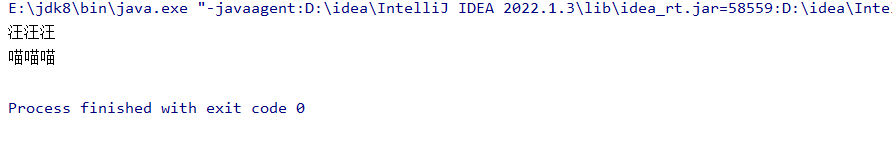

# 案例1：

实现一个动物园管理系统，定义接口Animal包含方法makeSound（）。不同类型的动物Dog、Cat实现该接口，并提供各自的实现。

```java
package com.eagles.interfacetest;

public interface Animal {
    String makeSound();
}
```

```java
package com.eagles.interfacetest;

public class Cat implements Animal{

    @Override
    public String makeSound() {
        return "喵喵喵";
    }
}
```

```java
package com.eagles.interfacetest;

public class Dog implements Animal{
    @Override
    public String makeSound() {
        return "汪汪汪";
    }
}
```

```java
package com.eagles.interfacetest;

public class Test {
    public static void main(String[] args) {
        Dog dog = new Dog();
        System.out.println(dog.makeSound());

        Cat cat = new Cat();
        System.out.println(cat.makeSound());
    }
}
```



# 案例2：

定制一款游戏，其中的角色可以通过接口Action执行动作，比如jump（）、run（）等。不同的游戏劫色如Hero、Monster实现这些动作接口。

```java
package com.eagles.interfacetest;

public interface Action {
    void jump();
    void run();
}
```

```java
package com.eagles.interfacetest;

public class Hero implements Action{
    @Override
    public void jump() {

    }

    @Override
    public void run() {

    }
}
```

```java
package com.eagles.interfacetest;

public class Monster implements Action{
    @Override
    public void jump() {

    }

    @Override
    public void run() {

    }
}
```

```java
package com.eagles.interfacetest;

public class Test02 {
    public static void main(String[] args) {

        Monster monster = new Monster();
        monster.jump();
        monster.run();

        Hero hero = new Hero();
        hero.jump();
        hero.run();
    }
}
```

# 案例3：

制定消息接口Message，人类Person可以接收多种消息的类型、比如：微信、QQ、电子邮箱email等。后期会加入新的消息类型，比如：钉钉。通过接口+多态模拟该场景。

#### 1. 定义 `Message` 接口

```java
public interface Message {
    void sendMessage(String content);
}
```

#### 2. 实现不同消息类型的类

##### 微信消息类 `WeChatMessage`

```java
public class WeChatMessage implements Message {
    @Override
    public void sendMessage(String content) {
        System.out.println("通过微信发送消息: " + content);
    }
}
```

##### QQ消息类 `QQMessage`

```java
public class QQMessage implements Message {
    @Override
    public void sendMessage(String content) {
        System.out.println("通过QQ发送消息: " + content);
    }
}
```

##### 电子邮件消息类 `EmailMessage`

```java
public class EmailMessage implements Message {
    @Override
    public void sendMessage(String content) {
        System.out.println("通过电子邮件发送消息: " + content);
    }
}
```

#### 3. 定义人类 `Person` 类

```java
public class Person {
    private String name;

    public Person(String name) {
        this.name = name;
    }

    public void receiveMessage(Message message, String content) {
        System.out.println(name + " 收到了消息:");
        message.sendMessage(content);
    }
}
```

#### 4. 测试代码

```java
public class TestMessages {
    public static void main(String[] args) {
        Person person = new Person("张三");

        // 发送微信消息
        Message weChatMessage = new WeChatMessage();
        person.receiveMessage(weChatMessage, "你好，这是微信消息。");

        // 发送QQ消息
        Message qqMessage = new QQMessage();
        person.receiveMessage(qqMessage, "你好，这是QQ消息。");

        // 发送电子邮件消息
        Message emailMessage = new EmailMessage();
        person.receiveMessage(emailMessage, "你好，这是电子邮件消息。");
    }
}
```

#### 5. 添加新的消息类型（如钉钉）

##### 钉钉消息类 `DingDingMessage`

```java
public class DingDingMessage implements Message {
    @Override
    public void sendMessage(String content) {
        System.out.println("通过钉钉发送消息: " + content);
    }
}
```

#### 6. 更新测试代码以支持钉钉消息

```java
public class TestMessages {
    public static void main(String[] args) {
        Person person = new Person("张三");

        // 发送微信消息
        Message weChatMessage = new WeChatMessage();
        person.receiveMessage(weChatMessage, "你好，这是微信消息。");

        // 发送QQ消息
        Message qqMessage = new QQMessage();
        person.receiveMessage(qqMessage, "你好，这是QQ消息。");

        // 发送电子邮件消息
        Message emailMessage = new EmailMessage();
        person.receiveMessage(emailMessage, "你好，这是电子邮件消息。");

        // 发送钉钉消息
        Message dingDingMessage = new DingDingMessage();
        person.receiveMessage(dingDingMessage, "你好，这是钉钉消息。");
    }
}
```

#### 运行结果

运行上述测试代码，输出如下：

```java
张三 收到了消息:
通过微信发送消息: 你好，这是微信消息。
张三 收到了消息:
通过QQ发送消息: 你好，这是QQ消息。
张三 收到了消息:
通过电子邮件发送消息: 你好，这是电子邮件消息。
张三 收到了消息:
通过钉钉发送消息: 你好，这是钉钉消息。
```

通过这种方式，我们实现了多态和接口的使用，使得系统具有良好的扩展性和灵活性。
