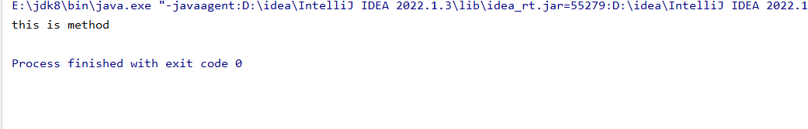
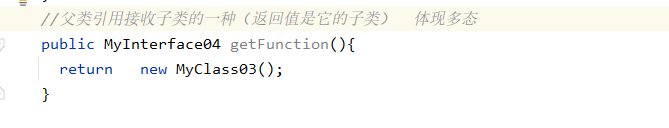

# 案例：

```java
package com.eagles.interfacetest;

public class MyClass02 {
    //成员变成了接口，照样可以用修饰符修饰
    private MyInterface04 myInterface04;
    //在Myclass02里面聚合了一个myInterface04的引用
    public MyClass02(MyInterface04 myInterface04) {
        this.myInterface04 = myInterface04;
    }

    public MyInterface04 getMyInterface04() {
        return myInterface04;
    }

    public void setMyInterface04(MyInterface04 myInterface04) {
        this.myInterface04 = myInterface04;
    }

    @Override
    public String toString() {
        return "MyClass02{" +
        "myInterface04=" + myInterface04 +
        '}';
    }
}
```

```java
package com.eagles.interfacetest;

public class MyClass03 implements MyInterface04{

    @Override
    public void method() {
        System.out.println("this is method ");
    }
}
```

```java
package com.eagles.interfacetest;

public interface MyInterface04 {
    void method();
}
```

```java
package com.eagles.interfacetest;

public class Test02 {
    public static void main(String[] args) {

        /*创建Myclass对象，无参构造被覆盖掉了，需要传一个实例
        这边让你传的是一个接口，不能直接实例化对象，不能直接去（new 接口）
        需要创建一个子类去继承这个接口
        */
        MyClass02 myClass02 = new MyClass02(new MyClass03());
        myClass02.getMyInterface04().method();//引用.get方法.里面的方法
    }
}
```

接口用类去继承，类去调用类，间接调用接口里面的东西



#### 其他的形式：


