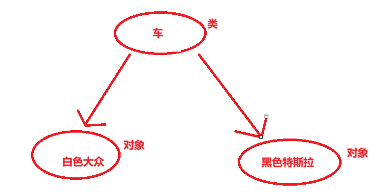
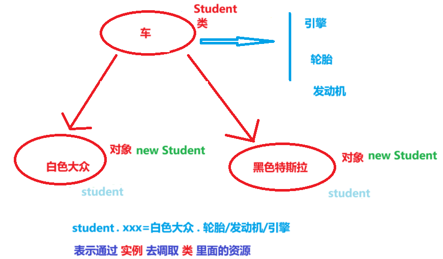

# 类和对象

- 类 = 属性+方法
- 面向对象本质就是：以类的方式组织对象，以对象的方式组织（封装）数据
- 三大特征：封装 ，继承，多态



类：某一类事物整体的描述/定义，但是并不能代表某一个具体的事物

对象/实例：万物皆对象，每一个对象都是类模版下的具体产品

关系：对象 is 类

```java
package com.eagles.pojo;

public class Student {

    //成员变量 实例变量（开辟外置在堆中）
    // （这里面的属性，必须要先创建学生对象，对象就是类的实例，
    // 先创建学生对象，再拿着对象的引用才能够去调用这些变量）
```

```java
package com.eagles.test;

import com.eagles.pojo.Student;

public class StuedentTest {
   
    public static void main(String[] args) {
        //创建学生对象
        Student student = new Student();
        
     student.study();
     student.eat();

    }
}
```



Student：类（这个是自己创建的一个类，java中jdk给我们提供的所有资源都是类，都是以类为单位去编写代码）通过class去声明这个类

student：如果想调用类里面的一些资源的话，得创建对象。想往控制台输入一个内容，需要创建一个Student对象，new Student就是一个具体的实例，student就是实例的一个引用（student这个变量就是对象的引用）

student.xxx：就是通过对象的引用去调用类里面的资源

# 类中对属性和行为的定义

```java
package com.eagles.pojo;

public class Student {

    //成员变量 实例变量（开辟外置在堆中）
    // （这里面的属性，必须要先创建学生对象，对象就是类的实例，
    // 先创建学生对象，再拿着对象的引用才能够去调用这些变量）
    public String id;

    public String name;

    public int age;

    public String address;

    public String birthday;
    //上面这些属性没有+public则在其他文件里面无法调用或访问这里面的属性，所以才+public使得可以被访问到
   //（在主函数里面的叫做局部变量）
   public void study(){

       System.out.println("学生需要学习");
   }
//行为可以用方法去设定
    public void eat(){

        System.out.println("学生需要炫饭");
    }

}
```

区别：

写在主函数里面的变量是局部变量（开辟在栈中）

写在类下面的是属性，+public是为了在其他文件可以访问/调用到（开辟在堆中）

```java
package com.eagles.test;

import com.eagles.pojo.Student;

public class StuedentTest {
    public static void main(String[] args) {
        //创建学生对象
        Student student = new Student();
        System.out.println(student.name);//null是引用数据类型在没有赋值的情况下，会取的默认值，代表空引用
        student.name="jack";//student.name这个变量在函数里面没有被赋值，因此在此处给他附一个jack
        System.out.println(student.name);//此处的name已经被赋值，输出jack

        //jack是存储在方法区里面的常量池中的，而Student.name是存储在堆中的，属于成员变量

        student.age=20;
        //基本数据类型可以赋值（是属性，是成员变量）  注意于下面study和eat的不同，下面为方法，上面为属性

        student.study();
        student.eat();
    }
}
```

仅创建属性属性里面是空字符null，可以通过对象的引用student.xxx=“ ”，对属性进行赋值

Student.name是存储在堆中的，属于成员变量。jack是存储在方法区里面的常量池中。是堆指向常量池的一个过程。

总结：先创建对象，然后在对对象进行赋值或者引用。
