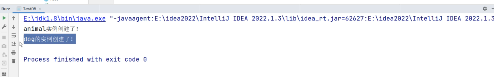
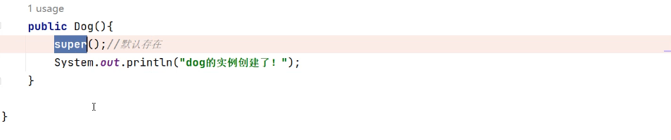
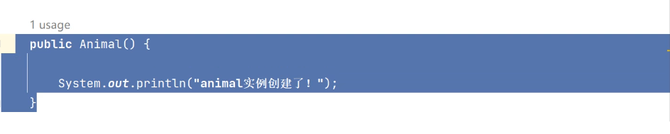
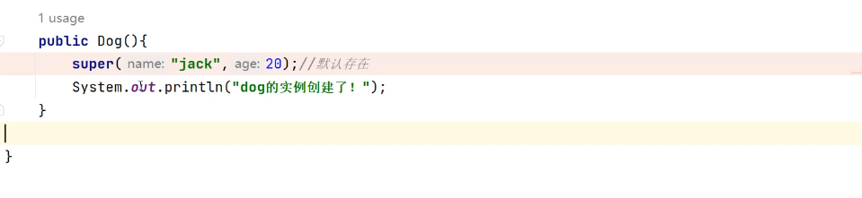
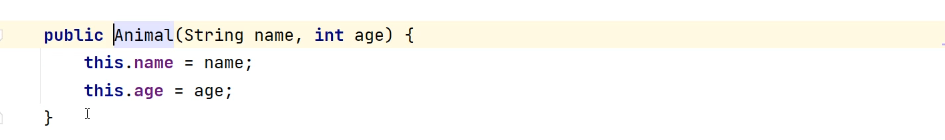
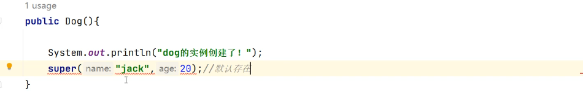
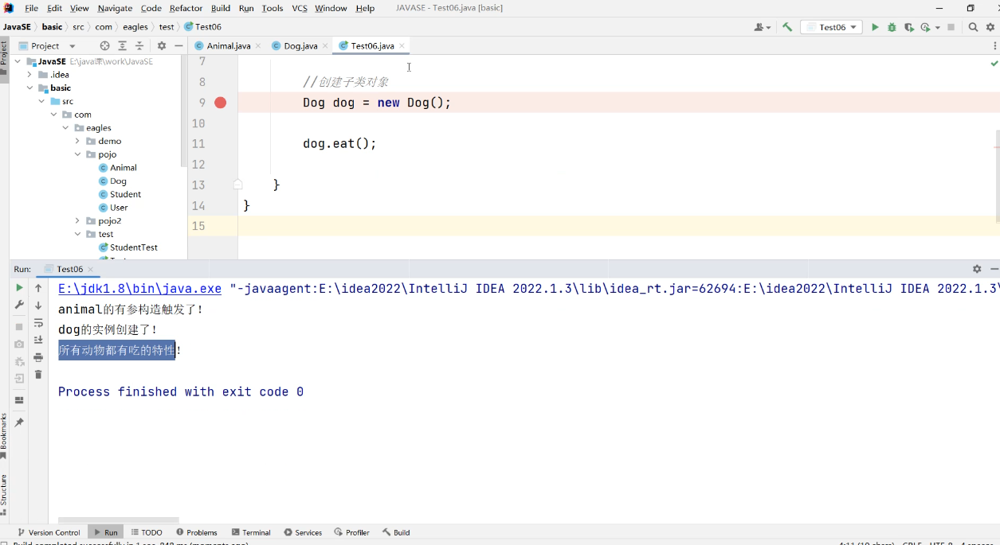
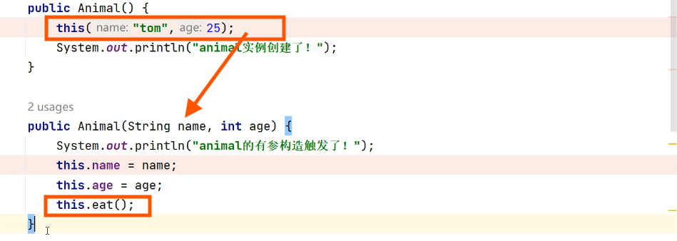
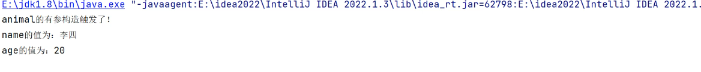

# super注意点：

1. super调用父类的构造方法，必须在构造方法的第一行（默认调用）
2. super必须只能出现在子类的方法或者构造方法中
3. super和this不能同时调用构造方法

- 代表的对象不同

。this：本身调用者这个对象

。super：代表父类对象的引用

- 前提

。this：没有继承也可以使用

。super：只有在继承条件下才可以使用

- 构造方法

。this（）：本类的构造

。super（）：父类的构造

- \*\*super\*\*与\*\*this\*\*的区别：super代表父类对象的引用，只能在继承条件下使用

：this调用自身对象，没有继承也可以使用

```java
package com.eagles.test;

public class Animal {
    private String name;
    public int age;
    //alt+inster快捷键快速获得get，set方法

    //alt+inster快捷键可以快速创建有参构造和无参构造 Constractor

    public Animal() {
        System.out.println("Animal实例被创建了！！！");
        //构造函数的目的就是创建对象，如果创建了这个的对象，那么这里面的内容将会被触发
    }
    public Aniamal（String name，int  age）{
        this.name = name;
        this.age = age;
    

}
```

```java
package com.eagles.test;

public class Dog extends Animal{

    public Dog(){
        System.out.println("dog的实例被创建了！！");
    }
}
```

```java
package com.eagles.test;

import com.sun.org.apache.xerces.internal.impl.dv.xs.DoubleDV;

public class Test00 {
    public static void main(String[] args) {
            //创建子类对象
        Dog dog = new Dog();

    }
}
```

Dog dog = new Dog();此处虽然创建的是子类对象，但是显示的结果却是：



那是因为子类继承父类，创建子类的对象也会把父类的对象给创建出来，这就可以解释为什么子类继承父类，子类为什么可以去调用父类所有的方法

# Super

#### 1.super(): //调用父类的构造函数

子类构造函数被创建出来的时候，他的第一行默认会有这样一个语法：



按住Atl点击super跳转的是父类里面的Animal构造函数，这个无参构造



#### 2.super(name:"jack",age:20)：

也可以在super里面直接赋值（如果父类构造函数是有参构造）



按住Alt指向的是父类的有参构造



这里面无参构造并没有被执行，是因为有参构造覆盖了无参构造，如果有参构造和无参构造同时被注释，系统会默认产生一个无参构造，

super默认会出现，并且只会出现在构造函数下面的第一行，放在后面不行会报错



### 补充：

```java
package com.eagles.test;

public class Animal {
    private String name;
    public int age;
    //alt+inster快捷键快速获得get，set方法

    //alt+inster快捷键可以快速创建有参构造和无参构造 Constractor

    public Animal() {
        System.out.println("Animal实例被创建了！！！");
        //构造函数的目的就是创建对象，如果创建了这个的对象，那么这里面的内容将会被触发
    }

    public Animal(String name, int age) {
        this.name = name;
        this.age = age;
    }

    public String getName() {
        return name;
    }

    public void setName(String name) {
        this.name = name;
    }

    public int getAge() {
        return age;
    }

    public void setAge(int age) {
        this.age = age;
    }

    //创造一个eat的方法
    public void eat(){
        System.out.println("所有动物都有吃的特性！！！");
    }
}
```

末尾这个在父类创造的eat方法只需要在子类写一个eat 将会跳出重写：

```java
package com.eagles.test;

public class Dog extends Animal{

    public Dog(){
        super("张三",30);
        System.out.println("dog的实例被创建了！！");
    }

    @Override //子类重写父类方法的标识
    public void eat() {
        super.eat();  //super父类的引用
    }
}
```

```java
package com.eagles.test;

import com.sun.org.apache.xerces.internal.impl.dv.xs.DoubleDV;

public class Test00 {
    public static void main(String[] args) {
            //创建子类对象

        Dog dog = new Dog();

        dog.eat();
    }
}
```

此时dog.eat();运行的结果为：



直接拿着super去调用父类的方法，此处是eat方法

# This：

this可以去.当前类的实例或者方法（this.eat就是调用方法）



this可以直接给当前类的有参函数进行赋值

# 实例

super案例：创建子类对象的同时给父类属性赋值

```java
package com.eagles.test;

public class Dog extends Animal{

    public Dog(){
        super("张三",30);
        System.out.println("dog的实例被创建了！！");
    }
     public Dog(String name,int age){
        super(name, age);

     }
    @Override //子类重写父类方法的标识
    public void eat() {
        super.eat();
    }
}
```

public Dog(String name,int age){ public Animal(String name, int age) {

super(name, age); 指向 this.name = name;

} this.age = age; }

通过super去指向父类的有参构造，有参构造的作用就是给当前类的成员变量进行赋值（子类的有参构造赋值给了父类的有参构造，父类的有参构造，给当前类里面的成员变量进行赋值。所以在测试组创建Dog对象，在通过继承运用get，set方法将可以修改父类成员变量的值）

```java
package com.eagles.test;

public class Animal {
    private String name;
    public int age;
    //alt+inster快捷键快速获得get，set方法

    //alt+inster快捷键可以快速创建有参构造和无参构造 Constractor

    public Animal() {
        System.out.println("Animal实例被创建了！！！");
        //构造函数的目的就是创建对象，如果创建了这个的对象，那么这里面的内容将会被触发
    }

    public Animal(String name, int age) {
        this.name = name;
        this.age = age;
    }

    public String getName() {
        return name;
    }

    public void setName(String name) {
        this.name = name;
    }

    public int getAge() {
        return age;
    }

    public void setAge(int age) {
        this.age = age;
    }
    //创造一个eat的方法
    public void eat(){
        System.out.println("所有动物都有吃的特性！！！");
    }
}
```

```java
package com.eagles.test;

import com.sun.org.apache.xerces.internal.impl.dv.xs.DoubleDV;

public class Test00 {
    public static void main(String[] args) {
            //创建子类对象

        Dog dog = new Dog("张三",20);

        String name = dog.getName(); //创建dog对象然后引用父类的getName，对name进行赋值
        System.out.println("name的值为：" + name);

        int age = dog.getAge();//继承父类的age方法，通过调用getAge
        System.out.println("age的值为：" + age);
    }
}
```


