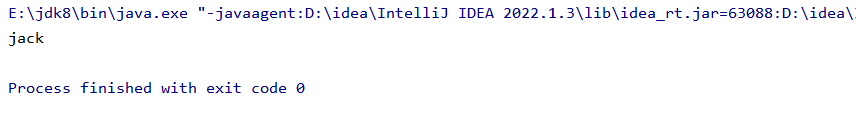

# 访问权限修饰符

java权限修饰符public、protected、default（默认）、private （权限由低到高），置于类的成员定义前，用于限定对象对该类成员的访问权限。

|  |  |  |  |  |
| --- | --- | --- | --- | --- |
| 修饰符 | 类内部 | 同一个包 | 不同包的子类 | 同一个工程 |
| private | yes |  |  |  |
| default（缺省） | yes | yes |  |  |
| protected | yes | yes | yes |  |
| public | yes | yes | yes | yes |

对于class的权限修饰只可以用public和default（缺省）。

- public类可以在任意地方被访问。
- default类可以被同一个包内部的类访问。

# Default（默认）:

```java
package com.eagles.pojo;

public class A {
    public String name;//public表示公共的
    private String name2;//private表示公共的
    String name3;//什么都不写那就是默认的default
}
```

接下来学一个default：

```java
package com.eagles.pojo;

public class A {
   
    String name3 = "jack";//什么都不写那就是默认的default
}
```

```java
package com.eagles.pojo;

public class B {
    public static void main(String[] args) {
        //创建一个类A的对象
        A a = new A();
        System.out.println(a.name3); //a.anme3 可以点出来name3，证明访问的权限是够的
    }
}
```

结果：



# Protected:

protected最高权限可以到达不同包里面的子类

```java
package com.eagles.pojo;

public class A {

    protected String name3 = "jack" ;//什么都不写那就是默认的default
}
```

C为pojo2包里面的一个类

```java
package com.eagles.pojo2;

import com.eagles.pojo.A;

 //public class C extends A {  //类C就相当于A类不同包的子类（一个pojo包一个pojo2包）

    //public static void main(String[] args) {
     //   A a = new A();
     //   System.out.println(a.name3);}  

      这样打印不出来，语法机制的问题
    
public class C extends A {  //类C就相当于A类不同包的子类（一个pojo包一个pojo2包）
       String name = super.name3;
    public  void main() {

        System.out.println(name3);
    }

    public static void main1(String[] args) {
        C c = new C();
        c.main();//c.main这个方法 方法里面输出打印name3
    }
  }
}
```
