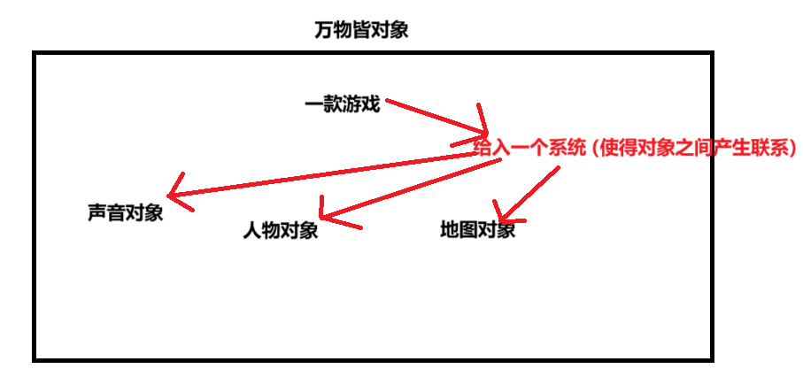

面向过程：

是分析解决问题的步骤，然后用函数把这些步骤一步一步的实现，然后在使用的时候一一调用，性能比较高。

（通过面向过程去完成一些业务逻辑特别复杂的需求的时候，效率是很低的，它强调的是一个因果关系，在完成需求的过程中它的侧重点是因为什么所以什么，如果中间某一个因果关系断掉了，就会导致最后的结果实现不了，所以它只适合用来完成一些业务逻辑比较简单的需求，它的性能很高，且流畅）（侧重过程）

面向对象：

把构成问题的事务进行分解成一个个对象，而建立对象的目的不是为了完成一个个步骤，而是为了描述某个事务在解决整个问题的过程中所发挥的行为。面向对象有封装，继承，多态的特性，所以易维护，易复用，易扩展。可以设计出低耦合的系统。但是在性能上来说，比面向过程要低（它属于一种模块化设计）（侧重结果）

Java就是不断的创建对象然后指挥对象去做事情
