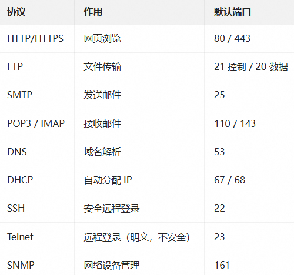
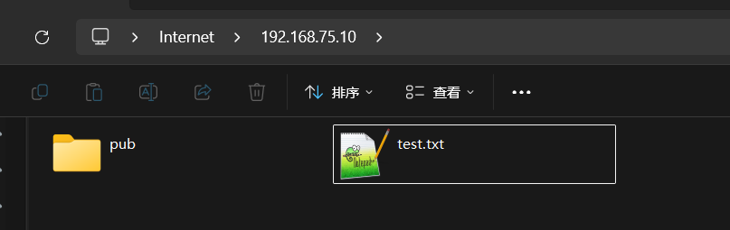
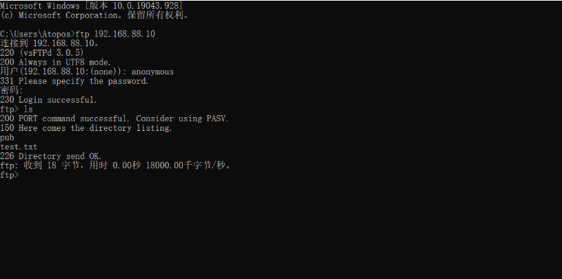

# FTP (File Transfer Protocol)

FTP（File Transfer Protocol）是用于在计算机网络中进行文件传输的协议。它使用客户端-服务器模式，允许文件在客户端和服务器之间上传或下载。FTP 服务通常用于在不同主机间传输大容量文件，特别是在网络环境中需要频繁进行文件交换时。

FTP 运行在 OSI 模型的应用层，并利用传输协议 TCP 在不同的主机之间提供可靠的数据传输。并且在文件传输中 FTP 还支持断点续传功能，可以大幅度减少 CPU 网络带宽的开销。

**OSI 模型的应用层->补充：****常见应用层协议**



## 工作原理

FTP 使用客户端与服务器之间的通信来传输文件。它通过两条连接来工作：一条用于命令传输（控制连接），另一条用于数据传输（数据连接）。

## 相关端口

**控制连接端口**：21

- **功能**：FTP 的控制连接使用端口 21。这条连接用于客户端与服务器之间交换命令和响应。当你在 FTP 客户端中输入命令（例如 `LIST`、`RETR`、`STOR`）时，这些命令是通过端口 21 发送的。
- **数据流向**：控制连接是全双工的，客户端和服务器都可以发送消息，但所有数据传输操作（如文件上传、下载）都不会通过控制连接进行。

**数据连接端口**：20

- **功能**：端口 20 在 FTP 协议中用于数据传输连接，特别是在 **主动模式**（PORT 模式）下。它用于通过数据连接传输实际的文件数据。
- **数据流向**：当 FTP 客户端在主动模式下与服务器建立连接时，服务器通过端口 20 向客户端的指定端口发起数据连接。这条连接用于传输文件内容。

# FTP 工作模式

FTP 支持两种不同的模式：主动模式（PORT）和被动模式（PASV）。

## 主动模式（Active Mode）

在主动模式下，客户端向服务器发起连接请求，服务器在数据传输时主动连接客户端。具体来说，客户端使用端口 21 与服务器建立控制连接，而数据连接则由服务器从端口 20 发起到客户端的指定端口。

### 连接过程

1. **建立控制连接**：客户端通过任意端口（例如随机的高端口，通常是 1024 以上的端口）向服务器的 **端口 21** 发起连接，建立 **控制连接**。这个连接用于发送 FTP 命令和接收响应。例如：客户端使用端口 1025，连接到服务器的端口 21（控制连接）。
2. **客户端发送命令**：客户端通过控制连接发送 FTP 命令（如 `USER`、`PASS`、`LIST` 等），请求服务器执行操作。
3. **客户端告诉服务器监听的端口**：当客户端希望传输文件时，它会告诉服务器自己希望通过哪个端口进行数据传输。这是通过 **PORT 命令** 完成的。客户端指定了一个端口（例如 1026）供服务器使用。
4. **服务器发起数据连接**：服务器收到客户端的 **PORT 命令** 后，会使用 **端口 20** 连接到客户端指定的端口（例如 1026）。这条连接用于传输数据，如文件内容或目录列表。
5. **数据传输**：当服务器与客户端的指定端口建立数据连接后，数据传输就开始了。文件会通过这个数据连接进行传输。
6. **断开数据连接**：数据传输完成后，数据连接会关闭，控制连接保持打开，直到用户结束会话（通过 `QUIT` 命令）。

### 优缺点

**优点**：服务器主动发起**数据连接**，因此客户端无需配置其防火墙以允许入站连接。

**缺点**：如果客户端位于 NAT 或防火墙后面，客户端很难接受来自服务器的入站连接。由于 NAT 会改变客户端的 IP 地址和端口，服务器可能无法正确连接到客户端。

## 被动模式（Passive Mode）

在被动模式下，服务器不会主动连接客户端，而是客户端主动与服务器建立数据连接。服务器会提供一个端口范围，客户端可以通过控制连接（端口 21）请求服务器提供一个可用端口，客户端再通过这个可用端口与服务器建立数据连接。

### 连接过程

1. **建立控制连接**：客户端首先向服务器的 **端口 21** 发起连接，建立控制连接。这个过程和主动模式相同。
2. **客户端请求服务器进入被动模式**：客户端发送 **PASV 命令**，请求服务器进入被动模式。此时，服务器会选择一个高端口（通常在 1024 以上），并向客户端返回该端口的信息。例如，服务器可能返回 `227 Entering Passive Mode (192,168,1,2 120,232)`，这意味着服务器的 IP 地址是 `192.168.1.2`，并且它希望客户端连接到端口 `29832`。
3. **客户端连接到服务器的被动端口**：客户端接收到服务器返回的 IP 地址和端口信息后，会从任意端口连接到服务器提供的被动端口（例如 29832）。这条连接用于文件数据的传输。
4. **数据传输**：一旦数据连接建立，客户端和服务器就可以通过该连接传输文件数据或目录列表。
5. **断开数据连接**：数据传输完成后，数据连接会关闭。控制连接仍然保持打开，直到用户结束会话（通过 `QUIT` 命令）。

### 优缺点

**优点**：被动模式解决了客户端处于 NAT 或防火墙后面时的问题，因为客户端只需要发起对服务器的外向连接，不需要接受来自服务器的入站连接。

**缺点**：服务器需要预先开放一个端口范围，并且在某些情况下，如果服务器的防火墙配置不当，仍然可能会遇到问题。

# FTP 常用服务软件

许多操作系统和第三方软件都提供 FTP 服务的实现。常见的 FTP 服务器软件有：

- **vsftpd**:在 Linux 上广泛使用的高安全性 FTP 服务器。
- **ProFTPD**:功能丰富的 FTP 服务，支持多种认证机制。
- **Pure-FTPd**:简单易用的 FTP 服务器，适用于 Unix/Linux 系统。
- **FileZilla Server**:在 Windows 上使用的开源 FTP 服务器。

# Vsftpd

## 相关介绍

- 软件包：vsftpd
- 服务类型：由Systemd启动的守护进程
- 配置单元：`/usr/lib/systemd/system/vsftpd.service`
- 守护进程：`/usr/sbin/vsftpd`
- 端口：`21(ftp)`,`20(ftp‐data)`
- 主配置文件：`/etc/vsftpd/vsftpd.conf`
- 用户访问控制配置文件：`/etc/vsftpd/ftpusers /etc/vsftpd/user_list`
- 日志文件：`/etc/logrotate.d/vsftpd`

配置文件参数

|  |  |
| --- | --- |
| **参数** | **作用** |
| listen=NO | 是否以独立运行的方式监听服务 |
| listen\_address=ip地址 | 设置要监听的IP地址 |
| listen\_port=21 | 设置FTP服务的监听端口 |
| download\_enable=YES | 是否允许下载文件 |
| userlist\_enable=YES | 设置用户列表为"允许" |
| userlist\_deny=YES | 设置用户列表为"禁止" |
| max\_clients=0 | 最大客户端连接数，0为不限制 |
| max\_per\_ip=0 | 同一IP地址的最大连接数，0为不限制 |
| anonymous\_enable=YES | 是否允许匿名用户访问 |
| anon\_upload\_enable=YES | 是否允许匿名用户上传文件 |
| anon\_umask | 匿名用户上传文件的umask |
| anon\_root=/var/ftp | 匿名用户的ftp根目录 |
| anon\_mkdir\_write\_enable=YES | 是否允许匿名用户创建目录 |
| anon\_other\_write\_enable=YES | 是否开放匿名用户的其他写入权限（重命名、删除等） |
| anon\_max\_rate=0 | 匿名用户的最大传输速率，0为不限制 |
| local\_enable=yes | 是否允许本地用户登录 |
| local\_umask=022 | 本地用户上传文件的umask值 |
| local\_root=/vat/ftp | 本地用户的ftp根目录 |
| chroot\_local\_user=YES | 是否将用户权限禁锢在ftp目录，以确保安全 |
| local\_max\_rate=0 | 本地用户的最大传输速率，0为不限制 |

## 基本操作

- 安装vsftpd软件

```shell
[root@server1 ~]# yum -y install vsftpd
```

- 准备共享分发的文件

```shell
[root@server1 ~]# touch /var/ftp/test.txt            # /var/ftp/ 是默认的共享目录
[root@server1 ~]# echo "hello ftp server" > /var/ftp/test.txt
```

- 配置文件中开启匿名用户登录

```bash
[root@server1 ~]# vim /etc/vsftpd/vsftpd.conf
......
anonymous_enable=YES
......
```

- 启动服务

```shell
[root@server1 ~]# systemctl start vsftpd
[root@server1 ~]# systemctl enable vsftpd
```

- 关闭防火墙

```shell
[root@server1 ~]# systemctl stop firewalld
[root@server1 ~]# setenforce 0
```

到此，我们的FTP服务端就部署完成了。接下来我们应该通过一些客户端软件来连接到服务端上，进行文件的传输。

## 客户端工具

|  |  |  |
| --- | --- | --- |
| 工具 | 平台 | 特点 |
| `ftp` | Linux | 命令行，最基础，适合实验 |
| `lftp` | Linux | 功能更强，支持断点续传、批量下载 |
| `curl` | Linux / macOS | 脚本里传文件很方便 |
| FileZilla | Win / Mac / Linux | 图形界面，拖拽操作 |
| WinSCP | Windows | 支持 FTP / SFTP / SCP |

### Linux

- 第一种

```shell
[root@server2 ~]# yum install -y ftp 
[root@server2 ~]# ftp 192.168.75.10
Connected to 192.168.75.10 (192.168.75.10).
220 (vsFTPd 3.0.5)
Name (192.168.75.10:root): anonymous         # 匿名用户anonymous
331 Please specify the password.
Password:      # 直接回车
230 Login successful.                        # 看到successful说明连接成功
Remote system type is UNIX.
Using binary mode to transfer files.
ftp>

# 退出的话，执行exit命令
```

- 第二种

```shell
[root@server2 ~]# yum intall -y lftp
[root@server2 ~]# lftp 192.168.75.10          #默认使用匿名账户登录
lftp 192.168.75.10:~> ls
drwxr-xr-x    2 0        0               6 Jan 17  2026 pub
-rw-r--r--    1 0        0              17 Oct 19 05:23 test.txt
lftp 192.168.75.10:/> 
```

**区别：**

- ftp 工具是一定要输入用户名称和密码的，登录成功或者失败会给出提示。
- lftp 不会直接给出登录成功或者失败的提示，需要输入 ls 工具才可以发现是否连接成功，优点在于连接更加方便

**注意：**

FTP 有个名单列表，里面会有一些用户名。配合配置文件中的 userlist配置

如果是userlist\_enable=YES 表示允许该名单的用户登录(白名单)

如果是 userlist\_deny=YES 表示拒绝名单里的用户登录(黑名单)

```bash
[root@server1 ~]# cat /etc/vsftpd/user_list
# vsftpd userlist
# If userlist_deny=NO, only allow users in this file
# If userlist_deny=YES (default), never allow users in this file, and
# do not even prompt for a password.
# Note that the default vsftpd pam config also checks /etc/vsftpd/ftpusers
# for users that are denied.
root
bin
...
```

### Windows

**第一种：**

可以在资源管理器或者运行窗口中输入 `ftp://192.168.75.10` 去连接到 ftp 服务器，如果我们想连接共享目录下面的具体某个目录，比如默认存在的pub目录，我们可以通过 `ftp://192.168.75.10/pub` 这样的方式来连接。



**第二种：**

可以打开 cmd 窗口，在 cmd 中通过 `ftp 192.168.75.10` 访问即可，跟 Linux 中使用 ftp 工具连接时的操作一致。



# 主被动模式配置

## 主动模式

在主动模式下，客户端告诉服务器使用哪个端口进行数据传输，服务器通过主动连接客户端的指定端口进行数据传输。

修改 `vsftpd` 配置文件

```bash
# 主动模式配置
connect_from_port_20=YES
```

## 被动模式

在被动模式下，服务器告诉客户端使用哪个端口传输数据，客户端会主动连接到这些端口。被动模式更适合穿越防火墙的网络环境。

修改`vsftpd`配置文件，添加以下内容

```bash
# 被动模式配置
pasv_enable=YES
pasv_min_port=30000
pasv_max_port=31000            # 随机端口范围(但是会有些许误差)
```

## 主被动切换测试

通过user01或者anonymous用户从客户端连接上来以后，通过passive切换主被动模式

```bash
1.user01
#如果想要通过user01登录，需要在FTP服务器上创建user01这个用户，并且设置好密码
[root@server1 ~]# useradd user01
[root@server1 ~]# passwd user01

[root@server2 ~]# ftp 192.168.75.10
Connected to 192.168.75.10 (192.168.75.10).
220 (vsFTPd 3.0.5)
Name (192.168.75.10:root): user01
331 Please specify the password.
Password:
230 Login successful.
Remote system type is UNIX.
Using binary mode to transfer files.
ftp> 

2.anonymous
[root@server2 ~]# ftp 192.168.75.10
Connected to 192.168.75.10 (192.168.75.10).
220 (vsFTPd 3.0.5)
Name (192.168.75.10:root): anonymous
331 Please specify the password.
Password:
230 Login successful.
Remote system type is UNIX.
Using binary mode to transfer files.
ftp> dir
227 Entering Passive Mode (192,168,75,10,201,31).    # 默认是被动模式，192,168,88,10,120,145 这里表示随机端口
150 Here comes the directory listing.
drwxr-xr-x    2 0        0               6 Jan 17  2026 pub
-rw-r--r--    1 0        0              17 Oct 19 05:23 test.txt
226 Directory send OK.
ftp> passive																	# 通过passive切换主被动
Passive mode off.
ftp> dir
200 PORT command successful. Consider using PASV.   # 主动模式使用20做为数据端口，所以没有提示端口
150 Here comes the directory listing.
drwxr-xr-x    2 0        0               6 Jan 17  2026 pub
-rw-r--r--    1 0        0              17 Oct 19 05:23 test.txt
226 Directory send OK.
ftp> 

#如果切换主动模式，数据连接建立失败，报425：
ftp> dir
200 PORT command successful. Consider using PASV.
425 Failed to establish connection.
#说明:服务器需要主动连接客户端的数据端口，但被客户端防火墙、NAT 或网络策略挡住了
```

# 案例分析01

自定义匿名**用户访问目录**，能够上传和下载文件

**服务端配置**

```shell
# 准备匿名用户访问的目录和文件
[root@server1 ~]# mkdir  -pv /share/pub && chmod 777 /share/pub && chown ftp:ftp /share/pub
[root@server1 ~]# echo "anonymous Test download..." >/share/pub/download.txt
# 修改相关配置
[root@server1 ~]# echo "anon_root=/share" >> /etc/vsftpd/vsftpd.conf
[root@server1 ~]# echo "anon_upload_enable=YES" >> /etc/vsftpd/vsftpd.conf
[root@server1 ~]# systemctl restart vsftpd.service
```

**客户端测试验证**

```shell
[root@server2 ~]# echo "annouymous test upload ...." >upload.txt
# 访问、上传和下载测试
[root@server2 ~]# lftp 192.168.75.10
lftp 192.168.75.10:~> ls
drwxrwxrwx    2 14       50              6 Oct 19 06:08 pub
lftp 192.168.75.10:~> cd pub
cd ok, cwd=/pub
lftp 192.168.75.10:/pub> ls
-rw-r--r--    1 0        0              28 Oct 19 06:13 download.txt
lftp 192.168.75.10:/pub> get download.txt 
28 bytes transferred
lftp 192.168.75.10:/pub> put upload.txt 
28 bytes transferred
lftp 192.168.75.10:/pub> ls
-rw-r--r--    1 0        0              28 Oct 19 06:13 download.txt
-rw-------    1 14       50             28 Oct 19 06:13 upload.txt

#说明上传文件也成功完成
[root@server1 pub]# ls
download.txt  upload.txt
```

# 案例分析02

使用本地用户成功登录以后，默认的访问目录为该用户的家目录

**服务端配置**

```shell
# 确保local_enable是否开启
[root@server1 share]# grep 'local_enable' /etc/vsftpd/vsftpd.conf
local_enable=YES

# 新建用户和测试文件
[root@server1 ~]# useradd user01
[root@server1 ~]# echo 1 | passwd --stdin user01
[root@server1 ~]# su - user01
[user01@server ~]$ echo "user01 Test download..." > download.txt
```

**客户端测试验证**

```shell
[root@server2 ~]# echo "annouymous test upload ...." >upload.txt
# 访问，上传和下载测试
[root@server2 ~]# lftp -u user01 192.168.75.10
Password: 
lftp user01@192.168.75.10:~> ls                   
-rw-r--r--    1 1000     1000           25 Oct 19 06:21 download.txt
lftp user01@192.168.75.10:~> get download.txt 
get: /root/download.txt: file already exists and xfer:clobber is unset
lftp user01@192.168.75.10:~> get download.txt  -o download_new.txt
25 bytes transferred in 10 seconds (2 B/s)          
lftp user01@192.168.75.10:~> put upload.txt 
22 bytes transferred
lftp user01@192.168.75.10:~> ls
-rw-r--r--    1 1000     1000           25 Oct 19 06:21 download.txt
-rw-r--r--    1 1000     1000           22 Oct 19 06:27 upload.txt
exit
[root@server2 ~]# ls
anaconda-ks.cfg  download.txt  download_new.txt  upload.txt

#说明上传文件也完成
[user01@server1 ~]$ ls
download.txt  upload.txt

！！！！
lftp user01@192.168.75.10:~> get download.txt 
get: /root/download.txt: file already exists and xfer:clobber is unset
执行get时，lftp 发现本地当前目录已经有 download.txt，所以拒绝覆盖。
方法一：开启覆盖
lftp user01@192.168.75.10:~> set xfer:clobber on
lftp user01@192.168.75.10:~> get download.txt
方法二：下载到不同文件名
lftp user01@192.168.75.10:~> get download.txt -o download_new.txt
方法三：先删除本地文件在下载
[root@server2 ~]# rm download.txt
```

# 案例分析03

虚拟用户访问控制：

虚拟用户为 eagleslab001 和 eagleslab002，服务端本地代理用户为 vuser

eagleslab001默认访问`/home/vsftpd/eagleslab01`且能够创建/删除/上传/下载文件

eagleslab002 不做额外配置。

**服务端配置**

```shell
# 创建用于进行FTP认证的用户数据库，其中奇数行为用户名，偶数行为密码
[root@server1 ~]$ cat << EOF > /etc/vsftpd/vuser.list
eagleslab001
00123456
eagleslab002
00234567
EOF

#哈希工具(db_load)：将明文信息转为密文
[root@server1 ~]# yum install -y libdb-utils
[root@server1 ~]# db_load -T -t hash -f /etc/vsftpd/vuser.list  /etc/vsftpd/vuser.db

# 查看文件描述以及修改权限 & 删除明文信息
[root@server1 ~]# file /etc/vsftpd/vuser.db
/etc/vsftpd/vuser.db: Berkeley DB (Hash, version 9, native byte-order)
[root@server1 ~]# chmod 600 /etc/vsftpd/vuser.db
[root@server1 ~]# rm -rf vuser.list

# 创建虚拟用户的本地代理用户 & 用户目录
[root@server1 ~]# useradd -d /home/vsftpd -s /sbin/nologin vuser
[root@server1 ~]# mkdir -p /home/vsftpd/{eagleslab001,eagleslab002}
[root@server1 ~]# chmod -Rf 755 /home/vsftpd/   # -f 终端不输任何数据
# 将整个 FTP 家目录及子目录的属主全部改为 vuser  #虚拟用户映射到 vuser，如果目录属于 root，写不进去
[root@server1 ~]# chown -R vuser:vuser /home/vsftpd/

# 新建用于虚拟用户认证的PAM文件
[root@server1 ~]# cat << EOF > /etc/pam.d/vsftpd_vuser
> auth required pam_userdb.so db=/etc/vsftpd/vuser
> account required pam_userdb.so db=/etc/vsftpd/vuser
> EOF

[root@server1 ~]# cat << EOF >> /etc/vsftpd/vsftpd.conf
> pam_service_name=vsftpd_vuser
> userlist_enable=YES
> guest_enable=YES
> guest_username=vuser
> allow_writeable_chroot=YES
> chroot_local_user=YES
> user_config_dir=/etc/vsftpd/conf.d
> EOF

[root@server1 ~]# cd /etc/vsftpd/conf.d/
[root@server1 conf.d]# touch eagleslab001

# 针对 eagleslabl001 设置不同权限，eagleslab002没有配置，默认走的是主配置默认权限
[root@server1 conf.d]# cat << EOF > /etc/vsftpd/conf.d/eagleslab001
local_root=/home/vsftpd/eagleslab001
anon_upload_enable=YES
anon_mkdir_write_enable=YES
anon_other_write_enable=YES
EOF

#如果想让eagleslab002只能读
[root@server1 conf.d]#cat << EOF > /etc/vsftpd/conf.d/eagleslab002
local_root=/home/vsftpd/eagleslab002
anon_upload_enable=NO
anon_mkdir_write_enable=NO
anon_other_write_enable=NO
EOF

# 重启服务
[root@server1 conf.d]# systemctl restart vsftpd

# 准备一些测试文件
[root@server1 conf.d]# echo "eagleslab001 Test download..." > /home/vsftpd/eagleslab001/download001.txt
[root@server1 conf.d]# echo "eagleslab002 Test download..." > /home/vsftpd/eagleslab002/download002.txt
```

**客户端测试验证**

```shell
# eagleslab001 
[root@client ~]# lftp -u eagleslab001,00123456 172.16.175.129
...
# eagleslab002 put: 访问失败: 550 Permission denied.
[root@client ~]# lftp -u eagleslab002,00234567 172.16.175.129

# eagleslab001 
[root@server2 ~]# lftp -u eagleslab001,00123456 192.168.75.10
lftp eagleslab001@192.168.75.10:~> ls
-rwxr-xr-x    1 1001     1001           30 Oct 19 06:53 download001.txt
lftp eagleslab001@192.168.75.10:/> put upload.txt 
22 bytes transferred
lftp eagleslab001@192.168.75.10:/> put upload_new.txt 
19 bytes transferred

#服务端查看
[root@server1 conf.d]# cd /home/vsftpd/eagleslab001
[root@server1 eagleslab001]# ls
download001.txt  upload.txt  upload_new.txt

# eagleslab002 走的是主配置默认权限
#虚拟用户默认可以登录、可以列目录、可以下载文件，只要它能看到对应目录里的文件，就能下载。
[root@server2 ~]# lftp -u eagleslab002,00234567 192.168.75.10
lftp eagleslab002@192.168.75.10:~> put upload_new.txt 
19 bytes transferred in 10 seconds (2 B/s)            
lftp eagleslab002@192.168.75.10:/> ls
drwxr-xr-x    2 0        0              29 Oct 19 06:53 eagleslab001
drwxr-xr-x    2 0        0              29 Oct 19 06:53 eagleslab002
-rw-------    1 1001     1001           19 Oct 19 06:57 upload_new.txt
lftp eagleslab002@192.168.75.10:/> 
exit

# eagleslab002 put: 访问失败: 550 Permission denied.（如果配置前面的只读配置）
[root@server2 ~]# lftp -u eagleslab002,00234567 192.168.75.10
```

**问题：没有执行chown -R vuser:vuser /home/vsftpd/，eagleslab001登录后put报错**

**！！！虚拟用户权限 = 主配置默认权限 + 独立配置覆盖 + 文件系统权限 + SELinux**

**现象**：虚拟用户 eagleslab001 登录 FTP 后执行 `put` 上传文件，报 `553 Could not create file`，但下载和列目录正常。

**原因**：虚拟用户通过 `guest_username=vuser` 映射为系统用户 vuser,而目录`/home/vsftpd/eagleslab001` 属主属组是 `root:root`,权限 `755`,vuser 只能算"其他用户",仅有 `r-x` 没有 `w`,文件系统层面拒绝写入。

vsftpd 的写权限配置（`write_enable=YES`、`anon_upload_enable=YES`）只决定服务层允不允许，最终还要过文件系统这一关，两层必须同时放行。

**解决**：执行 `chown -R vuser:vuser /home/vsftpd/` 和 `chmod -R 755 /home/vsftpd/`，将目录属主改为 vuser，再 `systemctl restart vsftpd` 即可上传。
