HTTPS（Hypertext Transfer Protocol Secure）是一种用于安全传输数据的通信协议。它使用了加密技术，确保在客户端和服务器之间传输的数据经过加密保护，不容易被恶意方进行窃听、篡改或伪造。在前期文章《结合Wireshark抓包分析，沉浸式体验HTTP请求的一次完整交互过程》中我们介绍了HTTP的工作原理，接下来就和博主一起来了解下HTTPS的交互流程以及与HTTP的差异吧！

# 1. HTTP的缺点

在正式介绍HTTPS前我们先来看看HTTP协议 当前存在的三大缺点：

- 机密性问题：通信使用了明文，第三方可以拦截并获悉通信内容；
- 完整性问题：未验证报文的完整性，第三方可以篡改通信内容；
- 认证问题：未验证对方的身份，第三方可以冒充他人身份参与通信。

注：其他未加密协议也会存在以上问题，比如Telnet、FTP。

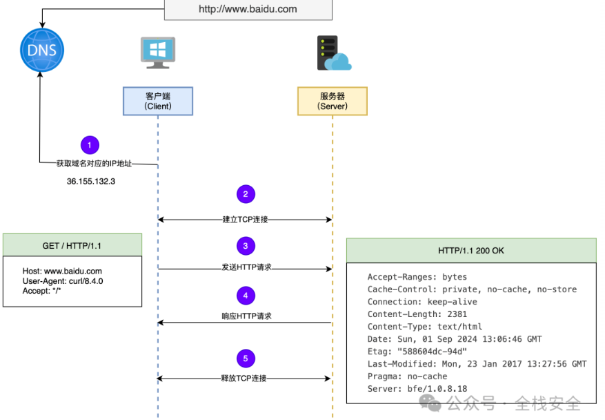

HTTP工作原理

为了解决以上三个问题，便诞生了HTTPS。

# 2. HTTPS简介

HTTPS 被称为 HTTP Over SSL (基于SSL加密的HTTP)，这里的SSL (Secure Socket Layer) 被称为**安全套接层**，它是一种**加密**协议，不仅可应用于HTTP协议、还可应用于POP3协议、SMTP协议、VPN等。

TLS (Transport Layer Security) 被称为**传输层安全**，TLS相对于SSL 3.0版本做了些修改和功能增强，相当于SSL的升级版本，所以有时也一起统称为 SSL，接入来本文若不明显强调，SSL就默认表示SSL/TLS。

我们可以用公式HTTPS = HTTP + SSL / TLS来表示HTTPS。

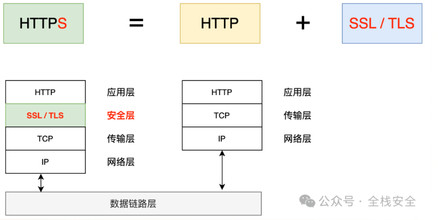

HTTPS协议栈

# 3. HTTPS交互流程

接下来用 Wireshark 工具抓了客户端与百度网站（<https://www.baidu.com>）的TLS 握手过程，可以看到下图中红色方框圈中 4 次TLS握手报文。

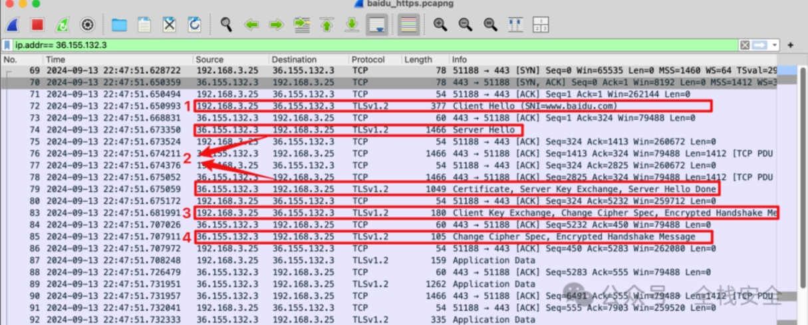

我们知道，HTTPS协议是基于TCP /IP协议的，所以在TLS握手前后客户端与百度服务器分别进行了TCP三次握手（69、70、71）和TCP四次挥手（95、99、103、105）。

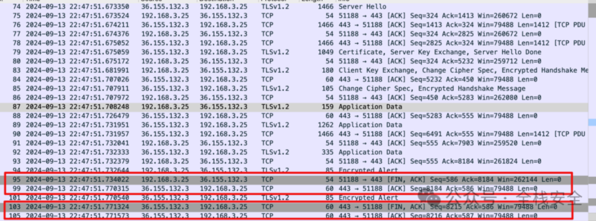

为了方便大家先从整体再到细节理解整个HTTPS交互过程，这里我先画一个HTTPS整体交互流程图（整体划分四个阶段）。每个交互细节会在接下来的介绍中持续展开，循序渐进。

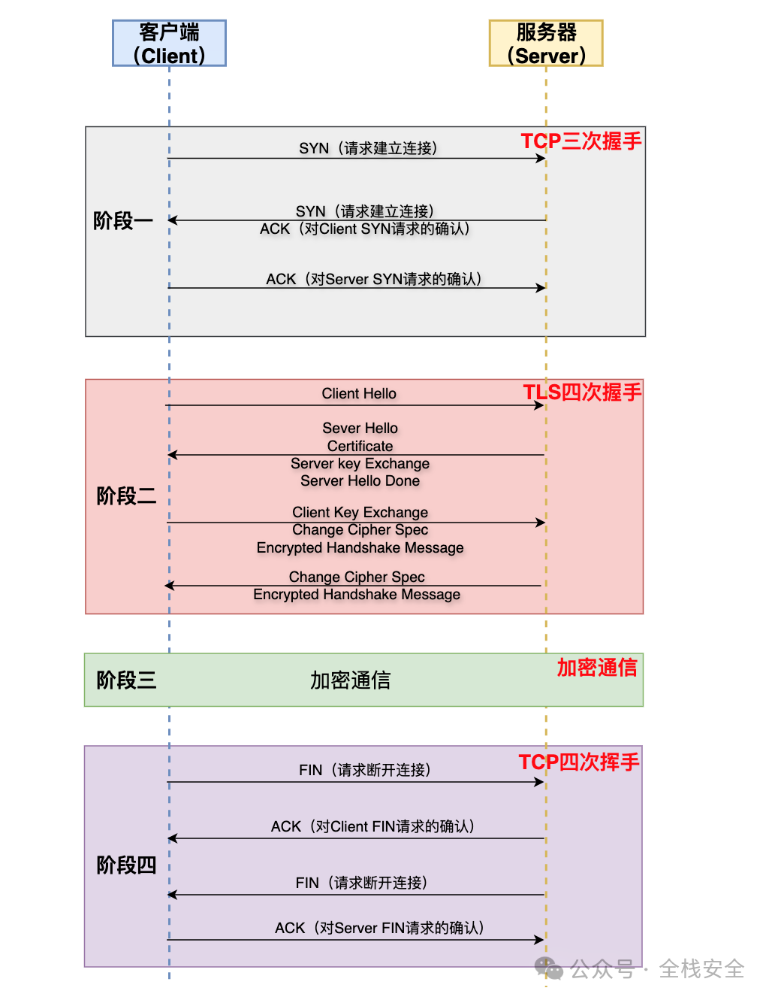

HTTPS的四个交互阶段

## 3.1. 阶段一：TCP三次握手建立连接

TCP三次握手

关于TCP三次握手的详细过程，前期博文已经介绍，这里就不再展开叙述，感兴趣的同学可以参阅《结合Wireshark抓包实战，图文详解TCP三次握手及四次挥手原理》

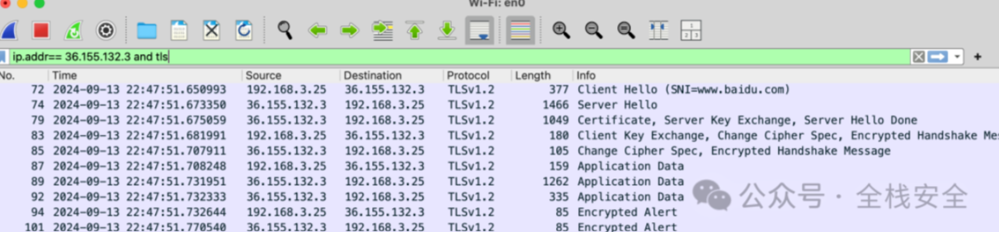

## 3.2. 阶段二：TLS握手建立安全通道

在Wireshark的显示过滤器中输入表达式ip.addr == 36.155.132.3 and tls过滤出TLS协议数据包。

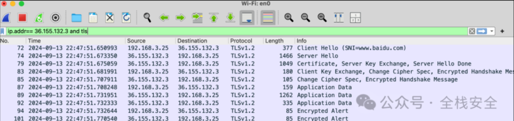

**第一次握手报文（72）：**

- 我->百度 发送TLS消息「Client Hello」

**第二次握手报文（74、79）：**

- 百度->我 发送TLS消息「Server Hello」
- 百度->我 发送TLS消息「Certificate」,「Server Key Exchange」，「Server Hello Done」

**第三次握手报文（83）：**

- 我->百度 发送TLS消息「Client Key Exchange」，「Change Cipher Spec」，「Encrypted Handshake Message」

**第四次握手报文（85）：**

- 百度->我 发送TLS消息「Change Cipher Spec」，「Encrypted Handshake Message」

为了直观展示TLS报文交互，基于抓包分析的数据包可以绘制得到下图。

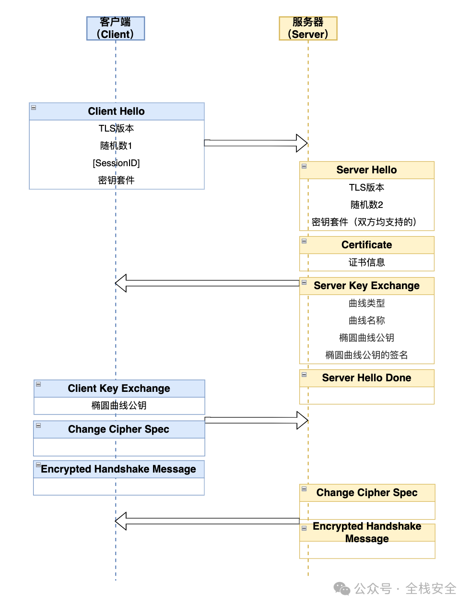

### 3.2.1. TLS第一次握手：client -> server (Client Hello)

客户端向服务端 发送：

1. 客户端支持的协议；
2. 已经使用的TLS版本；
3. 随机数Random；
4. 支持的密码套件。

从下图中，我们也可以看出SSL层是基于TCP层又进行封装的一层协议。

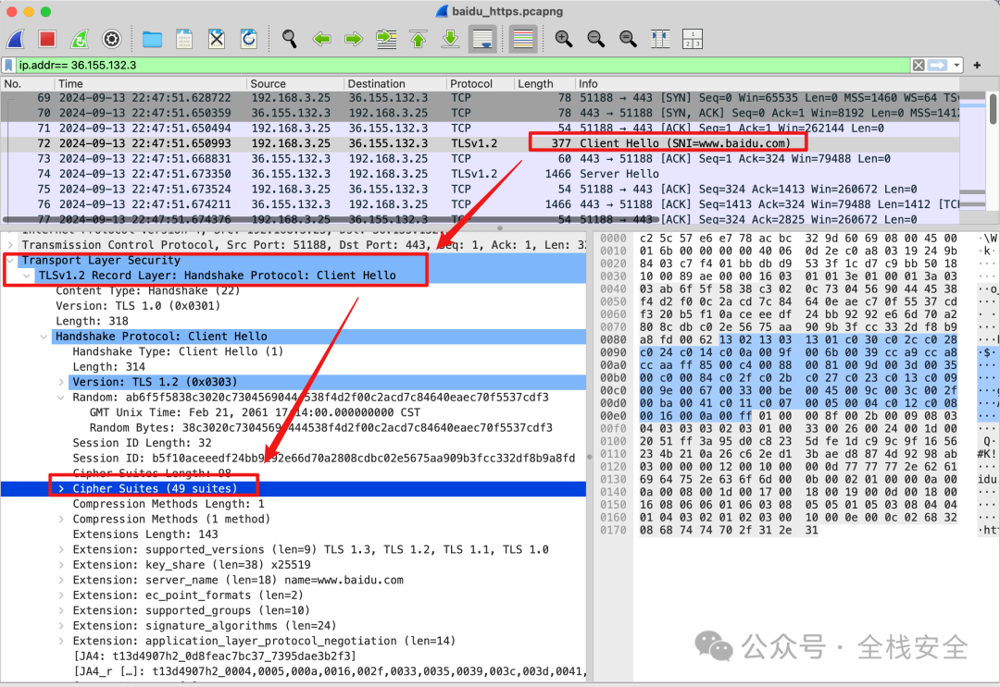

Client Hello

接下来我们看几个TLS协议中的重要字段（Version、Random、SessionID和Cipher Suites）。

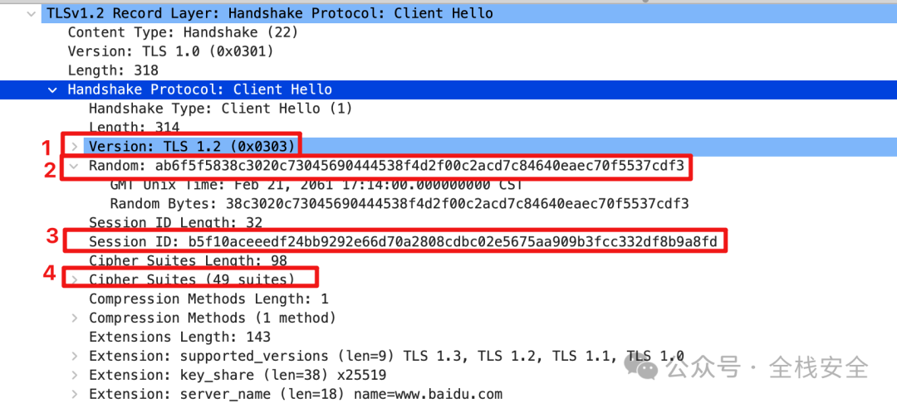

#### 3.2.1.1. version

从上图中可以看到当前通信安全层协议版本（Version）为TLS 1.2。其实TLS共总有4个版本，最新为TLS 1.3，具体如下：

- TLS 1.0：TLS 1.0于1999年发布，是SSL 3.0的升级版本，修复了一些安全漏洞，但仍然存在一些安全问题。
- TLS 1.1：TLS 1.1发布于2006年，引入了一些改进，包括对CBC（Cipher Block Chaining）模式的安全性改进，但仍然存在一些已知的安全问题。
- TLS 1.2：TLS 1.2发布于2008年，它引入了更强的加密算法和更灵活的密码套件选择，修复了许多安全漏洞，是目前广泛使用的版本。（当前样例中百度网站使用的就是TLS 1.2协议）
- TLS 1.3：发布于2018年，TLS 1.3是TLS协议的最新版本，大幅简化了握手过程，提高了性能和安全性。它删除了一些不安全的加密算法，并引入了0-RTT（零往返时间）握手，以减少延迟。

#### 3.2.1.2. Random

Random用于密钥 的制作。这里我们将第一次握手中客户端发送给服务端的随机数记为Client Random，记住这个随机数，后面还会用到。

#### 3.2.1.3. SessionID

SessionID用来表示客户端是否想复用先前存在的session。如果不复用，则此字段为0；如果想要复用，则此字段为想要复用的sessionID。是否复用由服务端确定。

#### 3.2.1.4. Cipher Suites

密码套件列表会全部发给服务端，服务端从中挑选一个最安全的密码套件返回客户端。

将Cipher Suites字段展开，如下图。代表客户端支持的密码套件列表。由于本次抓包使用的是curl工具，我们可以看到里面支持49种密码套件。每种套件代表不同的加密方式。不同的客户端（如浏览器）支持的列表也可能不一样。

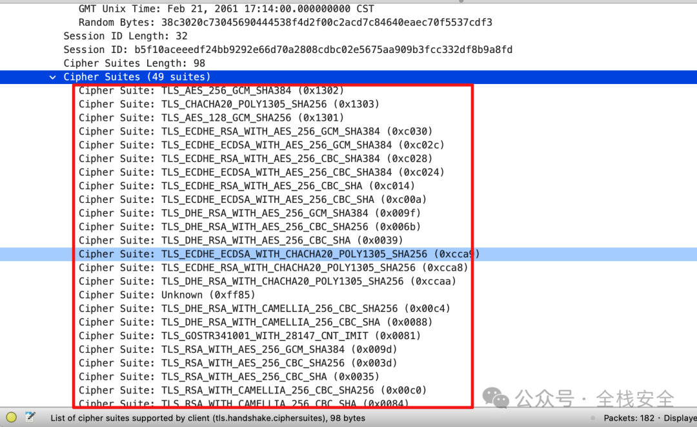

密码套件列表

密码套件的格式通常由一系列的加密算法和相关参数组成。一般来说，它的格式包含以下几个部分：

- **密钥交换算法：**用于协商会话密钥，例如 Diffie-Hellman（DHE）、ECDHE等。
- **身份验证算法：**也称签名算法用于验证对端身份，例如RSA。
- **加密算法：**用于实际数据传输的加解密，例如 AES（Advanced Encryption Standard）、RC4 等。
- **数据摘要算法：**用于计算哈希，主要是用于验证数据的完整性，防止信息被篡改。

格式：「密钥交换算法 + 签名算法（认证算法） + 对称加密算法 + 摘要算法」。其中密钥交换算法和签名算法可以相同，此时就会合二为一。

比如上图密码套件列表中的第四个TLS\_ECDHE\_RSA\_WITH\_AES\_256\_GCM\_SHA384。

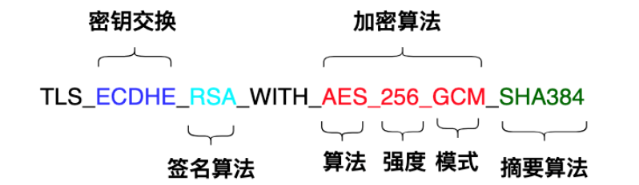

密码套件格式构成

在这个例子中：

- ECDHE表示密钥交换算法是基于椭圆曲线的 Diffie-Hellman（ECDHE）。
- RSA表示使用RSA算法（私钥加密、公钥解密）验证对方身份。
- AES\_256\_GCM表示使用 256 位的 AES 加密算法和 GCM 模式。
- SHA384表示使用 SHA-384 作为消息摘要算法。

不同的密码套件组合提供了不同的安全性和性能特点，服务器和客户端在进行 TLS 握手时会协商选择双方都支持的 Cipher Suite 来建立安全连接。

客户端发送完「Client Hello」（第72个报文），第73个报文则是服务端向客户端发送的ACK确认消息，代表上面的「Client Hello」已经收到。这里也可以看出服务端是通过普通的TCP 的ACK消息去应答「Client Hello」。

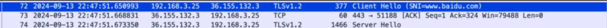

### 3.2.2. TLS第二次握手：server -> client (1.Server Hello; 2.Certificate,Server key Exchange,Server Hello Done)

这一次握手时，server向client连续发送了两个报文：

1. **Server Hello：**服务端为了证明自己的身份，会发送「Server Certificate」给客户端，这个消息里含有数字证书；
2. **Certificate,Server key Exchange,Server Hello Done：**目的是告诉客户端，我已经把该给你的东西都给你了，本次打招呼完毕。

#### 3.2.2.1. 服务端发送报文：Server Hello

服务端向客户端发送：

1. 服务端支持的协议；
2. 使用的TLS版本；
3. 随机数Random；
4. 服务端选用的密码套件。

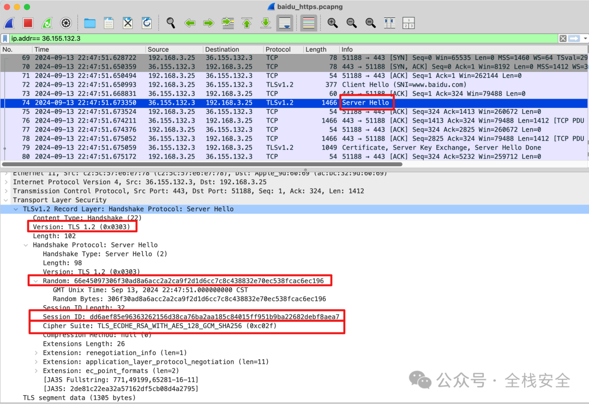

Server Hello

上图中可以看到，服务端也生成了一个随机数，并发送给了客户端，服务端生成的随机数记为Server Random。

**小结：**

1. 到目前为止客户端和服务器都已经拥有了自有的随机数，并且还会把随机数传递给对方，分别记为Client Random和Server Random，那这两个随机数有啥用呢？后文见分晓。
2. 客户端和服务端就已确认了 TLS 版本和使用的密码套件TLS\_ECDHE\_RSA\_WITH\_AES\_128\_GCM\_SHA256。

#### 3.2.2.2. 服务端发送报文：Certificate,Server key Exchange,Server Hello Done

这里服务端在一个数据包中发送了三个TLS消息：

- Certificate
- Server key Exchange
- Server Hello Done

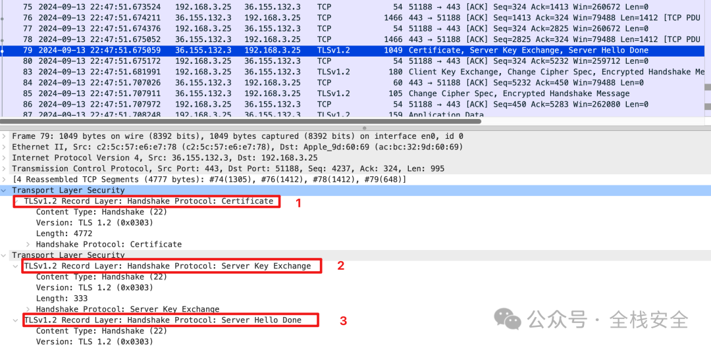

##### 3.2.2.2.1. Certificate

可以看到当前数据包中包含了三个数字证书，三个证书实际构成了一个完整的证书链。

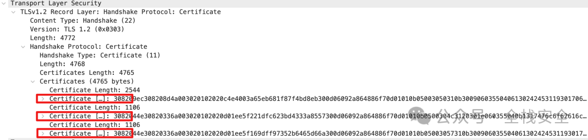

最下面的为根证书，最上面的为网站证书。感兴趣的同学可以逐一将证书链中的各个证书字段展开，查看详情。

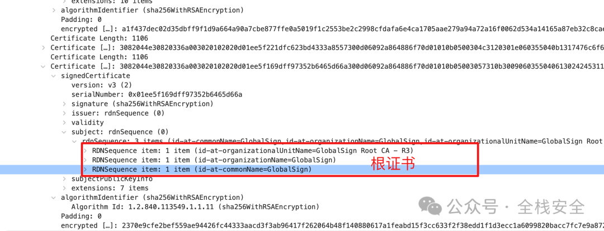

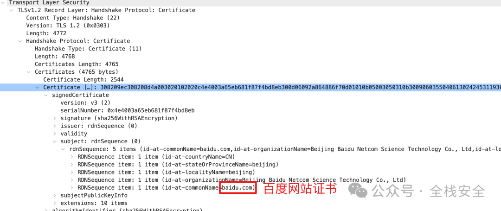

我们直接在百度网站上点击地址栏中的"🔒"图标也能看到此证书链，实际上与我们抓的证书链完全一致。

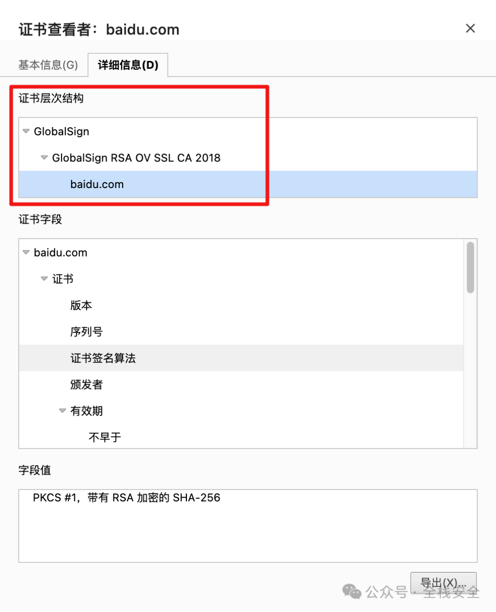

##### 3.2.2.2.2. Server Key Exchange

之前由于服务端选用ECDHE进行密钥协商，所以可以看到「Sever Key Exchange」消息中主要包括密钥交换算法EC Diffie-Hellman（简称ECDHE）以及携带的额外数据（Server Params）。Server Params参数包含：Curve Type、Named Curve以及Pubkey，分别代表曲线类型、曲线名称以及椭圆曲线公钥（用于实现密钥交换算法）。**为了防止公钥被篡改，这里服务端使用RSA私钥对椭圆曲线公钥进行签名并发送给客户端。**

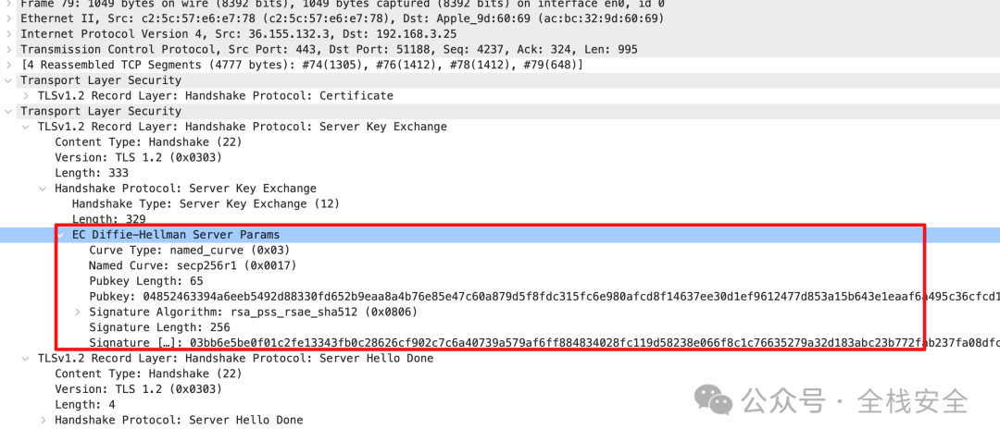

实质上这个过程服务器做了三件事情：

- 选择了名为 named\_curve 的椭圆曲线，选好了椭圆曲线相当于椭圆曲线基点 G 也定好了，这些都会公开给客户端；
- 生成随机数会作为服务端椭圆曲线的私钥，保留到本地；
- 根据基点 G 和私钥计算出服务端的椭圆曲线公钥，这个会公开给客户端。

以上三件事是ECDHE密钥交换必备的步骤，如果前期双方选用了RSA密钥交换算法，这里的步骤就又不一样了。

##### 3.2.2.2.3. Server Hello Done

表明Server Hello消息结束，这个消息中没有额外的其他字段。

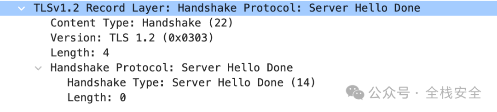

### 3.2.3. TLS第三次握手client -> server (Client Key Exchange, Change Cipher Spec, Encrypted Handshake Message)

该报文中，也是将TLS的三个消息合并到一个中发送。

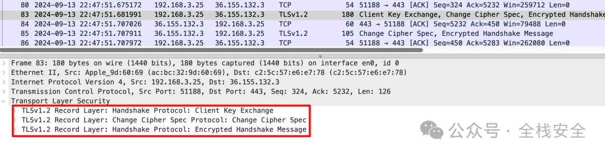

#### 3.2.3.1. Client Key Exchange

客户端收到了服务端的证书及「Server Hello Done」消息后，会先校验证书，校验通过后会将Client Params数据传递给服务端，其中包含自身生成的椭圆曲线公钥（Pubkey），数据内容如图所示：

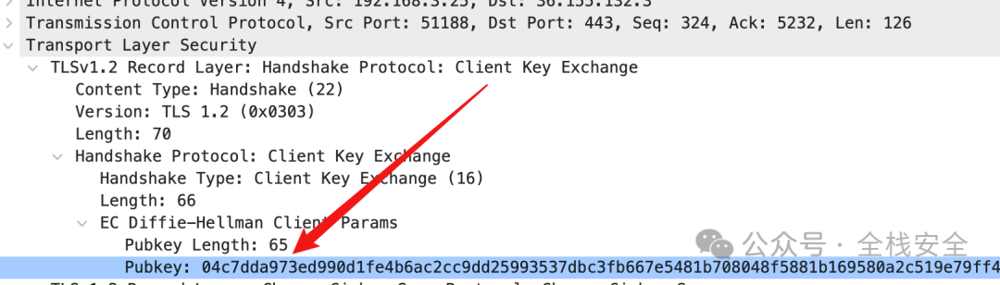

客户端会生成一个随机数作为客户端椭圆曲线的私钥，然后再根据服务端前面给的信息，生成客户端的椭圆曲线公钥，然后用「Client Key Exchange」消息发给服务端。

至此，双方都有对方的椭圆曲线公钥、自己的椭圆曲线私钥、椭圆曲线基点 G。于是，双方都可计算椭圆曲线的交点（x，y）。

还记得 TLS 握手阶段，客户端和服务端都会生成了一个随机数传递给对方吗？

最终的会话密钥就是用「客户端随机数 + 服务端随机数 + x（ECDHE 算法算出的预共享密钥） 」三者结合生成的。

之所以搞这么麻烦，就是因为 TLS 设计者不信任客户端或服务器伪随机数的可靠性，为了保证真正的完全随机，把三个不可靠家伙混合起来，随机的程度就非常高了，安全性也就更高。

#### 3.2.3.2. Change Cipher Spec

「Change Cipher Spec」消息表示客户端已经生成密钥，并切换到对称加密模式。

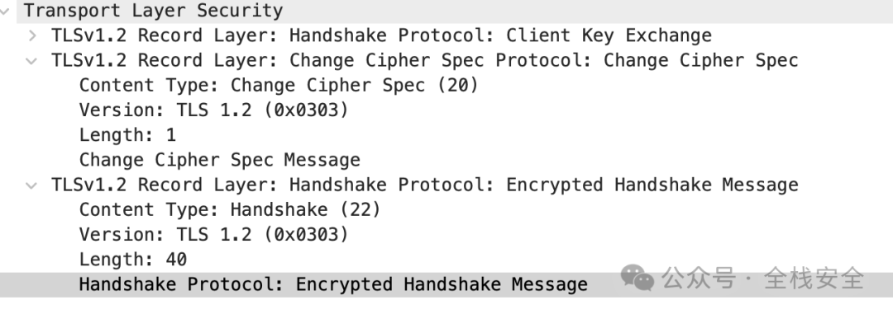

#### 3.2.3.3. Encrypted Handshake Message

发送这个消息有两个目的：

1. 告诉服务端，客户端在握手的过程中收到和发送的数据做一个摘要并用会话密钥加密发送给服务端做校验，保证TSL握手过程中报文没有被修改过
2. 如果服务端收到这个消息并能解密成功，就能说明对称密钥是正确的。

「Encrypted Handshake Message」消息其实不只是客户端会发送，之后服务端也会发送一个。

### 3.2.4. TLS 第四次握手server -> client (Change Cipher Spec,Encrypted Handshake Message)

服务器也是同样的操作，发送「Change Cipher Spec」和「Encrypted Handshake Message」消息，如果双方都验证加密和解密没问题，那么TLS握手正式完成。

最后，就用会话密钥加解密 HTTPS 请求和响应了，即开启了阶段三的加密通信。

问题1：HTTPS的交互过程中总共用到了几组密钥（包含对称密钥及非对称密钥）？大家可以基于对本文的理解在评论区给出自己的答案。

## 3.3. 阶段三：加密通信

TLS握手完成后，客户端与服务端的所有通信内容均被加密，如果没有会话密钥则无法解密通信内容。

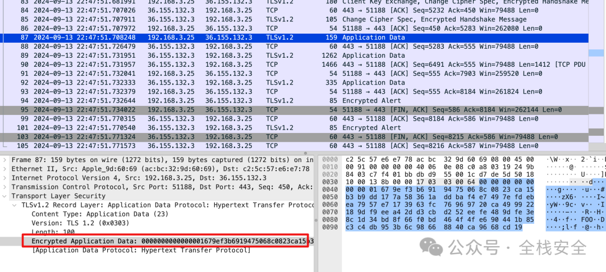

加密数据

问题2：此处的加密通信有可能会被第三方解密吗？如果会，那么第三方运用了什么技术手段？

## 3.4. 阶段四：TCP四次挥手断开连接

关于TCP四次挥手断开连接的详细过程，前期博文已经介绍，这里就不再展开叙述，感兴趣的同学可以参阅《结合Wireshark抓包实战，图文详解TCP三次握手及四次挥手原理》。

# 4. HTTPS的缺点

尽管HTTPS提供了许多安全优势，但也存在一些缺点：

- 在相同网络环境中，HTTPS 相比 HTTP 无论是响应时间（慢2~100倍）还是耗电量（因为需要更多的服务器资源）都有大幅度上升，会导致成本升高。

HTTPS需要客户端、服务端双方做加解密处理，需要消耗更多CPU和内存资源，相比HTTP通信，HTTPS又多了TLS握手，会消耗更多的网络资源，总体也导致HTTPS响应时间变慢。

- HTTPS 并不是绝对安全的，在中间人攻击、服务器劫持等情况下几乎起不到作用。
- 相比HTTPS，HTTPS需要额外购买SSL证书，最便宜的证书一年300多元，如果是是企业网站证书，一年至少也得3000元。
