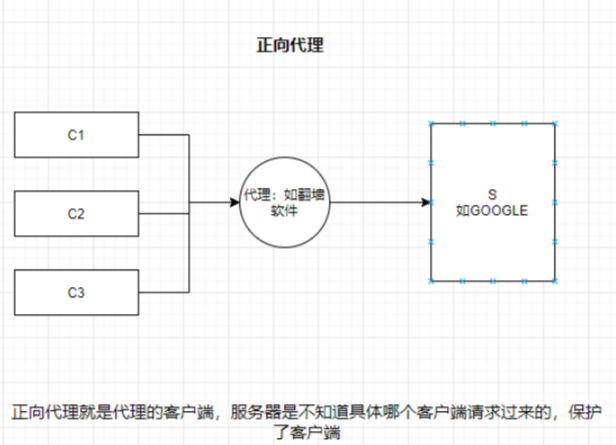
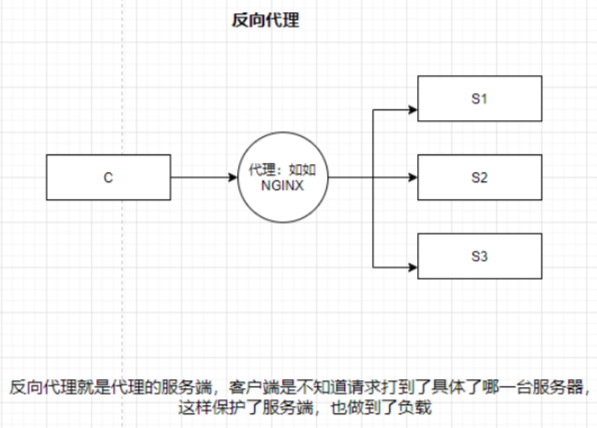
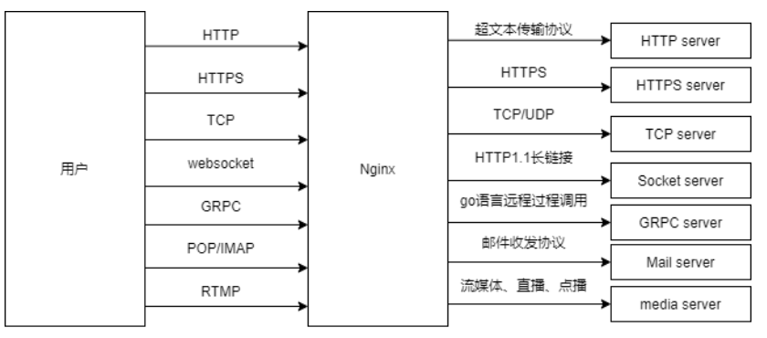
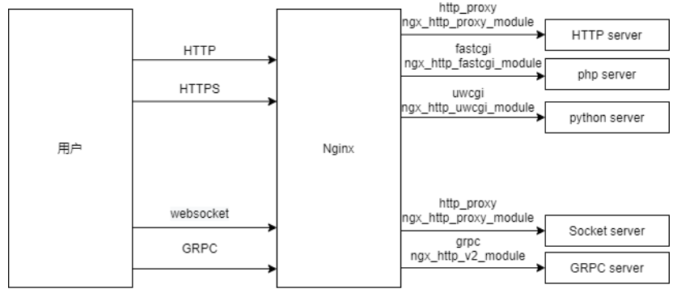
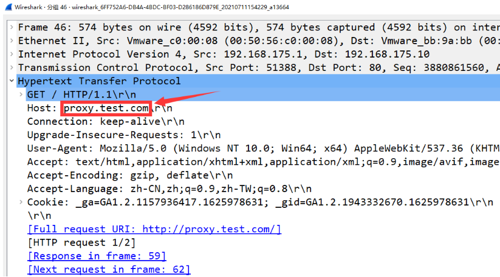
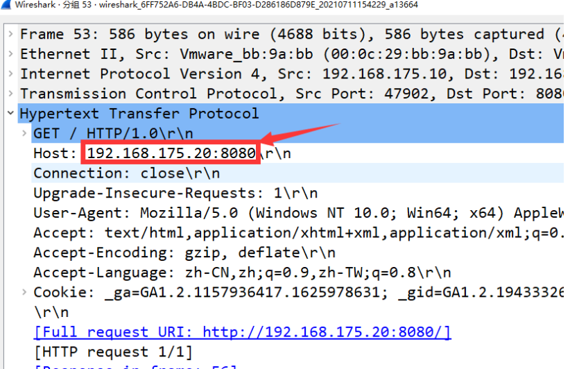

# Nginx代理服务

- 代理一词往往并不陌生, 该服务我们常常用到如(代理理财、代理租房、代理收货等等)


- 在没有代理模式的情况下，客户端和Nginx服务端，都是客户端直接请求服务端，服务端直接响应客户端。


- 那么在互联网请求里面,客户端往往无法直接向服务端发起请求,那么就需要用到代理服务,来实现客户端和服务通信


# Nginx代理服务常见模式





网络代理分为正向代理和反向代理 ，代理其实就是一个中介，最初的时候，只有正向代理，是帮助内网客户端访问外网服务器的，后来出现了反向代理，是把外网客户端的请求转发给内网服务器。  
其实最简单的区别，正向代理代理的是客户端 ，反向代理代理的是服务器。正向代理一般是客户端架设的，反向代理一般是服务器架设的。  
简单罗列一下吧：  
1、代理对象不同。正向代理代理的是客户端，反向代理代理的是服务器。正向代理帮助客户访问其无法访问的服务器资源，反向代理帮助服务器做负载均衡 ，另外，由于客户端跟真实服务器不直接接触，能起到一定安全防护的作用。  
2、架设主体不同。正向代理一般是客户端架设的，比如在自己的机器上装一个代理软件，反向代理一般是服务器架设的，通常是在机器集群 中部署个反向代理服务器。  
3、保护对象不同。正向代理保护对象是客户端，反向代理保护对象是原始资源服务器。  
4、作用目的不同。正向代理主要目的是解决访问限制问题，而反向代理一方面是作为负载均衡，再就是起到安全防护的作用。

# Nginx代理服务支持协议

- Nginx作为代理服务，可支持的代理协议非常的多



- 如果将Nginx作为反向代理服务，常常会用到如下几种代理协议



# Nginx反向代理配置语法

- 代理配置语法

```bash
Syntax:    proxy_pass URL;
Default:    —
Context:    location, if in location, limit_except

http://localhost:8000/uri/
http://192.168.75.10:8000/uri/
http://unix:/tmp/backend.socket:/uri/
```

- url跳转修改返回Location[不常用]

```bash
Syntax:    proxy_redirect default;
proxy_redirect off;proxy_redirect redirect replacement;
Default:    proxy_redirect default;
Context:    http, server, location
```

- 添加发往后端服务器的请求头信息

```bash
Syntax:    proxy_set_header field value;
Default:    proxy_set_header Host $proxy_host;
            proxy_set_header Connection close;
Context:    http, server, location

# 用户请求的时候HOST的值是www.test.com, 那么代理服务会像后端传递请求的还是www.test.com
proxy_set_header Host $http_host;
# 将$remote_addr的值放进变量X-Real-IP中，$remote_addr的值为客户端的ip
proxy_set_header X-Real-IP $remote_addr;
# 客户端通过代理服务访问后端服务, 后端服务通过该变量会记录真实客户端地址
proxy_set_header X-Forwarded-For $proxy_add_x_forwarded_for;
```

- 代理到后端的TCP连接、响应、返回等超时时间

```bash
//nginx代理与后端服务器连接超时时间(代理连接超时)
Syntax: proxy_connect_timeout time;
Default: proxy_connect_timeout 60s;
Context: http, server, location

//nginx代理等待后端服务器的响应时间
Syntax:proxy_read_timeout time;
Default:proxy_read_timeout 60s;
Context:http, server, location

//后端服务器数据回传给nginx代理超时时间
Syntax: proxy_send_timeout time;
Default: proxy_send_timeout 60s;
Context: http, server, location
```

- proxy\_buffer代理缓冲区

```bash
//nignx会把后端返回的内容先放到缓冲区当中，然后再返回给客户端,边收边传, 不是全部接收完再传给客户端
Syntax: proxy_buffering on | off;
Default: proxy_buffering on;
Context: http, server, location

//设置nginx代理保存用户头信息的缓冲区大小
Syntax: proxy_buffer_size size;
Default: proxy_buffer_size 4k|8k;
Context: http, server, location

//proxy_buffers 缓冲区
Syntax: proxy_buffers number size;
Default: proxy_buffers 8 4k|8k;
Context: http, server, location
```

- 常用优化配置

- Proxy代理网站常用优化配置如下，将配置写入新文件，调用时使用include引用即可

```bash
[root@Nginx ~]# vim /etc/nginx/proxy_params
proxy_set_header Host $http_host;
proxy_set_header X-Real-IP $remote_addr;
proxy_set_header X-Forwarded-For $proxy_add_x_forwarded_for;

proxy_connect_timeout 30;
proxy_send_timeout 60;
proxy_read_timeout 60;

proxy_buffering on;
proxy_buffer_size 32k;
proxy_buffers 4 128k;
```

- 重复使用配置

- 代理配置location时调用方便后续多个Location重复使用

```bash
location / {
    proxy_pass http://127.0.0.1:8080;
    include proxy_params;
}
```

# Nginx反向代理场景实践

- Nginx反向代理配置实例


- web01服务器,配置一个网站，监听在8080

```bash
[root@web01 ~]# cd /etc/nginx/conf.d/
[root@web01 conf.d]# vim web.conf
server {
    listen 8080;
    server_name localhost;

    location / {
        root /code/8080;
        index index.html;
        allow all;
    }
}
[root@web01 conf.d]# nginx -t
nginx: the configuration file /etc/nginx/nginx.conf syntax is ok
nginx: configuration file /etc/nginx/nginx.conf test is successful
[root@web01 conf.d]# systemctl restart nginx
[root@web01 ~]# mkdir -p /code/8080
[root@web01 ~]# echo "listening 8080 ..." > /code/8080/index.html
```

- proxy代理服务,配置监听80端口，使能够通过代理服务器访问到后端的192.168.175.20的8080端口站点内容

```bash
[root@proxy ~]# cd /etc/nginx/conf.d/
[root@proxy conf.d]# vim proxy_web_node1.conf
server {
    listen 80;
    server_name proxy.test.com;

    location / {
        proxy_pass http://192.168.175.20:8080;
    }
}
[root@proxy conf.d]# nginx -t
[root@proxy conf.d]# systemctl restart nginx
```

- 存在的问题，通过抓包可以看到客户端是使用域名对网站进行访问的，但是代理却是使用的IP地址加端口号
- 当访问80端口的时候，没有域名的情况下，默认会去找排在最上面的那个配置文件。
- 所以我们需要解决这个问题，保留住最开始的请求头部信息。





- 修改配置文件，使用`proxy_set_header`模块

```bash
[root@proxy conf.d]# vim proxy_web_node1.conf
server {
    listen 80;
    server_name proxy.test.com;

    location / {
        proxy_pass http://192.168.175.20:8080;
        proxy_set_header Host $http_host;
    }
}
```

- 使用http1.1协议

```bash
server {
    listen 80;
    server_name proxy.test.com;

    location / {
        proxy_pass http://192.168.175.20:8080;
        proxy_set_header Host $http_host;
        proxy_http_version 1.1;
    }
}
```

- 在生产环境中，我们必须要记录客户端的来源IP，如果所有的访问日志，全都来源于代理，那么我们根本不知道都有哪些地区的用户访问了我们什么页面。

- 还需要使用`proxy_set_header`

```bash
server {
    listen 80;
    server_name proxy.test.com;

    location / {
        proxy_pass http://192.168.175.20:8080;
        proxy_set_header Host $http_host;
        proxy_http_version 1.1;
        proxy_set_header X-Forwarded-For $proxy_add_x_forwarded_for;
    }
}
```
