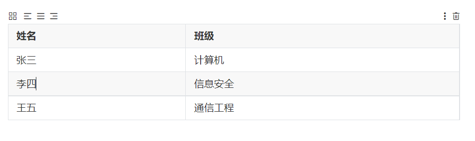

**级别**

#这是我的一级标题

##这是我的二级标题

###这是我的三级标题

# 这是我的一级标题

## 这是我的二级标题

### 这是我的三级标题

**无序标题**

-软件特性1

-软件特性2

-软件特性3【按Tab可以继续缩进】

- 软件特性1

- 软件特性1.1
- 软件特性1.2

- 软件特性2

- 软件特性2.1

- 软件特性3【按Tab可以继续缩进】

- 软件特性3.1

**有序排列**

1.第一点

2.第二点

3.第三点

1. 第一点
2. 第二点
3. 第三点
4. 【如果多按了一次 按回车自动删掉[Enter]】

**斜体**

\*这是斜体内容\*

*这是斜体内容【打完点空格】*

**粗体**

\*\*这是粗体内容\*\*

**这是粗体内容**【打完点空格】

**解释说明**

>这是文字内容块，进行解释说明

这是文字内容块，进行解释说明

**代码块**

``` python``` /```python+回车

```bash+回车 【名称大小写无所谓】

```python
def fibonacci(n):
    # 初始化斐波那契数列的前两项
    fib = [0, 1]
    # 循环生成后续项，直到达到指定数量
    while len(fib) < n:
        fib.append(fib[-1] + fib[-2])
    # 返回前n项（处理n=0/1的边界情况）
    return fib[:n]
```

**表格**

姓名|班级

-|-

张三|计算机

李四|信息安全

王五|通信工程



**vim乱码：**

```bash
:set paste
:set noautoindent
:set nosmartindent
:set nocindent
```
