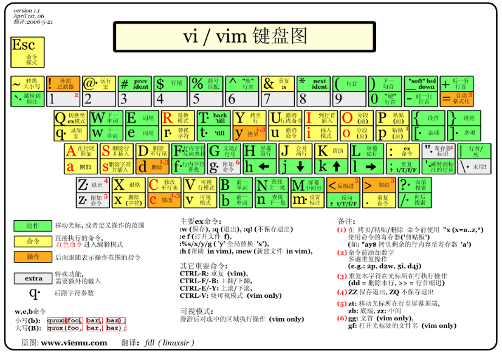
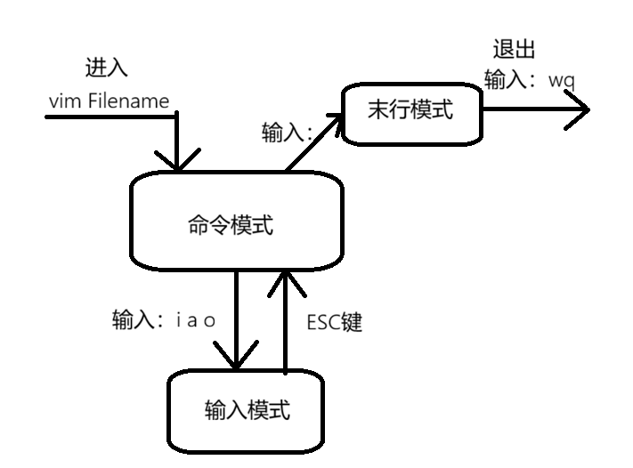
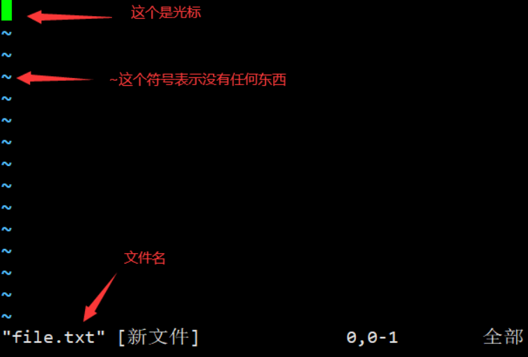
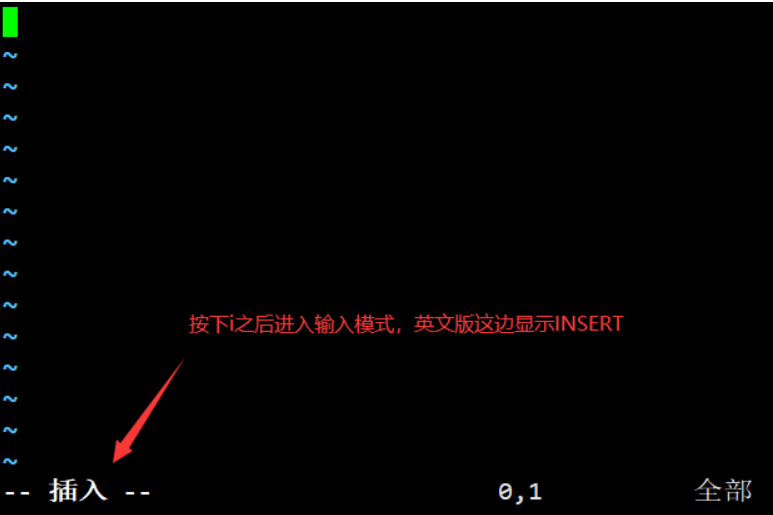
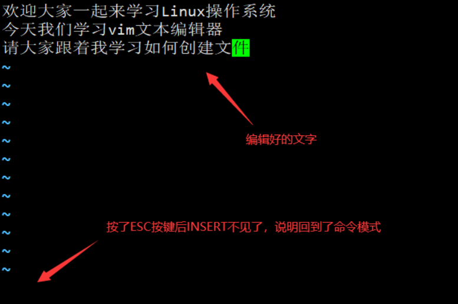
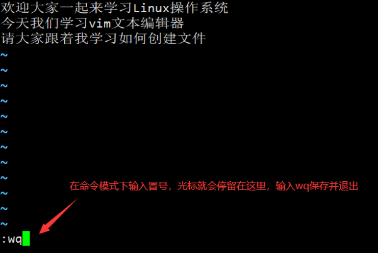

我们知道Linux的目录结构为树状结构，最顶级的目录为根目录 /。

其他目录通过挂载可以将它们添加到树中，通过解除挂载可以移除它们。

在开始本教程前我们需要先知道什么是绝对路径与相对路径。

- 绝对路径

- 路径的写法，由根目录`/`写起，例如：`/usr/share/doc`这个目录

- 相对路径

- 路径的写法，不是由`/`写起，例如由`/usr/share/doc`要到`/usr/share/man`底下时，可以写成：`cd ../man`这就是相对路径的写法。

# 文件管理命令

几个常见的处理目录的命令

- ls（英文全拼：list files）: 列出目录及文件名
- cd（英文全拼：change directory）：切换目录
- pwd（英文全拼：print work directory）：显示目前的目录
- mkdir（英文全拼：make directory）：创建一个新的目录
- rmdir（英文全拼：remove directory）：删除一个空的目录
- cp（英文全拼：copy file）: 复制文件或目录
- rm（英文全拼：remove）: 删除文件或目录
- mv（英文全拼：move file）: 移动文件与目录，或修改文件与目录的名称
- touch: 用于创建一个新的文件

## touch

创建新文件：用于修改文件或者目录的时间属性，包括存取时间和更改时间。若文件不存在，系统会建立一个新的文件。（文件存在，刷新文件的时间，文件内容不会改变）

```shell
touch 文件名
```

**案例演示**

```shell
# 创建新空白文件
[root@localhost ~]# touch newfile
```

## mkdir

创建新目录

```shell
mkdir [-mpv] 目录名称
```

**常用选项**

|  |  |
| --- | --- |
| **选项** | **含义** |
| `-m` | 配置文件的权限,直接配置，不需要看默认权限 (umask) |
| `-p` | 帮助你直接将所需要的目录(包含上一级目录)递归创建起来 |
| `-v` | 显示目录创建的过程 |

**案例演示**

```shell
# 创建一个新的文件夹叫dir
[root@localhost ~]# mkdir dir
# 无法直接创建多层目录
[root@localhost ~]# mkdir a/b/c
mkdir: 无法创建目录"a/b/c": 没有那个文件或目录
# 加上-p选项之后可以自动创建父级目录
[root@localhost ~]# mkdir -p a/b/c
# 显示详细的创建过程
[root@localhost ~]# mkdir -pv dir1/dir2
mkdir: 已创建目录 "dir1"
mkdir: 已创建目录 "dir1/dir2"
```

## cp

拷贝文件和目录

```shell
cp [选项]... 源文件... 目录
```

**常用选项**

|  |  |
| --- | --- |
| **选项** | **含义** |
| `-a` | 相当于`-pdr`的意思，至于`pdr`请参考下列说明 |
| `-d` | 如果源文件是符号链接，则复制链接本身，而不是链接指向的文件 |
| `-f` | 为强制(force)的意思，若目标文件已经存在且无法开启，则移除后再尝试一次 |
| `-i` | 若目标档(destination)已经存在时，在覆盖时会先询问动作的进行 |
| `-l` | 复制符号链接指向的文件，而不是链接本身 |
| `-p` | 连同文件的属性一起复制过去，保持文件的原始属性（如时间戳、权限等） |
| `-r` | 递归持续复制 |
| `-u` | 仅在源文件比目标文件新或目标文件不存在时进行复制 |
| `-v` | 显示复制的详细过程 |

**案例演示\***

```shell
[root@localhost ~]# mkdir /home/dir{1,2}
[root@localhost ~]# touch install.log
# 复制文件到目录下
[root@localhost ~]# cp -v install.log /home/dir1
# 复制文件到目录下，并且重命名为abc.txt
[root@localhost ~]# cp -v install.log /home/dir1/abc.txt
# 复制目录
[root@localhost ~]# cp -rv /etc /home/dir1
# 将多个文件复制到同一个目录
[root@localhost ~]# cp -rv /etc/passwd /etc/hostname /home/dir2
# 将多个文件复制到当前目录
[root@localhost ~]# cp -rv /etc/passwd /etc/hostname .
# 备份文件
[root@localhost ~]# cp -rv install.log{,old}
```

## mv

移动文件与目录，或修改名称

```shell
mv [选项]... 源文件... 目录
```

**常用选项**

|  |  |
| --- | --- |
| **选项** | **含义** |
| `-f` | force 强制的意思，如果目标文件已经存在，不会询问而直接覆盖 |
| `-i` | 若目标文件 (destination) 已经存在时，就会询问是否覆盖 |
| `-u` | 若目标文件已经存在，且 source 比较新，才会升级 (update) |
| `-v` | 显示复制的详细过程 |

**常用实例**

```shell
# 将file1移动到/home/dir2
[root@localhost ~]# touch file1
[root@localhost ~]# mv file1 /home/dir2

# 将file2移动到/home/dir2，并且改名file20
[root@localhost ~]# touch file2
[root@localhost ~]# mv file2 /home/dir2/file20
这里得首先mkdir /home/dir2 不然会将/home/dir2当做文件从而将file2改名为dir2

# 将file改名为file.txt
[root@localhost ~]# mv file file.txt
```

## rm

删除文件或目录

```shell
rm [选项]... 文件...
```

**常用选项**

|  |  |
| --- | --- |
| **选项** | **含义** |
| `-f` | 就是 force 的意思，忽略不存在的文件，不会出现警告信息【强制删除】 |
| `-i` | 互动模式，在删除前会询问使用者是否动作 |
| `-r` | 递归删除啊！最常用在目录的删除了！这是非常危险的选项！ |

**案例演示**

```shell
[root@localhost ~]# cd /home
[root@localhost home]# rm -rf dir1
```

## rmdir

**作用**：删除**空目录**（如果目录非空，会报错）。  
**基本语法**：

```bash
rmdir [选项] 目录路径
```

**常用参数**

- `-p`（递归删除父目录）  
  从子目录向上删除空目录链。例如：

```bash
rmdir -p a/b/c  # 若 a/b/c 为空，则依次删除 c → b → a
```

- `--ignore-fail-on-non-empty`  
  忽略非空目录的错误（静默跳过）

## 禁忌命令

如下命令会从根目录开始删除Linux系统中所有的文件，包括系统文件。严令禁止在任何服务器上输入如下命令

```plain
# 不要操作！！！
[root@localhost ~]# rm -rf /*
```

# 文本文件查看

在Linux中一切皆文件，说的就是Linux利用文本文件来保存系统所有的设置。

我们在Linux中想实现一个功能，不可避免的需要查看文本文件，修改文本文件。

## cat

用于打开文本文件并显示出来

```shell
cat [选项]... [文件]...
```

**常用选项**

|  |  |
| --- | --- |
| **选项** | **含义** |
| `-n` | 由 1 开始对所有输出的行数编号 |
| `-b` | 和 -n 相似，只不过对于空白行不编号 |
| `-s` | 当遇到有连续两行以上的空白行，就代换为一行的空白行 |
| `-A` | 显示控制字符 |

**案例演示\***

```shell
# 查看anaconda-ks.cfg文件
[root@localhost ~]# cat anaconda-ks.cfg
# 查看anaconda-ks.cfg文件，并且显示行号
[root@localhost ~]# cat  -n anaconda-ks.cfg
```

## less

可以随意浏览文件，支持翻页和搜索，支持向上翻页和向下翻页 【与cat不同的是不会一次性加载所有内容，当需要访问比较大的文件时如日志，不建议使用cat一次性加载，可能造成系统的IO堵塞】

**案例演示**

```shell
[root@localhost ~]# less anaconda-ks.cfg
```

## head

查看文件的开头部分的内容

```shell
head [选项]... [文件]...
```

**常用选项**

|  |  |
| --- | --- |
| **选项** | **含义** |
| `-q` | 隐藏文件名，默认是隐藏 |
| `-v` | 显示文件名 |
| `-c N` | 显示的字节数 |
| `-n N` | 显示的行数 |

N在这里表示Number（数量） 显示多少字节数和显示多少行（默认是10行）

**案例演示**

```shell
# 查看文件的前6行
[root@localhost ~]# head -n 6 anaconda-ks.cfg
#查看文件的前10个字节
[root@localhost ~]# head -c 10 anaconda-ks.cfg
```

## tail

会把文本文件里的最尾部的内容显示在屏幕上

```shell
tail [选项]... [文件]...
```

**常用选项**

|  |  |
| --- | --- |
| **选项** | **含义** |
| `-f` | 循环读取 |
| `-q` | 隐藏文件名，默认隐藏 |
| `-v` | 显示文件名 |
| `-c N` | 显示的字节数 |
| `-n N` | 显示文件的尾部 n 行内容 |
| `-s` | 与-f合用,表示在每次反复的间隔休眠S秒 |

**案例演示**

```shell
# 查看文件anaconda-ks.cfg尾部的3行
[root@localhost ~]# tail -n 3 anaconda-ks.cfg

# 查看日志的实时更新情况
[root@localhost ~]# tail -f /var/log/messages 
# ctrl+c退出

# 查看文件anaconda-ks.cfg从第10行到结尾
[root@localhost ~]# tail -n +10 anaconda-ks.cfg
```

## grep

针对文件内容进行过滤，本工具属于文本三剑客，后续会详细讲解，目前只要求初学者掌握最基本的实例即可

**案例演示**

```shell
# 在/etc/passwd的文件中找出有root的行
[root@xwz ~]# grep 'root' /etc/passwd

# 在/etc/passwd中找出root开头的行
[root@xwz ~]# grep '^root' /etc/passwd

# 在/etc/passwd中找出bash结尾的行
[root@xwz ~]# grep 'bash$' /etc/passwd
```

# 文本文件编辑

在 Linux 中只掌握文本查看是远远不够的，我们还需要掌握编辑文本文件。

Linux 上也有图形化的文本编辑器，类似于 Windows 的记事本，但是很多时候我们只能用命令行来管理 Linux 操作系统，所以必须要掌握命令行的文本编辑器软件。

目前常见的命令行文本编辑器

- **nano**：在 Debain 系列的系统上会比较常见，但是其他的 Linux 发行版也都可以安装
- **vi**：所有的 Unix Like 系统都会内建 vi 文本编辑器，其他的文本编辑器则不一定会存在。
- **vim**：具有程序编辑的能力，可以主动的以字体颜色辨别语法的正确性，方便程序设计。

## 什么是 Vim

Vim 是从 vi 发展出来的一个文本编辑器。代码补完、编译及错误跳转等方便编程的功能特别丰富，在程序员中被广泛使用。

Vim 是一个纯命令行文本编辑器，很多文本编辑的功能都是通过键盘快捷键的方式完成，所以我们需要记住常用的键位。



## 使用方式

基本上 vi/vim 共分为三种模式，分别是命令模式（Command mode），输入模式（Insert mode）和末行模式（Last line mode）。 这三种模式的作用分别是：

### 命令模式

用户刚刚启动 vi/vim，便进入了命令模式。

此状态下敲击键盘动作会被Vim识别为命令，而非输入字符。比如我们此时按下`i`，并不会输入一个字符，`i`被当作了一个命令。

以下是常用的几个命令：

|  |  |
| --- | --- |
| **命令** | **含义** |
| `i` | 切换到输入模式，以输入字符 |
| `x` | 删除当前光标所在处的字符 |
| `:` | 切换到末行模式，以在最底一行输入命令 |

### 输入模式

在命令模式下按下 `i` 就进入了输入模式。

在输入模式中，可以使用以下按键：

|  |  |
| --- | --- |
| **命令** | **含义** |
| `字符按键以及Shift组合` | 输入字符 |
| `ENTER` | 回车键，换行 |
| `BACK SPACE` | 退格键，删除光标前一个字符 |
| `DEL` | 删除键，删除光标后一个字符 |
| `方向键` | 在文本中移动光标 |
| `HOME/END` | 移动光标到行首/行尾 |
| `Page Up/Page Down` | 上/下翻页 |
| `Insert` | 切换光标为输入/替换模式，光标将变成竖线/下划线 |
| `ESC` | 退出输入模式，切换到命令模式 |

### 末行模式

在命令模式下按下 `:`（英文冒号）就进入了末行模式。

末行模式可以输入单个或多个字符的命令，可用的命令非常多。

在末行模式中，基本的命令有：

|  |  |
| --- | --- |
| **命令** | **含义** |
| `q` | 退出程序 |
| `w` | 保存文件 |

按 ESC 键可随时退出末行模式。

简单的说，我们可以将这三个模式的关系用下图来表示：



## 使用实例

有些 linux 发行套件上并没有安装 vim，我们可以安装一下，下面提供了 Rockylinux 的安装命令

```shell
# yum是在线安装软件的命令，后面会有详细的介绍，这边直接使用
[root@localhost ~]# yum -y install vim
```

vi和vim大部分的操作完全一模一样，所以会使用vim自然也会使用vi

**案例演示**

直接输入`vim 文件名`就能够进入 vim 的命令模式了。请注意，记得 vim 后面一定要加文件名，不管该文件存在与否！

```shell
[root@localhost ~]# vim file.txt
```

输入这条命令之后，会看到如下画面



按下`i`进入输入模式(也称为编辑模式)，开始编辑文字

在命令模式之中，只要按下`i`,`o`,`a`等字符就可以进入输入模式了！

在编辑模式当中，你可以发现在左下角状态栏中会出现`--INSERT--`的字样，那就是可以输入任意字符的提示。

这个时候，键盘上除了 Esc 这个按键之外，其他的按键都可以视作为一般的输入按钮了，所以你可以进行任何的编辑。



好了，假设我已经按照上面的样式给他编辑完毕了，那么应该要如何退出呢？是的！没错！就是给他按下 Esc 这个按钮即可！马上你就会发现画面左下角`--INSERT--`的不见了！



输入**:wq**后回车即可保存离开，注意其中的冒号必须是英文输入法下的冒号！



现在我们就成功创建了一个文件，查看文件的内容吧

```shell
[root@localhost ~]# ls -lh file.txt
[root@localhost ~]# cat file.txt
```

## 按键说明

下面将会列举出 vim 非常多的常用按键，初学者只需要浏览一遍，记住大概 vim 有哪些功能，等后面大量使用 vim 的时候，再来翻阅笔记，并且在多次使用中把这些功能记住。

### 命令模式

下面的操作都是在命令模式下进行的

**移动光标的方法**

|  |  |
| --- | --- |
| **方法** | **含义** |
| `h 或 向左箭头键(←)` | 光标向左移动一个字符 |
| `j 或 向下箭头键(↓)` | 光标向下移动一个字符 |
| `k 或 向上箭头键(↑)` | 光标向上移动一个字符 |
| `l 或 向右箭头键(→)` | 光标向右移动一个字符 |
| `[Ctrl] + [f]` | 屏幕『向下』移动一页，相当于 [Page Down]按键 (常用) |
| `[Ctrl] + [b]` | 屏幕『向上』移动一页，相当于 [Page Up] 按键 (常用) |
| `[Ctrl] + [d]` | 屏幕『向下』移动半页 |
| `[Ctrl] + [u]` | 屏幕『向上』移动半页 |
| `+` | 光标移动到非空格符的下一行 |
| `-` | 光标移动到非空格符的上一行 |
| `n + [space]` | 那个 n 表示『数字』，例如 20 。按下数字后再按空格键，光标会向右移动这一行的 n 个字符 |
| `0 或功能键[Home]` | 移动到这一行的最前面字符处 |
| `$ 或功能键[End]` | 移动到这一行的最后面字符处 |
| `H` | 光标移动到这个屏幕的最上方那一行的第一个字符 |
| `M` | 光标移动到这个屏幕的中央那一行的第一个字符 |
| `L` | 光标移动到这个屏幕的最下方那一行的第一个字符 |
| `G` | 移动到这个档案的最后一行(常用) |
| `nG` | n 为数字。移动到这个档案的第 n 行。例如 20G 则会移动到这个档案的第 20 行 |
| `gg` | 移动到这个档案的第一行，相当于 1G |
| `n + [Enter]` | n 为数字。光标向下移动 n行 |

**文本的搜索与替换**

|  |  |
| --- | --- |
| **方法** | **含义** |
| `/word` | 向光标之下寻找一个名称为 word 的字符串。 |
| `?word` | 向光标之上寻找一个名称为 word 的字符串。 |
| `n` | 继续向前搜索【下一个匹配项】 |
| `N` | 与 n 刚好相反，反向回溯搜索【上一个匹配项】 |
| `:n1,n2s/word1/word2/g` | n1 与 n2 为数字。在第 n1 与 n2 行之间寻找 word1 这个字符串，并将该字符串取代为 word2  【没有+g只会换每一行的第一个关键字，+g换替换所有关键字（global）】 |
| `:1,$s/word1/word2/g`  或 `:%s/word1/word2/g` | 从第一行到最后一行寻找 word1 字符串，并将该字符串取代为 word2 ！【 % 也是全文的意思】 |
| `:1,$s/word1/word2/gc`  或 `:%s/word1/word2/gc` | 从第一行到最后一行寻找 word1 字符串，并将该字符串取代为 word2 ！且在取代前显示提示给用户确认 (confirm) 是否需要取代！ |

**删除/剪切、复制与粘贴**

|  |  |
| --- | --- |
| **方法** | **含义** |
| `x, X` | x 为向后删除一个字符 (相当于 [del] 按键)， X 为向前删除一个字符(相当于 [backspace] 按键) |
| `nx` | n 为数字，连续向后删除 n 个字符。举例来说，我要连续删除 10 个字符， 『10x』。 |
| `dd` | 删除/剪切光标所在的那一整行(常用) |
| `ndd` | n 为数字。删除/剪切光标所在的向下 n 行，例如 20dd 则是删除 20 行 |
| `d1G` | 删除光标所在到第一行的所有数据 |
| `dG` | 删除光标所在到最后一行的所有数据 |
| `d$` | 删除游标所在处，到该行的最后一个字符 |
| `d0` | 那个是数字的 0 ，删除光标所在处，到该行的最前面一个字符 |
| `yy` | 复制游标所在的那一行 |
| `nyy` | n 为数字。复制光标所在的向下 n 行，例如 20yy 则是复制 20 行 |
| `y1G` | 复制游标所在行到第一行的所有数据 |
| `yG` | 复制游标所在行到最后一行的所有数据 |
| `y0` | 复制光标所在的那个字符到该行行首的所有数据 |
| `y$` | 复制光标所在的那个字符到该行行尾的所有数据 |
| `p, P` | p 为将已复制的数据在光标下一行贴上，P 则为贴在光标上一行！ |
| `J` | 将光标所在行与下一行的数据合并成同一行 |
| `c` | 删除并进入插入模式 |
| `u` | 撤销上一步操作 |
| `[Ctrl]+r` | 重做被撤销的操作。如果撤销多了想恢复过来就用这个 |
| `.` | 重复前一个动作。 如果你想要重复删除、重复贴上等等动作，按下小数点『.』就好了！ |

**1、j-合并行（join）**

**含义：**将当前行与下一行合并成一行。

**作用：**快速整理文本，把两行内容连成一行，中间用空格隔开。

**例子：**  
原文：

Hello

World

光标在 Hello 这一行，按下 j 后：

Hello World

**2、c-修改（Change）**

**含义：**c 代表 change，用于删除指定文本并进入插入模式。

**语法：**c + 移动命令（如 c$、cw、c3j 等）

**常见组合：**

cw：修改从光标到当前单词末尾

c$：修改从光标到行尾

c3j：修改从当前行开始往下 3 行

10c：删除当前行开始往下10行

**例子：**

原文：

I like apples and bananas.

光标在 `apples` 的 `a` 上，输入 `cw`，然后输入 `oranges`，再按 `Esc`：

I like oranges and bananas.

**3、u —— 撤销（Undo）**

**含义：**撤销上一次编辑操作。

**作用：**后悔了？按 u 就能回到上一步。

**例子：**

你刚删除了一行，想恢复：

按 u → 删除的内容恢复。

再按一次 u → 可以继续撤销更早的操作。

**4、[Ctrl]+r —— 重做（Redo）**

**含义：**重做被撤销的操作。

**作用：**如果你撤销多了，想恢复回来，就用这个。

**例子：**

你按了 u 撤销了删除操作，但其实你想删掉它：

**5、. —— 重复上一个操作（Repeat）**

**含义：**重复执行上一次的修改类操作（如删除、替换、插入等）。

**作用：**当你需要重复做同样的编辑动作时，不用再敲一遍命令，按 . 就行。

**例子：**

原文：

apple

banana

orange

grape

你想把所有单词都改成大写开头：

光标在 apple，输入 cwApple，按 Esc。

移动光标到 banana，按 . → 自动变成 Banana。

移动到 orange，按 . → 变成 Orange。

**进入输入或取代的编辑模式**

|  |  |
| --- | --- |
| **方法** | **含义** |
| `i, I` | 进入输入模式(Insert mode)： i 为『从目前光标所在处输入』， I 为『在目前所在行的第一个非空格符处开始输入』。 |
| `a, A` | 进入输入模式(Insert mode)： a 为『从目前光标所在的下一个字符处开始输入』， A 为『从光标所在行的最后一个字符处开始输入』。 |
| `o, O` | 进入输入模式(Insert mode)： 这是英文字母 o 的大小写。o 为在目前光标所在的下一行处输入新的一行； O 为在目前光标所在的上一行处输入新的一行！ |
| `r, R` | 进入取代模式(Replace mode)： r 只会取代光标所在的那一个字符一次【光标在 h 上，输入 r，然后输入 H】不用按下ESC自动回到普通模式；R会一直取代光标所在的文字，直到按下 ESC 为止 |
| `[Esc]` | 退出编辑模式，回到一般模式中 |

### 末行模式

**末行模式下的储存、离开等指令**

|  |  |
| --- | --- |
| **方法** | **含义** |
| `:w` | 将编辑的数据写入硬盘中 |
| `:w!` | 若文件属性为『只读』时，强制写入该文件。不过，到底能不能写入， 还是跟你对该文件的权限有关 |
| `:q` | 离开 vim |
| `:q!` | 若曾修改过文件，又不想储存，使用 ! 为强制离开不储存。 |
| `:wq` | 保存后离开，若为 `:wq!`则为强制保存退出 |
| `ZZ` | 这是大写的 Z 喔！如果修改过，保存当前文件，然后退出！效果等同于(保存并退出) |
| `:x` | 效果等同于(保存并退出) |
| `:X` | 大写的X，用于加密文件 |
| `ZQ` | 不保存，强制退出。效果等同于 `:q!` |
| `:w [filename]` | 将编辑的数据储存成另一个文件（类似文件另存为） |
| `:r [filename]` | 在编辑的数据中，读入另一个文件的数据。亦即将 『filename』 这个文件内容加到光标所在行后面 |
| `:n1,n2 w [filename]` | 将 n1 到 n2 的内容储存成 filename 这个文件。 |
| `:!command` | 暂时离开 vi 到bash命令行下执行 command 的显示结果！ |

**1、**`:w [filename]` **—— 另存为**

- **含义**：将当前在 Vim 中编辑的内容**保存到一个新的文件**中（类似于 Word 里的“另存为”）。
- **注意**：执行这个命令后，你当前的编辑窗口**并不会**自动切换到新文件名，除非你执行 `:e [filename]` 重新打开。
- **例子**：

假设你正在编辑一个临时文件，现在想把它保存为 `test.txt`。

:w test.txt

执行后，Vim 会创建一个名为 test.txt 的文件，并将你当前编辑的内容写入其中。

**2、** **:r [filename]** **—— 读入/插入文件**

- **含义：**将指定文件的内容读取并插入到当前光标所在行的下方。
- **作用：**相当于在 Vim 中“粘贴”另一个文件的内容。
- **例子：**

假设你正在编辑 main.txt，想把 header.txt 的内容加到当前光标位置下面。

:r header.txt

执行后，header.txt 里的所有内容会出现在你当前光标所在行的下一行。

**3、****:n1,n2 w [filename]** **—— 保存指定行到新文件**

- **含义：**将当前文件中第 n1 行到第 n2 行的内容单独提取出来，保存到一个新的文件中。
- **语法：**:起始行号,结束行号 w 目标文件名
- **例子：**

假设你的文件有 100 行，你想把第 10 行到第 20 行的内容单独保存为 part.txt。

:10,20 w part.txt

- 执行后，只有这 11 行的内容会被写入 `part.txt`。

**4.、**`:!command` **—— 执行外部 Shell 命令**

- **含义**：暂时跳出 Vim，去执行一条 Linux/Unix 的终端命令（Shell 命令），执行完后会回到 Vim。
- **作用**：在不退出编辑器的情况下，查看目录、运行脚本或查看文件。
- **例子**：

你想看看当前目录下有哪些文件，但又不想退出 Vim。

:!ls -l

执行后，Vim 会暂停，屏幕显示 ls -l 的结果，按回车后回到 Vim。

**另一个例子：**

你想查看 /etc/hosts 文件的内容，但不想在 Vim 里打开它。

:!cat /etc/hosts

执行后，Vim 会打印出该文件的内容。

**vim环境变量修改**

|  |  |
| --- | --- |
| **方法** | **含义** |
| `:set nu` | 显示行号，设定之后，会在每一行的前缀显示该行的行号 |
| `:set nonu` | 与 set nu 相反，为取消行号 |
| `:set ai` | 智能缩进（再写一些python代码更方便） |
| `:set noai` | 取消智能缩进 |
| `:set ts=4` | 设置Tab键为4个空格（默认为8个） |

**说明：**

这里的配置只是针对当前的 shell ，如果退出就会无效

如果需要永久生效可以写入到配置文件中，.vimrc是针对当前用户的，/tec/vimrc是针对所有用户的
