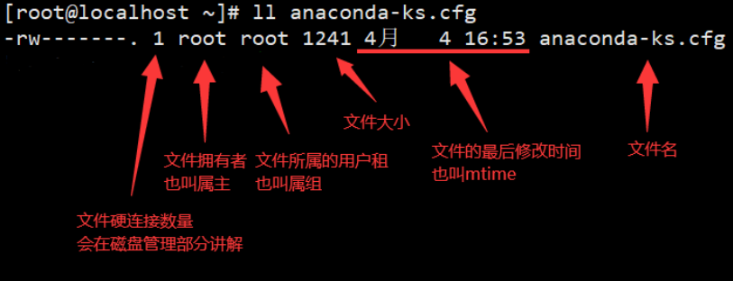
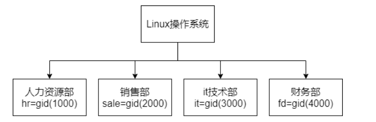
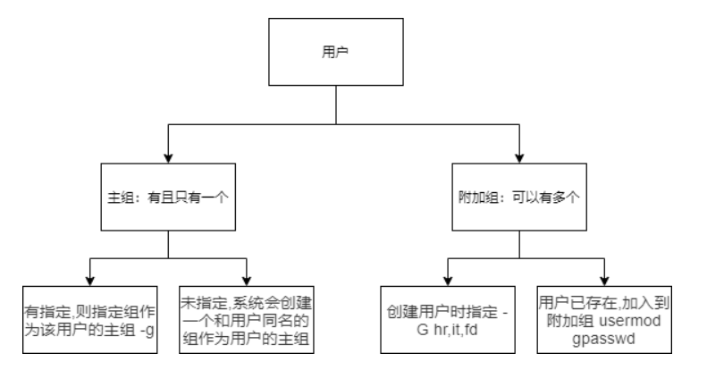
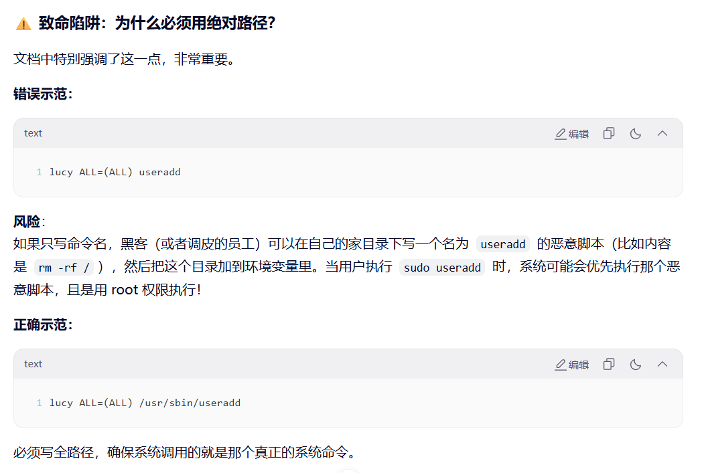

Linux系统是一个多用户多任务的分时操作系统，任何一个要使用系统资源的用户，都必须首先向系统管理员申请一个账号，然后以这个账号的身份进入系统。

为了更加方便的管理多个用户，就出现了用户组的概念，关于**用户**和**用户组**：

- 系统上的每个进程(运行的程序)都是作为特定用户运行
- 每个文件是由一个特定的用户拥有
- 访问文件和目录受到用户的限制
- 与正在运行的进程相关联的用户确定该进程可访问的文件和目录

实现用户账号的管理，要完成的工作主要有如下几个方面：

- 用户账号的添加、删除与修改
- 用户口令的管理
- 用户组的管理

# 用户和用户组查看

## id

用于显示用户的ID，以及所属群组的 ID

id会显示用户以及所属群组的实际与有效 ID。若两个 ID 相同，则仅显示实际 ID。若仅指定用户名称，则显示目前用户的 ID。

```shell
id [OPTION]... [USER]
```

|  |  |
| --- | --- |
| **选项** | **含义** |
| `-g` | 显示用户**所属群组**的 ID |
| `-G` | 显示用户**所属附加群组**的 ID |
| `-n` | 显示用户，**所属群组或附加群组**的名称 |
| `-r` | 显示用户真实 ID，用户真实的 uid |
| `-u` | 显示用户有效 ID，可以登录某些高权限用户 |

### uid 约定

Linux 操作系统会依据用户的 uid 数值来判定这个用户的角色，分别如下

- **0**：超级管理员，也就是root，在linux系统中拥有所有权力
- **1~999**：系统用户，系统用户往往是用来约束系统中的服务的
- **1000+**：普通用户，可以用来登陆和使用Linux操作系统

关于root用户

- uid是0
- 拥有操作系统所有权力
- 该用户有权力覆盖文件系统上的普通权限
- 安装或删除软件并管理系统文件和目录
- 大多数设备只能由root控制

### 案例演示

查看当前登陆的用户信息（unconfined：不受限制的）

```shell
[root@localhost ~]# id
uid=0(root) gid=0(root) 组=0(root) 环境=unconfined_u:unconfined_r:unconfined_t:s0-s0:c0.c1023
```

查看文件的拥有者

```shell
[root@localhost ~]# ll anaconda-ks.cfg 
-rw-------. 1 root root 1241 4月   4 16:53 anaconda-ks.cfg
```



查看运行进程的用户名，ps命令会在后面进程管理部分讲解

```shell
[root@localhost ~]# ps aux
USER PID %CPU %MEM    VSZ   RSS TTY STAT START   TIME COMMAND
root 2  0.0  0.0      0     0 ? S    09:06   0:00 [kthreadd]
root 3  0.0  0.0      0     0 ? S    09:06   0:01 [ksoftirqd/0]
root 4  0.1  0.0      0     0 ? R    09:06   0:09 [kworker/0:0]
root 5  0.0  0.0      0     0 ? S<   09:06   0:00 [kworker/0:0H]
```

## 相关的文件

之前说过 Linux 一切皆文件，所以用户和用户组相关的信息也都是保存在文本文件中的，下面列举出相关的文件。

### passwd 文件

用于保存用户的信息，一般第一行是 root 用户，下面都是其他用户

```shell
[root@localhost ~]# head -n 1 /etc/passwd
root:x:0:0:root:/root:/bin/bash
# 这个格式为用户名:密码:uid:gid:描述:家目录:登陆后执行的命令
```

### shadow 文件

格式中密码占位置太长了，所以使用x来替代，Linux系统会到shadow中查找x部分的密码内容

```shell
[root@localhost ~]# head -n 1 /etc/shadow
root:$6$frokclXSnQa8EbKs$pWElbjPlmxjYh30tr8qLsTQVOhuPg7GmW9Sanm2yXAK8TNMgje1gyc/vwPgqvmSMf6VaoEvveM0gFvtETmXy/.::0:99999:7:::
# 这个格式为用户名：加密密码：最后一次修改时间：最小修改时间间隔：密码有效期：密码需要变更前的警告天数：密码过期后的宽限时间：账号失效时间：保留字段
```

密码在`shadow`文件中会使用加密算法加密，加密算法默认是`$6`，这个类型6的加密算法是sha-512。我们也可以在man手册中看到对shadow文件的详细解释。

```shell
[root@localhost ~]# man 5 shadow
# man手册一共有9个章节，其中第5个章节是对文件格式的说明
# 对man手册感兴趣的同学，也可以自己在网上查找学习man手册的更多内容
```

### group文件

用户和组的对应关系，会保存在group文件中

```shell
[root@localhost ~]# head -n 1 /etc/group
root:x:0:
# 这个格式是组名:口令(Password)存在/etc/gshadow中:组标识号(GID):以该组为附加组的用户
```

# 用户组管理

## 添加用户组

groupadd 命令用于创建一个新的工作组，新工作组的信息将被添加到系统文件中

```shell
groupadd [选项] 组
```

### 常用选项

|  |  |
| --- | --- |
| **选项** | **含义** |
| `-g` | 指定新建工作组的 id |
| `-r` | 创建系统工作组，系统工作组的组ID小于 500 |
| `-K` | 覆盖配置文件`/etc/login.defs` |
| `-o` | 允许添加组 ID 号不唯一的工作组 |
| `-f` | 如果指定的组已经存在，不会报错，仅以成功状态退出。  与-g 一起使用：如果指定的 GID 已经被占用了，系统会自动帮你找一个新的、空闲的 GID 来创建这个组，而不是报错说 GID 冲突。 |

#### `-g`**：指定 GID**

- **含义**：默认情况下，系统会自动分配下一个可用的 GID。如果你希望手动指定这个新组的 GID，就用这个参数。
- **例子**：  
  创建一个名为 `devops` 的组，并强制指定它的 GID 为 `1234`。

groupadd -g 1234 devops

执行后，查看 `/etc/group`，你会看到 `devops:x:1234:`。

#### `-r`**：创建系统组**

- **含义**：创建一个“系统工作组”。

- **普通组**：通常是给真人用户用的，GID 一般从 1000 或 500 开始往上加。
- **系统组**：是给软件、服务（如 nginx, mysql）用的，GID 范围通常在 `SYS_GID_MIN` 到 `SYS_GID_MAX` 之间（一般是 1-499 或 1-999）。

- **例子**：  
  为 MySQL 数据库创建一个系统组。

groupadd -r mysql

系统会自动分配一个小于 500（或 1000，取决于发行版配置）的 GID 给它。

#### `-K`**：覆盖默认配置**

- **含义**：`/etc/login.defs` 是 Linux 的登录配置文件，里面定义了 GID 的范围等默认值。`-K` 允许你在创建组时，临时修改这些默认规则，而不需要去改配置文件。
- **例子**：  
  假设配置文件规定 GID 最小是 1000，但我现在想创建一个 GID 为 800 的组（非系统组范围），可以这样:

groupadd -K GID\_MIN=800 -K GID\_MAX=900 mygroup

（注：这个参数比较高级，日常运维用得少，通常配合脚本自动化部署使用。）

#### `-o`**：允许 GID 重复**

- **含义**：默认情况下，GID 必须是**唯一**的（一个萝卜一个坑）。加上 `-o` 后，允许两个不同的组名拥有**相同**的 GID。
- **例子**：  
  假设已经有一个组 `group1`，GID 是 `1005`。现在我想创建一个 `group2`，也想用 `1005`。

groupadd -g 1005 -o group2

执行后，`group1` 和 `group2` 虽然名字不同，但在系统权限看来，它们其实是同一个 GID。

#### `-f`**：强制模式**

- **含义**：这个参数用来处理“组已存在”的情况，防止脚本报错中断。

- 如果组**已经存在**：命令不会报错，而是直接成功退出（状态码 0）。
- 如果配合 `-g` 使用：如果指定的 GID 已经被占用了，系统会自动帮你找一个新的、空闲的 GID 来创建这个组，而不是报错说 GID 冲突。

- **例子**：

**场景 1（组已存在）**  
你想创建 `testgroup`，但它已经有了。

groupadd -f testgroup

系统什么都不做，也不会报错，直接返回成功。

**场景 2（GID 冲突）**  
GID 1005 已经被占用了。

groupadd -f -g 1005 testgroup2

系统发现 1005 用不了，会自动分配比如 1006 给 `testgroup2`，并创建成功。

### 案例演示

按照下图创建组，并且指定gid，并且检查是否成功



```shell
[root@localhost ~]# groupadd hr -g 1000
[root@localhost ~]# groupadd sale -g 2000
[root@localhost ~]# groupadd it -g 3000
[root@localhost ~]# groupadd fd -g 4000
[root@localhost ~]# tail -n 4 /etc/group
hr:x:1000:
sale:x:2000:
it:x:3000:
fd:x:4000:
```

## 修改用户组

groupmod命令用于更改群组识别码或名称

```shell
groupmod [选项] 组
```

### 常用选项

- **-g**：修改组 ID
- **-n**：改名为 NEW\_GROUP
- **-o**：允许使用重复的 GID

- **修改 GID（-g）**

这是最常用的功能，用于更改组的数字 ID。

**场景假设**

你有一个叫 dev 的组，当前的 GID 是 1001，现在你想把它改成 2000。

**操作步骤**

1.查看修改前：

grep "dev" /etc/group

# 输出可能类似：dev:x:1001:

2.执行修改：

groupmod -g 2000 dev

3.查看修改后：

grep "dev" /etc/group

# 输出变为：dev:x:2000:

**注意：**修改 GID 后，该组原先拥有的文件，其所属组 ID **不会自动更新**，还是旧的 GID（1001）。你需要手动使用 chown 或 find 命令去更新文件的归属。

- **修改组名（-n）**

用于给组“改名”。

**场景假设**

公司部门调整，原来的 sales 组要改名为 marketing。

**操作步骤**

1.执行修改：

groupmod -n marketing sales

语法结构是：groupmod -n 新名字 旧名字

2.验证结果：

grep "marketing" /etc/group

# 输出：marketing:x:1002:

此时你会发现，组名变了，但是 GID（比如 1002）保持不变。

- **允许重复 GID（-o）**

这个选项比较特殊，它允许两个不同的组名拥有相同的 GID。

**场景假设**

你有两个组 group\_a（GID 6000）和 group\_b（GID 6001）。你想把 group\_b 的 GID 改成 6000（和 group\_a 一样）。如果不加 -o，系统会报错说 GID 已存在。

**操作步骤**

1.执行修改（强制重复）：

groupmod -g 6000 -o group\_b

2.查看结果：

grep "6000" /etc/group

# 输出可能类似：

# group\_a:x:6000:

# group\_b:x:6000:

**风险提示**：虽然系统允许这样做，但在实际生产环境中**强烈不建议**使用 -o。因为当两个组拥有相同的 GID 时，文件权限管理会变得非常混乱，你很难分清文件到底属于哪个组，会给安全审计带来麻烦。

### 案例演示

- 修改fd组的名字为finance

```shell
[root@localhost ~]# groupmod -n finance fd
[root@localhost ~]# tail -n 1 /etc/group
finance:x:4000:
```

## 删除用户组

groupdel命令用于删除群组

需要从系统上删除群组时，可用groupdel(group delete)指令来完成这项工作。**倘若该群组中仍包括某些用户，则必须先删除这些用户后，方能删除群组。**

```shell
groupdel [组名]
```

### 案例演示

- 删除一个用户组

```shell
[root@localhost ~]# groupadd test
[root@localhost ~]# groupdel test
```

## 用户组成员管理

gpasswd 是 Linux 下工作组文件 /etc/group 和 /etc/gshadow 管理工具，用于将一个用户添加到组或者从组中删除

```shell
gpasswd [选项] 组
```

### 常用选项

- **-a**：添加用户到组；
- **-d**：从组删除用户；
- **-A**：指定管理员，可以执行添加或者删除组员；
- **-M**：替换组中的全部用户列表，不包含在内的用户将会从组中删除；
- **-R**：限制用户登入组，只有组中的成员才可以用newgrp加入该组。

### 案例演示

创建用户 itadmin，并且将其加入 it 组

```shell
[root@localhost ~]# useradd itadmin
[root@localhost ~]# gpasswd -a itadmin it
正在将用户“itadmin”加入到“it”组中
[root@localhost ~]# cat /etc/group |grep it:
it:x:3000:itadmin
# 在组文件中，可以看到这个组的成员
[root@localhost ~]# id itadmin
uid=6667(itadmin) gid=6667(itadmin) 组=6667(itadmin),3000(it)
# 在用户的信息中，可以看到这个用户的所属组
```

# 用户管理

## 添加用户

useradd 可以用来添加新的用户账号

```shell
useradd [选项] 用户名
```

### 常用选项

- **-c** ：指定一段注释性描述。
- **-d** ：指定用户主目录，如果此目录不存在，则同时使用-m选项，可以创建主目录。
- **-m**：创建用户的主目录
- **-g**：指定用户所属的用户组，默认会创建一个和用户名同名的用户组。
- **-G** ：指定用户所属的附加组，一个用户可以属于多个附加组。
- **-s** ：指定用户的登录Shell。
- **-u** ：指定用户的用户号，如果同时有-o选项，则可以重复使用其他用户的标识号。

### 案例演示

- **添加一般用户**

```shell
[root@localhost ~]# useradd user01
```

- 系统会自动分配一个 UID（比如 1001）。
- 会自动创建一个和用户名同名的私有组（GID）。
- 会在 /home 下自动创建 /home/user01 目录（取决于发行版配置，CentOS 默认会建，有些不会）。
- Shell 默认为 /bin/bash。

- **为添加的用户指定相应的用户组**

```plain
[root@localhost ~]# useradd -g root user02
```

- **为新添加的用户指定home目录**

```plain
[root@localhost ~]# useradd -d /home/test user03
```

useradd 命令默认不会自动创建这个指定的目录（除非配合 -m）。如果你只用了 -d 而没加 -m，用户创建成功了，但 /home/test 文件夹可能不存在，导致用户登录报错。所以要先准备目录。

- **建立一个不给登录的用户**

```shell
[root@localhost ~]# useradd -s /sbin/nologin user04
```

- **查看用户描述信息**

```bash
[root@localhost ~]# useradd -c "this is python_developmer user" python-developmer
[root@localhost ~]# cat /etc/passwd |grep python-developmer
python-developmer:x:1005:1005:this is python_developmer user:/home/python-developmer:/bin/bash
```

## 切换用户

su命令用户Linux系统中的用户切换

```plain
su [选项] 用户名
```

### 常用选项

- `-`：以目标用户的环境变量启动新会话。这将模拟用户完全登录到新用户账户，包括其家目录、环境变量等。
- `-c 命令`：执行指定的命令，并在执行完毕后返回原始用户。
- `-s shell`：使用指定的 shell 替代目标用户的默认 shell。

**-：彻底切换（最常用）**

- **含义**：图片里说“以目标用户的环境变量启动新会话”，翻译成人话就是：模拟一次完整的登录过程。
- **作用**：

1. 切换身份：变成了新用户。
2. 切换目录：自动跳转到新用户的家目录（比如从 /root 跳到了 /home/user1）。
3. 切换环境：加载新用户的环境变量（比如 PATH 路径），确保新用户能正常使用自己的命令。

- **例子**：

假设你现在是 root 用户，想变成普通用户 xiaoming 去测试环境。

su - xiaoming

输入密码后，你会发现命令行前缀变了，而且当前所在的目录也自动变成了 /home/xiaoming。 这是最推荐、最标准的切换方式。

**-c：临时执行一条命令**

- **含义：**以目标用户的身份执行指定的命令，执行完立刻变回原来的用户。
- **作用：**当你不想完全切换过去，只是想借用一下别人的权限跑一个脚本或命令时，这个非常有用。
- **例子：**

你现在是 root，想以 nginx 用户的身份检查一个配置文件，但不想切换到 nginx 用户（而且 nginx 用户通常是 nologin 的）。

su - nginx -c "ls /var/log/nginx"

这条命令会以 nginx 的身份列出日志目录，执行完后，你依然是 root。

**-s：指定 Shell**

- 含义：忽略目标用户默认的 Shell，强制使用你指定的 Shell 来启动。
- 作用：通常用于目标用户的默认 Shell 坏了，或者你想体验不同的 Shell（比如从 bash 换成 zsh）。
- 例子：

切换到 user1，但是强制使用 /bin/sh 而不是他默认的 /bin/bash。

su -s /bin/sh user1

### 重点补充：**`su`**和**`su -`**的巨大区别
这是面试和实际操作中最容易混淆的地方，请务必注意：

- `su username`**（不带横杠）**：

- **半吊子切换**。
- 身份变了，但**当前目录不变**（还在原来的目录），**环境变量也不变**（还是用原来的 PATH）。
- *后果*：有时候你会发现切换过去了，但是输入命令提示“找不到命令”，就是因为环境变量没切过去。

- `su - username`**（带横杠）**：

- **彻底切换**。
- 身份、目录、环境全部变成新用户的样子。
- *建议*：**永远养成带横杠的习惯**。

## 修改用户：usermod

usermod命令用于修改用户帐号

usermod可用来修改用户帐号的各项设定

```shell
usermod [选项] 登录
```

### 常用选项

- **-c<备注>**：修改用户帐号的备注文字。
- **-a**：追加，默认的修改是覆盖
- **-d登入目录>**：修改用户登入时的目录。
- **-e<有效期限>**：修改帐号的有效期限。
- **-f<缓冲天数>**：修改在密码过期后多少天即关闭该帐号。
- **-g<群组>**：修改用户所属的群组。
- **-G<群组>**：修改用户所属的附加群组。
- **-l<帐号名称>**：修改用户帐号名称。
- **-L**：锁定用户密码，使密码无效。
- **-s**：修改用户登入后所使用的shell。
- **-u**：修改用户ID。
- **-U**：解除密码锁定。

### 案例演示

- 更改登录的目录

```shell
[root@localhost ~]# usermod -d /home user01
[root@localhost ~]# su - user01
[user01@localhost ~]$ pwd
/home
```

- 改变用户的uid

```shell
[root@localhost ~]# usermod -u 6666 user02
```

**核心重点：-G 与 -a 的配合**

这是 usermod 最容易踩坑的地方，请务必注意。

- -G：指定用户的“附加组”。
- -a：追加。

**大坑预警：**

如果你直接使用 usermod -G 组名 用户，系统会**覆盖**掉用户原本所有的附加组，只保留你新指定的这一个组！

**正确做法**： 如果想给用户**增加**一个新组，同时保留旧组，必须加上 -a。

**例子：**

用户 tom 已经在 group\_a 里了，现在想让他也加入 group\_b。

# ❌ 错误写法（会把 tom 从 group\_a 踢出去，只在 group\_b 里）

usermod -G group\_b tom

# ✅ 正确写法（追加，tom 既在 group\_a 也在 group\_b）

usermod -a -G group\_b tom

**修改主组 -g**

- 含义：修改用户的主组。
- 区别：这会改变用户创建文件时默认的归属组。
- 例子：

把 tom 的主组改为 dev。

usermod -g dev tom

**修改家目录 -d**

- **含义：**修改用户登录后的默认目录。
- **注意：**usermod -d /new/dir user 只是修改了配置文件（/etc/passwd）里的路径指向，它不会自动帮你把旧家目录里的文件搬家到新目录！
- **最佳实践：**通常配合 -m 使用，表示“搬家”。

usermod -d /home/new\_dir -m user01

(如果不加 -m，用户登录后会发现新目录是空的，旧文件还留在旧目录里)

usermod -d /home user01

这句命令把 user01 的家目录强行指定为了 /home。所以当你切换过去后，pwd 显示的就是 /home。

**修改 UID -u**

- **含义：**修改用户的数字 ID。
- **场景：**比如两台服务器做集群，要求同一个用户在两台机器上的 UID 必须一致。
- **注意：**修改 UID 后，该用户原本拥有的文件不会自动更新属主（还是旧的 UID 数字）。你需要手动去修改文件权限。

usermod -u 6666 user02

**修改用户名 -l**

- **含义：**Login name，修改登录名。
- **场景：**员工改名或离职交接。
- **例子：**

把 tom 改名为 jerry。

usermod -l jerry tom

**锁定与解锁 -L / -U**

-L (Lock)：锁定用户。

- 原理：它会在 /etc/shadow 文件里该用户的密码前加一个 ! 号，导致密码失效。
- 作用：禁止用户通过密码登录，但如果是用 SSH 密钥登录可能不受影响。常用于临时封禁员工账号。

usermod -L user01

-U (Unlock)：解锁用户，恢复正常。

usermod -U user01

## 删除用户：userdel

userdel命令用于删除用户帐号

userdel可删除用户帐号与相关的文件。若不加参数，则仅删除用户帐号，而不删除相关文件

```shell
userdel [-r][用户帐号]
```

### 常用选项

- **-r**：删除用户登入目录以及目录中所有文件【递归】

### 案例演示

删除用户账号【容易出现孤儿进程】

```shell
[root@localhost ~]# userdel user04
```

删除用户账户和家目录

```shell
[root@localhost ~]# userdel -r user03
```

# passwd 文件中的 shell

查看`/etc/passwd`文件会发现在每行的最后是登录成功之后执行的命令，有两种是使用最为频繁的：

- /bin/bash：这个是 Linux 的命令行工具，我们正常登陆之后默认就是进入命令行
- /sbin/nologin：如果写成 nologin，那么用户将无法登录，有些用户是作为进程权限管理而存在的，不需要登录。如果提供登录的功能反而不安全，所以写成 nologin

```shell
[root@localhost ~]# cat /etc/passwd
root:x:0:0:root:/root:/bin/bash
bin:x:1:1:bin:/bin:/sbin/nologin
daemon:x:2:2:daemon:/sbin:/sbin/nologin
adm:x:3:4:adm:/var/adm:/sbin/nologin
lp:x:4:7:lp:/var/spool/lpd:/sbin/nologin
```

我们可以新建一个用户，然后尝试自定义登录成功之后执行的命令，用来加深印象。

```shell
[root@localhost ~]# useradd test01
[root@localhost ~]# tail -n 1 /etc/passwd
test01:x:1000:1000::/home/test01:/bin/vi
```

切换到test01用户，会发现自动进入vi的界面，说明最后的这个**字段**内容就是用户登录之后会运行的程序



# 用户密码管理

root用户可以直接设置普通用户密码，普通用户必须要提供原密码，才可以修改自己密码。

## passwd

passwd命令用来更改使用者的密码

```shell
passwd [选项...] <帐号名称>
```

### 常用选项

- **-k**：保持身份验证令牌不过期
- **-d**：删除已命名帐号的密码(只有根用户才能进行此操作)
- **-l**：锁定指名帐户的密码(仅限 root 用户)
- **-u**：解锁指名账户的密码(仅限 root 用户)
- **-x**：密码的最长有效时限(只有根用户才能进行此操作)
- **-n**：密码的最短有效时限(只有根用户才能进行此操作)
- **-w**：在密码过期前多少天开始提醒用户(只有根用户才能进行此操作)
- **-i**：当密码过期后经过多少天该帐号会被禁用(只有根用户才能进行此操作)
- **-S**：报告已命名帐号的密码状态(只有根用户才能进行此操作)
- **--stdin**：从标准输入读取令牌(只有根用户才能进行此操作)

### 案例演示

修改test01用户密码

```shell
[root@localhost ~]# passwd test01
更改用户 test01 的密码 。
新的 密码：
重新输入新的 密码：
passwd：所有的身份验证令牌已经成功更新。

root 用户：可以直接修改任何人的密码，不需要知道对方原来的密码。这就是特权。
普通用户：只能修改自己的密码，而且必须先输入“旧密码”验证身份，才能设置新密码。
```

使用管道符设置用户密码

```shell
[root@localhost ~]# echo 123456 | passwd --stdin test01
更改用户 test01 的密码 。
passwd：所有的身份验证令牌已经成功更新。

--stdin 的意思就是“从标准输入读取密码”，而不是像平时那样等着人手动敲键盘。
```

**锁定账户（-l, lock）**

passwd -l test01

- **作用**：瞬间禁止 `test01` 登录。
- **原理**：它会在加密后的密码前面加一个 `!` 号，让密码失效。
- **场景**：员工离职或被停职，但不想删除他的数据，先把他锁在外面。

**解锁账户（-u, unlock）**

passwd -u test01

- **作用**：恢复 `test01` 的登录权限。
- **原理**：把密码前面的 `!` 号去掉，密码恢复正常。

**查看状态（-S）**

**命令：**

passwd -S test01

- **作用**：查看账户密码的简要状态。
- **输出示例**：`test01 P 05/10/2023 ...`

- 如果显示 `P` (Password)，表示密码可用。
- 如果显示 `L` (Locked)，表示账户被锁定了。
- 如果显示 `NP` (No Password)，表示没有密码。

**Chpasswd**

**chpasswd** 是专门用于批量更新密码的工具，它更安全且在所有主流发行版中都可用。

**批量修改示例 (使用 chpasswd)：**

你可以创建一个文件 users.txt，里面写好 用户:密码：

tom:123456

jerry:123456

spike:123456

然后执行：

chpasswd < users.txt

这样就能一次性给这三个人设置好密码，既高效又兼容。

## login.defs文件

`/etc/login.defs`文件是用来创建用户时进行一定的限制，但是优先级低于`/etc/passwd`和`/etc/shadow`,如果有冲突的地方,系统会以`/etc/passwd`和`/etc/shadow`为准

下面是这个文件的内容，egrep命令我们后续会讲到，这边可以理解为不看文件的注释和空行。

```shell
[root@localhost ~]# egrep -v '^[ ]*$|^#' /etc/login.defs
MAIL_DIR    /var/spool/mail  # 系统消息(邮件)文件夹
PASS_MAX_DAYS    99999        # 密码有效最大天数 
PASS_MIN_DAYS    0            # 密码有效最小天数
PASS_MIN_LEN    5            # 密码长度
PASS_WARN_AGE    7            # 密码失效警告倒计时
UID_MIN                  1000    # 用户UID最小1000
UID_MAX                 60000    # 用户UID最大60000
SYS_UID_MIN               201    # 系统用户UID最小201
SYS_UID_MAX               999    # 系统用户UID最大999
GID_MIN                  1000    # 用户组GID最小1000
GID_MAX                 60000    # 用户组GID最大60000
SYS_GID_MIN               201
SYS_GID_MAX               999
CREATE_HOME    yes              # 创建家目录
UMASK           077          # 创建文件/目录的权限掩码
USERGROUPS_ENAB yes          # 创建用户时同时生成组是  如果此处是no 创建的用户 会是gid=100(users)groups=100(users) 
ENCRYPT_METHOD SHA512        # 加密  方法  sha 512 这个方法生成的密码在/etc/shadow里面的第二列会以$6$开头
```

## chage

chage是用于更改用户密码过期信息

```shell
chage [选项] 登录
```

chage 的全称是 **Change Age**。你可以把它理解为**密码的“保质期”管理员。**

如果把用户密码比作一盒牛奶，chage 就是用来贴标签的：

生产日期（-d）：什么时候改的密码？

最短保质期（-m）：刚改完密码，至少要喝几天才能换新？（防止用户为了绕过历史记录，一秒钟内连改5次密码）

最长保质期（-M）：最多能用几天？过期必须扔（强制改密）。

临期提醒（-W）：过期前几天开始弹窗警告？

宽限期（-I）：过期后还能宽限几天？过了宽限期还没改，账号直接锁定。

### 常用选项

- `-l`

- **作用**：查看。
- **记忆**：`l` 代表 List。这是最常用的，用来**检查用户的密码状态。**

- `-d`

- **作用**：修改“最后一次修改密码的日期”。
- **实战**：`chage -d 0 username`。这是管理员最常用的命令，用于强制新员工或疑似被盗号的用户下次登录时重设密码。

- `-m`

- **作用**：密码最短使用期限。
- **场景**：设置为 0 表示随时可以改；设置为 7 表示改完密码后，7天内不允许再次修改。【**最小天数**】

- `-M`

- **作用**：密码最长使用期限。
- **场景**：比如设置为 90，意味着每3个月必须改一次密码，否则账号会被锁定或无法登录。【**最大天数**】

- `-W`

- **作用**：提前警告天数。
- **场景**：设置为 7，意味着密码过期前7天，用户每次登录都会看到提示：“警告：您的密码将在 7 天后过期”。【 **警告天数**】

- `-E`

- **作用**：**账号**的绝对过期日期。
- **区别**：前面的 `-M` 是密码过期（改个密码还能用），这个 `-E` 是账号直接废了（比如实习生 6月30日离职，直接设 `-E 2024-06-30`）。

- `-I`

- **作用**：密码过期后的宽限天数。
- **场景**：密码过期了，用户出差没来得及改。设置 `-I 5`，表示过期后还能用5天，但这5天里登录系统会强制要求先改密码才能进系统。如果5天后还没改，账号就被禁用。【**INACITVE**】

### 案例演示

强制用户在下次登录的时候换密码

```shell
[root@localhost ~]# chage -d 0 test01
[root@localhost ~]# logout
You must change your password now and login again!
更改用户 test01 的密码 。
为 test01 更改 STRESS 密码。
（当前）UNIX 密码：

[root@localhost ~]# chage -l root
最近一次密码修改时间                                    ：从不
密码过期时间                                    ：从不
密码失效时间                                    ：从不
帐户过期时间                                            ：从不
两次改变密码之间相距的最小天数          ：0
两次改变密码之间相距的最大天数          ：99999
在密码过期之前警告的天数        ：7

# 设置用户 user01 的密码过期前7天提醒用户修改密码
[root@localhost ~]# chage -W 7 user01

# 设置用户 user01 的密码最短使用天数为7天，即密码修改后7天内不能再次修改
[root@localhost ~]# chage -m 7 user01
[root@localhost ~]# chage -l user01
最近一次密码修改时间                                    ：11月 08, 2024
密码过期时间                                    ：从不
密码失效时间                                    ：从不
帐户过期时间                                            ：从不
两次改变密码之间相距的最小天数          ：7
两次改变密码之间相距的最大天数          ：99999
在密码过期之前警告的天数        ：7
```

**小知识：** 当你新建用户的时候，用户的home目录下会有一些默认的隐藏文件，这些隐藏文件是在创建用户的时候从`/etc/skel/`中复制过去的。

- **现象**：当你用 `useradd` 创建一个新用户时，系统会自动给他生成一个家目录（比如 `/home/test`），并且里面会有一些隐藏文件（如 `.bashrc`, `.bash_profile`）。
- **真相**：这些文件是从 `/etc/skel` 这个目录**复制**过去的。
- **/etc/skel 的作用**：它是一个**模板目录**（Skeleton Directory）。

- 如果你想让所有新创建的用户，一出生就自带一个特定的配置文件（比如统一的环境变量，或者一个欢迎文件 `readme.txt`），你只需要把这个文件放到 `/etc/skel` 里即可。
- 下次再创建用户，这个文件就会自动出现在用户的家目录里。

**总结：** `chage` 是用来管“时间”的，`/etc/skel` 是用来管“出生配置”的。

# sudoers

Linux是多用户多任务的操作系统, 共享该系统的用户往往不只一个。出于安全性考虑, 有必要通过useradd创建一些非root用户, 只让它们拥有不完全的权限; 如有必要，再来提升权限执行。

sudo就是来解决这个需求的: 这些非root用户不需要知道root的密码，就可以提权到root，执行一些root才能执行的命令。

```shell
sudo [选项] [用户名] [命令]
```

## sudo 命令执行过程

1. 当用户执行sudo时，系统会主动寻找`/etc/sudoers`文件，判断该用户是否有执行sudo的权限
2. 确认用户具有可执行sudo的权限后，让用户输入用户自己的密码确认
3. 若密码输入成功，则开始执行sudo后续的命令

## 赋予用户 sudo 操作的权限

通过useradd添加的用户，并不具备sudo权限。在ubuntu/centos/RockyLinux等系统下, 需要将用户加入admin组或者wheel组或者sudo组。以root用户身份执行如下命令, 将用户加入wheel/admin/sudo组。

```shell
usermod -a -G wheel <用户名>
```

如果提示wheel组不存在, 则还需要先创建该组

```shell
groupadd wheel
```

## 配置文件

sudo 的权限控制可以在 `/etc/sudoers` 文件中查看到。一般来说，通过 `cat /etc/sudoers` 指令来查看该文件, 会看到如下几行代码。

```shell
[root@localhost ~]# egrep -v '^[ ]*$|^#' /etc/sudoers
=====省略=====
root    ALL=(ALL)     ALL
%wheel    ALL=(ALL)    ALL
```

**对/etc/sudoers文件进行编辑的代码公式可以概括为:**

```shell
授权用户/组 主机=[(切换到哪些用户或组)] [是否需要输入密码验证] 命令1,命令2,...
字段1 字段2 =[(字段3)] [字段4] 字段5
```

凡是[ ]中的内容, 都能省略; 命令和命令之间用`,`号分隔，字段3、字段4，是可以省略的。

- "字段1"不以%号开头的表示"将要授权的用户"，以%号开头的表示"将要授权的组"。
- "字段2"表示允许登录的主机, ALL表示所有，;如果该字段不为ALL,表示授权用户只能在某些机器上登录本服务器来执行sudo命令
- "字段3"如果省略, 相当于(root:root)，表示可以通过sudo提权到root，如果为(ALL)或者(ALL:ALL), 表示能够提权到(任意用户:任意用户组)。
- "字段4"的可能取值是NOPASSWD:。请注意NOPASSWD后面带有冒号:。表示执行sudo时可以不需要输入密码。

- 比如:`lucy ALL=(ALL) NOPASSWD: /bin/useradd`表示: 普通用户lucy可以在任何主机上, 通过sudo执行/bin/useradd命令, 并且不需要输入密码
- 比如:`peter ALL=(ALL) NOPASSWD: ALL`,表示: 普通用户peter可以在任何主机上, 通过sudo执行任何命令, 并且不需要输入密码。

- "字段5"是使用逗号分开一系列命令,这些命令就是授权给用户的操作; ALL表示允许所有操作。命令都是使用绝对路径, 这是为了避免目录下有同名命令被执行，从而造成安全隐患。

- 如果你将授权写成如下安全性欠妥的格式:`lucy ALL=(ALL) chown,chmod,useradd`那么用户就有可能创建一个他自己的程序, 也命名为useradd, 然后放在它的本地路径中, 如此一来他就能够使用root来执行这个"名为useradd的程序"。这是相当危险的!

**再次讲解一下**

**谁(Who) 在哪(Where) = (变成谁) 验证方式 能做什么**

对应的专业术语是：

授权用户/组 主机名 = (目标用户) NOPASSWD: 命令列表

**逐段详细拆解**

**. 谁 (Who) —— 授权对象**

普通用户：直接写用户名（例如：lucy）。

用户组：在组名前加 %（例如：%wheel 或 %sudo）。

**. 在哪 (Where) —— 允许的主机**

ALL：表示所有主机（最常用，表示在哪台机器上都生效）。

主机名：如果写具体的机器名，表示该规则只在那台机器上生效（用于集中管理多台服务器的场景）。

**. 变成谁 (As Whom) —— 目标身份**

括号不能少：必须用 ( ) 括起来。

ALL 或 (ALL)：表示可以变成任意用户（通常指 root）。

省略：如果这一项省略，系统默认等同于 (root)。

**. 验证方式 (Validation) —— 是否需要密码**

默认情况：如果不写，执行 sudo 时需要输入用户自己的密码。

NOPASSWD:：表示免密执行。

注意：冒号 : 必须紧跟在 NOPASSWD 后面，且后面要有空格。

**. 能做什么 (What) —— 命令列表**

ALL：表示允许执行所有命令（拥有最高权限）。

具体命令：必须使用绝对路径（例如 /usr/sbin/useradd）。

多个命令：用逗号 , 分隔，中间不要加空格（例如 /bin/chown,/bin/ls）。

|  |  |  |
| --- | --- | --- |
| 案例配置行 | 含义解读 | 关键点 |
| `lucy ALL=(ALL) NOPASSWD: /bin/useradd` | 用户 lucy 可以在任意主机上，免密码执行 useradd 命令。 | **精细化授权** 只给一个命令权限，且免密。 |
| `peter ALL=(ALL) NOPASSWD: ALL` | 用户 peter 可以在任意主机上，免密码执行 任意命令。 | **完全授权** 相当于给了 peter 等同于 root 的权限，但不用输密码。 |
| `%wheel ALL=(ALL) ALL` | wheel 组里的所有用户，可以在任意主机上，执行任意命令（需要输密码）。 | **组授权** 这是 CentOS/Rocky 的默认管理员配置。 |
| `papi ALL=/usr/sbin/, !/usr/sbin/fdisk` | 用户 papi 可以执行 `/usr/sbin/`  下的所有命令，但禁止执行 `fdisk` | **黑名单机制** 用 `!`来排除特定危险命令。 |

#### 路径必须写全（绝对路径）
- **错误写法**：`lucy ALL=(ALL) useradd`
- **风险**：黑客可以在自己的目录下写一个恶意程序也叫 `useradd`。如果只写命令名，系统可能会执行黑客的那个恶意程序，且是用 root 权限运行！
- **正确写法**：`lucy ALL=(ALL) /usr/sbin/useradd`（告诉系统必须执行这个路径下的程序）。

#### 省略号的含义
- 凡是方括号 `[]` 里的内容，如果不写，系统都有默认值。
- 比如省略了 `(字段3)`，默认就是提权到 root；省略了 `字段4`，默认就是需要输密码。



## 编辑配置文件

在实践中,去编辑`/etc/sudoers`文件，系统提示我没权限，这是因为`/etc/sudoers`的内容如此敏感，以至于该文件是只读的。所以，编辑该文件前，请确认清楚你知道自己正在做什么。

强烈建议通过`visudo`命令来修改该文件，通过`visudo`修改，如果配置出错，会有提示。

官方文档推荐的做法，不是直接修改`/etc/sudoers`文件，而是将修改写在`/etc/sudoers.d/`目录下的文件中。如果使用这种方式修改sudoers，需要在`/etc/sudoers`文件的最后行，加上`#includedir /etc/sudoers.d`一行(默认已有)。需要注意，这个`#includedir /etc/sudoers.d`中的`#`并不是注释，请勿修改。

## sudo 选项

- **-u**：以指定用户或 ID 运行命令(或编辑文件)
- **-l**：显示出自己（执行 sudo 的使用者）的权限【这里是L】
- **-b**：将要执行的指令放在后台执行
- **-i**： 以目标用户身份运行一个登录 shell，相当于切换到root，不过只需要用户自己的密码即可。

为了让你更清楚 `-i` 的特殊性，我们拿它和 `sudo -s` 以及 `su` 做个对比：

#### `sudo -i`**vs**`sudo -s`

- `sudo -s`：

- **身份**：变成了 root。
- **环境**：**保留了原本用户的环境**。
- **目录**：还在你原本的目录里（比如 `/home/user`）。
- *场景*：只想临时用 root 权限跑个命令，不想切换目录和环境。

- `sudo -i`：

- **身份**：变成了 root。
- **环境**：**完全变成 root 的环境**。
- **目录**：自动跳到了 `/root`。
- *场景*：你要进行长期的系统维护，需要一个纯净、完整的 root 工作环境。

#### `sudo -i`**vs**`su -`

- **功能上**：`sudo -i` 和 `su -` 几乎是一模一样的，都是“登录式切换”。
- **密码上（关键区别）**：

- `su -`：需要输入**目标用户（root）的密码**。
- `sudo -i`：输入**你自己的密码**。

## 案例演示

- 以管理员身份查看shadow文件

```shell
[root@localhost ~]# useradd user
[root@localhost ~]# echo 123456 | passwd --stdin user
[root@localhost ~]# usermod -a -G wheel user
[root@localhost ~]# su - user
[user@localhost ~]$ cat /etc/shadow
cat: /etc/shadow: 权限不够
[user@localhost ~]$ sudo -u root cat /etc/shadow
[sudo] user 的密码：
[user@localhost ~]$ sudo cat /etc/shadow
# sudo -u root用的比较多，可以被精简为sudo
```

`su` **和** `sudo` **的核心区别**

|  |  |  |
| --- | --- | --- |
| **特性** | `su`  (Switch User) | `sudo`  (Superuser Do) |
| **核心逻辑** | 变身。我是张三，我现在要变成李四。 | 授权。我是张三，我要以李四的身份做一件事。 |
| **需要的密码** | 需要目标用户的密码。 *(例如：root 切到 user 不需要密码，但 user 切到 root 需要 root 的密码)* | 需要当前用户的密码。 *(例如：user 执行 sudo，输入的是 user 自己的密码)* |
| **持续时间** | 持久。一旦切换成功，直到你输入 `exit`  退出，你一直都是那个用户。 | 临时。通常只对当前这一条命令有效（或者在几分钟的缓存期内）。 |
| **安全性** | 较差。因为你需要把 root 密码告诉每一个需要管理服务器的人。 | 较好。不需要告诉别人 root 密码，只需要在配置里给权限即可。 |

**结合你的案例来看**

让我们看看案例中发生了什么：

[root@localhost ~]# su - user

**场景：**管理员（root）正在操作。

**动作：**root 想要测试一下刚刚创建的普通用户 user 的环境。

**结果：**root 直接“变身”成了 user。注意，因为是从 root 切到普通用户，系统不需要输入密码。此时，你的提示符从 # 变成了 $，当前目录也变成了 /home/user。

[user@localhost ~]$ sudo cat /etc/shadow

**场景：**你现在已经是普通用户 user 了。

**动作：**你想看一个只有 root 才能看的文件（/etc/shadow）。

**结果：**你不想退出 user 身份，只是临时借用一下 root 的权限看个文件。于是你用了 sudo。系统提示你输入user 的密码（因为 user 被加到了 wheel 组，有 sudo 权限）。

- 查看下列示例

- # 用户 papi 在所有可能出现的主机上, 能够提权到 root 下执行 /bin/chown 和 /usr/sbin/useradd, 都不必输入密码
- # 在具有 sudo 操作的用户下, 执行`sudo -l`可以查看到该用户被允许和被禁止运行的命令

```shell
papi ALL=(root) NOPASSWD: /bin/chown,/usr/sbin/useradd
```

- 查看下列示例

- # !/usr/sbin/fdisk 表示取消该命令
- # 用户 papi 在所有可能出现的主机上, 能够运行目录 /usr/sbin 和 /sbin 下所有的程序, 但 fdisk 除外

```shell
papi ALL=/usr/sbin/,/sbin/,!/usr/sbin/fdisk
```

- 默认情况下输入一次sudo可以保持15分钟不再要求输入密码，如果想要延长这个时间，可以修改配置文件

```shell
# 这个是改成60分钟才会需要再次输入密码，并且输入密码的时候密码会显示成*号
[root@localhost ~]# visudo
Defaults env_reset,pwfeedback,timestamp_timeout=60
```
