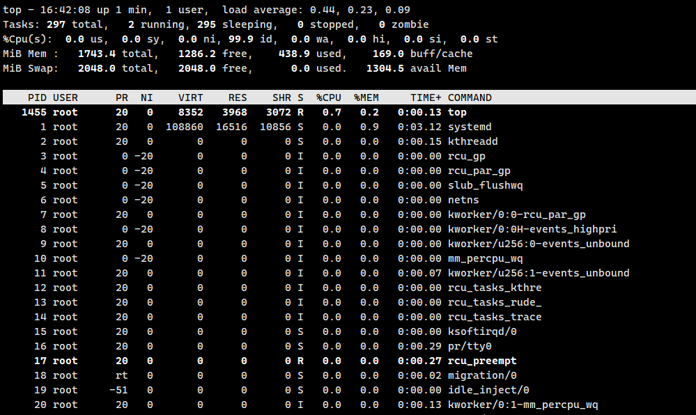
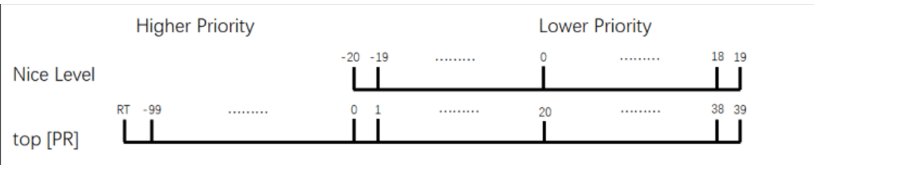

进程是一个**在系统中运行的程序**

进程是**已启动的可执行程序的运行实例**，进程有以下组成部分

- **打个比方**：

- **程序**就像是**菜谱**（写在纸上的步骤，是静止的）。
- **进程**就是你**照着菜谱做菜的过程**（买菜、洗菜、炒菜、装盘，是动态的，有开始也有结束）。

**进程的四个组成部分**

1. **已分配内存的地址空间**：程序运行需要占用内存。系统会给这个进程划分一块专属的内存区域，存放数据和代码。
2. **安全属性（所有权凭据和特权）**：进程是有“身份”的。比如你是用 `root` 用户启动的，还是用 `user1` 启动的？它拥有谁的权限？（这就联系到了之前问的 SUID，SUID 就是改变这个属性的）。
3. **进程代码的一个或多个执行线程**：CPU 实际上是在执行这些代码指令。一个进程可以有一个线程（单线程），也可以有多个线程（多线程，同时干好几件事）。
4. **进程状态**：进程不是永远在跑的。它可能在“运行中”，也可能在“睡眠”（等待你按键盘），或者“停止”了。

**程序 vs 进程（核心区别）**

- **程序**：

- **定义**：二进制文件（就是硬盘上的那个 `.exe` 或可执行文件）。
- **特点**：**静态的**。它就静静地躺在硬盘里，你不点它，它永远不会动。
- **例子**：`/bin/date`, `/usr/sbin/httpd` 等，这些都是硬盘上的文件路径。

- **进程**：

- **定义**：程序运行的过程。
- **特点**：**动态的**。它有**生命周期**（创建、运行、消亡）。程序运行起来后，就变成了进程，占用 CPU 和内存。
- **例子**：当你输入 `date` 命令查看时间时，系统加载了 `/bin/date` 这个程序，此时内存中就产生了一个 `date` 进程，显示完时间后，这个进程就自动结束了。

# 进程类型

守护进程：在系统引导过程中启动的进程，跟终端无关的进程

前台进程：跟终端相关，通过终端启动的进程

这俩其实主要区别就在于**“需不需要你盯着”**以及**“跟终端有没有关系”**。你可以把它们想象成餐厅里的两种服务员：

- **前台进程**：就像**大堂经理**，直接面对顾客（用户），你需要看着他操作，他结束了你才能走。
- **守护进程**：就像**后厨**，一直在后台默默干活，不管你看不看他，他都在那里，而且通常从餐厅开门（开机）一直忙到关门。

下面详细解释一下这两个概念：

---

### 前台进程
前台进程就是我们平时操作最频繁的进程。

#### 核心特点
- **占用终端**：它启动后会霸占你的命令行窗口。在它运行结束之前，你无法在这个窗口输入新的命令。
- **依赖终端**：它和当前的终端（Shell）是“绑定”的。如果你强行关闭了终端窗口，前台进程通常也会随之被杀掉。
- **交互性强**：它通常需要你输入数据，或者把结果直接显示给你看。

#### 实例
- 当你输入 `top` 命令查看系统负载时，屏幕被它占满，你按 `q` 退出后，才能继续输命令。`top` 就是前台进程。
- 当你输入 `vi test.txt` 编辑文件时，你必须保存退出才能回到命令行。`vi` 就是前台进程。

---

### 守护进程
守护进程的名字来源于英文 **Daemon**（在希腊神话中指一种介于人和神之间的精灵，在后台默默守护）。

#### 核心特点
- **与终端无关**：它是在后台运行的，不需要你盯着，也不受终端关闭的影响。即使你退出了登录，它依然在运行。
- **生命周期长**：通常在**系统启动（开机）时自动启动**，一直运行到**系统关机**才停止。
- **提供服务**：它们通常不是为了和你交互，而是为了**等待请求**。比如等待有人访问网站、等待有人传文件等。

#### 命名习惯
在 Linux 中，守护进程的名字通常以字母 `d` 结尾，代表 Daemon。

#### 实例
- `sshd`：这是 SSH 守护进程。它一直在后台默默运行，监听 22 端口。当你试图远程连接服务器时，它才会被“唤醒”来处理你的登录请求。
- `httpd`**或**`nginx`：这是 Web 服务器的守护进程。它一直在后台等着，一旦有用户在浏览器输入你的网址，它就负责把网页发过去。
- `crond`：这是定时任务守护进程。它一直看着系统时间，一旦到了你设定的时间点，它就执行相应的任务。

# 进程的生命周期

父进程复制自己的地址空间(fork)创建一个新的(子)进程结构。每个新进程分配一个唯一的进程ID(PID)，满足跟踪安全性之需。PID和父进程ID(PPID)是子进程环境的元素，任何进程都可以创建子进程，所有进程都是第一个系统进程的后代。

# systemd简介

首先 systmed 是一个用户空间的程序，属于应用程序，不属于 Linux 内核范畴。Systemd 是 Linux 系统中最新的初始化系统（init），它主要的设计目标是克服 sysvinit（这个是centos6中的初始化系统）固有的缺点，提高系统的启动速度。

Linux内核加载启动后，用户空间的第一个进程就是初始化进程，这个程序的物理文件约定位于`/sbin/init`，当然也可以通过传递内核参数来让内核启动指定的程序。这个进程的特点是进程号为1，代表第一个运行的用户空间进程。不同发行版采用了不同的启动程序，主要有以下几种主流选择：

- 以 Ubuntu 为代表的 Linux 发行版采用 upstart
- 红帽系列发行版本中

- 红帽6以前的版本使用System V init
- 红帽7及以后，使用systemd

RockyLinux上所有的进程都是systemd的后代，systemd的功能繁多，不仅用来管理服务，还可以管理挂载点，定义定时任务等。这些工作都是由编辑相应的配置单元文件完成的。

## systemd unit 类型

systemd 把系统里所有需要管理的对象（不仅仅是服务，还有挂载点、定时器等）都统称为 **Unit**，并给它们分配了不同的“身份”和“职责”。

**什么是Unit？**

在以前的 Linux 系统（SysVinit）中，我们只管“服务”（比如 httpd, sshd）。但在 **systemd** 的世界里，管理的范围扩大了。systemd 认为不仅仅是服务需要管理，挂载硬盘、监听端口、定时任务都需要统一管理。

于是，它引入了 **Unit** 的概念。每一个 Unit 都有一个配置文件，定义了它该干什么。

**配置单元类型**

systemd需要管理的功能比较多，所以支持的配置单元类型也比较繁多，我们在日常使用Linux的过程中对系统服务的管理最多，所以我们主要了解一下`service`类型即可，其他类型作为一个了解，下面列举出所有类型详细的解释。

|  |  |  |
| --- | --- | --- |
| **单元类型** | **文件格式** | **描述** |
| Service unit | .service | 服务类 |
| Target unit | .target | 一个 unit 服务组，用于模拟实现运行级别 |
| Automount unit | .automount | 文件系统自动挂载点 |
| Device unit | .device | 内核识别的设备文件 |
| Mount unit | .mount | 文件系统挂载点 |
| Path unit | .path | 文件或目录 |
| Scope unit | .scope | 外部创建的进程 |
| Slice unit | .slice | A group of hierarchically organized units that manage system processes. |
| Snapshot unit | .snapshot | 系统快照 |
| Socket unit | .socket | 套接字 |
| Swap unit | .swap | 标识 swap 设备 |
| Timer unit | .timer | systemd 的计时器 |

#### 核心常用类型
- **Service unit (.service)**

- **作用**：这是最重要的类型，用来管理系统服务（后台进程）。
- **例子**：`sshd.service`（SSH服务）、`httpd.service`（Web服务）。

- **Target unit (.target)**

- **作用**：用来模拟以前的“运行级别”，或者把一组服务归类。
- **例子**：`multi-user.target`（多用户模式，相当于以前的运行级别3）、`graphical.target`（图形界面模式，相当于运行级别5）。启动这个 target，systemd 就知道该启动哪些相关的服务。

#### 其他常见类型
- **Socket unit (.socket)**：管理进程间通信的套接字。Systemd 可以实现“按需启动”，比如没人访问网站时，Web服务不启动；一旦有人请求80端口（Socket触发），systemd 自动启动 Web 服务。
- **Mount unit (.mount) & Automount unit (.automount)**：管理文件系统的挂载（比如开机自动挂载硬盘）。
- **Timer unit (.timer)**：替代传统的 `crontab`，用于定时任务。
- **Path unit (.path)**：监控文件或目录的变化（比如某个目录有新文件了，就触发某个服务）。

---

**unit 文件保存位置**

我们目前了解到文件所在的位置即可，关于文件内部的格式与如何修改这些文件，我们会在后续的服务搭建过程中细讲。

|  |  |
| --- | --- |
| **目录** | **描述** |
| /usr/lib/systemd/system/ | RPM 包安装时分发的 unit 文件 |
| /run/systemd/system/ | systemd 运行时创建的文件 |
| /etc/systemd/system/ | systemctl enable 创建的 unit 文件 |

Systemd 会在三个地方找配置文件，它们的优先级是从高到低的（类似于“就近原则”）：

1. **/etc/systemd/system/** (优先级最高)

- **用途**：系统管理员自定义的配置，或者通过 `systemctl enable` 命令生成的链接文件。如果你想修改某个服务，应该把配置文件放在这里。

2. **/run/systemd/system/** (优先级中)

- **用途**：系统运行时临时生成的文件。重启后消失。

3. **/usr/lib/systemd/system/** (优先级最低)

- **用途**：**软件安装包（RPM）默认安装的位置**。这是软件的原始配置文件。尽量不要直接修改这里，因为软件升级时可能会被覆盖。

# 管理系统服务

systemd 的主要命令行工具是`systemctl`

```shell
systemctl [选项...] {命令} ...
```

## systemctl常用命令

这边列举出来的命令会在后面的学习过程中经常用到，所以大家只要对本部分中系统管理的命令合集有一个印象即可。

|  |  |
| --- | --- |
| **命令** | **描述** |
| systemctl start name.service | 启动服务 |
| systemctl stop name.service | 停止服务 |
| systemctl restart name.service | 重启服务（没启动的服务会启动） |
| systemctl try-restart name.service | 只重启正在运行的服务 |
| systemctl reload name.service | 重载配置文件 |
| systemctl status name.service systemctl is-active name.service | 检查服务状态检查服务是否启动 |
| systemctl list-units --type service --all | 显示所有的服务状态 |
| systemctl enable name.service | 启用开机自启服务 |
| systemctl disable name.service | 停用自启服务 |
| systemctl status name.service systemctl is-enabled name.service | 检查服务状态查看服务是否自启 |
| systemctl list-unit-files --type service | 查看所有服务 |
| systemctl list-dependencies --after | 列出在指定服务之前启动的服务（依赖） |
| systemctl list-dependencies --before | 列出在指定服务之后启动的服务（被依赖） |

#### 服务的启动、停止与重启
- `systemctl start name.service`：启动服务（比如启动 nginx）。
- `systemctl stop name.service`：停止服务。
- `systemctl restart name.service`：重启服务（不管之前是不是在运行，都先停后起，会导致服务瞬间中断）。
- `systemctl reload name.service`：**平滑重载**。不中断服务，只是重新读取配置文件（比如修改了 nginx 配置后常用）。
- `systemctl try-restart name.service`：只有当服务正在运行时才重启，没运行就不管。

#### 查看状态
- `systemctl status name.service`：查看服务的详细状态（正在运行？报错？日志是什么？）。
- `systemctl is-active name.service`：脚本中常用，只返回 `active` 或 `inactive`，用来判断服务是否活着。

#### 开机自启管理（非常重要）
- `systemctl enable name.service`：**设置开机自启**。

- *原理*：它会在 `/etc/systemd/system/` 目录下创建一个指向 `/usr/lib/...` 的软链接。

- `systemctl disable name.service`：**取消开机自启**。
- `systemctl is-enabled name.service`：检查服务是否设置了开机自启。

#### 列表查看
- `systemctl list-units --type service --all`：列出当前**内存中**已加载的所有服务（包括没启动的）。
- `systemctl list-unit-files --type service`：列出硬盘上**所有**的服务配置文件及其开机启动状态（enabled/disabled）。

#### 依赖关系（进阶）
- `systemctl list-dependencies`：查看服务之间的依赖。比如 `network.target` 依赖于 `network.service`。Systemd 的强大之处就在于能并行处理这些依赖，加快开机速度。

# ps

ps命令用于显示当前进程的状态，类似于 windows 的任务管理器

```shell
ps [选项]
```

## 选项

- **-a**：列出所有的进程
- **-e**：列出所有的进程，等同于`-A`
- **-f**：显示不包含资源使用率的相关信息
- **‐H**：以进程层级格式显示进程相关信息
- **-w**：显示加宽可以显示较多的信息
- **-u**：显示较详细的信息
- **-x**：显示其他使用者的进程

显示信息的格式说明

|  |  |
| --- | --- |
| **列名** | **说明** |
| USER | 进程拥有者 |
| PID | 进程ID |
| %CPU | 占用的 CPU 使用率 |
| %MEM | 占用的内存使用率（物理内存） |
| VSZ | 占用的虚拟内存大小 |
| RSS | 占用的常驻内存大小（实际占用的物理内存） |
| TTY | 执行的终端编号（？表示没有中断[守护进程]，pts/0 表示伪终端） |
| STAT | 该进程的状态（R运行，S睡眠，Z僵尸，T停止） |
| START | 进程开始时间 |
| TIME | CPU使用时间 |
| COMMAND | 所执行的命令 |

\*STAT表示的进程状态有如下几种：

- **D**: 无法中断的休眠状态 ，将一直等待事件的发生或等待某种系统资源
- **R**: 正在执行中
- **S**: 可中断状态
- **T**: 暂停执行
- **Z**: 不存在但暂时无法消除，也叫僵尸进程
- **W**: 没有足够的内存可分配
- **<**: 高优先序的进程
- **N**: 低优先序的进程
- **+**：前台进程
- **l**：多线程进程
- **s**：主进程(先导进程)

**僵尸进程和孤儿进程：**

这俩虽然名字听起来都像“没人管的孩子”，但在 Linux 系统里，它们的处境其实天差地别。**孤儿进程**只是没了爹，但有人（系统）收养，生活照旧；而**僵尸进程**则是虽然“死”了，尸体却一直赖在进程表里占着位置，这才是真正需要警惕的系统隐患。

咱们用大白话配合生活中的例子来拆解一下：

**孤儿进程：被系统“收养”的孩子**

**场景描述**：  
想象一下，父亲（父进程）还在世，孩子（子进程）正在干活。突然，父亲因为意外（崩溃或被杀）去世了，但孩子还活着。

**发生了什么？**

- 孩子失去了父亲，成了“孤儿”。
- 在 Linux 世界里，系统有一个终极的“老祖宗”进程，叫做 `init` 进程（现在的系统中通常是 `systemd`，PID 为 1）。
- **系统规定**：一旦发现有孤儿进程，`systemd` 会立刻站出来，说：“别怕，我来当你的新爸爸。”
- **结果**：孤儿进程会被 `systemd` **收养**。它依然是一个**活着的、健康的**进程，继续正常干活，只是它的“父进程 ID”变成了 1。

**结论**：  
**孤儿进程不是坏事**。系统会自动处理，它依然在运行，占用正常的资源（CPU、内存），干完活就会正常退出。

---

**僵尸进程：死了但不肯“断气”的进程**

**场景描述**：  
孩子（子进程）干完活了，或者出错了，它**死掉了**。  
按照规矩，孩子死后，父亲需要给孩子办“后事”（在系统中叫“回收”或“清理”），比如去读取一下孩子的梦想清单（退出状态码），然后把孩子的尸体火化（释放进程表中的记录）。

**发生了什么？**

- 孩子已经死了（代码执行完了），**不占用内存也不占用 CPU** 了。
- 但是，父亲（父进程）太忙了，或者代码写烂了，**忘记**去给孩子办后事（没有调用回收函数）。
- **结果**：孩子的尸体一直停放在家里（进程表中），占着一个“名额”（PID）。这就叫**僵尸进程**。

**结论**：  
**僵尸进程是坏事**。

- 它虽然不干活（不占 CPU/内存），但它**占着“坑位”**（进程号 PID）。
- 系统的进程号是有限的。如果僵尸进程太多，把坑位都占满了，新的进程就生不出来了，系统就会瘫痪。
- **怎么杀？** 你直接杀僵尸进程是杀不死的（因为它已经死了）。你通常得去杀它的**父亲**，父亲一死，僵尸进程就会被 `systemd` 收养并顺手把后事办了。

|  |  |  |
| --- | --- | --- |
| 特性 | 孤儿进程 | 僵尸进程 |
| 状态 | 活着 | 死了 |
| 资源占用 | 占用 CPU、内存（因为它在运行） | 几乎不占资源，只占一个进程表位置（PID） |
| 父进程 | 父进程挂了 | 父进程通常还活着（只是不负责任） |
| 系统处理 | 被 `systemd`  (PID 1) 收养，继续运行 | 赖在进程表里，无法自动消失 |
| 危害程度 | 无害（系统正常现象） | 有害（会导致系统无法创建新进程） |
| 解决办法 | 不需要解决，系统自动处理 | 需要杀死其父进程，强制让 `systemd`  回收 |

**一句话总结**

- **孤儿进程**：爹死了，孩子被国家（systemd）收养，**活得很好**。
- **僵尸进程**：孩子死了，爹不给埋，尸体**占着床位**。

## 实例

**常用组合：ps aux**

```bash
a：显示所有用户的进程（不仅限于当前用户），且与终端相关。
u：以用户为中心的格式显示（User-oriented），即显示详细列（如 %CPU, %MEM, USER 等）。
x：显示没有控制终端的进程（即后台守护进程）。
组合效果 aux：显示系统中所有进程（无论有没有终端，无论是谁的），并以详细格式展示。
[root@localhost ~]# ps aux | head -n 5
USER        PID %CPU %MEM    VSZ   RSS TTY      STAT START   TIME COMMAND
root          1  0.0  0.3 128144  6656 ?        Ss   5月10   0:01 /usr/lib/systemd/systemd --switched-root --system --deserialize 22
root          2  0.0  0.0      0     0 ?        S    5月10   0:00 [kthreadd]
root          3  0.0  0.0      0     0 ?        S    5月10   0:00 [ksoftirqd/0]
root          5  0.0  0.0      0     0 ?        S<   5月10   0:00 [kworker/0:0H]
```

**常用组合：ps -aux**

```plain
-a：显示所有用户的进程（但仅限与终端相关的）。
-u：筛选特定用户的进程（后面需接用户名，如 ps -u root）。
-x：显示没有控制终端的进程。
-e 或 -A：显示所有进程（Every/All）。
-f：全格式显示（Full-format），包含 UID, PPID 等详细信息。
[root@localhost ~]# ps -aux
USER         PID %CPU %MEM    VSZ   RSS TTY      STAT START   TIME COMMAND
root           1  0.1  0.9 172972 16128 ?        Ss   20:38   0:01 /usr/lib/sys
root           2  0.0  0.0      0     0 ?        S    20:38   0:00 [kthreadd]
root           3  0.0  0.0      0     0 ?        I<   20:38   0:00 [rcu_gp]
root           4  0.0  0.0      0     0 ?        I<   20:38   0:00 [rcu_par_gp]
root           5  0.0  0.0      0     0 ?        I<   20:38   0:00 [slub_flushw
root           6  0.0  0.0      0     0 ?        I<   20:38   0:00 [netns]
```

**常用组合：ps -ef**

```bash
-e：显示所有进程
-f：显示完整格式程序信息
[root@localhost ~]# ps -ef |head -n 10
UID         PID   PPID  C STIME TTY          TIME CMD
root          1      0  0 5月10 ?       00:00:01 /usr/lib/systemd/systemd --switched-root --system --deserialize 22
root          2      0  0 5月10 ?       00:00:00 [kthreadd]
root          3      2  0 5月10 ?       00:00:00 [ksoftirqd/0]
root          5      2  0 5月10 ?       00:00:00 [kworker/0:0H]
root          6      2  0 5月10 ?       00:00:00 [kworker/u256:0]
root          7      2  0 5月10 ?       00:00:00 [migration/0]
root          8      2  0 5月10 ?       00:00:00 [rcu_bh]
root          9      2  0 5月10 ?       00:00:01 [rcu_sched]
root         10      2  0 5月10 ?       00:00:00 [lru-add-drain]
```

**三、实际使用场景对比**

1. **资源监控场景**

- **推荐使用**`ps aux`：当需要查看CPU/内存占用率时，如排查内存泄漏
- **示例**：`ps aux --sort=-%mem | head`（按内存降序查看前10进程）

2. **进程关系分析**

- **推荐使用**`ps -ef`：当需要查看父进程关系时，如排查进程启动异常
- **示例**：`ps -ef | grep nginx`（查看nginx进程及其父子关系）

3. **脚本兼容性**

- **推荐使用**`ps -ef`：在跨平台脚本中更可靠，某些嵌入式Linux不支持`aux`
- **替代方案**：`ps -e -o pid,ppid,cmd`（更兼容的自定义输出）

**常用组合：ps -efH**

```shell
`查看进程以层级格式（类似于pstree命令）`
[root@localhost ~]# ps -efH
root         1     0  0 14:26 ?        00:00:00 /usr/lib/systemd/systemd --switched-root --system --deserialize 22
root       479     1  0 14:26 ?        00:00:00   /usr/lib/systemd/systemd-journald
root       500     1  0 14:26 ?        00:00:00   /usr/sbin/lvmetad -f
root       507     1  0 14:26 ?        00:00:00   /usr/lib/systemd/systemd-udevd
root       615     1  0 14:27 ?        00:00:00   /sbin/auditd
polkitd    638     1  0 14:27 ?        00:00:00   /usr/lib/polkit-1/polkitd --no-debug
dbus       639     1  0 14:27 ?        00:00:00   /usr/bin/dbus-daemon --system --address=systemd: --nofork --nopidfile --systemd-activation
root       646     1  0 14:27 ?        00:00:00   /usr/sbin/NetworkManager --no-daemon
root       649     1  0 14:27 ?        00:00:00   /usr/sbin/irqbalance --foreground
root       653     1  0 14:27 ?        00:00:00   /usr/lib/systemd/systemd-logind
root       655     1  0 14:27 ?        00:00:00   /usr/sbin/crond -n
chrony     661     1  0 14:27 ?        00:00:00   /usr/sbin/chronyd
root       662     1  0 14:27 ?        00:00:00   login -- root
```

**按照CPU使用率排序查看所有进程**

```shell
[root@localhost ~]# ps -aux --sort %cpu     # 递增
[root@localhost ~]# ps -aux --sort -%cpu    # 递减
```

**按照实际内存使用排序查看所有进程**

```shell
[root@localhost ~]# ps -aux --sort rss     # 递增
[root@localhost ~]# ps -aux --sort -rss    # 递减
```

**按照父子进程显示ssh服务的层级关系**

```shell
[root@localhost ~]# ps -auxf |grep sshd
# ps -efH
root       6814  0.0  0.2 112756  4320 ?        Ss   09:06   0:00 /usr/sbin/sshd -D
root       7097  0.0  0.2 158760  5576 ?        Ss   09:06   0:00  \_ sshd: root@pts/0
root       7337  0.1  0.2 158760  5588 ?        Ss   10:21   0:00  \_ sshd: root@pts/1
root       7364  0.0  0.0 112724   988 pts/1    S+   10:24   0:00          \_ grep --color=auto sshd
```

**自定义显示格式**

```shell
[root@localhost ~]# ps -axo user,pid,ppid,%mem,%cpu,command --sort -%cpu
```

**查看指定进程的PID，多种查看的方式**

```shell
[root@localhost ~]# cat /run/sshd.pid 
[root@localhost ~]# ps -aux |grep sshd
[root@localhost ~]# pgrep -l sshd
[root@localhost ~]# pidof sshd
```

**查看进程树**

```shell
[root@localhost ~]# yum install -y psmisc
[root@localhost ~]# pstree
systemd─┬─NetworkManager───2*[{NetworkManager}]
        ├─agetty
        ├─atd
        ├─auditd─┬─sedispatch
        │        └─2*[{auditd}]
        ├─bluetoothd
        ├─chronyd
        ├─crond
        ├─dbus-broker-lau───dbus-broker
        ├─firewalld───{firewalld}
        ├─irqbalance───{irqbalance}
        ├─lsmd
        ├─mcelog
        ├─polkitd───7*[{polkitd}]
        ├─rsyslogd───2*[{rsyslogd}]
        ├─sshd───sshd───sshd───bash───bash───pstree
        ├─systemd───(sd-pam)
        ├─systemd-journal
        ├─systemd-logind
        ├─systemd-udevd
        └─tuned───3*[{tuned}]
```

# top

top命令用于**实时显示** process 的动态

## 示例

```shell
[root@localhost ~]# top
```



第1行：系统时间、运行时间、登录终端数、系统负载（三个数值分别为1分钟、5分钟、15分钟内的平 均值，数值越小意味着负载越低）。

第2行：进程总数、运行中的进程数、睡眠中的进程数、停止的进程数、僵死的进程数。

第3行：用户占用资源百分比、系统内核占用资源百分比、改变过优先级的进程资源百分比、空闲的资源百分比等。

第4行：物理内存总量、内存使用量、内存空闲量、作为内核缓存的内存量。（buffer和cache之间的区 别，cache是提高cpu和内存之间的数据交换速度，buffer是io设备和存储设备之间的缓冲区）

第5行：虚拟内存总量、虚拟内存使用量、虚拟内存空闲量、已被提前加载的内存量。

```shell
在 top 命令中，load average（系统负载平均值）表示单位时间内处于可运行状态（Running）和
不可中断睡眠状态（Uninterruptible Sleep，D状态）的进程总数，通常显示三个数值，分别对应
过去1分钟、5分钟、15分钟的平均负载。
具体计算逻辑
1. 统计范围：
    ◦ 包括正在CPU上运行的进程（Running）。
    ◦ 包括等待CPU资源的进程（处于就绪队列）。
    ◦ 包括处于不可中断睡眠状态的进程（Uninterruptible Sleep，如等待磁盘I/O完成）。
2. 计算方式：
    系统通过一个“指数移动平均”算法计算，并非简单的算术平均。该算法会给近期的负载赋予更高权重，
    older 的数据权重逐渐降低，因此能更灵敏地反映近期负载变化。
3. 数值含义：
    ◦ 若数值等于CPU核心数，说明负载适中，CPU刚好能处理所有任务。
    ◦ 若远小于核心数，说明CPU较空闲。
    ◦ 若远大于核心数，说明任务堆积，系统可能繁忙（如CPU、I/O资源不足）。
例如，4核CPU的 load average 为 4.0 时，负载处于均衡状态；若达到 8.0，则意味着任务排队情况较严重。
```

## 选项

- **-d**: 改变显示的更新速度，或是在交互式指令列( interactive command)按 s
- **-c**: 切换显示模式，共有两种模式，一是只显示程序的名称，另一种是显示完整的路径与名称
- **-S**: 累积模式，会将己完成或消失的子行程 ( dead child process ) 的 CPU time 累积起来
- **-s**: 安全模式，将交互式指令取消, 避免潜在的危机
- **-i**: 不显示任何闲置 (idle) 或无用 (zombie) 的行程
- **-n**: 更新的次数，完成后将会退出 top
- **-b**: 显示模式，搭配 "n" 参数一起使用，可以用来将 top 的结果输出到文件内
- **-z：**彩色

## 交互模式快捷键

|  |  |
| --- | --- |
| **快捷键** | **功能** |
| 空格 | 立即刷新 |
| P | 根据CPU使用多少排序 |
| T | 根据时间、累计排序 |
| q | 退出top命令 |
| m | 切换显示内存信息 |
| t | 切换显示进程和CPU状态信息 |
| c | 切换显示命令名称和完整命令行 |
| M | 根据内存的大小排序 |
| W | 将当前设置写入 ~/.toprc 文件中，这是top配置文件推荐方法 |
| N | 以PID的大小排序 |
| z | 彩色 |

## 实例

- 显示进程信息，每个1秒钟刷新一次

```shell
[root@localhost ~]# top -d 1
```

- 显示完整命令

```shell
[root@localhost ~]# top -c
```

- 更新两次后终止更新显示

```shell
[root@localhost ~]# top -n 2
```

- 显示指定的进程信息

```shell
[root@localhost ~]# top -p 7097
```

- 查看指定用户的进程

```plain
[root@localhost ~]# top -d 1 -u user01
```

- 将2次top信息写入到文件

```plain
[root@localhost ~]# top -d 1 -b -n 2 > top.txt
```

**什么是swap分区？**

Swap分区是Linux系统中用于扩展物理内存的磁盘空间，当物理内存不足时，系统将部分不活跃的内存数据转移至Swap分区，以释放内存供当前程序使用，从而防止系统因内存耗尽而崩溃。

一句话总结：Swap分区是Linux系统的"内存保险丝"——它用较慢的磁盘空间作为缓冲，防止内存耗尽导致系统崩溃，但过度依赖会降低性能，需根据实际场景合理配置。

**Buffer和cache的区别？**

**核心区别总结**

**Buffer（缓冲区）**：用于**协调数据传输速率**，解决设备间速度不匹配问题，本质是"流量整形"。  
当你向硬盘写入数据时，系统先将数据存入**Buffer**，等达到一定量（如4K）后再批量写入磁盘，**减少磁盘寻道次数**。

**Cache（缓存）**：用于**提高数据访问速度**，减少重复访问慢速设备的开销，本质是"空间换时间"。  
CPU访问内存时，会将**最近使用的数据**存入**Cache**，下次访问相同数据时直接从Cache读取，**避免等待慢速内存**。

**二者协同工作场景**

在复杂系统中，Buffer和Cache常**协同工作**：

- 数据库系统：**Buffer**管理磁盘页的批量写入，**Cache**存储热数据页
- 网络传输：**Buffer**处理TCP数据流，**Cache**存储常用资源（如CDN）
- 操作系统：**Buffer**用于磁盘I/O调度，**Cache**用于文件系统加速

# kill

kill 命令用于删除执行中的程序或工作

kill 可将指定的信号送至程序。预设的信号为 SIGTERM(15)，可将指定程序终止

```shell
kill [-s <信息名称或编号>][程序]　或　kill [-l <信息编号>][程序]
```

## 选项

- **-l <信号编号>**： 若不加<信号编号>选项，则 -l 参数会列出全部的信号名称
- **-s <信号名称或编号>**：指定要送出的信息
- **[程序]**：[程序]可以是程序的PID或是PGID

使用 kill -l 命令列出所有可用信号，最常用的信号如下

|  |  |  |
| --- | --- | --- |
| **编号** | **信号名** | **作用** |
| 1 | SIGHUP | 重新加载配置 |
| 2 | SIGINT | 通过键盘 `ctrl+c`  打印捕获信息，程序继续运行 |
| 3 | SIGQUIT | 通过键盘 `ctrl+\`  打印捕获信息，程序优雅退出 |
| 9 | SIGKILL | 强制终止 |
| 15 | SIGTERM | 终止(正常结束) |
| 18 | SIGCONT | 继续 |
| 19 | SIGSTOP | 停止 |
| 20 | SIGTSTP | 暂停`ctrl z` |

**kill命令是Linux系统中用于向进程发送信号的工具，通过控制进程行为实现终止、暂停、重启等操作，其核心在于信号机制而非简单"杀死"进程。**

## 实例

- 杀死所有的ping命令，在linux命令中，**使用反引号`包含的命令会优先执行，并将执行的结果作为参数提供给命令。**

```shell
[root@localhost ~]# kill `pgrep ping`
```

- 强制杀死进程

```shell
[root@localhost ~]# kill -9 `pgrep ping`
```

- 温柔的杀死进程

```bash
[root@localhost ~]# kill -15 `pgrep ping`
```

# pkill

pkill 用于杀死一个进程，与 kill 不同的是它会杀死指定名字的所有进程

```shell
pkill [选项]  name
```

## 选项

- **name**： 进程名
- **-u**：指定用户名
- **-t**：指定终端

## 实例

- 结束所有的sshd进程

```shell
[root@localhost ~]# pkill sshd
```

- 结束用户user1的所有进程

```shell
[root@localhost ~]# pkill -u user1
```

- 终止pts/2上所有进程

```shell
[root@localhost ~]# pkill -t pts/2
```

- 终止pts/2上所有进程，并结束pts/2

```shell
[root@localhost ~]# pkill -9 -t pts/1
```

- 查看远程登录用户，并踢出用户

```shell
[root@localhost ~]# w
 15:02:26 up  5:21,  2 users,  load average: 0.05, 0.03, 0.05
USER     TTY      FROM             LOGIN@   IDLE   JCPU   PCPU WHAT
root     tty1                      14:41   20:34   0.02s  0.02s -bash
root     pts/0    192.168.175.1    14:42    2.00s  0.05s  0.01s w
user1    pts/1   192.168.175.1     14:40   20:34   0.02s  0.02s -bash
[root@localhost ~]# pkill -u user1
```

# Linux进程调度及多任务

每个CPU(或CPU核心)在一个时间点上只能处理一个进程，通过时间片技术，Linux实际能够运行的进程 (和线程数)可以超出实际可用的CPU及核心数量。Linux内核进程调度程序将多个进程在CPU核心上快速切换，从而给用户多个进程在同时运行的假象。（并发）

### 相对优先级

由于不是每个进程都与其他进程同样重要，可告知进程调度程序为不同的进程使用不同的调度策略。常规系统上运行的大多数进程所使用的调度策略为SCHED\_OTHER(也称为SCHED\_NORMAL),但还有其他一些调度策略用于不同的目的。SCHED\_OTHER调度策略运行的进程的相对优先级称为进程的nice值， 可以有40种不同级别的nice值。

在Linux中，决定一个进程的优先级的因素有两个，一个是PR值，一个是NICE值，PR值是由系统内核动态调控。而NICE值由我们用户自己决定。不过，PR值跟NICE值之间也是有一定的关联的。

**NICE值的范围：**-20到19，数值越小，优先级越高

**PR值的范围：**-99到39，其中0-39是与**NICE值**有着一定的对应关系

进程默认启动时nice为0，优先级为20



### 查看进程的nice级别

#### 使用ps查看

```bash
[root@localhost ~]# ps -axo pid,command,nice --sort=nice
[root@localhost ~]# ps -axo pid,command,nice,cls --sort=-nice
```

TS表示该进程使用的调度策略为SCHED\_OTHER

#### 使用top查看

NI：实际nice级别

PR：将nice级别显示为映射到更大优先级队列，-20映射到0，+19映射到39

#### 启动具有不同nice级别的进程

启动进程的时候为进程指定nice值

启动进程时，通常会继承父进程的nice级别，默认为0

```plain
[root@localhost ~]# nice -n -20 vim
[root@localhost ~]# ps -axo command,pid,nice |grep vim
```

## PRI

`PRI` 其实就是 `PR` 的全称，在 `top` 命令里显示为 `PR`，而在 `ps` 命令里通常显示为 `PRI`。它们本质上指的是同一个概念——**内核调度器用来决定谁先运行的那个最终优先级数值**。

在top命令中可以看到有PR这个数值，PR 和 nice 值，都会影响进程执行的优先级。PR 由 OS 内核动态调整，用户不能调整（PR 值越低，进程执行的优先级越高）。

nice值用户可以自己调整，在用户调整了nice值后系统会通过如下公式来调整新的PR值，从而确定这个进程在系统中的优先级

```shell
PR(新) = PR(旧) + nice
```

#### 更改现有进程的nice级别

调整进程的优先级(Nice Level) （-20高) - - - 0 - - - (19低)

- 使用shell更改nice级别

```bash
[root@localhost ~]# vim
[root@localhost ~]# ps -axo command,pid,nice |grep vim
vim                            1855   0
grep --color=auto vim          1888   0
[root@localhost ~]# renice -20 1855
1855 (process ID) old priority 0, new priority -20
[root@localhost ~]# ps -axo command,pid,nice |grep vim
vim                            1855 -20
grep --color=auto vim          1895   0
```

|  |  |  |  |
| --- | --- | --- | --- |
| 用户设置的 Nice 值 | `top`显示的 PR 值 | `ps` 显示的 PRI (内核值) | 优先级状态 |
| -20 | 0 | 100 | 最高 (实时感) |
| 0 (默认) | 20 | 120 | 标准 |
| 19 | 39 | 139 | 最低 (很谦让) |

# jobs

jobs 命令可以用来查看当前终端放入后台的任务

```shell
jobs [-lnprs] [任务声明 ...]
```

## 将任务放入到后台

Linux 命令放入后台的方法有两种：

- 在命令后面加入`空格 &`。使用这种方法放入后台的命令，在后台处于执行状态
- 命令执行过裎中按 Ctrl+Z 快捷键，命令在后台处于暂停状态

### 实例

- 将任务放入后台，然后查看任务

- "+"号代表最近一个放入后台的工作，也是工作恢复时默认恢复的工作
- "-"号代表倒数第二个放入后台的工作

```shell
[root@localhost ~]# top &
[root@localhost ~]# vi &
[root@localhost ~]# ping baidu.com > /dev/null &
# 让ping运行，但是不显示结果
[root@localhost ~]# jobs
[1]   已停止               top
[2]-  已停止               vi
[3]+  运行中               ping baidu.com > /dev/null &
```

## 将任务恢复到前台

fg 命令用于把后台工作恢复到前台执行

```shell
fg %工作号
```

注意，在使用此命令时，％ 可以省略，但若将% 工作号全部省略，则此命令会将带有 + 号的工作恢复到前台。另外，使用此命令的过程中， % 可有可无。

### 实例

- 将top恢复到前台

- 命令虽然是对的，但是top这种需要交互的任务是无法后台的，所以也恢复不了

```shell
[root@localhost ~]# top &
[1] 20584
[root@localhost ~]# jobs
[1]+  已停止               top
[root@localhost ~]# fg 1
```

## 后台任务恢复到后台运行

前面讲过，使用`Ctrl+z`快捷键的方式，可以将前台工作放入后台，但是会处于暂停状态,可以使用bg命令

```shell
bg %工作号
```

这里的 % 同上，可以省略

### 实例

- 将ping命令暂停到后台，然后恢复后台运行

```shell
[root@localhost ~]# ping baidu.com > /dev/null
^Z    # 这边按下了Ctrl+z
[1]+  已停止               ping baidu.com > /dev/null
[root@localhost ~]# jobs
[1]+  已停止               ping baidu.com > /dev/null
[root@localhost ~]# bg %1
[1]+ ping baidu.com > /dev/null &
[root@localhost ~]# jobs
[1]+  运行中               ping baidu.com > /dev/null &
```

# nohup

虽然可以将程序放在后台运行，但是一旦关闭远程连接那么程序就会中断，如果我们想要将程序一直保持在后台运行，那么我们可以有如下三个选择：

- 把需要在后台执行的命令加入`/etc/rc.local`文件，让系统在启动时执行这个后台程序。这种方法的问题是，服务器是不能随便重启的，如果有临时后台任务，就不能执行了
- 使用**系统定时任务**，让系统在指定的时间执行某个后台命令。这样放入后台的命令与终端无关，是不依赖登录终端的
- 使用 nohup 命令

```shell
nohup 命令 &
```

注意，这里的`&`表示此命令会在终端后台工作；反之，如果没有`&`，则表示此命令会在终端前台工作。

## 实例

- 让一个任务后台运行

```shell
[root@localhost ~]# nohup ping baidu.com &
```

我们退出远程连接，然后重新登录回来，会看到`ping baidu.com`依旧在运行，查看`~/nohup.out`文件可以看到程序执行输出的内容

```shell
[root@localhost ~]# ps aux |grep ping
root       7157  0.0  0.0 149968  1988 ?        S    14:12   0:00 ping baidu.com
[root@localhost ~]# tail -f nohup.out
```
