我们在计算机中保存的文件大都是保存在电脑硬盘中，部分同学还会将自己的文件存储在网盘中，网盘中的文件只能说是用来做备份，并不能像本地硬盘上的数据那样随时使用，我们在学习存储管理的时候主要学习的就是如何对自己计算机上的硬盘进行管理，目前我们主流的硬盘主要有两种形态，一种是机械硬盘(HDD)，一种是的固态硬盘(SSD)

# 硬盘工作原理

## 机械硬盘HDD

机械硬盘是靠机械马达以固定的速度转动磁盘，然后再有机械臂的摆动，让磁头可以读取盘片上的磁性信息，这种工作原理的硬盘我们成为机械硬盘。

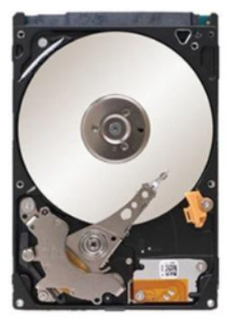

【用最好的动画为你讲解--机械硬盘的原理】<https://www.bilibili.com/video/BV1bDpEz6EPA?vd_source=0cac30621a4ece30bc36b6c96b630ab1>

## 固态硬盘SSD

固态硬盘依靠主控芯片来将数据的二进制信息写入浮栅晶体管中，以这样的原理实现数据的读取和写入。

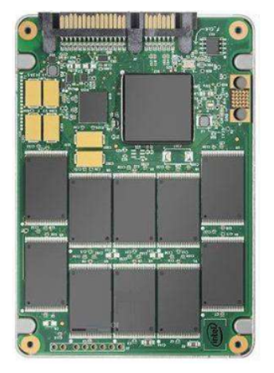

由于浮栅晶体管的设计原理，每次数据的读写，都会让浮栅晶体管所需要的电压更高，一定寿命以后，固态硬盘就会失效。并且固态硬盘如果发生了损坏，数据恢复的难度是大于机械硬盘的，所以为了可靠性，企业目前还是在大量使用机械硬盘的。

【用最好的动画为你讲解--固态硬盘(SSD)的原理】<https://www.bilibili.com/video/BV1jDgtzEEVe?vd_source=0cac30621a4ece30bc36b6c96b630ab1>

# 硬盘设备命名

一台服务器往往会配备有多块硬盘，Linux中为了区分不同的硬盘，会使用不同的命名来将硬盘设备标识，Linux系统对物理磁盘设备会使用`sd[a-z]`的方式来命名。物理硬盘上的详细分区会使用数字的方式来进行标识，比如`sda`设备上的多个分区会标识为`sda[1,2,3....]`

# 分区表

为了让系统能够识别和管理物理设备上的不同分区，需要在物理设备前加上一些数据用于记录分区的情况，这些数据就是**分区表数据**，目前分区表有两种主流的格式：

- MBR

- 管理的硬盘大小不能超过2T
- 有主分区和扩展分区两种，不管是哪种分区，总数不能超过4个分区
- 扩展分区内部可以逻辑上划分多个区域，但是在分区表中都算在一个分区内
- 如果作为系统盘，必须要设置一个激活分区，用于存放系统的引导文件

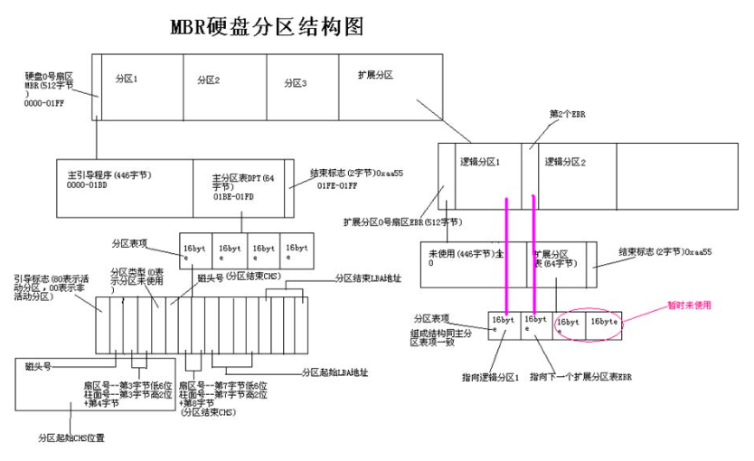

- GPT

- 管理硬盘大小不能超过18EB，目前人类还没制造出单块这么大的硬盘
- 理论上支持无限分区，在win10系统上，最多可以分128个分区
- 如果作为系统盘，**必须要创建一个EFI分区，用于存放系统的引导文件**建议ESP分区512M，对齐8扇区4096字节

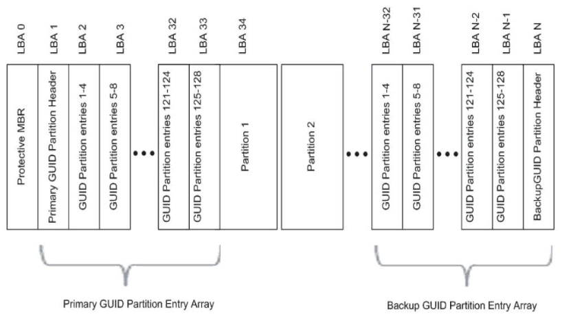

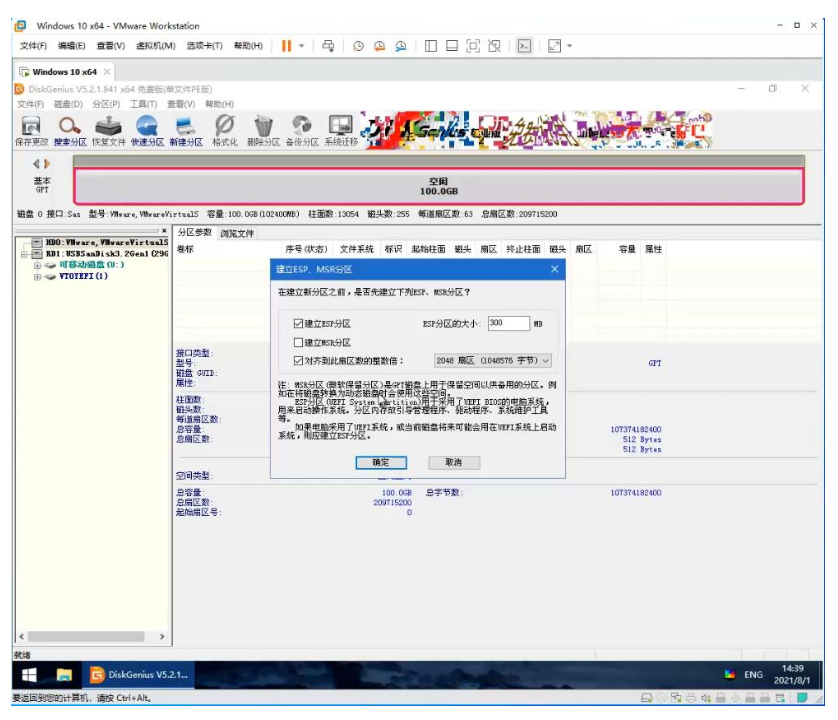

电脑启动的时候：

MBR分区表会找到激活分区，从里面加载系统启动；

GPT分区表会查找EFI分区，没有是开不了机的，所以GPT分区表情况下需要建立ESP，MSR分区。

MSR是微软保留的引导分区，分区一般不会坏因此一般不需要。

ESP建立512MB，对齐到扇区整数倍是指一次读写几个扇区（例如新建个txt只写一个字符，依旧占用4K，除非越写越大超过4K，占4K的整数倍），并不是越大越好也不是越小越好，根据实际需求，一般是4KB。

# 管理分区

- 列出块设备

```bash
[root@localhost ~]# lsblk
NAME            MAJ:MIN RM  SIZE RO TYPE MOUNTPOINT
sda               8:0    0   50G  0 disk
├─sda1            8:1    0    1G  0 part /boot
└─sda2            8:2    0   49G  0 part
  ├─centos-root 253:0    0   47G  0 lvm  /
  └─centos-swap 253:1    0    2G  0 lvm  [SWAP]
sdb               8:16   0   20G  0 disk
sdc               8:32   0   20G  0 disk
sr0              11:0    1 1024M  0 rom
```

- 创建分区命令

```bash
fdisk  管理MBR分区
gdisk  管理GPT分区
parted 高级分区操作
```

- 重新设置内存中的内核分区表版本

```bash
partprobe
```

## parted 命令

- parted的操作都是实时生效的，小心使用
- 格式：

```bash
parted [选项]... [设备 [命令 [参数]...]...]
```

- 操作命令：

```bash
cp [FROM-DEVICE] FROM-MINOR TO-MINOR           #将文件系统复制到另一个分区 
help [COMMAND]                                 #打印通用求助信息，或关于 COMMAND 的信息 
mklabel 标签类型                               #创建新的磁盘标签 (分区表) 
mkfs MINOR 文件系统类型                        #在 MINOR 创建类型为“文件系统类型”的文件系统 
mkpart 分区类型 [文件系统类型] 起始点 终止点   #创建一个分区 
mkpartfs 分区类型 文件系统类型 起始点 终止点   #创建一个带有文件系统的分区 
move MINOR 起始点 终止点                       #移动编号为 MINOR 的分区 
name MINOR 名称                                #将编号为 MINOR 的分区命名为“名称” 
print [MINOR]                                  #打印分区表，或者分区 
quit                                           #退出程序 
rescue 起始点 终止点                           #挽救临近“起始点”、“终止点”的遗失的分区 
resize MINOR 起始点 终止点                     #改变位于编号为 MINOR 的分区中文件系统的大小 
rm MINOR                                       #删除编号为 MINOR 的分区 
select 设备                                    #选择要编辑的设备 
set MINOR 标志 状态                            #改变编号为 MINOR 的分区的标志
```

- 查看分区情况

```bash
[root@localhost ~]# parted /dev/nvme0n1 print
Model: VMware Virtual NVMe Disk (nvme)
Disk /dev/nvme0n1: 21.5GB
Sector size (logical/physical): 512B/512B
Partition Table: msdos
Disk Flags:

Number  Start   End     Size    Type     File system  Flags
 1      1049kB  1075MB  1074MB  primary  xfs          boot
 2      1075MB  21.5GB  20.4GB  primary               lvm

[root@localhost ~]# parted /dev/nvme0n2 print
Error: /dev/nvme0n2: unrecognised disk label
Model: VMware Virtual NVMe Disk (nvme)
Disk /dev/nvme0n2: 5369MB
Sector size (logical/physical): 512B/512B
Partition Table: unknown
Disk Flags:
```

- 设置磁盘的分区表

```bash
# [root@localhost ~]# parted /dev/nvme0n2 mklabel msdos
[root@localhost ~]# parted /dev/nvme0n2 mklabel gpt
Information: You may need to update /etc/fstab.

[root@localhost ~]# parted /dev/nvme0n2 print
Model: VMware Virtual NVMe Disk (nvme)
Disk /dev/nvme0n2: 5369MB
Sector size (logical/physical): 512B/512B
Partition Table: gpt
Disk Flags:

Number  Start  End  Size  File system  Name  Flags
# 由于没有分区，所有没有具体的分区信息
```

- 对磁盘进行分区

```bash
[root@localhost ~]# parted /dev/nvme0n2 mkpart primary 1 1G
# 创建1个G大小的分区
Information: You may need to update /etc/fstab.
[root@localhost ~]# parted /dev/nvme0n2 print
Model: VMware Virtual NVMe Disk (nvme)
Disk /dev/nvme0n2: 5369MB
Sector size (logical/physical): 512B/512B
Partition Table: gpt
Disk Flags:

Number  Start   End     Size   File system  Name     Flags
 1      1049kB  1000MB  999MB               primary
```

- 删除分区

```bash
[root@localhost ~]# parted /dev/nvme0n2 rm 1
Information: You may need to update /etc/fstab.

[root@localhost ~]# parted /dev/nvme0n2 print
Model: VMware Virtual NVMe Disk (nvme)
Disk /dev/nvme0n2: 5369MB
Sector size (logical/physical): 512B/512B
Partition Table: gpt
Disk Flags:

Number  Start  End  Size  File system  Name  Flags
```

- 修改磁盘为mbr分区，注意会丢失所有数据

```bash
[root@localhost ~]# parted /dev/nvme0n2 mklabel msdos
警告: The existing disk label on /dev/nvme0n2 will be destroyed and all data on this disk will be lost. Do
you want to continue?
是/Yes/否/No? yes
信息: You may need to update /etc/fstab.
```

## fdisk工具

管理磁盘中MBR分区

`fdisk [磁盘名称]`

fdisk命令中的参数以及作用

|  |  |
| --- | --- |
| **参数** | **作用** |
| m | 查看全部可用的参数 |
| n | 添加新的分区 |
| d | 删除某个分区信息 |
| l | 列出所有可用的分区类型 |
| t | 设置/改变某个分区的类型 |
| p | 查看分区信息 |
| w | 保存并退出 |
| q | 不保存直接退出 |


```bash
[root@localhost ~]# fdisk /dev/nvme0n2

Welcome to fdisk (util-linux 2.37.4).
Changes will remain in memory only, until you decide to write them.
Be careful before using the write command.

Device does not contain a recognized partition table.
Created a new DOS disklabel with disk identifier 0x447f44d1.

Command (m for help): n
Partition type
   p   primary (0 primary, 0 extended, 4 free)
   e   extended (container for logical partitions)
Select (default p): p
Partition number (1-4, default 1):
First sector (2048-10485759, default 2048):
Last sector, +/-sectors or +/-size{K,M,G,T,P} (2048-10485759, default 10485759): +1G

Created a new partition 1 of type 'Linux' and of size 1 GiB.

Command (m for help): p
Disk /dev/nvme0n2: 5 GiB, 5368709120 bytes, 10485760 sectors
Disk model: VMware Virtual NVMe Disk
Units: sectors of 1 * 512 = 512 bytes
Sector size (logical/physical): 512 bytes / 512 bytes
I/O size (minimum/optimal): 512 bytes / 512 bytes
Disklabel type: dos
Disk identifier: 0x447f44d1

Device         Boot Start     End Sectors Size Id Type
/dev/nvme0n2p1       2048 2099199 2097152   1G 83 Linux

Command (m for help): w
The partition table has been altered.
Calling ioctl() to re-read partition table.
Syncing disks.

[root@localhost ~]# lsblk
NAME        MAJ:MIN RM  SIZE RO TYPE MOUNTPOINTS
sr0          11:0    1  1.7G  0 rom
nvme0n1     259:0    0   20G  0 disk
├─nvme0n1p1 259:1    0    1G  0 part /boot
└─nvme0n1p2 259:2    0   19G  0 part
  ├─rl-root 253:0    0   17G  0 lvm  /
  └─rl-swap 253:1    0    2G  0 lvm  [SWAP]
nvme0n2     259:3    0    5G  0 disk
└─nvme0n2p1 259:8    0    1G  0 part
nvme0n3     259:4    0    5G  0 disk
nvme0n4     259:5    0    5G  0 disk
nvme0n5     259:6    0    5G  0 disk
nvme0n6     259:7    0    5G  0 disk
```

## gdisk工具

管理磁盘中的GPT分区

使用方式和选项与fdisk中几乎一致

# 存储结构与磁盘划分

Linux系统中常见的目录名称以及相应内容

|  |  |
| --- | --- |
| **目录名称** | **应放置文件的内容** |
| /boot | 开机所需文件-->内核、开机菜单以及所需配置文件等 |
| /dev | 以文件形式存放任何设备与接口 |
| /etc | 配置文件 |
| /home | 用户家目录 |
| /bin | 存放单用户模式下还可以操作的命令 |
| /lib | 开机时用到的函数库，以及/bin与/sbin下面的命令要调用的函数 |
| /sbin | 开机过程中需要的命令 |
| /media | 用于挂载设备文件的目录 |
| /opt | 放置第三方的软件 |
| /root | 系统管理员的家目录 |
| /srv | 一些网络服务的数据文件目录 |
| /tmp | 任何人均可使用的“共享”临时目录 |
| /proc | 虚拟文件系统，例如系统内核、进程、外部设备及网络状态等 |
| /usr/local | 用户自行安装的软件 |
| /usr/sbin | Linux系统开机时不会使用到的软件/命令/脚本 |
| /usr/share | 帮助与说明文件，也可放置共享文件 |
| /var | 主要存放经常变化的文件，如日志 |
| /lost+found | 当文件系统发生错误时，将一些丢失的文件片段存放在这里 |

表示路径的方式：

- 绝对路径指的是从根目录（/）开始写起的文件或目录名称
- 相对路径则指的是相对于当前路径的写法

# 物理设备的命名规则

常见的硬件设备及其文件名称

|  |  |
| --- | --- |
| **硬件设备** | **文件名称** |
| IDE设备 | /dev/hd[a-d] |
| SCSI/SATA/U盘 | /dev/sd[a-p] |
| 软驱 | /dev/fd[0-1] |
| 打印机 | /dev/lp[0-15] |
| 光驱 | /dev/cdrom |
| 鼠标 | /dev/mouse |
| 磁带机 | /dev/st0或/dev/ht0 |

一般的硬盘设备都会是以“/dev/sd”开头，分区编号按照如下规则：

- 主分区或扩展分区的编号从1开始，到4结束；
- 逻辑分区从编号5开始。

设备文件名称：

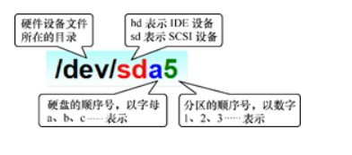

# 文件系统与数据资料

当我们对一块硬盘分区好了以后，接下来我们还要做一件事情，就是我们要对这个分区做一个规定。也可以理解为，当我们要在这个分区上面存放数据的时候，应该按照什么样的规律存放，或者是读取的时候应该按照什么样的规律读取。

这样对磁盘或者分区的规定，我们就称之为文件系统。

文件系统的作用是合理规划硬盘，以保证用户正常的使用需求。Linux系统支持数十种的文件系统。但是从大的角度上来看，其实主要分为日志式文件系统和索引式文件系统两种。

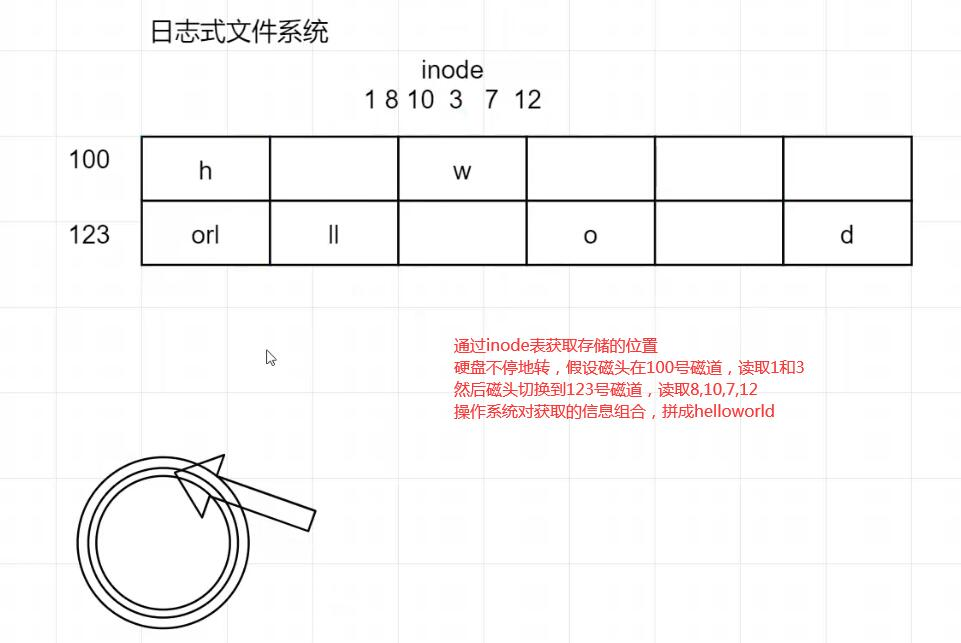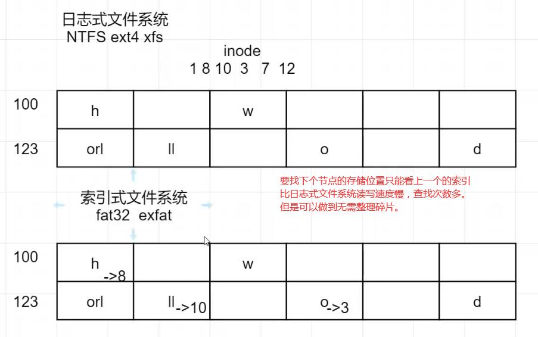

**Windows文件系统讲解：E:\Personal\Videos\屏幕录制**

## Linux常见的文件系统

|  |  |
| --- | --- |
| **文件系统** | **解释** |
| Ext3 | 是一款日志文件系统，能够在系统异常宕机时避免文件系统资料丢失，并能自动修复数据的不一致与错误。然而，当硬盘容量较大时，所需的修复时间也会很长，而且也不能百分之百地保证资料不会丢失。它会把整个磁盘的每个写入动作的细节都预先记录下来，以便在发生异常宕机后能回溯追踪到被中断的部分，然后尝试进行修复。 |
| Ext4 | Ext3的改进版本，作为RHEL 6系统中的默认文件管理系统，它支持的存储容量高达1EB（1EB=1,073,741,824GB），且能够有无限多的子目录。另外，Ext4文件系统能够批量分配block块，从而极大地提高了读写效率。 |
| XFS | 是一种高性能的日志文件系统，而且是RHEL 7中默认的文件管理系统，它的优势在发生意外宕机后尤其明显，即可以快速地恢复可能被破坏的文件，而且强大的日志功能只用花费极低的计算和存储性能。并且它最大可支持的存储容量为18EB，这几乎满足了所有需求。 |

格式化后会发生如下事情

- 日志式文件系统先干掉inode表，索引式文件系统先干掉第一个索引，表示空间可用。
- Linux创建一个硬盘地图'superblock'，记录此filesystem 的整体信息，包括inode/block的总量、使用量、剩余量， 以及文件系统的格式与相关信息等；
- inode：记录文件的属性，一个文件占用一个inode，同时记录此文件的数据所在的block 号码，默认一个inode表格128字节，一个block记录消耗4B，记录满了后会新建inode用于扩展。

- 该文件的访问权限（read、write、execute）；
- 该文件的所有者与所属组（owner、group）；
- 该文件的大小（size）；
- 该文件的创建或内容修改时间（ctime）；
- 该文件的最后一次访问时间（atime）；
- 该文件的修改时间（mtime）；
- 文件的特殊权限（SUID、SGID、SBIT）；
- 该文件的真实数据地址（point）。

- block：用于存储数据

计算机系统在发展过程中产生了众多的文件系统，为了使用户在读取或写入文件时不用关心底层的硬盘结构，Linux内核中的软件层为用户程序提供了一个VFS（Virtual File System，虚拟文件系统）接口，这样用户实际上在操作文件时就是统一对这个虚拟文件系统进行操作了。

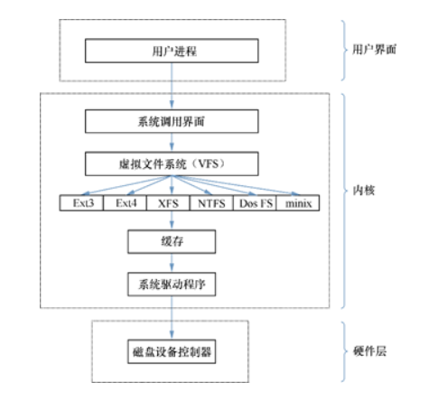

ll -i/ls -i /stat [文件名] 可以查看文件的inode编号

## mkfs工具

Linux mkfs（英文全拼：make file system）命令用于在特定的分区上建立 linux 文件系统。

**格式：**

```bash
mkfs [-V] [-t fstype] [fs-options] filesys [blocks]
```

选项：

- device ： 预备检查的硬盘分区，例如：/dev/nvme0n1p1
- -V : 详细显示模式
- -c : 在制做档案系统前，检查该partition 是否有坏轨
- -l bad\_blocks\_file : 将有坏轨的block资料加到 bad\_blocks\_file 里面
- block : 给定 block 的大小

**实例：使用parted分区，然后使用mkfs创建ext4文件系统**

```bash
[root@localhost ~]# parted /dev/nvme0n3 mklabel gpt
[root@localhost ~]# parted /dev/nvme0n3 mkpart primary 1 1G
Information: You may need to update /etc/fstab.
[root@localhost ~]# parted /dev/nvme0n3 print
Model: VMware Virtual NVMe Disk (nvme)
Disk /dev/nvme0n3: 5369MB
Sector size (logical/physical): 512B/512B
Partition Table: gpt
Disk Flags:

Number  Start   End     Size   File system  Name     Flags
 1      1049kB  1000MB  999MB               primary

[root@localhost ~]# mkfs.ext4 /dev/nvme0n3p1
mke2fs 1.46.5 (30-Dec-2021)
Creating filesystem with 243968 4k blocks and 61056 inodes
Filesystem UUID: db15a3c8-ae5d-4e69-aa93-cc0ee4107547
Superblock backups stored on blocks:
        32768, 98304, 163840, 229376

Allocating group tables: done
Writing inode tables: done
Creating journal (4096 blocks): done
Writing superblocks and filesystem accounting information: done

[root@localhost ~]# parted /dev/nvme0n3 print
Model: VMware Virtual NVMe Disk (nvme)
Disk /dev/nvme0n3: 5369MB
Sector size (logical/physical): 512B/512B
Partition Table: gpt
Disk Flags:

Number  Start   End     Size   File system  Name     Flags
 1      1049kB  1000MB  999MB  ext4         primary
```

## mount挂载

挂载文件系统`mount 文件系统 挂载目录`

mount命令中的参数以及作用

|  |  |
| --- | --- |
| **参数** | **作用** |
| -a | 挂载所有在/etc/fstab中定义的文件系统 |
| -t | 指定文件系统的类型 |

临时挂载文件系统

系统在重启后挂载就会失效

```bash
[root@node-1 ~]# mkdir backup
[root@node-1 ~]# mount /dev/sda2 /root/backup
```

如果想让硬件设备和目录永久地进行自动关联，就必须把挂载信息按照指定的填写格式“设备文件 挂载目录 格式类型 权限选项 是否备份 是否自检”,写入到/etc/fstab文件中。

用于挂载信息的指定填写格式中，各字段所表示的意义

|  |  |
| --- | --- |
| **字段** | **意义** |
| 设备文件 | 一般为设备的路径+设备名称，也可以写唯一识别码（UUID，Universally Unique Identifier） |
| 挂载目录 | 指定要挂载到的目录，需在挂载前创建好 |
| 格式类型 | 指定文件系统的格式，比如Ext3、Ext4、XFS、SWAP、iso9660（此为光盘设备）等 |
| 权限选项 | 若设置为defaults，则默认权限为：rw, suid, dev, exec, auto, nouser, async |
| 是否备份 | 若为1则开机后使用dump进行磁盘备份，为0则不备份 |
| 是否自检 | 若为1则开机后自动进行磁盘自检，为0则不自检 |

- 实例，挂载分区`/dev/sdb1`到`/mnt/volume1`下，并且设置为永久自动挂载

```bash
[root@localhost ~]# mkdir -p /mnt/volume1
[root@localhost ~]# mount /dev/sdb1 /mnt/volume1
[root@localhost ~]# df -h
文件系统                 容量  已用  可用 已用% 挂载点
/dev/mapper/centos-root   47G  995M   46G    3% /
devtmpfs                 979M     0  979M    0% /dev
tmpfs                    991M     0  991M    0% /dev/shm
tmpfs                    991M  8.5M  982M    1% /run
tmpfs                    991M     0  991M    0% /sys/fs/cgroup
/dev/sda1               1014M  133M  882M   14% /boot
tmpfs                    199M     0  199M    0% /run/user/0
/dev/sdb1                9.1G   37M  8.6G    1% /mnt/volume1
# 先卸载sdb1
[root@localhost ~]# umount /dev/sdb1
[root@localhost ~]# vim /etc/fstab
# 最后一行加上
/dev/sdb1 /mnt/volume1 ext4 defaults 0 0

[root@localhost ~]# mount -a
# 测试是否正确配置，fstab上的设备挂一遍试试看，万一错了重启系统会失败。
[root@localhost ~]# df -h
文件系统                 容量  已用  可用 已用% 挂载点
/dev/mapper/centos-root   47G  995M   46G    3% /
devtmpfs                 979M     0  979M    0% /dev
tmpfs                    991M     0  991M    0% /dev/shm
tmpfs                    991M  8.5M  982M    1% /run
tmpfs                    991M     0  991M    0% /sys/fs/cgroup
/dev/sda1               1014M  133M  882M   14% /boot
tmpfs                    199M     0  199M    0% /run/user/0
/dev/sdb1                9.1G   37M  8.6G    1% /mnt/volume1
```

## umount

撤销已经挂载的设备文件`umount [挂载点/设备文件]`

```bash
[root@node-1 ~]# umount /dev/sda2
```

挂载实验：

```shell
#进行了格式化后
#[root@localhost ~]# mkfs.ext4 /dev/sdb1
#未挂载sdb1前，此时file0创建在sdb1上
[root@localhost ~]# mkdir /mnt/disk1
[root@localhost ~]# touch /mnt/disk1/file0
[root@localhost ~]# ll /mnt/disk1/
-rw-r--r--  1 root root 0 6月   9 19:44 file0
#挂载sdb1,file0消失
[root@localhost ~]# mount /dev/sdb1 /mnt/disk1/
[root@localhost ~]# ll /mnt/disk1/
drwx------ 2 root root 16384 6月   9 19:42 lost+found
#此时file0创建在sdb1
[root@localhost ~]# touch /mnt/disk1/file1
[root@localhost ~]# ll /mnt/disk1/
-rw-r--r-- 1 root root     0 6月   9 19:48 file1
drwx------ 2 root root 16384 6月   9 19:42 lost+found
#卸载sdb1,file1消失，file0出现
[root@localhost ~]# umount /dev/sdb1
[root@localhost ~]# ll /mnt/disk1/
-rw-r--r--  1 root root 0 6月   9 19:44 file0
```

**1. Superblock（超级块）—— 文件系统的“总指挥部”**

- **核心作用**：记录整个文件系统的宏观信息，是系统读取硬盘时首先要查看的结构。如果它损坏，整个文件系统将无法识别。
- **关键信息**：

- Block 总量、已用量、剩余量。
- Inode 总量、已用量、剩余量。
- 文件系统的格式（如 Ext4）、状态等全局属性。

- **通俗比喻**：图书馆的“总服务台”，不存具体的书，只管理整个图书馆的容量和使用情况。

**2. Inode（索引节点）—— 文件的“身份证”**

- **核心作用**：存储文件的元数据（属性），但不包含文件名和实际内容。一个文件有且仅有一个 Inode。
- **关键信息**：

- 文件权限、所有者、所属组。
- 文件大小、时间戳（创建/修改/访问）。
- 指向数据 Block 的指针（地址）。

- **通俗比喻**：书的“索引卡片”，上面记录了作者、出版日期等信息，以及最重要的——书在书架上的位置。

**3. Block（数据块）—— 文件内容的“仓库”**

- **核心作用**：存储文件实际数据的最小单位。
- **关键信息**：

- 默认大小通常为 4KB。
- 小文件至少占用一个 Block，大文件会占用多个。

- **通俗比喻**：书架上的“格子”，真正存放书籍（文件内容）的地方。

**4. 间接索引 —— 解决大文件存储的“套娃战术”**

这是理解文件如何扩展的关键，也是本次学习的难点。

- **问题根源（计算由来）**：

1. Inode 中用于直接存储地址的空间为 **48字节**。
2. 每个 Block 的地址编号需要 **4字节** 来记录。
3. 因此，Inode 最多只能直接记录 `48B ÷ 4B = 12` 个 Block 的地址。
4. 这 12 个 Block 总共能存储 `12 × 4KB = 48KB` 的数据。

- **解决方案（分级存储）**：

- **小文件（< 48KB）**：**直接寻址**。Inode 中的 12 个指针直接指向数据 Block，效率最高。
- **大文件（> 48KB）**：**间接寻址**。当 12 个直接指针用完后，Inode 会启用“间接指针”。

1. 系统申请一个新的 Block（例如 999号），这个 Block **不存数据，专门用来存更多的地址编号**，这个 Block 就叫“间接块”。
2. Inode 的第 13 个指针不再指向数据，而是指向这个“间接块”（即写下 999）。
3. 查找时，系统先看 Inode 找到 999，再去读 999号 Block 里的地址列表，最终找到真正的数据。这个过程就像“套娃”。

|  |  |  |  |
| --- | --- | --- | --- |
| 卡槽编号 | 类型 | 里面写的内容 | 作用 |
| 0 ~ 11 | 直接指针 | 数据块编号 (如: 1, 2, 3...) | 主力军，存最常用的前 48KB 数据地址 |
| 12 | 一级间接 | 地址块的编号 (如: 999) | 扩充队，指向一个存满地址的仓库 |
| 13 | 二级间接 | (空或更高级的地址块) | 预备队，用于超大文件 |
| 14 | 三级间接 | (空或更高级的地址块) | 特种部队，用于巨型文件 |

## lsblk
**查看磁盘层级结构**

直接在终端输入 `lsblk`，它会清晰地展示设备的从属关系：

```plain
NAME   MAJ:MIN RM   SIZE RO TYPE MOUNTPOINT
sda      8:0    0   100G  0 disk 
├─sda1   8:1    0  512M  0 part /boot
└─sda2   8:2    0 99.5G  0 part 
  ├─vg_root-lv_root 253:0 0 97.5G 0 lvm  /
  └─vg_root-lv_swap 253:1 0  2G 0 lvm  [SWAP]
sr0     11:0    1  1024M  0 rom  /media/cdrom
```

- **NAME**: 设备名称。例如 `sda` 是第一块 SATA/SCSI 硬盘，`sda1` 是它的第一个分区。
- **MAJ:MIN**: 设备的主、次设备号，由内核分配。
- **RM**: 是否为可移动设备（1 为是，0 为否）。可以看到 `sr0` (光驱) 是可移动的。
- **SIZE**: 设备或分区的容量大小。
- **RO**: 是否为只读设备（1 为是，0 为否）。
- **TYPE**: 设备类型，如 `disk` (物理磁盘)、`part` (分区)、`lvm` (逻辑卷)、`rom` (光盘)。
- **MOUNTPOINT**: 设备的挂载点，即它在文件系统目录中的位置。

**常用选项速查**

`lsblk` 有很多实用的参数

|  |  |  |
| --- | --- | --- |
| **选项** | **功能说明** | **实用示例** |
| `-f` | 显示文件系统信息，如类型、UUID、标签等。 | `lsblk -f` |
| `-a` | 显示所有设备，包括未挂载的空设备。 | `lsblk -a` |
| `-m` | 显示设备的权限信息（所有者、组、模式）。 | `lsblk -m` |
| `-l` | 以列表格式而非默认的树状格式显示。 | `lsblk -l` |
| `-p` | 显示完整的设备路径（如 `/dev/sda1`）。 | `lsblk -p` |
| `-o` | 自定义输出的列。 | `lsblk -o NAME,SIZE,FSTYPE` |
| `-t` | 显示设备的拓扑信息（如 I/O 大小）。 | `lsblk -t` |
| `-S` | 专门输出 SCSI 设备的信息。 | `lsblk -S` |

**实战场景举例**

**1. 查看文件系统和 UUID (**`lsblk -f`**)**

这是在配置开机自动挂载（编辑 `/etc/fstab` 文件）时最常用的命令，因为使用 UUID 比使用设备名（如 `/dev/sda1`）更稳定可靠。

```plain
$ lsblk -f
NAME   FSTYPE LABEL UUID                                 MOUNTPOINT
sda                                                         
├─sda1 ext4         a1b2c3d4-...                           /boot
└─sda2 LVM2_member  e5f6g7h8-...                           
  ├─vg_root-lv_root xfs          i9j0k1l2-...              /
  └─vg_root-lv_swap swap         m3n4o5p6-...              [SWAP]
```

**2. 查看指定设备的信息**

你可以直接跟上设备路径来查看特定磁盘的详细信息。

```plain
# 查看 /dev/sda 磁盘及其所有分区的信息
$ lsblk /dev/sda
```

**3. 组合使用选项**

你可以将多个选项组合起来，以满足特定的查看需求。例如，以列表形式查看所有设备的文件系统信息，并且不显示标题行，方便脚本处理：

```plain
$ lsblk -fln
```

## blkid
**1. 最常用的两个功能**

**查看所有设备信息**

直接输入 `blkid`，会列出系统中所有块设备（硬盘分区、U盘、光驱等）的详细信息。

```plain
[root@localhost ~]# blkid
/dev/sda1: UUID="a1b2c3d4-..." TYPE="xfs"
/dev/sdb1: UUID="1234-5678" TYPE="ext4" LABEL="DATA"
```

- **解读**：

- `/dev/sda1`：设备名称。
- `UUID="..."`：唯一识别码，这是它最重要的信息。
- `TYPE="xfs"`：文件系统格式。
- `LABEL="DATA"`：用户自定义的卷标（名字）。

**查看指定设备的信息**

如果你只关心某一块硬盘（比如 `/dev/nvme0n2p1`），可以直接跟设备名。

```plain
[root@localhost ~]# blkid /dev/nvme0n2p1
/dev/nvme0n2p1: UUID="db15a3c8-..." TYPE="ext4"
```

---

**2. 进阶查询技巧（实战必备）**

在配置开机自动挂载（`/etc/fstab`）时，我们通常需要**只复制 UUID**，或者**通过 UUID 反查设备**，这时候以下参数非常有用：

**只要 UUID（配合脚本或复制用）**

使用 `-s UUID` 指定只看 UUID，配合 `-o value` 只输出值，不输出设备名。

```plain
[root@localhost ~]# blkid -s UUID -o value /dev/sda1
a1b2c3d4-xxxx-xxxx-xxxx-xxxxxxxxxxxx
```

- **用途**：干净利落，方便直接复制去写配置文件。

**通过 UUID 反查设备名**

如果你知道 UUID，但忘了它是哪块盘（比如 `/dev/sda1` 还是 `/dev/sdb1`），可以用 `-U` 参数。

```plain
[root@localhost ~]# blkid -U a1b2c3d4-xxxx-xxxx-xxxx-xxxxxxxxxxxx
/dev/sda1
```

**通过 LABEL（卷标）反查设备名**

如果你给硬盘起了名字叫 "BACKUP"，可以用 `-L` 参数找它。

```plain
[root@localhost ~]# blkid -L BACKUP
/dev/sdb1
```

可以进入救援模式下修改密码，或者救援/etc/fstab文件

1.在系统出现引导界面时，按“E”键进入内核编辑界面

2.在系统内核行末尾添加“rd.break”参数，然后按“Ctrl+X”组合键或F10来运行修改过的内核程序

3.大约30秒过后，进入系统的紧急救援模式。依次输入以下命令，等待系统重启操作完毕，然后就可以使用新密码来登录系统

mount -o remount,rw /sysroot #以读写方式重新挂载

chroot /sysroot #切换至/sysroot

passwd root #重设密码，或使用echo 2 | passwd root

touch /.autorelabel #重建selinux标记文件

exit #退出编辑模式，输入两次exit或一次exit一次reboot

reboot -f

## df

用于显示文件系统的磁盘空间使用情况

`df [选项]`

常用选项

- `-h`：以人类可读的格式显示磁盘空间，使用K、M、G等单位。
- `-T`：显示文件系统类型。

```bash
[root@localhost ~]# df -h
文件系统                 容量  已用  可用 已用% 挂载点
/dev/mapper/centos-root   47G  995M   46G    3% /
devtmpfs                 979M     0  979M    0% /dev
tmpfs                    991M     0  991M    0% /dev/shm
tmpfs                    991M  8.5M  982M    1% /run
tmpfs                    991M     0  991M    0% /sys/fs/cgroup
/dev/sda1               1014M  133M  882M   14% /boot
tmpfs                    199M     0  199M    0% /run/user/0
/dev/sdb1                9.1G   37M  8.6G    1% /mnt/volume1
```

## du

查看某个目录下文件数据的占用量

`du [选项] [文件]`

```bash
[root@localhost ~]# du -sh /etc
23M     /etc
```

# 添加交换分区

SWAP（交换）分区是一种通过在硬盘中预先划分一定的空间，然后将把内存中暂时不常用的数据临时存放到硬盘中，以便腾出物理内存空间让更活跃的程序服务在生产环境中来使用的技术，交换分区的大小一般为真实物理内存的1.5～2倍

```bash
[root@localhost ~]# mkswap /dev/nvme0n2p1
Setting up swapspace version 1, size = 1024 MiB (1073737728 bytes)
no label, UUID=9d5158b3-9a30-4a0a-8167-7ee1bc9ce4f8
[root@localhost ~]# free -h
               total        used        free      shared  buff/cache   available
Mem:           1.7Gi       448Mi       1.2Gi       6.0Mi       201Mi       1.3Gi
Swap:          2.0Gi          0B       2.0Gi
[root@localhost ~]# swapon /dev/nvme0n2p1        # 挂载swap交换分区
[root@localhost ~]# vim /etc/fstab                # 写入fstab文件中永久挂载
#
# /etc/fstab
# Created by anaconda on Sat Nov  9 02:51:16 2024
#
# Accessible filesystems, by reference, are maintained under '/dev/disk/'.
# See man pages fstab(5), findfs(8), mount(8) and/or blkid(8) for more info.
#
# After editing this file, run 'systemctl daemon-reload' to update systemd
# units generated from this file.
#
/dev/mapper/rl-root     /                       xfs     defaults        0 0
UUID=12fcea99-d1db-4f0a-ad86-f03129024fdb /boot                   xfs     defaults        0 0
/dev/mapper/rl-swap     none                    swap    defaults        0 0
/dev/nvme0n2p1          swap                    swap    defaults        0 0

[root@localhost ~]# free -h
               total        used        free      shared  buff/cache   available
Mem:           1.7Gi       451Mi       1.2Gi       6.0Mi       205Mi       1.3Gi
Swap:          3.0Gi          0B       3.0Gi
```

# 磁盘容量配额

简单理解就是可以通过磁盘配额限制某个用户能够使用的磁盘空间

## quota

### 核心概念（必知必会）
在操作命令之前，理解以下四个概念至关重要：

#### 1. 配额的两种维度
- **块配额 (Block Quota)**：限制**磁盘空间大小**。

- 例如：限制用户只能用 500MB 空间。

- **文件数配额 (Inode Quota)**：限制**文件个数**。

- 例如：限制用户只能存 1000 个文件。这能防止有人创建几百万个 1KB 的小文件耗尽 inode 资源。

#### 2. 配额的两种限制（红线）
- **软限制 (Soft Limit)**：**“警告线”**。

- 超过这个值，系统会报警，但允许用户在一定时间内（宽限期）继续写入。

- **硬限制 (Hard Limit)**：**“绝对红线”**。

- 一旦达到这个值，系统会立即拒绝写入（ `Disk quota exceeded`）。**软限制必须小于硬限制。**

#### 3. 宽限期 (Grace Time)
- 当你超过“软限制”但未达到“硬限制”时，系统允许你暂时超限的时间（默认通常是 7 天）。
- 如果在 7 天内你把文件删减到软限制以下，警报解除；如果 7 天后还超着，你就无法再写入数据，直到用量降下来。

### 实例切入

描述：

- 创建5个用户user1,user2,user3,user4,user5，密码和用户名相同，初始组为usergrp组。
- 5个用户都可以取得300M的磁盘使用空间，文件数量不限。超过250M给于提示。

### 准备磁盘

- 创建分区

```bash
[root@localhost ~]# fdisk /dev/nvme0n2

Welcome to fdisk (util-linux 2.37.4).
Changes will remain in memory only, until you decide to write them.
Be careful before using the write command.

Device does not contain a recognized partition table.
Created a new DOS disklabel with disk identifier 0x27819a3d.

Command (m for help): n
Partition type
   p   primary (0 primary, 0 extended, 4 free)
   e   extended (container for logical partitions)
Select (default p):

Using default response p.
Partition number (1-4, default 1):
First sector (2048-10485759, default 2048):
Last sector, +/-sectors or +/-size{K,M,G,T,P} (2048-10485759, default 10485759): +2G

Created a new partition 1 of type 'Linux' and of size 2 GiB.

Command (m for help): p
Disk /dev/nvme0n2: 5 GiB, 5368709120 bytes, 10485760 sectors
Disk model: VMware Virtual NVMe Disk
Units: sectors of 1 * 512 = 512 bytes
Sector size (logical/physical): 512 bytes / 512 bytes
I/O size (minimum/optimal): 512 bytes / 512 bytes
Disklabel type: dos
Disk identifier: 0x27819a3d

Device         Boot Start     End Sectors Size Id Type
/dev/nvme0n2p1       2048 4196351 4194304   2G 83 Linux

Command (m for help): w
The partition table has been altered.
Calling ioctl() to re-read partition table.
Syncing disks.
```

- lsblk 查看当前分区情况

```bash
[root@localhost ~]# lsblk
NAME        MAJ:MIN RM  SIZE RO TYPE MOUNTPOINTS
sr0          11:0    1  1.7G  0 rom
nvme0n1     259:0    0   20G  0 disk
├─nvme0n1p1 259:1    0    1G  0 part /boot
└─nvme0n1p2 259:2    0   19G  0 part
  ├─rl-root 253:0    0   17G  0 lvm  /
  └─rl-swap 253:1    0    2G  0 lvm  [SWAP]
nvme0n2     259:3    0    5G  0 disk
└─nvme0n2p1 259:8    0    2G  0 part
nvme0n3     259:4    0    5G  0 disk
nvme0n4     259:5    0    5G  0 disk
nvme0n5     259:6    0    5G  0 disk
nvme0n6     259:7    0    5G  0 disk
```

- 格式化分区的文件系统

```bash
[root@localhost ~]# mkfs.ext4 /dev/nvme0n2p1
mke2fs 1.46.5 (30-Dec-2021)
Creating filesystem with 524288 4k blocks and 131072 inodes
Filesystem UUID: da4f8f5c-6867-4cf8-8486-333a16adbcdb
Superblock backups stored on blocks:
        32768, 98304, 163840, 229376, 294912

Allocating group tables: done
Writing inode tables: done
Creating journal (16384 blocks): done
Writing superblocks and filesystem accounting information: done
```

- 创建目录并挂载

```bash
[root@localhost ~]# mkdir /mnt/mountpoint
[root@localhost ~]# mount /dev/nvme0n2p1 /mnt/mountpoint
[root@localhost ~]# df -Th
Filesystem          Type      Size  Used Avail Use% Mounted on
devtmpfs            devtmpfs  4.0M     0  4.0M   0% /dev
tmpfs               tmpfs     872M     0  872M   0% /dev/shm
tmpfs               tmpfs     349M  6.3M  343M   2% /run
/dev/mapper/rl-root xfs        17G  1.7G   16G  10% /
/dev/nvme0n1p1      xfs       960M  261M  700M  28% /boot
tmpfs               tmpfs     175M     0  175M   0% /run/user/0
/dev/nvme0n2p1      ext4      2.0G   24K  1.8G   1% /mnt/mountpoint
```

### 准备用户

```bash
[root@atopos ~]# setenforce 0
# 临时关闭SELinux
[root@atopos ~]# getenforce 
Permissive
[root@atopos ~]# groupadd usergrp
[root@atopos ~]# for i in {1..5}; do useradd -g usergrp -b /mnt/mountpoint user$i; done
```

### 命令执行效果
当你在终端以 root 权限（或使用 `sudo`）执行这条命令后，会产生以下结果：

1. 系统会创建 5 个新用户：`user1`, `user2`, `user3`, `user4`, `user5`。
2. 这 5 个用户的主用户组都会被设置为 `usergrp`。
3. 系统会为每个用户创建家目录，路径分别是：

- `/mnt/mountpoint/user1`
- `/mnt/mountpoint/user2`
- `/mnt/mountpoint/user3`
- `/mnt/mountpoint/user4`
- `/mnt/mountpoint/user5`  
  并且，系统会自动将 `/etc/skel` 目录下的默认配置文件（如 `.bashrc`）复制到这些新家目录中。

### 补充说明
这条命令只负责创建用户和家目录。新创建的账户默认是**没有密码**的，因此无法直接登录。如果需要为这些用户设置密码，可以在循环中加入设置密码的命令。

一个常见的做法是使用 `passwd` 命令的 `--stdin` 选项（在 CentOS/RHEL 等系统中可用）：

for i in{1..5};do useradd -g usergrp -b /mnt/mountpoint user$i &&echo"default\_password"|passwd --stdin user$i;done

### 开启配额功能（EXT4文件系统）

##### 1. 重新挂载（添加参数）

- 检查挂载点是否支持quota配置

```bash
[root@localhost ~]# mount | grep mountpoint
/dev/nvme0n2p1 on /mnt/mountpoint type ext4 (rw,relatime,seclabel)
```

- 重新挂载，让文件系统支持quota配置

```bash
[root@localhost ~]# mount -o remount,usrquota,grpquota /mnt/mountpoint/
[root@localhost ~]# mount | grep mountpoint
/dev/nvme0n2p1 on /mnt/mountpoint type ext4 (rw,relatime,seclabel,quota,usrquota,grpquota)
```

这条命令的作用是**重新挂载**文件系统，并动态添加参数，而无需重启电脑。

- `mount -o remount`：

- 意思是“不要卸载，直接在原有基础上修改挂载参数”。这样做的**好处是不会打断正在使用该目录的进程。**

##### 2. 安装 quota

- 软限制：当达到软限制时会提示用户，但仍允许用户在限定的额度内继续使用。
- 硬限制：当达到硬限制时会提示用户，且强制终止用户的操作。

quotacheck主要参数

- -a：扫描所有在/etc/mtab内含有quota参数的文件系统
- -u：针对用户扫描文件与目录的使用情况，会新建一个aquota.user文件
- -g：针对用户组扫描文件与目录的使用情况，会新建一个aquota.group文件
- -v：显示扫描过程的信息

```bash
[root@atopos ~]# yum install -y quota
```

##### 3. 扫描并生成配额文件

```bash
[root@localhost ~]# quotacheck -avug
quotacheck: Your kernel probably supports ext4 quota feature but you are using external quota files. Please switch your filesystem to use ext4 quota feature as external quota files on ext4 are deprecated.
quotacheck: Scanning /dev/nvme0n2p1 [/mnt/mountpoint] done
quotacheck: Cannot stat old user quota file /mnt/mountpoint/aquota.user: No such file or directory. Usage will not be subtracted.
quotacheck: Cannot stat old group quota file /mnt/mountpoint/aquota.group: No such file or directory. Usage will not be subtracted.
quotacheck: Cannot stat old user quota file /mnt/mountpoint/aquota.user: No such file or directory. Usage will not be subtracted.
quotacheck: Cannot stat old group quota file /mnt/mountpoint/aquota.group: No such file or directory. Usage will not be subtracted.
quotacheck: Checked 8 directories and 15 files
quotacheck: Old file not found.
quotacheck: Old file not found.
```

##### 4. 激活配额服务

```bash
[root@localhost ~]# quotaon -avug
quotaon: Your kernel probably supports ext4 quota feature but you are using external quota files. Please switch your filesystem to use ext4 quota feature as external quota files on ext4 are deprecated.
/dev/nvme0n2p1 [/mnt/mountpoint]: group quotas turned on
/dev/nvme0n2p1 [/mnt/mountpoint]: user quotas turned on
```

### 配置与限制配额

##### 1. 编辑配额限制

```bash
[root@localhost ~]# edquota -u user1
```

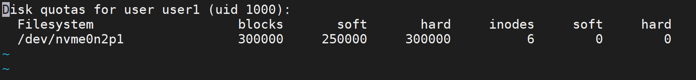

##### 2. 批量复制配置

- 可以将针对user1的限制复制给user2

```plain
[root@localhost ~]# edquota -p user1 -u user2
```

##### 3. 查看限制情况

- 管理员使用 `repquota` 查看所有用户的状态。

```bash
[root@localhost ~]# repquota -as
*** Report for user quotas on device /dev/nvme0n2p1
Block grace time: 7days; Inode grace time: 7days
                        Space limits                File limits
User            used    soft    hard  grace    used  soft  hard  grace
----------------------------------------------------------------------
root      --     20K      0K      0K              2     0     0
user1     --     16K    245M    293M              4     0     0
user2     --     16K    245M    293M              4     0     0
user3     --     16K      0K      0K              4     0     0
user4     --     16K      0K      0K              4     0     0
user5     --     16K      0K      0K              4     0     0
```

**报表解读：**

- `used`：当前用量。
- `soft` / `hard`：限制值。
- `grace`：宽限期（如果超限会显示倒计时）。
- *注意：user3-5 的限制为 0，代表无限制。*

### 测试

我们使用 `dd` 命令尝试写入一个 500MB 的大文件，看看会发生什么。

```bash
# user1用户测试
[root@localhost ~]# su - user1
[user1@localhost ~]$ dd if=/dev/zero of=bigfile bs=10M count=50  
nvme0n2p1: warning, user block quota exceeded.
nvme0n2p1: write failed, user block limit reached.
dd: error writing 'bigfile': Disk quota exceeded
30+0 records in
29+0 records out
307179520 bytes (307 MB, 293 MiB) copied, 1.1834 s, 260 MB/s
[user1@localhost ~]$ du -sh
293M    .

# user2用户测试
[root@localhost ~]# su - user2
[user2@localhost ~]$ dd if=/dev/zero of=bigfile bs=10M count=50
nvme0n2p1: warning, user block quota exceeded.
nvme0n2p1: write failed, user block limit reached.
dd: error writing 'bigfile': Disk quota exceeded
30+0 records in
29+0 records out
307183616 bytes (307 MB, 293 MiB) copied, 1.43269 s, 214 MB/s
[user2@localhost ~]$ du -sh
293M    .
```

### quota 命令

Linux quota命令用于显示磁盘已使用的空间与限制。

执行quota指令，可查询磁盘空间的限制，并得知已使用多少空间

选项：

- -g 列出群组的磁盘空间限制。
- -q 简明列表，只列出超过限制的部分。
- -u 列出用户的磁盘空间限制。
- -v 显示该用户或群组，在所有挂入系统的存储设备的空间限制。
- -V 显示版本信息。

## xfs\_quota

专门针对XFS文件系统来管理quota磁盘容量配额服务

`xfs_quota [参数] 配额 文件系统`

- -c参数用于以参数的形式设置要执行的命令
- -x参数是专家模式

硬盘使用量的软限制和硬限制分别为3MB和6MB；创建文件数量的软限制和硬限制分别为3个和6个。

```bash
# 设置限制：空间软3M/硬6M，文件数软3/硬6
[root@localhost ~]# xfs_quota -x -c 'limit bsoft=3m bhard=6m isoft=3 ihard=6 test' /boot
# 查看报表
[root@localhost ~]# xfs_quota -x -c report /boot
User quota on /boot (/dev/sda1)
                               Blocks                     
User ID          Used       Soft       Hard    Warn/Grace     
---------- -------------------------------------------------- 
root           115516          0          0     00 [--------]
test                0       3072       6144     00 [--------]
```

```bash
[root@localhost ~]# su - test
# 写入 5M (在软限制内，成功)
[test@localhost ~]$ dd if=/dev/zero of=/boot/tom bs=5M count=1
1+0 records in
1+0 records out
5242880 bytes (5.2 MB) copied, 0.00350676 s, 1.5 GB/s
# 写入 8M (超过硬限制 6M，失败)
[test@localhost ~]$ dd if=/dev/zero of=/boot/tom bs=8M count=1
dd: error writing ‘/boot/tom’: Disk quota exceeded
1+0 records in
0+0 records out
4194304 bytes (4.2 MB) copied, 0.00760235 s, 552 MB/s
```

# 软硬方式链接

在Linux系统中存在硬链接和软连接两种文件。

- 硬链接（hard link）：

- 可以将它理解为一个“指向原始文件inode的指针”，系统不为它分配独立的inode和文件。所以，硬链接文件与原始文件其实是同一个文件，只是名字不同。我们每添加一个硬链接，该文件的inode连接数就会增加1；而且只有当该文件的inode连接数为0时，才算彻底将它删除。换言之，由于硬链接实际上是指向原文件inode的指针，因此即便原始文件被删除，依然可以通过硬链接文件来访问。需要注意的是，由于技术的局限性，我们不能跨分区对目录文件进行链接。

- 软链接（也称为符号链接[symbolic link]）：

- 仅仅包含所链接文件的路径名，因此能链接目录文件，也可以跨越文件系统进行链接。但是，当原始文件被删除后，链接文件也将失效，从这一点上来说与Windows系统中的“快捷方式”具有一样的性质。

## ln

用于创建链接文件

`ln [选项] 目标`

ln命令中可用的参数以及作用

|  |  |
| --- | --- |
| **参数** | **作用** |
| -s | 创建“符号链接”（如果不带-s参数，则默认创建硬链接） |
| -f | 强制创建文件或目录的链接 |
| -i | 覆盖前先询问用户 |
| -v | 显示创建链接的过程 |

### 软链接演示

```bash
[root@localhost ~]# echo "hello linux" > testfile
[root@localhost ~]# ln -s testfile linkfile            # 创建软连接
[root@localhost ~]# ll
total 8
-rw-------. 1 root root 905 Nov  9 10:57 anaconda-ks.cfg
lrwxrwxrwx. 1 root root   8 Nov 15 20:41 linkfile -> testfile
-rw-r--r--. 1 root root  12 Nov 15 20:40 testfile
[root@localhost ~]# cat linkfile
hello linux
[root@localhost ~]# ls -l linkfile
lrwxrwxrwx. 1 root root 8 Nov 15 20:41 linkfile -> testfile
[root@localhost ~]# rm -f testfile
[root@localhost ~]# cat linkfile
cat: linkfile: No such file or directory
```

### 硬链接演示

```bash
[root@localhost ~]# echo "hello linux" > testfile
[root@localhost ~]# ln testfile linkfile
[root@localhost ~]# cat linkfile
hello linux
[root@localhost ~]# ls -l linkfile
-rw-r--r--. 2 root root 12 Nov 15 20:42 linkfile
[root@localhost ~]# rm -f testfile
[root@localhost ~]# cat linkfile
hello linux
```

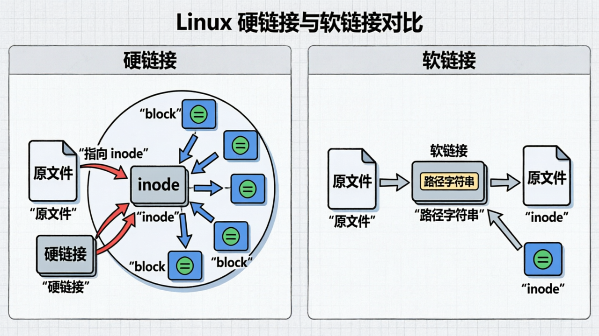
