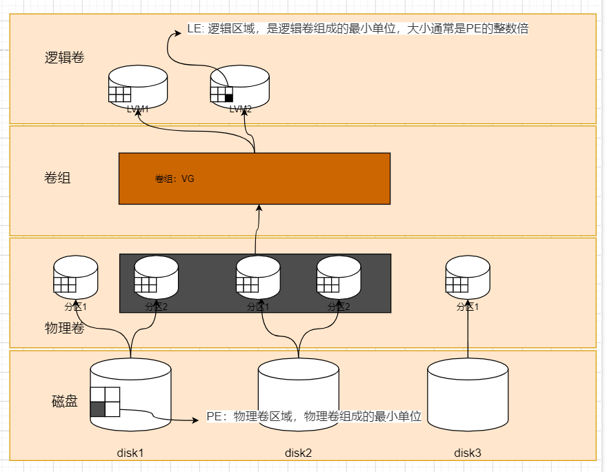

逻辑卷管理器是Linux系统用于对硬盘分区进行管理的一种机制，理论性较强，其创建初衷是为了解决硬盘设备在创建分区后不易修改分区大小的缺陷。尽管对传统的硬盘分区进行强制扩容或缩容从理论上来讲是可行的，但是却可能造成数据的丢失。而LVM技术是在硬盘分区和文件系统之间添加了一个逻辑层，它提供了一个抽象的卷组，可以把多块硬盘进行卷组合并。这样一来，用户不必关心物理硬盘设备的底层架构和布局，就可以实现对硬盘分区的动态调整。



**物理卷处于LVM中的最底层，可以将其理解为物理硬盘、硬盘分区或者RAID磁盘阵列，这都可以**。卷组建立在物理卷之上，一个卷组可以包含多个物理卷，而且在卷组创建之后也可以继续向其中添加新的物理卷。逻辑卷是用卷组中空闲的资源建立的，并且逻辑卷在建立后可以动态地扩展或缩小空间。这就是LVM的核心理念。

PE最小存储单元，VG（卷组）通过PV（物理卷）组合好PE（物理卷最小单元），成一个整的；然后LV（逻辑卷）从VG（卷组）分出来可供挂载使用

## 部署逻辑卷

常用的LVM部署命令

|  |  |  |  |
| --- | --- | --- | --- |
| **功能/命令** | **物理卷管理** | **卷组管理** | **逻辑卷管理** |
| 扫描 | pvscan | vgscan | lvscan |
| 建立 | pvcreate | vgcreate | lvcreate |
| 显示 | pvdisplay | vgdisplay | lvdisplay |
| 删除 | pvremove | vgremove | lvremove |
| 扩展 |  | vgextend | lvextend |
| 缩小 |  | vgreduce | lvreduce |

为了避免多个实验之间相互发生冲突，请大家自行将虚拟机还原到初始状态，并在虚拟机中添加两块新硬盘设备，然后开机

第1步：让新添加的两块硬盘设备支持LVM技术

```bash
[root@localhost ~]# pvcreate /dev/nvme0n2 /dev/nvme0n3
  Physical volume "/dev/nvme0n2" successfully created.
  Physical volume "/dev/nvme0n3" successfully created.
#有时候创建不成功，有残留数据需要重新做分区表
#[root@localhost ~]#parted /dev/nvme0n2 /dev/nvme0n3 mklabel msdos
```

**parted 磁盘名 mklabel msdos**

**“强制清空磁盘的‘户口本’，并重新建立一个新的”**。

简单来说，`parted 磁盘名 mklabel msdos` 的作用是：**擦除磁盘上原有的所有分区表信息（包括残留的旧数据），并初始化一个新的 MBR (msdos) 分区表。**

以下是详细的拆解和原因分析：

### 1. 命令拆解
- `parted`：Linux 下强大的分区工具。
- `mklabel`：这是核心动作，意思是“创建标签”，也就是**初始化分区表**。
- `msdos`：指定分区表的格式为 **MBR**（即传统的 msdos 格式）。

### 2. 为什么要重新设置？（核心原因）
你遇到的情况通常是：**磁盘虽然看起来是空的，或者已经删除了分区，但**`pvcreate`**依然报错。**

#### “残留数据”的干扰
当你在一块旧硬盘上操作时，即使你用 `fdisk` 删除了所有分区，硬盘的头部（或尾部）往往还残留着**旧的“签名”（Signature）**。

- 这些签名可能来自之前的文件系统（如 ext4, xfs）。
- 可能来自之前的 RAID 信息（superblock）。
- 可能来自之前的 LVM 信息。

#### LVM 的安全机制
当你运行 `pvcreate` 时，LVM 会检查磁盘。如果它检测到磁盘上有“旧的分区表签名”或“文件系统签名”，为了防止你误操作导致旧数据丢失，LVM 会拒绝创建物理卷，并报错：

`Device /dev/sdX has a partition signature...`  
或者  
`Device /dev/sdX excluded by a filter.`

#### 强制“洗白”
执行 `parted ... mklabel msdos` 相当于**“格式化分区表”**。

- 它会**彻底覆盖**磁盘头部的旧分区表信息。
- 它会让系统认为这是一块全新的、空白的磁盘。
- 此时再运行 `pvcreate`，系统检测不到任何旧签名，就会顺利通过。

### 3. 注意事项：MBR (msdos) vs GPT
你在命令中使用了 `msdos`，这代表使用 **MBR** 分区格式。

- **适用场景**：小于 2TB 的硬盘。
- **潜在风险**：如果你的 文件 容量**大于 2TB**，使用 `msdos` 会导致超过 2TB 的空间无法被识别和使用。
- **最佳实践**：

- 如果是**大容量硬盘（>2TB）**，建议使用 `mklabel gpt`。
- 如果是**小容量硬盘**，`mklabel msdos` 是完全没问题的。

### 总结
这行命令就像是**把房子的地基铲平重做**。虽然房子（分区）还没盖，但先把地皮（分区表）清理干净，确保没有上一任房主（旧系统/旧数据）留下的痕迹，这样 LVM（新住户）才愿意住进来。

第2步：把两块硬盘设备加入到storage卷组中，然后查看卷组的状态

```bash
[root@localhost ~]# vgcreate storage /dev/nvme0n2 /dev/nvme0n3
  Volume group "storage" successfully created
[root@localhost ~]# vgdisplay storage
  --- Volume group ---
  VG Name               storage
  System ID
  Format                lvm2
  Metadata Areas        2
  Metadata Sequence No  1
  VG Access             read/write
  VG Status             resizable
  MAX LV                0
  Cur LV                0
  Open LV               0
  Max PV                0
  Cur PV                2
  Act PV                2
  VG Size               9.99 GiB
  PE Size               4.00 MiB
  Total PE              2558
  Alloc PE / Size       0 / 0
  Free  PE / Size       2558 / 9.99 GiB
  VG UUID               fhR9kn-q5mT-CxO1-Skst-c5mN-X1nN-TbQpU6
```

第3步：切割出一个约为150MB的逻辑卷设备。

这里需要注意切割单位的问题。在对逻辑卷进行切割时有两种计量单位。

第一种是以容量为单位，所使用的参数为-L。例如，使用-L 150M生成一个大小为150MB的逻辑卷。

另外一种是以基本单元的个数为单位，所使用的参数为-l。每个基本单元的大小默认为4MB。例如，使用-l 37可以生成一个大小为37×4MB=148MB的逻辑卷。

```bash
# [root@localhost ~]# lvcreate -n vo -l 37 -I 8M storage
[root@localhost ~]# lvcreate -n vo -l 37 storage
  Logical volume "vo" created.
# 每个PE占4M，37*4=148M，远少于/dev/nvme0n2的5G，不会占用到第二个PV（/dev/nvme0n3），所以lsblk只看到占用了/dev/nvme0n2
[root@localhost ~]# lsblk
NAME         MAJ:MIN RM  SIZE RO TYPE MOUNTPOINTS
sr0           11:0    1  1.7G  0 rom
nvme0n1      259:0    0   20G  0 disk
├─nvme0n1p1  259:1    0    1G  0 part /boot
└─nvme0n1p2  259:2    0   19G  0 part
  ├─rl-root  253:0    0   17G  0 lvm  /
  └─rl-swap  253:1    0    2G  0 lvm  [SWAP]
nvme0n2      259:3    0    5G  0 disk
└─storage-vo 253:2    0  148M  0 lvm
nvme0n3      259:4    0    5G  0 disk
nvme0n4      259:5    0    5G  0 disk
nvme0n5      259:6    0    5G  0 disk
nvme0n6      259:7    0    5G  0 disk

[root@localhost ~]# lvdisplay
  --- Logical volume ---
  LV Path                /dev/storage/vo
  LV Name                vo
  VG Name                storage
  LV UUID                X83QDm-cgYS-Vlsj-FHqq-pJWh-bWnY-NhoozO
  LV Write Access        read/write
  LV Creation host, time localhost.localdomain, 2024-11-16 17:35:36 +0800
  LV Status              available
  # open                 0
  LV Size                148.00 MiB
  Current LE             37
  Segments               1
  Allocation             inherit
  Read ahead sectors     auto
  - currently set to     8192
  Block device           253:2

  --- Logical volume ---
  LV Path                /dev/rl/swap
  LV Name                swap
  VG Name                rl
  LV UUID                mStLV7-xYcw-4GHG-vdEC-igob-LNmI-xWVQRF
  LV Write Access        read/write
  LV Creation host, time localhost.localdomain, 2024-11-09 10:51:12 +0800
  LV Status              available
  # open                 2
  LV Size                2.00 GiB
  Current LE             512
  Segments               1
  Allocation             inherit
  Read ahead sectors     auto
  - currently set to     8192
  Block device           253:1

  --- Logical volume ---
  LV Path                /dev/rl/root
  LV Name                root
  VG Name                rl
  LV UUID                yQ6wgx-mgEh-ACiF-Au17-X7Qs-PzQx-0eiqg3
  LV Write Access        read/write
  LV Creation host, time localhost.localdomain, 2024-11-09 10:51:12 +0800
  LV Status              available
  # open                 1
  LV Size                <17.00 GiB
  Current LE             4351
  Segments               1
  Allocation             inherit
  Read ahead sectors     auto
  - currently set to     8192
  Block device           253:0
```

# lvcreate -n vo -l 37 -I 8M storage

-I：条带大小

**“在 storage 卷组中，创建一个名为 vo 的逻辑卷，大小为 37 个 PE。请使用** **条带化技术** **存储数据，每块硬盘轮流写入** **8MB** **的数据块，以获得更高的读写性能。”**

第4步：把生成好的逻辑卷进行格式化，然后挂载使用。

```bash
[root@localhost ~]# mkfs.ext4 /dev/storage/vo
mke2fs 1.46.5 (30-Dec-2021)
Creating filesystem with 151552 1k blocks and 37848 inodes
Filesystem UUID: 11f83627-21f1-42fb-a19b-6ccfdc62453d
Superblock backups stored on blocks:
        8193, 24577, 40961, 57345, 73729

Allocating group tables: done
Writing inode tables: done
Creating journal (4096 blocks): done
Writing superblocks and filesystem accounting information: done

[root@localhost ~]# mkdir /mnt/vo
[root@localhost ~]# mount /dev/storage/vo /mnt/vo
[root@localhost ~]# df -h
Filesystem              Size  Used Avail Use% Mounted on
devtmpfs                4.0M     0  4.0M   0% /dev
tmpfs                   872M     0  872M   0% /dev/shm
tmpfs                   349M  5.2M  344M   2% /run
/dev/mapper/rl-root      17G  1.7G   16G  10% /
/dev/nvme0n1p1          960M  261M  700M  28% /boot
tmpfs                   175M     0  175M   0% /run/user/0
/dev/mapper/storage-vo  134M   14K  123M   1% /mnt/vo
[root@localhost ~]# lsblk
NAME         MAJ:MIN RM  SIZE RO TYPE MOUNTPOINTS
sr0           11:0    1  1.7G  0 rom
nvme0n1      259:0    0   20G  0 disk
├─nvme0n1p1  259:1    0    1G  0 part /boot
└─nvme0n1p2  259:2    0   19G  0 part
  ├─rl-root  253:0    0   17G  0 lvm  /
  └─rl-swap  253:1    0    2G  0 lvm  [SWAP]
nvme0n2      259:3    0    5G  0 disk
└─storage-vo 253:2    0  148M  0 lvm  /mnt/vo
nvme0n3      259:4    0    5G  0 disk
nvme0n4      259:5    0    5G  0 disk
nvme0n5      259:6    0    5G  0 disk
nvme0n6      259:7    0    5G  0 disk

[root@localhost ~]# echo "/dev/storage/vo /mnt/vo ext4 defaults 0 0" >> /etc/fstab
```

### 1.** `/dev/storage/vo` **(你创建的逻辑卷)
这是你通过 `lvcreate` 命令亲手创建的数据卷，主要用于学习和测试 LVM 的操作。

- **名称 (LV Name):** `vo`
- **所属卷组 (VG Name):** `storage`
- **大小 (LV Size):** `148.00 MiB`
- **用途:** 这是一个通用的数据存储卷。你通常会把它格式化（如 `mkfs.ext4`）并挂载到一个目录（如 `/data`），用来存放文件。目前它没有被挂载使用（`# open 0`）。

### 2.**`/dev/rl/root`**(系统的根目录)
这是 Linux 操作系统的“心脏”，是你的主文件系统。

- **名称 (LV Name):** `root`
- **所属卷组 (VG Name):** `rl` (通常是 `rhel` 或 `rocky` 的缩写)
- **大小 (LV Size):** `<17.00 GiB`
- **用途:** 它被挂载在 `/` (根目录) 上。你安装的所有软件、系统配置文件、以及 `/home` 目录下的用户数据（除非单独分区）都存储在这里。系统启动和运行都离不开它（`# open 1` 表示正在被使用）。

### 3.**`/dev/rl/swap`**(系统的交换空间)
这是系统的“虚拟内存”，是物理内存（RAM）的延伸和补充。

- **名称 (LV Name):** `swap`
- **所属卷组 (VG Name):** `rl`
- **大小 (LV Size):** `2.00 GiB`
- **用途:** 它不用于存储文件，而是作为内存的“后备军”。当物理内存不够用时，系统会把内存中暂时不用的数据“交换”到 swap 空间，为重要程序腾出内存。它被挂载为 `[SWAP]` 类型，而不是一个普通的目录（`# open 2` 表示系统内核正在使用它）。

## 扩容逻辑卷

第1步：把上一个实验中的逻辑卷vo扩展至290MB

```bash
[root@localhost ~]# umount /mnt/vo
[root@localhost ~]# lvextend -L 290M /dev/storage/vo
  Rounding size to boundary between physical extents: 292.00 MiB.
  Size of logical volume storage/vo changed from 148.00 MiB (37 extents) to 292.00 MiB (73 extents).
  Logical volume storage/vo successfully resized.
```

第2步：检查硬盘完整性，并重置硬盘容量，否则挂载了还是148M

```bash
[root@localhost ~]# e2fsck -f /dev/storage/vo
e2fsck 1.46.5 (30-Dec-2021)
Pass 1: Checking inodes, blocks, and sizes
Pass 2: Checking directory structure
Pass 3: Checking directory connectivity
Pass 4: Checking reference counts
Pass 5: Checking group summary information
/dev/storage/vo: 11/37848 files (0.0% non-contiguous), 15165/151552 blocks
[root@localhost ~]# resize2fs /dev/storage/vo
resize2fs 1.46.5 (30-Dec-2021)
Resizing the filesystem on /dev/storage/vo to 299008 (1k) blocks.
The filesystem on /dev/storage/vo is now 299008 (1k) blocks long.
```

`e2fs` 其实是 **Extended File System 2** 的缩写，通常指的是 Linux 系统中用于管理 **ext2、ext3 和 ext4** 文件系统的核心工具集，也就是 `e2fsprogs`。

你可以把它理解为 Linux 文件系统的**“维修工具箱”**。

为了让你更清楚地理解，我们可以从以下三个维度来解释：

### 1. 字面含义：文件系统家族
`e2fs` 中的 "e2" 代表 **ext2**（第二代扩展文件系统），这是 Linux 早期最经典的文件系统。  
虽然名字里带着 "2"，但这个工具集随着技术发展一直在更新，现在它已经完美支持 **ext3**（增加了日志功能）和 **ext4**（目前最主流的 Linux 文件系统）。

### 2. 实际指代：**`e2fsprogs`**工具包
在 Linux 运维中，当我们提到 `e2fs` 时，通常是指包含了一系列管理命令的软件包 `e2fsprogs`。你之前用到的命令其实都属于这个包：

- `e2fsck`：**“医生”**。用于检查和修复文件系统错误（比如非正常关机后的修复）。
- `resize2fs`：**“裁缝”**。用于调整文件系统的大小（你刚才扩容时用的就是这个）。
- `mke2fs`：**“建筑师”**。用于格式化磁盘，创建新的文件系统。
- `tune2fs`：**“调节师”**。用于修改文件系统的参数（比如调整挂载次数限制）。
- `dumpe2fs`：**“透视眼”**。用于查看文件系统的底层详细信息。

### *3. 为什么它很重要？*
它是 Linux 系统的基石之一。因为 ext4 是目前 CentOS、Ubuntu、Debian 等主流发行版默认的文件系统，所以 `e2fsprogs` 是系统管理员必须掌握的工具集。

第3步：重新挂载硬盘设备并查看挂载状态

```bash
[root@localhost ~]# systemctl daemon-reload
[root@localhost ~]# mount -a
[root@localhost ~]# df -h
Filesystem              Size  Used Avail Use% Mounted on
devtmpfs                4.0M     0  4.0M   0% /dev
tmpfs                   872M     0  872M   0% /dev/shm
tmpfs                   349M  5.2M  344M   2% /run
/dev/mapper/rl-root      17G  1.7G   16G  10% /
/dev/nvme0n1p1          960M  261M  700M  28% /boot
tmpfs                   175M     0  175M   0% /run/user/0
/dev/mapper/storage-vo  268M   14K  250M   1% /mnt/vo
```

第4步，如果扩容到6G，则会占用到nvme0n3的pv

```shell
[root@localhost ~]# umount /mnt/vo
[root@localhost ~]# lvextend -L 6G /dev/storage/vo
  Size of logical volume storage/vo changed from 292.00 MiB (73 extents) to 6.00 GiB (1536 extents).
  Logical volume storage/vo successfully resized.
[root@localhost ~]# e2fsck -f /dev/storage/vo
e2fsck 1.46.5 (30-Dec-2021)
Pass 1: Checking inodes, blocks, and sizes
Pass 2: Checking directory structure
Pass 3: Checking directory connectivity
Pass 4: Checking reference counts
Pass 5: Checking group summary information
/dev/storage/vo: 11/73704 files (0.0% non-contiguous), 24683/299008 blocks
[root@localhost ~]# resize2fs /dev/storage/vo
resize2fs 1.46.5 (30-Dec-2021)
Resizing the filesystem on /dev/storage/vo to 6291456 (1k) blocks.
The filesystem on /dev/storage/vo is now 6291456 (1k) blocks long.

[root@localhost ~]# mount -a
[root@localhost ~]# lsblk
NAME         MAJ:MIN RM  SIZE RO TYPE MOUNTPOINTS
sr0           11:0    1  1.7G  0 rom
nvme0n1      259:0    0   20G  0 disk
├─nvme0n1p1  259:1    0    1G  0 part /boot
└─nvme0n1p2  259:2    0   19G  0 part
  ├─rl-root  253:0    0   17G  0 lvm  /
  └─rl-swap  253:1    0    2G  0 lvm  [SWAP]
nvme0n2      259:3    0    5G  0 disk
└─storage-vo 253:2    0    6G  0 lvm  /mnt/vo
nvme0n3      259:4    0    5G  0 disk
└─storage-vo 253:2    0    6G  0 lvm  /mnt/vo
nvme0n4      259:5    0    5G  0 disk
nvme0n5      259:6    0    5G  0 disk
nvme0n6      259:7    0    5G  0 disk
[root@localhost ~]# df -h
Filesystem              Size  Used Avail Use% Mounted on
devtmpfs                4.0M     0  4.0M   0% /dev
tmpfs                   872M     0  872M   0% /dev/shm
tmpfs                   349M  5.2M  344M   2% /run
/dev/mapper/rl-root      17G  1.7G   16G  10% /
/dev/nvme0n1p1          960M  261M  700M  28% /boot
tmpfs                   175M     0  175M   0% /run/user/0
/dev/mapper/storage-vo  5.7G   14K  5.4G   1% /mnt/vo
```

## 缩小逻辑卷

第1步：检查文件系统的完整性

```bash
[root@localhost ~]# umount /mnt/vo
[root@localhost ~]# e2fsck -f /dev/storage/vo
e2fsck 1.46.5 (30-Dec-2021)
Pass 1: Checking inodes, blocks, and sizes
Pass 2: Checking directory structure
Pass 3: Checking directory connectivity
Pass 4: Checking reference counts
Pass 5: Checking group summary information
/dev/storage/vo: 11/1529856 files (0.0% non-contiguous), 391996/6291456 blocks
```

第2步：把逻辑卷vo的容量减小到120MB

```bash
[root@localhost ~]# resize2fs /dev/storage/vo 120M
resize2fs 1.46.5 (30-Dec-2021)
Resizing the filesystem on /dev/storage/vo to 122880 (1k) blocks.
The filesystem on /dev/storage/vo is now 122880 (1k) blocks long.

[root@localhost ~]# lvreduce -L 120M /dev/storage/vo
  File system ext4 found on storage/vo.
  File system size (120.00 MiB) is equal to the requested size (120.00 MiB).
  File system reduce is not needed, skipping.
  Size of logical volume storage/vo changed from 6.00 GiB (1536 extents) to 120.00 MiB (30 extents).
  Logical volume storage/vo successfully resized.
```

第3步：重新挂载文件系统并查看系统状态

```bash
[root@localhost ~]# mount -a
[root@localhost ~]# df -h
Filesystem              Size  Used Avail Use% Mounted on
devtmpfs                4.0M     0  4.0M   0% /dev
tmpfs                   872M     0  872M   0% /dev/shm
tmpfs                   349M  5.2M  344M   2% /run
/dev/mapper/rl-root      17G  1.7G   16G  10% /
/dev/nvme0n1p1          960M  261M  700M  28% /boot
tmpfs                   175M     0  175M   0% /run/user/0
/dev/mapper/storage-vo  108M   14K   99M   1% /mnt/vo
```

## 逻辑卷快照

LVM还具备有“快照卷”功能，该功能类似于虚拟机软件的还原时间点功能。例如，可以对某一个逻辑卷设备做一次快照，如果日后发现数据被改错了，就可以利用之前做好的快照卷进行覆盖还原。LVM的快照卷功能有两个特点：

- **快照卷的容量必须等同于逻辑卷的容量**；
- 快照卷**仅一次有效**，一旦执行还原操作后则会被**立即自动删除**。

```bash
[root@localhost ~]# vgdisplay
  --- Volume group ---
  VG Name               storage
  System ID
  Format                lvm2
  Metadata Areas        2
  Metadata Sequence No  5
  VG Access             read/write
  VG Status             resizable
  MAX LV                0
  Cur LV                1
  Open LV               1
  Max PV                0
  Cur PV                2
  Act PV                2
  VG Size               9.99 GiB
  PE Size               4.00 MiB
  Total PE              2558
  Alloc PE / Size       30 / 120.00 MiB
  Free  PE / Size       2528 / <9.88 GiB    # 容量剩余9.88G
  VG UUID               fhR9kn-q5mT-CxO1-Skst-c5mN-X1nN-TbQpU6

  --- Volume group ---
  VG Name               rl
  System ID
  Format                lvm2
  Metadata Areas        1
  Metadata Sequence No  3
  VG Access             read/write
  VG Status             resizable
  MAX LV                0
  Cur LV                2
  Open LV               2
  Max PV                0
  Cur PV                1
  Act PV                1
  VG Size               <19.00 GiB
  PE Size               4.00 MiB
  Total PE              4863
  Alloc PE / Size       4863 / <19.00 GiB
  Free  PE / Size       0 / 0
  VG UUID               GbAoZ2-IvHg-YKLQ-366L-f2lq-qo71-T79Hm6
```

接下来用**重定向**往逻辑卷设备所挂载的目录中写入一个文件

```bash
[root@localhost ~]# echo "hello world" > /mnt/vo/readme.txt
[root@localhost ~]# ls -l /mnt/vo
total 14
drwx------. 2 root root 12288 Apr 18 13:38 lost+found
-rw-r--r--. 1 root root    12 Apr 18 13:48 readme.txt
```

第1步：使用-s参数生成一个快照卷，使用-L参数指定切割的大小。

另外，还需要在命令后面写上是针对哪个逻辑卷执行的快照操作。**强烈建议快照大小和原来的LVM一样大**

```bash
[root@localhost ~]# lvcreate -L 120M -s -n SNAP /dev/storage/vo
#强烈建议快照大小和原来的LVM一样大，虽然指定大小是120M，并不是创建一个120M大小的快照，除非修改、新增的文件超出120M才会出事情，删除不影响。
  Logical volume "SNAP" created.
[root@localhost ~]# lvdisplay
  --- Logical volume ---
  LV Path                /dev/storage/vo
  LV Name                vo
  VG Name                storage
  LV UUID                X83QDm-cgYS-Vlsj-FHqq-pJWh-bWnY-NhoozO
  LV Write Access        read/write
  LV Creation host, time localhost.localdomain, 2024-11-16 17:35:36 +0800
  LV snapshot status     source of
                         SNAP [active]
  LV Status              available
  # open                 1
  LV Size                120.00 MiB
  Current LE             30
  Segments               1
  Allocation             inherit
  Read ahead sectors     auto
  - currently set to     8192
  Block device           253:2

  --- Logical volume ---
  LV Path                /dev/storage/SNAP
  LV Name                SNAP
  VG Name                storage
  LV UUID                om37W1-JVXY-yctX-4Rm7-Bh9L-ERVo-JlqTuV
  LV Write Access        read/write
  LV Creation host, time localhost.localdomain, 2024-11-16 17:43:02 +0800
  LV snapshot status     active destination for vo
  LV Status              available
  # open                 0
  LV Size                120.00 MiB
  Current LE             30
  COW-table size         120.00 MiB
  COW-table LE           30
  Allocated to snapshot  0.01%
  Snapshot chunk size    4.00 KiB
  Segments               1
  Allocation             inherit
  Read ahead sectors     auto
  - currently set to     8192
  Block device           253:5

  --- Logical volume ---
  LV Path                /dev/rl/swap
  LV Name                swap
  VG Name                rl
  LV UUID                mStLV7-xYcw-4GHG-vdEC-igob-LNmI-xWVQRF
  LV Write Access        read/write
  LV Creation host, time localhost.localdomain, 2024-11-09 10:51:12 +0800
  LV Status              available
  # open                 2
  LV Size                2.00 GiB
  Current LE             512
  Segments               1
  Allocation             inherit
  Read ahead sectors     auto
  - currently set to     8192
  Block device           253:1

  --- Logical volume ---
  LV Path                /dev/rl/root
  LV Name                root
  VG Name                rl
  LV UUID                yQ6wgx-mgEh-ACiF-Au17-X7Qs-PzQx-0eiqg3
  LV Write Access        read/write
  LV Creation host, time localhost.localdomain, 2024-11-09 10:51:12 +0800
  LV Status              available
  # open                 1
  LV Size                <17.00 GiB
  Current LE             4351
  Segments               1
  Allocation             inherit
  Read ahead sectors     auto
  - currently set to     8192
  Block device           253:0
```

第2步：在逻辑卷所挂载的目录中创建一个50MB的垃圾文件，然后再查看快照卷的状态。可以发现存储空间占的用量上升了

```bash
[root@localhost ~]# dd if=/dev/zero of=/mnt/vo/files count=1 bs=50M
1+0 records in
1+0 records out
104857600 bytes (105 MB) copied, 3.29409 s, 31.8 MB/s
[root@localhost ~]# lvdisplay
  --- Logical volume ---
  LV Path                /dev/storage/vo
  LV Name                vo
  VG Name                storage
  LV UUID                X83QDm-cgYS-Vlsj-FHqq-pJWh-bWnY-NhoozO
  LV Write Access        read/write
  LV Creation host, time localhost.localdomain, 2024-11-16 17:35:36 +0800
  LV snapshot status     source of
                         SNAP [active]
  LV Status              available
  # open                 1
  LV Size                120.00 MiB
  Current LE             30
  Segments               1
  Allocation             inherit
  Read ahead sectors     auto
  - currently set to     8192
  Block device           253:2

  --- Logical volume ---
  LV Path                /dev/storage/SNAP
  LV Name                SNAP
  VG Name                storage
  LV UUID                om37W1-JVXY-yctX-4Rm7-Bh9L-ERVo-JlqTuV
  LV Write Access        read/write
  LV Creation host, time localhost.localdomain, 2024-11-16 17:43:02 +0800
  LV snapshot status     active destination for vo
  LV Status              available
  # open                 0
  LV Size                120.00 MiB
  Current LE             30
  COW-table size         120.00 MiB
  COW-table LE           30
  Allocated to snapshot  41.90%        # 从0.01变成了41.90
  Snapshot chunk size    4.00 KiB
  Segments               1
  Allocation             inherit
  Read ahead sectors     auto
  - currently set to     8192
  Block device           253:5

  --- Logical volume ---
  LV Path                /dev/rl/swap
  LV Name                swap
  VG Name                rl
  LV UUID                mStLV7-xYcw-4GHG-vdEC-igob-LNmI-xWVQRF
  LV Write Access        read/write
  LV Creation host, time localhost.localdomain, 2024-11-09 10:51:12 +0800
  LV Status              available
  # open                 2
  LV Size                2.00 GiB
  Current LE             512
  Segments               1
  Allocation             inherit
  Read ahead sectors     auto
  - currently set to     8192
  Block device           253:1

  --- Logical volume ---
  LV Path                /dev/rl/root
  LV Name                root
  VG Name                rl
  LV UUID                yQ6wgx-mgEh-ACiF-Au17-X7Qs-PzQx-0eiqg3
  LV Write Access        read/write
  LV Creation host, time localhost.localdomain, 2024-11-09 10:51:12 +0800
  LV Status              available
  # open                 1
  LV Size                <17.00 GiB
  Current LE             4351
  Segments               1
  Allocation             inherit
  Read ahead sectors     auto
  - currently set to     8192
  Block device           253:0
```

第3步：为了校验SNAP快照卷的效果，需要对逻辑卷进行快照还原操作。在此之前记得先卸载掉逻辑卷设备与目录的挂载。

```bash
[root@localhost ~]# umount /mnt/vo
[root@localhost ~]# lvconvert --merge /dev/storage/SNAP 
  Merging of volume storage/SNAP started.
  storage/vo: Merged: 31.39%
  storage/vo: Merged: 100.00%
```

convert：转换 merge：合并

第4步：快照卷会被自动删除掉，并且刚刚在逻辑卷设备被执行快照操作后再创建出来的50MB的垃圾文件也被清除了

```bash
[root@localhost ~]# mount -a
[root@localhost ~]# ls /mnt/vo/
lost+found  readme.txt
```

## 删除逻辑卷

第1步：取消逻辑卷与目录的挂载关联，删除配置文件中永久生效的设备参数。

```bash
[root@localhost ~]# umount /mnt/vo/
[root@localhost ~]# vi /etc/fstab 
#
# /etc/fstab
# Created by anaconda on Mon Apr 15 17:31:00 2019
#
# Accessible filesystems, by reference, are maintained under '/dev/disk'
# See man pages fstab(5), findfs(8), mount(8) and/or blkid(8) for more info
#
/dev/mapper/centos-root /                       xfs     defaults        0 0
UUID=63e91158-e754-41c3-b35d-7b9698e71355 /boot                   xfs     defaults        0 0
/dev/mapper/centos-swap swap                    swap    defaults        0 0
```

第2步：删除逻辑卷设备，需要输入y来确认操作

```bash
[root@localhost ~]# lvremove /dev/storage/vo 
Do you really want to remove active logical volume storage/vo? [y/n]: y
  Logical volume "vo" successfully removed
```

第3步：删除卷组，此处只写卷组名称即可，不需要设备的绝对路径。

```bash
[root@localhost ~]# vgremove storage
  Volume group "storage" successfully removed
```

第4步：删除物理卷设备

```bash
[root@localhost ~]# pvremove /dev/nvme0n2 /dev/nvme0n3
  Labels on physical volume "/dev/nvme0n2" successfully wiped.
  Labels on physical volume "/dev/nvme0n3" successfully wiped.
```

部署逻辑卷

准备裸盘或者分区

创建物理卷pvcreate

创建卷组vgcreate

创建逻辑卷lvcreate

格式化

挂载

扩容逻辑卷

卸载

lvextend进行扩容

检查文件系统e2fsck

刷新文件系统resize2fs

再重新挂载

缩容逻辑卷

卸载

检查文件系统e2fsck

刷新文件系统resize2fs

lvreduce进行缩容

再重新挂载

COW（copy on write）写时复制技术

只有当数据发生修改的时候，才会进行拷贝，所以快照在刚刚拍摄时是不占用空间的，随之时间推移的快照会越来越大

删除逻辑卷

卸载

删除逻辑卷

删除卷组

删除物理卷
