ISO组织：

<https://baike.baidu.com/item/%E5%9B%BD%E9%99%85%E6%A0%87%E5%87%86%E5%8C%96%E7%BB%84%E7%BB%87/779832>

OSI参考模型：

<https://blog.csdn.net/weixin_44772566/article/details/136717134>

- 数据从产生到传递到目的地的过程中会经历好几个过程，每个过程都负责加工自己这部分的内容，类似于工厂流水线
- 目前我们只需要有个最基本的概念：

- IP地址是用来标识网络中位置的，比如你在江苏省xxx市xxx路xxx号
- MAC地址是每个网络设备的唯一ID，比如你的身份证号码
- 如果想要发送数据，必须(暂且认为必须)同时拥有IP和MAC地址
- Linux的网络管理基础部分就是需要大家掌握IP地址的配置

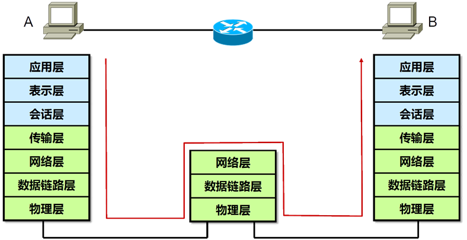

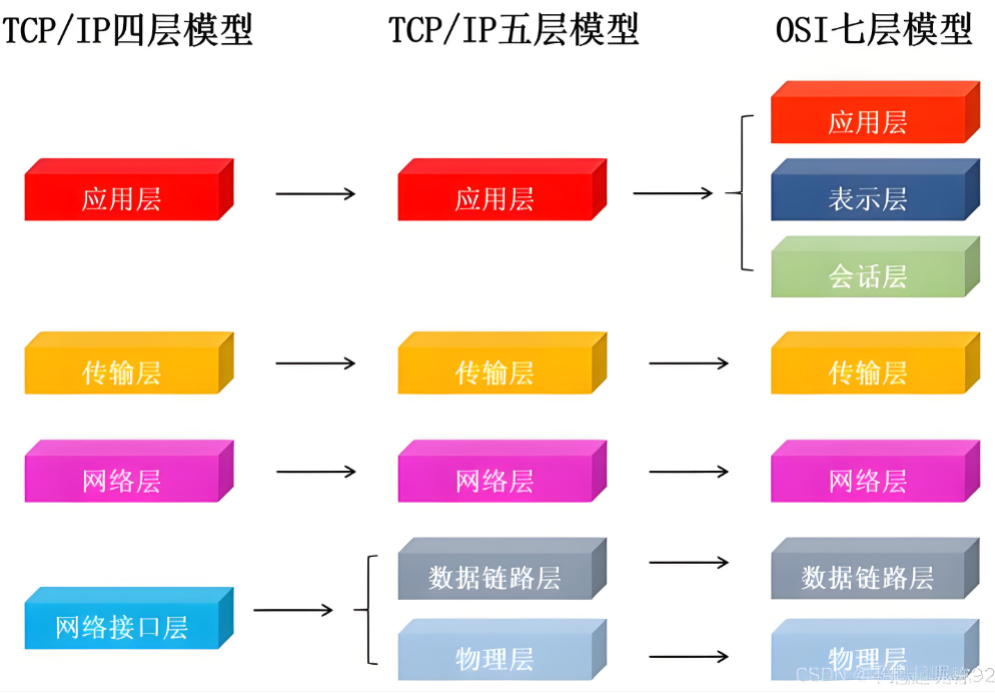

## IP地址

**IANA是一个分配地址的机构**

- 在IP网络中，通信节点需要有一个唯一的IP地址
- IP地址用于IP报文的寻址以及标识一个节点
- IPv4地址一共32bits，使用点分十进制的形式表示

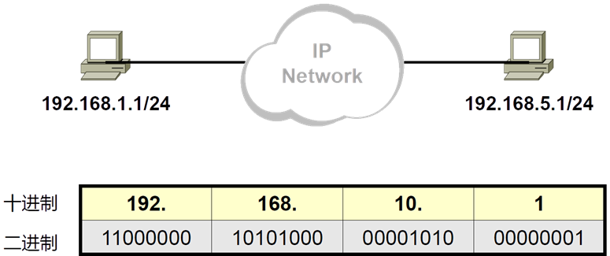

- IPv4地址由网络位和主机位组成

- 网络位一致表示在同一个广播域中，可以直接通信
- 主机位用于在同一个局域网中标识唯一节点

IPv4地址是由32位二进制数字组成，每八位为一组可以化为点分十进制

128 64 32 16 8 4 2 1

11000000 10101000 01010000 10000100

192.168.80.132

网络位：指定的是某一个区域，或者说是某一个网段

主机位：用于区分每一个机器的地址

### 早期IP地址的划分

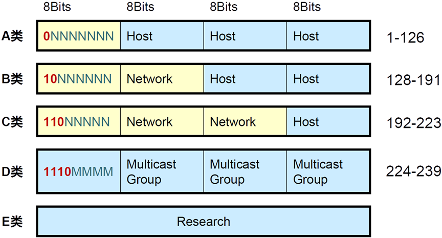

- 早期参与互联网的设备不多，所以仅仅使用ABC类地址分配给用户即可
- 随着网络用户的增多，ABC类分配地址过于浪费，于是出现子网掩码方式划分网络位和主机位

A类：网络位前面写0是固定的，网络位是8位，网络地址范围为1.0.0.0~126.0.0.0 【127开头的地址表示自己】

一个A类网络号下面可以有多少个主机？

【主机个数为二的二十四次方-2】  
 比如10.0.0.0/8，他可以用的IP地址范围是10.0.0.1~10.225.225.254

（主机位全部为0的时候是网络地址，不可作为IP地址；主机位全部为1的时候是广播地址，不可作为IP地址）

B类：网络位前面写10是固定的，网络位是16位，网络地址范围为128.0.0.0~191.255.0.0

【主机个数为二的十六次方-2】

C类：网络位前面写110是固定的，网络位是32位，网络地址范围为129.0.0.0~223.255.255.0【主机个数为二的八次方-2】

### IP网络通信类型

- 单播(Unicast)
- 广播(Broadcast)
- 组播(Multicast)

### 子网掩码(Netmask)

为什么会产生子网划分？

因为在传统的主类地址划分的方式中，会造成很多ip地址大量浪费的情况

- 网络掩码与IP地址搭配使用，用于描述一个IP地址中的网络部分及主机部分
- 网络掩码32bits，与32bits的IP地址一一对应，掩码中为1的位对应IP地址中的网络位，掩码中为0的位对应IP地址中的主机位

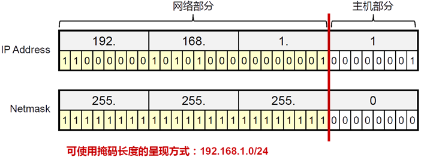

- 减少一个局域网中的设备数量可以有效降低广播报文消耗资源
- 可变长子网掩码可以将一个局域网中的主机地址分配的更加小

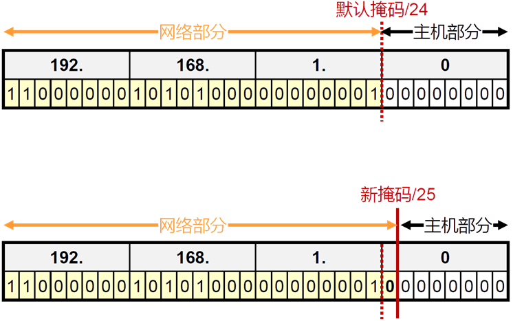

### 广播地址与网络号

- 在局域网中经常会有广播的需要(比如，mac地址查询，地址冲突检测等等)，所以将主机位全为1的地址做为本局域网的广播地址(注意！广播并不能跨越不同的局域网)
- 在网络中需要表示整个局域网，就像邮政编码表示一个大的区域一样，所以将主机位全为0的地址作为本局域网的网络号，用来代指整个网段
- 综上所述，计算产生的子网及每个子网的主机数量公式如下：

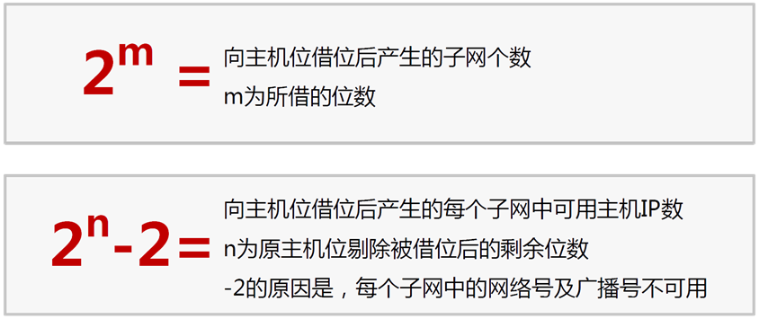

### 私有IP地址

- 如果要取得互联网合法地址用于通信，必须要找iana.org组织分配
- 很多企业内部都有大量的网络设备，大多数时候这些设备只需要内部通信即可
- 企业的网络管理员可以从如下网段中自行分配地址

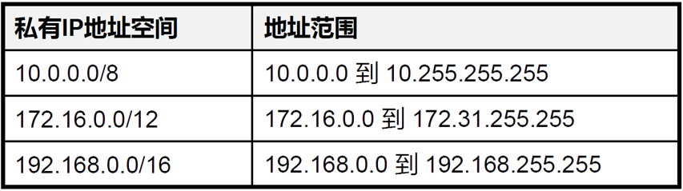

- 私有IP地址空间中的地址不需要申请，随意使用，但是不能在互联网上与合法地址通信(因为对方没法回复你这个地址，因为世界上私有IP地址段无数个重复的，怎么知道回到谁那里呢)
- 而我们明明用的私有IP地址，也可以上网，因为我们需要先把自己的上网请求提交给网络中的网关(就是你家的出口路由器)，再由网关代替我们去获取内容转交给我们的电脑手机，而网关往往能从运营商那里得到一个合法的公有IP地址

# DHCP

DHCP（动态主机配置协议），主要用于给设备自动的分配IP地址以及网络信息，以便网络设备能够连接到网络并进行通信

DHCP给设备提供的信息如下：

- IP地址
- 子网掩码
- 网关地址
- DNS服务器地址
- 租约时间

## DHCP工作过程

1. 客户端启动时发送 DHCP 发现(DHCPDISCOVER)广播消息,寻找 DHCP 服务器。
2. DHCP 服务器收到广播消息后,会提供一个未被使用的 IP 地址以及其他网络配置信息(如子网掩码、默认网关、DNS 服务器等),并发送 DHCP 提供(DHCPOFFER)消息给客户端。
3. 客户端收到一个或多个 DHCP 提供消息后,会选择其中一个 DHCP 服务器提供的 IP 地址,并发送 DHCP 请求(DHCPREQUEST)消息确认。
4. DHCP 服务器收到客户端的 DHCP 请求消息后,会将该 IP 地址分配给客户端,并发送 DHCP 确认(DHCPACK)消息给客户端。(ack=acknowledge 承认、认可、告知收到)
5. 客户端收到 DHCP 确认消息后,就可以使用分配到的 IP 地址和其他网络配置参数连接到网络了。

`dhclient`（dh client是DHCP的一个客户端程序）

我们可以通过抓包软件，捕捉到主机通过DHCP方式获取ip的过程，一共有4个数据包：

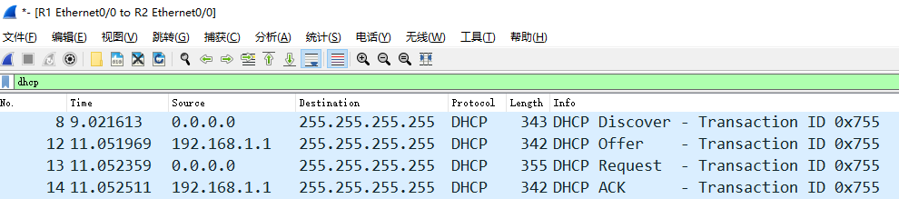

其中每个数据包的作用如下：

1. `Discover`消息是用于客户端向整个内网发送广播，期待DHCP服务器进行回应

1. 这个数据包中的重要内容就是：消息类型，客户端ID，主机名，请求获得的信息

2. `Offer`消息是DHCP服务器对客户的回应

1. 这个消息中会回复对方所需要的所有信息

3. `Request`这个是客户端确认DHCP服务器的消息

1. 这个消息和第一个消息差不多，但是消息类别变为`Request`，并且会携带请求的IP地址

4. `ACK`DHCP服务器给客户端的最终确认

1. 这个消息和第二个消息差不多，但是消息类型变为`ACK`

## DHCP续租

DHCP分配的信息是有有效期的，再租约时间快到的时候，如果我们想要继续使用这个地址信息，就需要向DHCP服务器续租

这也是大家虚拟机上IP地址经常发生变化的原因，这是因为虚拟机上默认就是以DHCP的方式获得IP地址的

我们可以查看Linux上的网络配置信息，该信息位于`/etc/NetworkManager/system-connections/ens160.nmconnection`

```plain
[root@localhost ~]# cat /etc/NetworkManager/system-connections/ens160.nmconnection
[connection]
id=ens160
uuid=dfea55d8-6ddc-3229-8152-cb9e261de181（uuid表示接口的唯一id）
type=ethernet （类型为以太网）
autoconnect-priority=-999 （自动连接优先级 --999，表示可能不会自动连接）
interface-name=ens160 （接口名称）
timestamp=1731149277 （时间戳）

[ethernet]

[ipv4]
method=auto

[ipv6]
addr-gen-mode=eui64（使用addr-gen-mode=eui64的地址生成模式，基于MAC地址生成IPv6地址）
method=auto

[proxy]

# 可以看到配置中的method字段是以dhcp来获得IP地址的。

科普：时间戳
时间戳是指从1970年1月1日（通过协议时间）至当前时间的总秒数。在网络配置文件中，时间戳通常用来记录配置的最后修改时间）
```

同样从VMware的虚拟网络设置中，也可以看到租约时间相关的内容

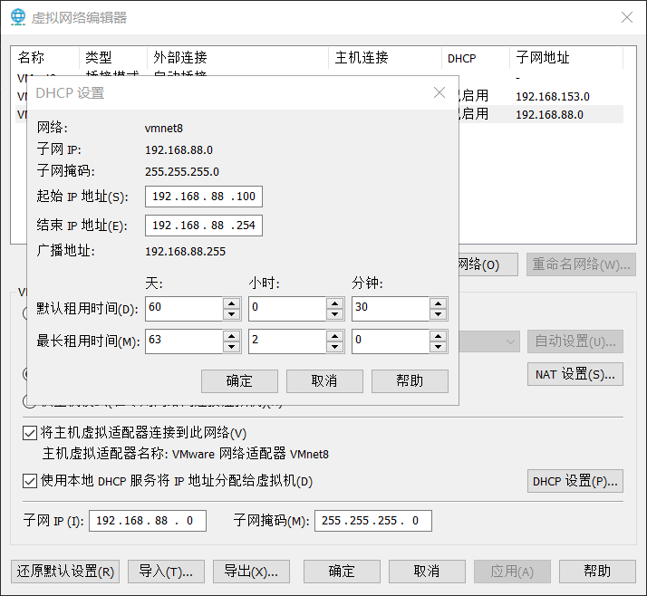

# VMware网卡的三种模式

[一、桥接模式](https://blog.csdn.net/qq_39192827/article/details/85872025#t0)

[二、NAT模式](https://blog.csdn.net/qq_39192827/article/details/85872025#t1)

[三、仅主机模式](https://blog.csdn.net/qq_39192827/article/details/85872025#t2)

在VMware虚拟网网络编辑器中我们可以看到有三个虚拟交换机分别对应不同的网络模式：

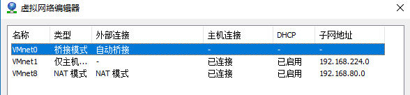

VMnet0：用于桥接模式下的虚拟交换机

VMnet1：用于仅主机模式下的虚拟交换机

VMnet8：用于NAT模式下的虚拟交换机

对应地，在Windows主机上对应虚拟了VMware Network Adapter VMnet1和VMware Network Adapter VMnet8两块虚拟网卡，至于为什么没有VMnot0的虚拟网卡，且看下文。

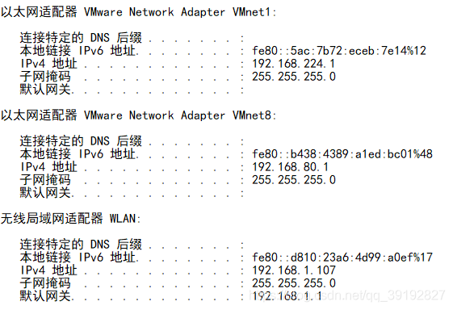

可见物理机其实有3个IP地址 ：192.168.1.107，192.168.80.1，192.168.22.1。通过这3个ip地址都可以访问到主机。

### 一、桥接模式

利用虚拟网桥，将虚拟机的网卡与主机的物理网卡连接在同一个逻辑网络中，主机充当**透明网桥**（类似交换机），不进行地址转换，直接转发数据。**让虚拟机在网络层面上“消失”，伪装成物理局域网中的一台独立实体机器。**假装自己是一台独立的物理电脑，直接连在路由器上。所以所有桥接下的网卡与网卡都是交换模式的，相互可以访问而不干扰。在桥接模式下，虚拟机IP地址需要与主机在同一网段，如果需要联网，则网关与DNS需要与主机网卡一致。

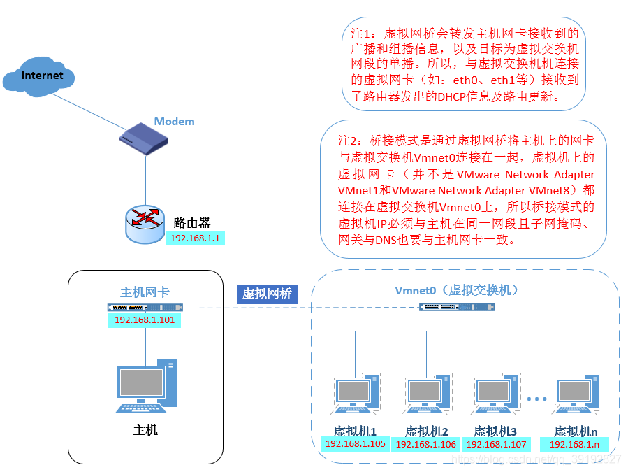

### 场景设定
- **路由器** = **大马路**（或者是小区的总大门）。
- **物理主机（你的电脑）** = **你家的房子**。
- **物理网卡** = **你家的大门**。
- **虚拟机** = **住在你家里的一个房客**。

### 什么是“桥接模式”？
在桥接模式下，**你的电脑（主机）变成了一个透明的桥梁**。

想象一下，你在自家大门旁边，专门给那个房客（虚拟机）开了一扇**独立的侧门**。

- **房客（虚拟机）**：通过侧门直接走到大马路上。
- **你（主机）**：通过正门走到大马路上。

**结果就是：**  
在“大马路”（路由器）看来，**你和房客是平等的邻居**。

- 大马路会给房客分配一个**独立的门牌号**（IP地址）。
- 房客可以直接收快递（下载数据），不需要经过你转手。
- 邻居（局域网里的其他电脑）可以直接去敲房客的门，不需要经过你同意。

#### 核心机制：二层网络的“透明网桥”

在计算机网络中，我们常说“二层”指的是**数据链路层**（MAC地址层）。

- **普通模式（非桥接）**：主机操作系统会拦截网络数据包，进行拆包、分析、修改（比如NAT模式下的地址转换），然后再转发。此时，主机是一个**路由器**或**网关**的角色。
- **桥接模式**：主机上的虚拟网桥（Virtual Bridge）工作在**二层**。它不关心IP地址，也不关心数据包的内容。它只做一件事：**根据MAC地址转发帧**。

- 它就像一根看不见的网线，一头连着物理网卡，一头连着虚拟机的虚拟网卡。
- 对于外面的物理交换机（路由器）来说，它根本不知道中间有个“主机”在做转发，它只看到有两个设备（主机和虚拟机）连在它上面。

#### 身份认同：独立的“公民”身份

桥接模式最本质的特征是**网络身份的独立性**。

- **IP地址分配**：在桥接模式下，虚拟机直接向物理网络中的**DHCP服务器**（通常是路由器）发起请求。路由器会像对待手机、平板一样，给虚拟机分配一个独立的IP地址。
- **同网段**：虚拟机获得的IP地址，与物理主机处于**完全相同**的网段。

- *例如：主机是*`192.168.1.10`*，虚拟机可能是*`192.168.1.11`*。*

- **平级关系**：虚拟机不再是主机的“附属品”，而是物理局域网中的**平等节点**。

#### 通信方式：局域网内的“广播风暴”

由于桥接模式打通了虚拟机与物理局域网的直接通道，所有的网络广播包（Broadcast）都会毫无保留地传递给虚拟机。

- **可见性**：虚拟机可以被局域网内的任何其他设备（如打印机、其他电脑、手机）直接访问，无需主机进行端口映射。
- **混杂模式**：为了实现这一点，物理网卡通常需要开启“混杂模式”，即接收所有流经它的数据包，而不仅仅是发给它自己的包，然后由虚拟网桥来判断哪些包该给虚拟机。

所以，桥接模式下的所有虚拟机都是和主机是在同一网段的，可以把它们看成是"平等"的关系，这就会带来一些麻烦，比如192.168.1段下只有254个主机地址，所以桥接模式下虚拟机和物理的总数不能超过这个数字！

**配置方法**

1、在系统的虚拟机设置中将网络连接模式选择为桥接模式：

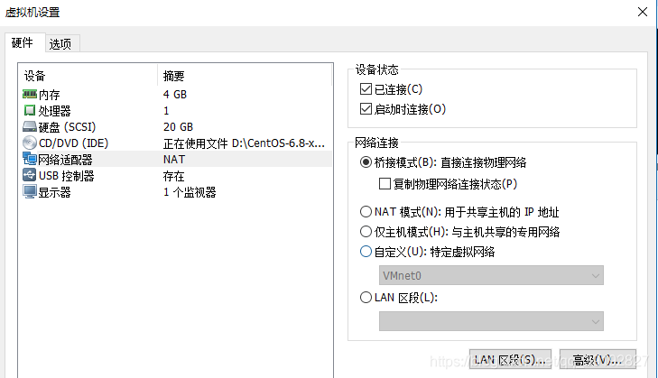

2、因为桥接模式虚拟机与宿主机在同一网段下，我们先查看下宿主机的网络信息：

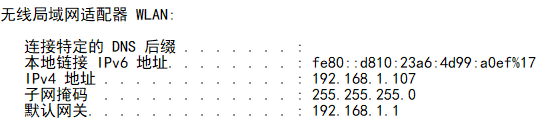

3、接下来在虚拟机中配置

网卡(/etc/sysconfig/network-scripts/ifcfg-etho0文件)：

注意，网关与DNS需要与主机相同，因为他们在同一网段下~

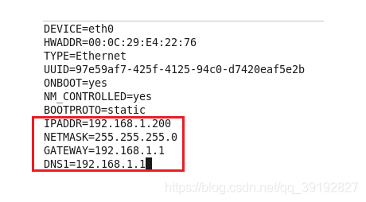

4、重启网络服务，测试：

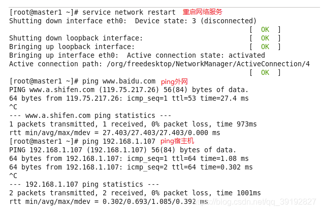

### 二、NAT模式

上面说过，桥接模式可能会导致一定的ip资源紧缺，这时候NAT模式时最佳选择。

先看网络结构图 ：

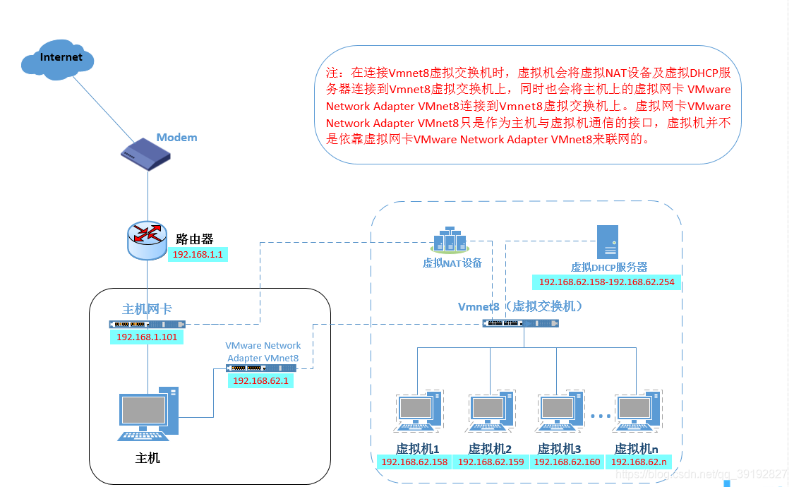

在NAT模式中，主机网卡直接与虚拟NAT设备相连，然后虚拟NAT设备与虚拟DHCP服务器一起连接在虚拟交换机VMnet8上，这样就实现了虚拟机联网。VMware Network Adapter VMnet8网卡是为了实现主机与虚拟机之间的通信。

可见NAT模式下主机更像是虚拟机们的"路由器"，通过VMnet8虚拟网卡为虚拟机分发地址。所以虚拟机和主机不再同一网段下，可以理解为主机是虚拟机的"上级"，这也就是为什么桥接模式没有VMnet0这个虚拟网卡，因为桥接模式下的虚拟机和主机是"平等"的，共用同一个路由器呀。

**配置方法**

1、同上

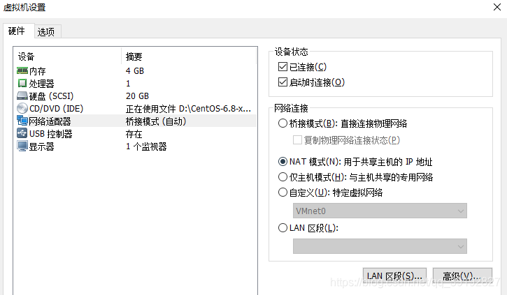

2、因为主机是虚拟机的"路由器"，所以我们需要去查看"路由器"给VMnet8这个交换机分配了哪一网段：

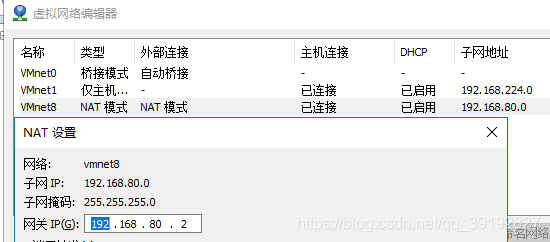

3、同上，修改网卡配置：

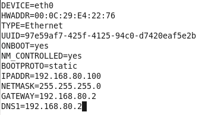

4、重启网络服务，测试：

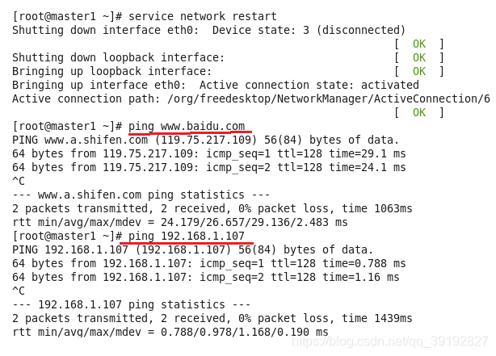

测试主机能否ping通虚拟机：

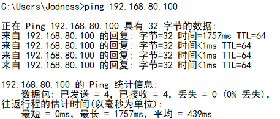

也就是说，VMnet8网卡的作用仅仅是主机与虚拟机之间的通信，访问外网是不通过VMnet8网卡的！

### 为什么看出“访问外网不走 VMnet8”？
#### 看 IP 地址的“家族”
- **图 1（虚拟机配置）**：

- 虚拟机的 IP 是 `192.168.80.100`（这是 VMnet8 网段的地址）。
- 虚拟机的网关是 `192.168.80.2`（这是主机上 VMnet8 虚拟网卡的地址）。

- **图 2（虚拟机 Ping 百度）**：

- 百度返回的 IP 是 `119.75.217.109`。
- **关键点**：如果数据包真的只是“通过” VMnet8，那么百度看到的源 IP 应该是 `192.168.80.100`。但是，`192.168.x.x` 是私有地址，互联网上的路由器是不认路的，数据包回不来。
- **真相**：为了访问百度，虚拟机必须“借用”主机的真实物理 IP（比如你图 3 里的 `192.168.1.107`）。这意味着，数据包走到 VMnet8 的尽头（网关）时，被主机“截获”并进行了伪装（NAT 转换），换上了主机的物理 IP 发往了外网。所以，去外网的路，在逻辑上是“穿过”了主机，而不是“流过”VMnet8 就结束了。

#### 看 Ping 的结果
- **图 3（主机 Ping 虚拟机）**：

- 你的物理主机（Windows）Ping 通了 `192.168.80.100`。
- 这证明了 **VMnet8 确实建立了主机与虚拟机之间的直连通道**。

- **反向思考**：如果访问外网也走这条路，那么虚拟机的流量就会堵在 VMnet8 这个“死胡同”里。因为 VMnet8 只是主机内部的一个虚拟接口，它本身没有连接光纤或网线到互联网的能力。它必须把数据交给主机的物理网卡（WLAN 或以太网）才能出去。

### 总结：VMnet8 到底是个什么角色？
你可以把 **VMnet8** 想象成你家（主机）里的一个 **“内部传达室”**。

- **对内（主机 <-> 虚拟机）**：

- 你想给虚拟机送信（Ping），你直接走到传达室（VMnet8）把信放进去，虚拟机就能拿到。
- 这就是你说的：“VMnet8 的作用仅仅是主机与虚拟机之间的通信”。

- **对外（虚拟机 -> 外网）**：

- 虚拟机想去百度（外网），它先把信交给传达室（VMnet8）。
- 但是传达室（VMnet8）出不去大门。
- 所以，主机的“管家”（NAT 服务）从传达室取出信，**把寄件人改成管家的名字**（IP 伪装），然后拿着信走出大门（物理网卡），发往互联网。

我们可以来做个测试

先把Windows系统中的VMnet8网卡禁用了


再来测试一下

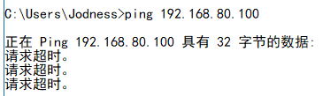

主机ping不通虚拟机

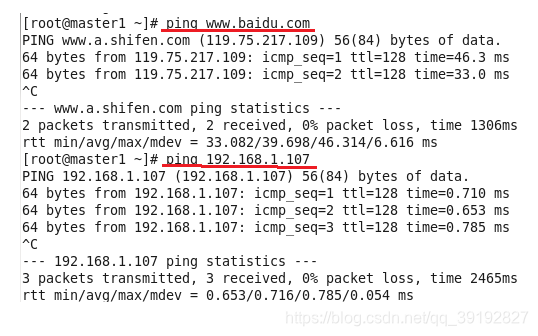

虚拟机可以ping通外网 ，不过也可以ping通192.168.1.107！

而肯定ping不通192.168.80.1

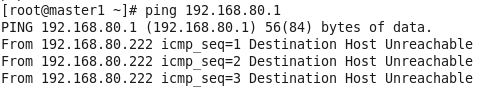

我的理解是这样的，这时候主机和虚拟机就像一个路由器下的两个"主机"，但虚拟机的ip是由与主机相连的VMnet8网卡决定的；虚拟机ping主机时，通过共同的路由器可以找到主机；而主机ping虚拟机时，如果有两个物理机，他们给虚拟机分发的网段是相同的，所以对应的虚拟机的ip是可能相同，而此时禁用了VMnet8，一个主机就无法找到对应的虚拟机了(可能与另一台主机下的虚拟机ip相同，此时虚拟机的ip无法再整个网络结构中唯一标识了)。

所以啊，NAT模式下的虚拟机时通过真实主机的ip访问外网

### 三、仅主机模式

仅主机模式可有看成是NAT模式去除了虚拟NAT设备，然后使用VMware Network Adapter VMnet1虚拟网卡连接VMnet1虚拟交换机来与虚拟机通信的，Host-Only模式将虚拟机与外网隔开，使得虚拟机成为一个独立的系统，只与主机相互通讯。

如果你懂了NAT模式，那理解仅主机模式起来就很简单了~

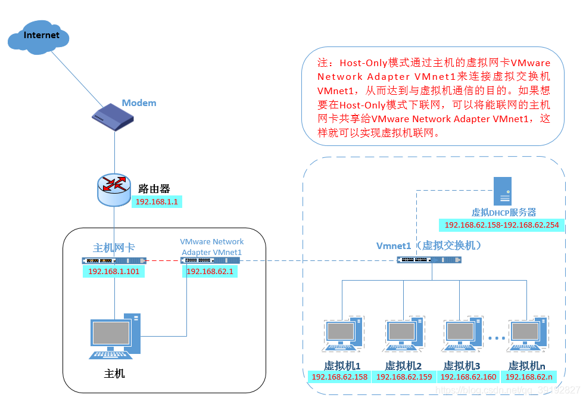

**配置方法**

类似前面两种模式

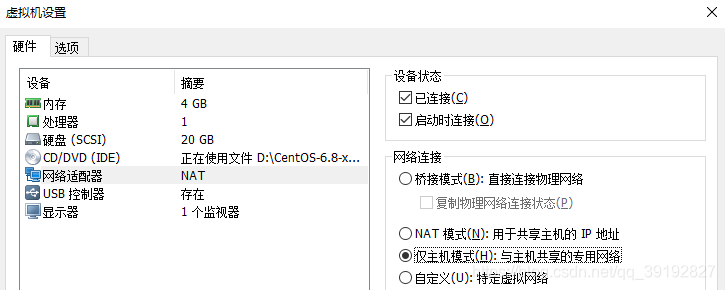

查看VMnet1

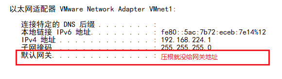

所以肯定pin不通外网

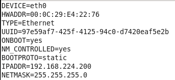

#### 为什么虚拟机 Ping 不通外网（百度）？

- **原理：**

- 外网（百度）在遥远的互联网。
- 虚拟机的数据包想出去，必须经过**网关**进行 NAT 转换（伪装成物理机的 IP）。
- 但是！**仅主机模式**的定义就是：**切断与物理网络的连接**。
- VMware 在仅主机模式下，**不提供 NAT 服务**（或者说 NAT 功能被关闭/隔离了）。
- 所以，数据包到了网关就被丢弃了，根本出不了这台电脑。

有趣的是

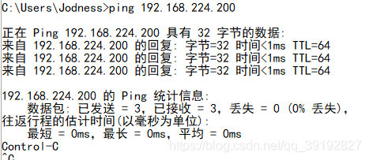

主机能ping通虚拟机，而虚拟机不能ping通192.168.1.107

**为什么 Ping 不通物理机的真实 IP（.1.107）**：因为 `.224.x` 网段和 `.1.x` 网段是两个世界，中间的桥梁（路由/NAT）在“仅主机模式”下被人为拆断了。

所以我们可以推测，虚拟机ping主机很可能是通过NAT模式下的NAT虚拟设备，而仅主机模式没有这个设备；而主机ping虚拟机是通过VMnet1网卡。而禁用NAT虚拟设备有些困难，我们也不太好验证。

数据包发给了网关（VMware 的虚拟网络服务），但因为这个模式叫“仅主机”，VMware 的虚拟交换机被设计为**不连接外部网络**。它不知道（或者被禁止）把数据包转发到物理机的真实网卡（WLAN/以太网）上去。数据包在这里就迷路了。

虚拟机自然可以ping通192.168.224.1

# 屋里两个人（主机VMnet1和虚拟机）能互相喊话，但谁也无法打开门去外面的世界（外网），也喊不到隔壁屋的人（物理机真实IP）。
# DNS（域名解析）

DNS(Domain Name System) 是一套从域名到IP的映射的协议

在网络世界中，如果我们想要给某个机器，或者是某个网站去发送一个数据，都需要通过IP地址来找到对方，比如我们想要使用百度来搜索东西，就需要知道百度的IP地址，换句话说只要知道了百度的IP地址，我们就可以访问到百度

但是IP地址不易记忆，不可能记住每一个网站的IP地址是什么，于是早期的搞IT的那帮人研发出一个叫做主机名的东西。

最开始人们把IP和主机名的的对应关系记录在本地，这个文件目前在windows系统的`C:\Windows\System32\drivers\etc\hosts`中。[优先本地解析，本地没有的再去互联网解析]但是后面发现并不好用，而且需要经常手动更新这个文件。类似于黄历

随着主机名越来越多，hosts文件不易维护，所以后来改用**域名解析系统DNS**：

- 一个组织的系统管理机构，维护系统内的每个主机的`IP和主机名`的对应关系
- 如果新计算机接入网络，将这个信息注册到`数据库`中
- 用户输入域名的时候，会自动查询`DNS`服务器，由`DNS服务器`检索数据库, 得到对应的IP地址。

## 域名

主域名是用来识别主机名称和主机所属的组织机构的一种分层结构的名称。 例如：[http://www.baidu.com(域名使用.连接](http://www.baidu.xn--com(-et6f94vu7gxx9d.xn--gzu679g/))

一般com后面还有一个.默认是不写的，完整应该是com.，这个.叫做根域名

- com： 一级域名，表示这是一个企业域名。同级的还有 "net"(网络提供商)，"org"(非盈利组织) 等。

（通常代表不同的组织类型或用途）

- baidu: 二级域名, 公司名。
- www: 只是一种习惯用法，并不是每个域名都支持。
- http:// : 要使用什么协议来连接这个主机名。

## 常见的域名解析服务器

- 114dns

114.114.114.114

114.114.115.115

这是国内用户量数一数二的 dns 服务器，该 dns 一直标榜高速、稳定、无劫持、防钓鱼。

- Google DNS

8.8.8.8

8.8.4.4

......

可以理解为由这些服务器帮我们记录的域名和IP的对应关系，我们访问域名的时候去找这些dns服务器询问该域名对应的IP地址，当然，除了上述提到的这些dns服务器，三大运营商也提供了dns解析服务

## 域名解析的过程

1. 浏览器发起域名解析，首先查询浏览器缓存，如果没有，就查询自己的hosts文件，如果没有就提出域名解析请求
2. 客户机提出域名解析请求，并将该请求发送给本地的域名服务器。
3. 当本地的域名服务器收到请求后,就先查询本地的缓存,如果有该纪录项,则本地的域名服务器就直接把查询的结果返回。
4. 如果本地的缓存中没有该纪录,则本地域名服务器就直接把请求发给根域名服务器,然后根域名服务器再返回给本地域名服务器一个所查询域(根的子域)的主域名服务器的地址。
5. 本地服务器再向上一步返回的域名服务器发送请求,然后接受请求的服务器查询自己的缓存,如果没有该纪录,则返回相关的下级的域名服务器的地址。
6. 重复第四步,直到找到正确的纪录。
7. 本地域名服务器把返回的结果保存到缓存,以备下一次使用,同时还将结果返回给客户机
8. 全球有十三台根域名服务器

假设你要找一个叫 **“张三”**（域名 `www.example.com`）的人，但你只有他的名字，没有他的电话号码（IP 地址）。

### 第一阶段：自己先找找（本地查询）
**对应你的步骤 1**

在你麻烦别人之前，你会先看看自己有没有他的联系方式。

1. **浏览器缓存**：你首先翻自己的**手机通话记录**。如果最近刚打过，直接就有了。（最快）
2. **系统缓存/Hosts**：如果没有，你翻翻自己的**私人通讯录**（Hosts 文件）。如果你手动存过张三的电话，那就直接用它。

**结论**：如果这两步都没有，你就必须得去问“查号台”了。

### 第二阶段：问管家（本地域名服务器 LDNS）
**对应你的步骤 2、3**

你给负责你这片区域的**管家**（本地域名服务器，通常是运营商或公共 DNS）打了个电话。

1. **管家查账本**：管家每天处理很多人找“张三”，他先看自己的**记事本**（缓存）。
2. **直接返回**：如果管家最近刚帮别人查过张三，他直接告诉你号码。流程结束！

**结论**：如果管家也没记下来，他就要开始动用他的“关系网”去帮你查了。

### 第三阶段：管家的“三级跳”查询（迭代查询）
**对应你的步骤 4、5、6**

这是最绕的部分。管家不会像无头苍蝇一样乱撞，他有一个明确的**层级线索**。

假设我们要找 `www.example.com` 的 IP。

1. **第一跳：问根老大（根域名服务器）**

- 管家问全球互联网的**总指挥**（根服务器）：“你知道 `www.example.com` 的电话吗？”
- **根老大说**：“我管全世界，太忙了，不知道具体的。但是，我知道 `.com` 这一块的负责人是谁，你去问 `.com` 的服务器吧。”（返回顶级域名服务器地址）

2. **第二跳：问顶级大佬（顶级域名服务器 TLD）**

- 管家听话，去问 `.com`**的大佬**：“你知道 `www.example.com` 的电话吗？”
- `.com`**大佬说**：“我只管所有以 `.com` 结尾的域名。具体的 `example` 公司我不清楚，但我知道 `example.com` 的权威管理员是谁，你去问他吧。”（返回权威域名服务器地址）

3. **第三跳：问权威负责人（权威域名服务器）**

- 管家终于找到了**管事儿的**（权威服务器）：“你知道 `www.example.com` 的电话吗？”
- **权威负责人说**：“这公司是我的，我当然知道！`www.example.com` 的 IP 是 `1.2.3.4`。”（返回最终 IP 地址）

### 第四阶段：回家交差（返回与缓存）
**对应你的步骤 7**

1. **管家告诉你**：管家拿到号码 `1.2.3.4` 后，赶紧打电话告诉你（客户机）。
2. **管家记小本本**：管家怕下次还有人问，赶紧把 `example.com` -> `1.2.3.4` 记在自己的本子上（缓存），并设定一个过期时间（TTL）。下次再有人问，他就不用跑这三趟了。

### 总结一下
这个过程其实就是：

1. **先看自己**（浏览器/Hosts）有没有？有就直接用。
2. **再问管家**（本地 DNS）有没有？有就直接用。
3. **管家跑腿**（迭代查询）：

- 先问**根**（指路去 .com）
- 再问**.com**（指路去 example.com）
- 最后问**example.com**（拿到 IP）

4. **最后反馈**：管家把 IP 给你，并存一份备用。

# 配置网络服务

## 修改网卡配置文件

```plain
# 修改网卡配置文件
[root@localhost ~]# cat /etc/NetworkManager/system-connections/ens160.nmconnection 
[connection]
id=ens160
uuid=dfea55d8-6ddc-3229-8152-cb9e261de181
type=ethernet
autoconnect-priority=-999
interface-name=ens160
timestamp=1732264040

[ethernet]

[ipv4]
address1=192.168.88.110/24,192.168.88.2
dns=114.114.114.114;114.114.115.115;
method=manual（手动的）

[ipv6]
addr-gen-mode=eui64
method=auto

[proxy]
```

### 一个网卡只能有一个 IP 吗？
**绝对不是。**  
虽然通常我们说“这台电脑的 IP 是 xxx”，但实际上，**一个网卡完全可以（也经常）拥有多个 IP 地址**。这叫做 **IP 别名** 或 **多 IP 配置**。

**场景举例：**

- 你的网卡主 IP 是 `192.168.88.110`，用来日常上网。
- 但你同时运行了一个 Web 服务器，为了测试方便，你想让它同时也响应 `192.168.88.200` 的访问。
- 这时候，你就需要在同一个网卡上绑定这两个 IP。

[ipv4]

*# 配置两个 IP：192.168.88.110 和 192.168.88.200*

*# 注意：网关通常只写在一个 IP 后面，或者都不写（如果在全局配置里）*address1=192.168.88.110/24,192.168.88.2;

address1=192.168.88.200/24;

method=manual

当修改完Linux系统中的服务配置文件后，并不会对服务程序立即产生效果。要想让服务程序获取到最新的配置文件，需要手动重启相应的服务，之后就可以看到网络畅通了

```plain
[root@localhost ~]# systemctl restart NetworkManager
[root@localhost ~]# ping -c 4 www.baidu.com
PING www.a.shifen.com (180.101.50.242) 56(84) bytes of data.
64 bytes from 180.101.50.242 (180.101.50.242): icmp_seq=1 ttl=128 time=11.3 ms
64 bytes from 180.101.50.242 (180.101.50.242): icmp_seq=2 ttl=128 time=8.70 ms
64 bytes from 180.101.50.242 (180.101.50.242): icmp_seq=3 ttl=128 time=13.5 ms
64 bytes from 180.101.50.242 (180.101.50.242): icmp_seq=4 ttl=128 time=9.95 ms

--- www.a.shifen.com ping statistics ---   （statistic：统计学、统计资料）
4 packets transmitted, 4 received, 0% packet loss, time 3005ms
rtt min/avg/max/mdev = 8.703/10.882/13.535/1.793 ms （Round-Trip Time,RRT 表示往返时间的最小值、平均值、最大值和标准偏差）
（round：绕行、使呈圆形、弯曲）
```

## 网卡配置文件参数

|  |  |  |
| --- | --- | --- |
| **节** | **参数** | **描述** |
| `[connection]` | `id` | 连接的名称，这里是 `ens160`。 |
|  | `uuid` | 连接的唯一标识符（UUID），用于唯一识别此连接。 |
|  | `type` | 连接的类型，`ethernet`表示这是一个以太网连接。 |
|  | `autoconnect-priority` | 自动连接优先级，数值越小优先级越低。这里设置为 `-999`，表示极低的优先级。 |
|  | `interface-name` | 连接对应的网络接口名称，这里是 `ens160`。 |
|  | `timestamp` | 连接的时间戳，表示最后修改的时间。 |
| `[ethernet]` | - | 此节用于配置以太网特定的设置，当前没有额外参数。 |
| `[ipv4]` | `address1` | 静态 IPv4 地址及其子网掩码，格式为 `IP地址/子网掩码`  和网关，例：`192.168.88.110/24,192.168.88.2`。 |
|  | `dns` | DNS 服务器地址，多个地址用分号分隔，这里是 `114.114.114.114;114.114.115.115;`。 |
|  | `method` | IPv4 地址配置方法，这里设置为 `manual`，表示使用手动配置。 |
| `[ipv6]` | `addr-gen-mode` | 地址生成模式，`eui64`表示使用 EUI-64 地址生成方式。 |
|  | `method` | IPv6 地址配置方法，这里设置为 `auto`，表示自动获取 IPv6 地址。 |
| `[proxy]` | - | 此节用于配置代理设置，当前没有额外参数。 |

**重新加载网络配置**

```plain
[root@localhost ~]# systemctl restart NetworkManager

# 或者先禁用再启用网卡
[root@localhost ~]# yum install -y NetworkManager-initscripts-updown-1:1.48.10-2.el9_5.noarch
（下载initscripts-updown插件，这个插件提供了ifup和ifdown等命令的支持，便于管理网络接口）
[root@localhost ~]# ifdown ens160        # 禁用网卡
[root@localhost ~]# ifup ens160            # 启用网卡
（ifup和ifdown是常见的网络接口管理工具，用于启用和禁用网络接口）
```

# nmcli 工具

**命令的原理是有一个connection连接到device设备上，通过对connection的命令从而对配置进行修改[这个命令和系统是没有关系的还是这个命令在其他Linux系统上也是可以直接使用的]**


nmcli命令是redhat7或者centos7之后的命令，该命令可以完成网卡上所有的配置工作，并且可以写入 配置文件，永久生效

- 查看接口状态

```plain
[root@localhost ~]# nmcli device status
DEVICE  TYPE      STATE                   CONNECTION
ens160  ethernet  connected               ens160
lo      loopback  connected (externally)  lo
（device：设备  status：地位、身份 externally：外面地  extra：额外的）
（例子展示了ens160以太网设备和lo回环设备的信息）
【device是一定会存在的，如果删除了连接，connection将会变成--】
```

- 查看链接信息

```plain
[root@localhost ~]# nmcli connection show
NAME    UUID                                  TYPE      DEVICE
ens160  dfea55d8-6ddc-3229-8152-cb9e261de181  ethernet  ens160
lo      529b2eed-2755-4cce-af3c-999beb49882d  loopback  lo
```

- 配置IP等网络信息

```plain
[root@localhost ~]# nmcli con mod "ens160" ipv4.addresses 192.168.88.140/24 ipv4.gateway 192.168.88.2 ipv4.dns "8.8.8.8,8.8.4.4" ipv4.method manual
con=connection    mod=modify（修改）   ens160（连接名）
```

- 启动/停止接口

```plain
[root@localhost ~]# nmcli connection down ens160
[root@localhost ~]# nmcli connection up ens160
先关闭再开启相当于是一次重启，终端断开需要在虚拟机里重新打开
```

- 创建链接

```plain
[root@localhost ~]# nmcli connection add type ethernet ifname ens160 con-name dhcp_ens160 查看方法以颜色隔开
# 激活链接
[root@localhost ~]# nmcli connection up dhcp_ens160
默认会覆盖掉之前的连接
科普：
（在Linux系统中，"ifname"通常用于指代网络接口的名称。后面跟设备名，连接到哪个设备上。
例如，在使用ifconfig命令查看或适配网络接口时，可能会看到类似“eth0”、“wlan0"等网络接口名称，
这些名称就是“ifname”所指的实体。此外，在Linux系统网络配置文件中，也可能会使用“IFNAME"作为变量名来引用网络接口名称）
```

- 删除链接

```plain
[root@localhost ~]# nmcli connection delete dhcp_ens160
成功删除连接 'dhcp_ens160'（37adadf4-419d-47f0-a0f6-af849160a4f7）。
```

# nmtui图形化修改

使用nmtui命令来配置网络

```plain
[root@localhost ~]# nmtui
# 可以将环境变量改成中文
[root@localhost ~]# yum install -y langpacks-zh_CN        # 安装中文包支持
[root@localhost ~]# export LANG=zh_CN.UTF-8  （export：出口、输出）（explore：探索）
# 改回英文是LANG=en_US.UTF-8
```


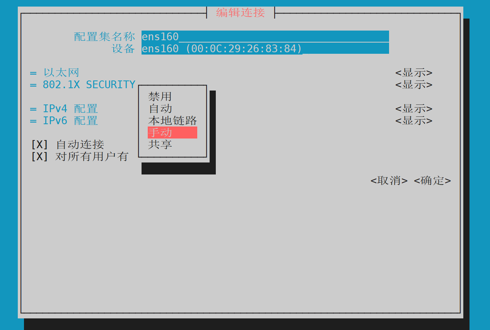

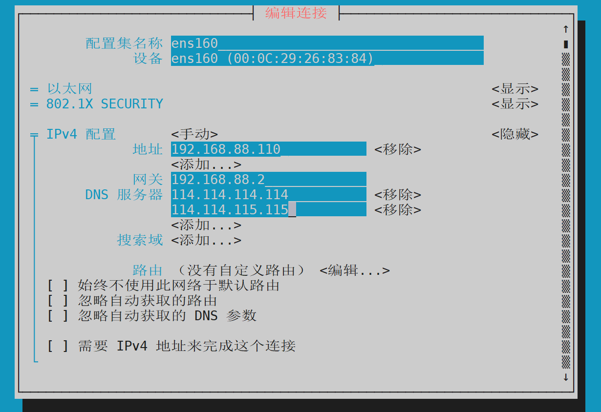

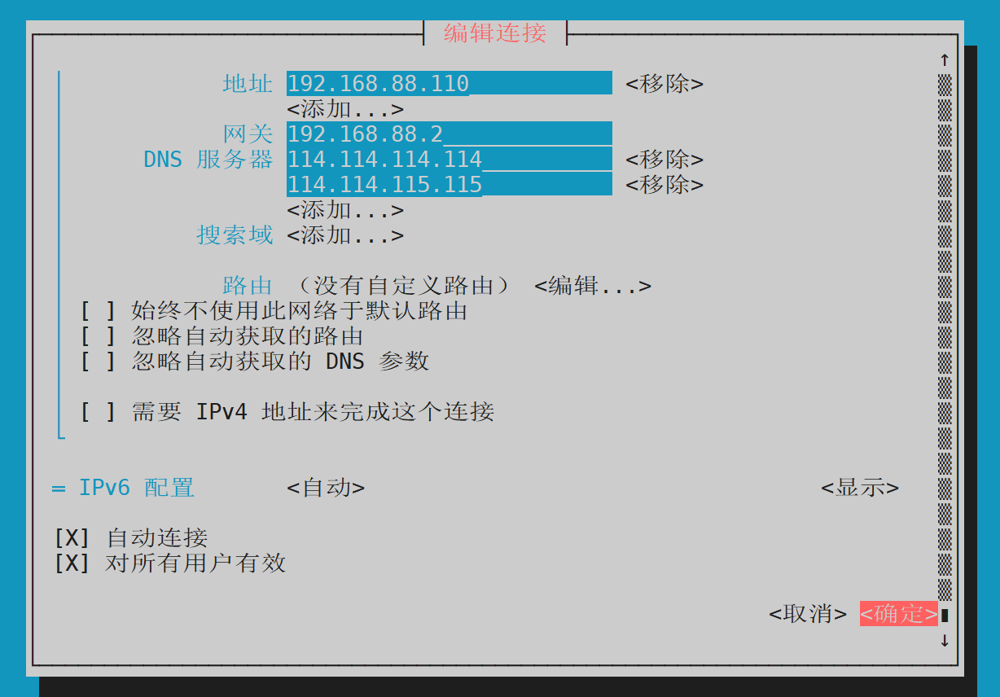

# ifconfig

- ifconfig 命令用于显示或设置网络设备。

**安装：**`yum install -y net-tools`

## 语法

```plain
ifconfig [network_interface]
         [down|up]
         [add <address>]
         [del <address>]
         [hw <type> <hw_address>]
         [io_addr <I/O_address>]
         [irq <IRQ>]
         [media <media_type>]
         [mem_start <memory_address>]
         [metric <number>]
         [mtu <bytes>]
         [netmask <netmask>]
         [tunnel <address>]
         [-broadcast <address>]
         [-pointopoint <address>]
         [<IP_address>]
```

## 选项说明

- `down`/`up`: 禁用/启用网络接口
- `add <address>`/`del <address>`: 添加或删除 IP 地址
- `hw <type> <hw_address>`: 设置硬件地址 (MAC 地址)
- `io_addr <I/O_address>`: 设置 I/O 地址
- `irq <IRQ>`: 设置中断请求
- `media <media_type>`: 设置网络媒体类型
- `mem_start <memory_address>`: 设置内存起始地址
- `metric <number>`: 设置路由度量值
- `mtu <bytes>`: 设置 MTU 值
- `netmask <netmask>`: 设置子网掩码
- `tunnel <address>`: 设置隧道地址
- `-broadcast <address>`: 设置广播地址 （broad：宽阔的，广泛的；cast：投射）
- `-pointopoint <address>`: 设置点对点地址
- `<IP_address>`: 设置 IP 地址

## 实例

- 显示网络设备信息

```plain
[root@localhost cmatrix-1.2a]# ifconfig
ens33: flags=4163<UP,BROADCAST,RUNNING,MULTICAST>  mtu 1500
        inet 192.168.88.136  netmask 255.255.255.0  broadcast 192.168.88.255
        inet6 fe80::a49c:12c9:1ebd:8fb2  prefixlen 64  scopeid 0x20<link>
        ether 00:0c:29:cb:d5:1a  txqueuelen 1000  (Ethernet)
        RX packets 122441  bytes 178564616 (170.2 MiB)
        RX errors 0  dropped 0  overruns 0  frame 0
        TX packets 13762  bytes 1315614 (1.2 MiB)
        TX errors 0  dropped 0 overruns 0  carrier 0  collisions 0 
        （crrier0 collision0表示没有载波冲突，这通常意味着网络接口没有遇到物理层或者数据链层的冲突）

网络配置信息：
（MULTICAST=multicast多播；MTU（最大传输单位）：1500字节；IPV4的地址：182.168.66.136；子网掩码：255.255.255.0；广播地址：192.168.88.255）
（IPV6地址：fe80::a49c:12c9:1ebd:8fb2；MAC地址：00:0c:29:cb:d5:1a ；接收（RX）数据包数：122441；接收字节数：178564616（约170.2MiB))
 (接收错误数：0；发送（RX）数据包数：13762；发送字节数：1315614（约1。2MiB）；发送错误数：0））

lo: flags=73<UP,LOOPBACK,RUNNING>  mtu 65536
        inet 127.0.0.1  netmask 255.0.0.0
        inet6 ::1  prefixlen 128  scopeid 0x10<host>
        loop  txqueuelen 1000  (Local Loopback)
        RX packets 0  bytes 0 (0.0 B)
        RX errors 0  dropped 0  overruns 0  frame 0
        TX packets 0  bytes 0 (0.0 B)
        TX errors 0  dropped 0 overruns 0  carrier 0  collisions 0

回环接口信息：
（回环接口：lo（回环接口）；状态：up（启用）、LOOPBACK(回环）、RUNNING（运行）；MTU：65536字节；IPV4地址：127.0.0.1；子网掩码：255.0.0.0））
```

- 启动关闭指定网卡

```plain
[root@localhost ~]# ifconfig ens33 down
[root@localhost ~]# ifconfig ens33 up
```

- 配置IP地址

```plain
[root@localhost ~]# ifconfig eth0 192.168.1.56 
//给eth0网卡配置IP地址
[root@localhost ~]# ifconfig eth0 192.168.1.56 netmask 255.255.255.0 
// 给eth0网卡配置IP地址,并加上子掩码
[root@localhost ~]# ifconfig eth0 192.168.1.56 netmask 255.255.255.0 broadcast 192.168.1.255
// 给eth0网卡配置IP地址,加上子掩码,加上个广播地址
```

- 设置最大传输单元

```bash
[root@localhost ~]# ifconfig eth0 mtu 1500 
//设置能通过的最大数据包大小为 1500 bytes（字节)
```
