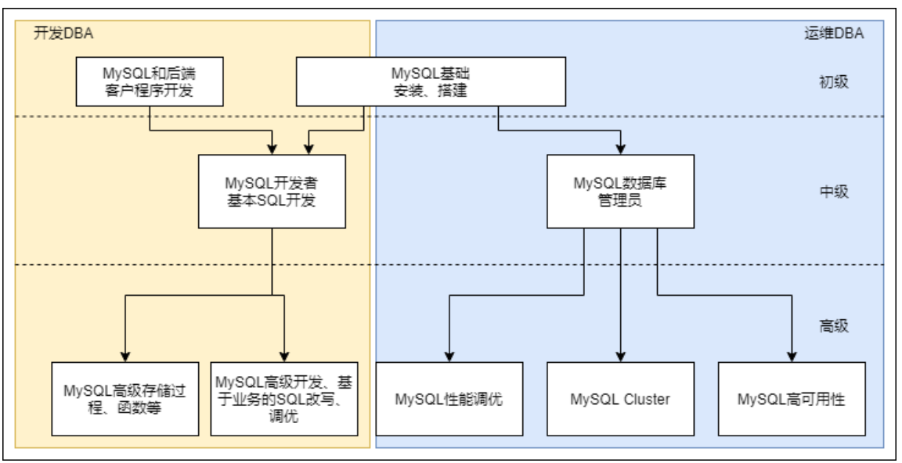
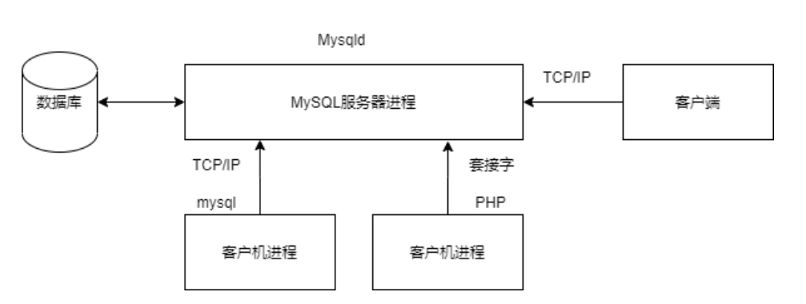
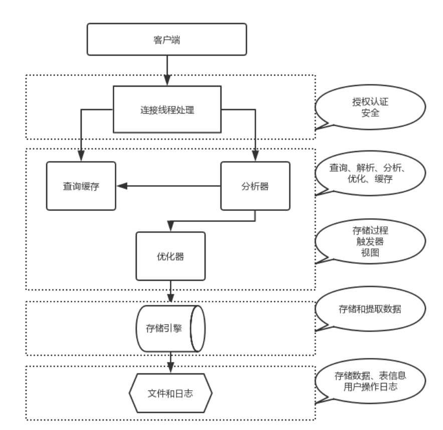
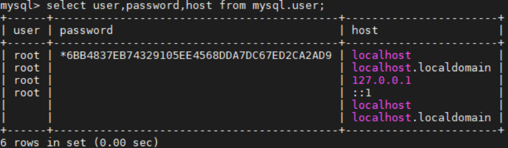
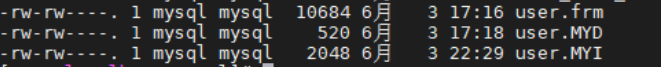
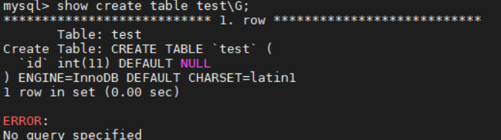
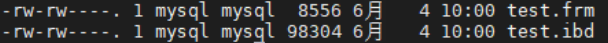

# MySQL介绍

简单介绍

data:数据

db:数据库，简称为数据的集合

dba:数据库管理员

dbms:数据库管理系统，通常指Mysql或者其他数据库管理软件

dbs:数据库系统，上述所有硬件软件人员数据等全部的集合

## DBA工作内容



**功能**

- 数据管理

- 增删改查

- 用户管理

- grant all on *.* to all@'%' identified by '123';
- 敲完这条命令就可以等着被开除了( • ̀ω•́ )✧
- root，运维用户ops，程序连接用户(只读用户，读写用户)

- 集群管理
- 数据备份、恢复

- 逻辑备份
- 物理备份
- 冷备
- 热备
- 温备
- 全备
- 增量备份
- 差异备份

- 监控

- 进程，端口
- 集群状态
- 主从复制 延时情况
- SQL读写速率
- slowlog

## 什么是数据

数据(data)是事实或观察的结果，是对客观事物的逻辑归纳，是用于表示客观事物的未经加工的的原始素材。

数据可以是连续的值，比如声音、图像，称为模拟数据。也可以是离散的，如符号、文字，称为数字数据。

在计算机系统中，数据以二进制信息单元0,1的形式表示。

**数据的定义:**数据是指对客观事件进行记录并可以鉴别的符号，是对客观事物的性质、状态以及相互关系等进行记载的物理符号或这些物理符号的组合。它是可识别的、抽象的符号。\*

## 什么是数据库管理系统

DBMS（database management system）


## 数据库管理系统种类

### RDBMS

以多张二维表的方式来存储，又给多张表建立了一定的关系（关系型数据库）

### NoSQL

nosql 很多以json格式进行存储数据的（非关系数据库）[mogodb]

### RDMS与NoSQL对比

#### 功能对比

|  |  |  |
| --- | --- | --- |
|  | **关系型数据库** | **非关系型数据库** |
| 强大的查询功能 | √ | × |
| 强一致性 | √ | × |
| 二级索引 | √ | × |
| 灵活模式 | × | √ |
| 扩展性 | × | √ |
| 性能 | × | √ |

#### 特点对比

- 关系型数据库（RDBMS）的特点：

- 二维表
- 典型产品Oracle传统企业，MySQL互联网企业
- 数据存取是通过SQL（Structured Query Language结构化查询语言）
- 最大特点数据安全性方面强（ACID）

- 非关系型数据库（NoSQL：Not only SQL）的特点：

- 不是否定关系型数据库，而是做关系型数据库的补充

### 数据库市场

#### MySQL的市场应用

- 中、大型互联网公司
- 市场空间：互联网领域第一
- 趋势明显
- 同源产品：MariaDB、PerconaDB

#### 类似产品

- 微软：SQLserver

- 微软和sysbase合作开发的产品，后来自己开发，windows平台
- 三、四线小公司，传统行业在用

- IBM：DB2

- 市场占有量小
- 目前只有：国有银行（人行，中国银行，工商银行等）、中国移动应用

- PostgreSQL
- MongoDB
- Redis

## MySQL发展史

- 1979年，报表工具Unireg出现。
- 1985年，以瑞典David Axmark为首，成立了一家公司（AB前身），ISAM引擎出现。
- 1990年，提供SQL支持。
- 1999年-2000年，MySQL AB公司成立，并公布源码，开源化。
- 2000年4月BDB引擎出现，支持事务。
- 2008年1月16日 MySQL被Sun公司收购。
- 2009年4月20日Oracle收购Sun公司，MySQL转入Oracle门下。

# MySQL安装

## MySQL安装方式

- rpm、yum安装

- 安装方便、安装速度快、无法定制

- 二进制

- 不需要安装，解压即可使用，不能定制功能

- 编译安装

- 可定制，安装慢
- 四个步骤

- 解压(tar)
- 生成(./configure) cmake
- 编译(make)
- 安装(make install)

## 源码安装

- MySQL版本选择：

- <https://downloads.mysql.com/archives/community/>
- 5.6：GA(稳定版) 6-12个月 小版本是偶数版是稳定版，奇数版本是开发版
- 5.7：选择5.17版本以上，支持MGR（MySQL自带的高可用）

- 下载源码，并且配置编译环境

```shell
wget https://downloads.mysql.com/archives/get/p/23/file/mysql-5.6.40.tar.gz
tar xzvf mysql-5.6.40.tar.gz
cd mysql-5.6.40
yum install -y ncurses-devel libaio-devel cmake gcc gcc-c++ glibc
```

- 创建mysql用户

```shell
useradd mysql -s /sbin/nologin -M
```

- 编译并安装

```shell
[root@localhost mysql-5.6.40]# mkdir /application
[root@localhost mysql-5.6.40]# cmake . -DCMAKE_INSTALL_PREFIX=/application/mysql-5.6.38 \
-DMYSQL_DATADIR=/application/mysql-5.6.38/data \
-DMYSQL_UNIX_ADDR=/application/mysql-5.6.38/tmp/mysql.sock \
-DDEFAULT_CHARSET=utf8 \
-DDEFAULT_COLLATION=utf8_general_ci \
-DWITH_EXTRA_CHARSETS=all \
-DWITH_INNOBASE_STORAGE_ENGINE=1 \
-DWITH_FEDERATED_STORAGE_ENGINE=1 \
-DWITH_BLACKHOLE_STORAGE_ENGINE=1 \
-DWITHOUT_EXAMPLE_STORAGE_ENGINE=1 \
-DWITH_ZLIB=bundled \
-DWITH_SSL=bundled \
-DENABLED_LOCAL_INFILE=1 \
-DWITH_EMBEDDED_SERVER=1 \
-DENABLE_DOWNLOADS=1 \
-DWITH_DEBUG=0

[root@localhost mysql-5.6.40]# echo $?    #查看上条命令是否运行正确，0表示正确
[root@localhost mysql-5.6.40]# make
[root@localhost mysql-5.6.40]# make install
```

- 创建配置文件

```shell
ln -s /application/mysql-5.6.38/ /application/mysql
cd /application/mysql/support-files/
cp my-default.cnf /etc/my.cnf
cp：是否覆盖"/etc/my.cnf"？ y
```

- 创建启动脚本

```shell
cp mysql.server /etc/init.d/mysqld
```

- 初始化数据库

```shell
cd /application/mysql/scripts/
yum -y install autoconf
./mysql_install_db --user=mysql --basedir=/application/mysql --datadir=/application/mysql/data/
```

- 启动数据库

```shell
mkdir /application/mysql/tmp
chown -R mysql.mysql /application/mysql*
/etc/init.d/mysqld start
```

- 配置环境变量

```shell
vim /etc/profile.d/mysql.sh
export PATH="/application/mysql/bin:$PATH"
source /etc/profile
```

- systemd管理mysql

```shell
vim /usr/lib/systemd/system/mysqld.service
[Unit]
Description=MySQL Server
Documentation=man:mysqld(8)
Documentation=https://dev.mysql.com/doc/refman/en/using-systemd.html
After=network.target
After=syslog.target
[Install]
WantedBy=multi-user.target
[Service]
User=mysql
Group=mysql
ExecStart=/application/mysql/bin/mysqld --defaults-file=/etc/my.cnf
LimitNOFILE = 5000

vim /etc/my.cnf
 basedir = /application/mysql/
 datadir = /application/mysql/data

systemctl daemon-reload
```

- 设置mysql开机启动，并且开始mysql服务

```shell
systemctl start mysqld
systemctl enable mysqld
```

- 设置mysql密码，并且登录测试

```shell
mysqladmin -uroot password '123456'
mysql -uroot -p123456
mysql> show databases;
mysql> \q
Bye
```

**前面这个编译安装到达make的时候开始报错**

这是一个非常经典的 **MySQL 源码编译安装报错**，尤其是在较新的 Linux 发行版（如 CentOS 7/8, Ubuntu 18.04+）上编译老版本的 MySQL（如 5.5, 5.6）时经常遇到。

### 错误分析
从你右侧的报错截图中可以看到关键信息：

`/usr/include/linux/stat.h:131:9: error: '__u32' does not name a type`

**原因很简单：**  
你正在编译的 MySQL 版本（5.6.40）比较老，它引用的系统头文件（`linux/stat.h`）中使用了 `__u32`、`__u64` 这种数据类型。但是，你当前的 Linux 操作系统内核版本较新，新的内核头文件中不再默认包含定义这些类型的库，导致编译器不认识 `__u32` 是什么，从而报错。

### 解决方案
你有两种主要的方法来解决这个问题，推荐使用方法一，最快最直接。

#### 方法一：修改报错的头文件（最简单）
既然编译器不认识 `__u32`，我们就手动告诉它这个类型在哪里定义的。

1. **编辑文件**  
   根据报错信息，找到对应的文件 `/usr/include/linux/stat.h`。使用 vim 打开它：

vim /usr/include/linux/stat.h

2. **添加代码**  
   在文件的**最顶端**（第一行），加入下面这行代码：

#include <linux/types.h>

3. **保存并退出**  
   按 `Esc`，输入 `:wq` 保存退出。
4. **重新编译**  
   回到你的 MySQL 源码目录，重新执行 `make` 命令（不需要重新 cmake）

make clean # 建议先清理一下之前的编译缓存

make

#### 方法二：修改 MySQL 源码（如果不让改系统文件）
如果你不想修改系统的头文件，可以去修改 MySQL 源码中引用它的地方，但比较麻烦。

通常在报错的 `extra/yassl/src/ssl.cpp` 或者 `include/my_global.h` 中加入 `#include <linux/types.h>` 也可以解决，但方法一是一劳永逸的。

### 总结
这个错误不是你的命令写错了（左边的 `cmake` 参数看起来是没问题的），而是 **软件版本（老 MySQL）** 与 **操作系统版本（新 Linux Kernel）** 不兼容导致的。按照方法一修改系统头文件即可解决。

**为什么这样做？？原理是什么**

这个报错的核心在于，编译器在处理 `__u32` 这种数据类型时，找不到它的定义。简单来说，编译器知道“需要用到一个32位的无符号整数”，但不知道 `__u32` 这个代号对应的是什么。

以下是详细的原理和为什么加上指定位置就能解决问题的解析：

### 报错的本质：找不到“字典”
- **代码中的代号**：在 Linux 内核开发中，`__u32` 是一个常用的缩写，代表“无符号32位整数”。
- **定义的缺失**：这个缩写的真正定义（即告诉编译器 `__u32` 其实就是 `unsigned int`）通常存放在另一个文件中，叫做 `<linux/types.h>`。
- **新版系统的变化**：在旧版 Linux 系统中，`stat.h` 可能会自动包含 `types.h`。但在较新的 Linux 发行版（如 CentOS 7/8）中，为了加快编译速度或解耦，头文件之间的依赖被精简了。`stat.h` 不再自动去读取 `types.h`。
- **结果**：当你编译 MySQL 5.6（老软件）时，它只看了 `stat.h`，没看 `types.h`，所以它一脸茫然：“`__u32` 是个啥？我不认识。”

### 修改的原理：手动指明“字典”位置
当你执行 `vim /usr/include/linux/stat.h` 并在第一行加入 `#include <linux/types.h>` 时，你实际上是在做以下操作：

- **预处理指令**：`#include` 是 C 语言的预处理指令。它的作用相当于“复制粘贴”。
- **强制引入**：你告诉编译器：“在开始读 `stat.h` 的内容之前，先把 `types.h` 里的内容拿过来读一遍。”
- **补全定义**：`types.h` 文件里清楚地写着：
- typedef \_\_u32 unsignedint;*// (伪代码示意)*
- 一旦这个文件被包含进来，编译器就有了这本“字典”。当它再次看到 `__u32` 时，查了一下字典，知道它代表 `unsigned int`，于是就能顺利通过编译了。

### 为什么指定位置就可以被找到？
你可能会问，为什么代码里只写 `<linux/types.h>`，而不写完整的 `/usr/include/linux/types.h`？

- **标准搜索路径**：编译器（GCC）在设计时，就已经被硬编码了几个标准的“搜查目录”。在大多数 Linux 系统中，`/usr/include` 是默认的首要搜索路径。
- **相对路径引用**：当你写 `<linux/types.h>` 时，编译器会自动去 `/usr/include` 目录下寻找 `linux` 文件夹，并在其中找到 `types.h`。
- **系统级修复**：因为 `/usr/include/linux/stat.h` 是系统级的头文件，你修改它相当于修复了系统的一个“兼容性漏洞”。这使得所有后续依赖这个头文件的程序（不仅仅是 MySQL）在编译时都能正确找到类型定义。

### 总结
你做的这个修改，就像是给一本缺页的旧书（MySQL 源码引用的系统头文件）贴了一张便利贴，上面写着：“如果看不懂这个词，请去查阅那本新字典（types.h）”。这样，编译器就能读懂老代码，编译也就成功了。

## 二进制安装

当前运维和开发最常见的做法是二进制安装mysql

- 下载二进制包并且解压

```shell
wget https://downloads.mysql.com/archives/get/p/23/file/mysql-5.6.40-linux-glibc2.12-x86_64.tar.gz
tar xzvf mysql-5.6.40-linux-glibc2.12-x86_64.tar.gz
```

- 然后的步骤就和编译安装一样

```shell
mkdir /application
mv mysql-5.6.40-linux-glibc2.12-x86_64 /application/mysql-5.6.40
ln -s /application/mysql-5.6.40 /application/mysql #为了后续写的脚本，方便监控mysql
cd /application/mysql/support-files    #该文件夹有mysql初始化（预设）配置文件，覆盖文件是因为注释更全。
cp my-default.cnf /etc/my.cnf
cp：是否覆盖"/etc/my.cnf"？ y
mkdir /etc/init.d
cp mysql.server /etc/init.d/mysqld    #mysql.server包含如何启动mysql的脚本命令，让系统知道通过该命令启动mysql时的动作，该目录存放系统中各种服务的启动/停止脚本
cd /application/mysql/scripts
useradd mysql -s /sbin/nologin -M
 yum -y install autoconf    #不然会报错
./mysql_install_db --user=mysql --basedir=/application/mysql --data=/application/mysql/data
#这里会报错需要安装一个工具，并再次运行
yum install -y perl-core
./mysql_install_db --user=mysql --basedir=/application/mysql --data=/application/mysql/data
vim /etc/profile.d/mysql.sh    #写到环境变量的子配置文件内，未修改前只能使用/bin/mysql的命令才能启用，而不能全局使用
export PATH="/application/mysql/bin:$PATH"

source /etc/profile    #否则要重启系统才生效
```

- 需要注意，官方编译的二进制包默认是在`/usr/local`目录下的，我们需要修改配置文件

```shell
sed -i 's#/usr/local#/application#g' /etc/init.d/mysqld /application/mysql/bin/mysqld_safe
```

此时不可以通过systemctl命令启动，只能通过/etc/init.d/mysql start启动（nginx也是，如果此时通过这样的命令启动Nginx，会导致systemctl start Nginx失败，因为冲突。）

- 创建systemd管理文件，并且测试是否正常使用

```shell
vim /usr/lib/systemd/system/mysqld.service
[Unit]
Description=MySQL Server
Documentation=man:mysqld(8)
Documentation=https://dev.mysql.com/doc/refman/en/using-systemd.html
After=network.target
After=syslog.target
[Install]
WantedBy=multi-user.target
[Service]
User=mysql
Group=mysql
ExecStart=/application/mysql/bin/mysqld --defaults-file=/etc/my.cnf    #强制从my.cnf读配置，不然会从多个路径读配置
LimitNOFILE = 5000
server_id = 1    #用作主从的时候生效

vim /etc/my.cnf
 basedir = /application/mysql/
 datadir = /application/mysql/data

ln -s /usr/lib64/libncurses.so.6.2 /usr/lib64/libncurses.so.5
ln -s /usr/lib64/libtinfo.so.6.2 /usr/lib64/libtinfo.so.5

ls -l /usr/lib64/libncurses.so.5 /usr/lib64/libtinfo.so.5  #检验软链接是否建立成功

systemctl daemon-reload
systemctl start mysqld
systemctl enable mysqld
#此时ss -ntl 可以看到3306端口
mysqladmin -uroot password '123456'
mysql -uroot -p123456
```

这段脚本是在进行 **MySQL 5.6 二进制包（Binary Tarball）的手动安装与初始化**。这通常是在 CentOS/RedHat 系统下，不使用 `yum` 自动安装，而是下载官方压缩包进行解压安装的标准流程。

下面我为你逐行解析这些命令的含义、背后的原理以及为什么要这么做。

---

### 第一阶段：文件部署与软链接
```plain
mkdir /application
mv mysql-5.6.40-linux-glibc2.12-x86_64 /application/mysql-5.6.40
ln -s /application/mysql-5.6.40 /application/mysql
```

- **含义**：

1. 创建一个目录 `/application`，通常作为第三方软件的统一安装根目录。
2. 将你下载并解压好的 MySQL 文件夹移动到这个目录下，并重命名。
3. **关键步骤**：创建一个名为 `mysql` 的软链接（快捷方式），指向具体的版本目录 `mysql-5.6.40`。

- **为什么要做软链接？**  
  这就好比你在桌面上放了一个“快捷方式”。

- **方便升级**：将来你要升级到 MySQL 5.7 时，只需要解压新版本，然后把软链接指向新版本，而不用去修改成千上万个脚本里的路径。
- **路径简短**：以后写配置文件或脚本时，用 `/application/mysql` 比用 `/application/mysql-5.6.40` 更简洁。

---

### 第二阶段：配置文件与启动脚本
```plain
cd /application/mysql/support-files
cp my-default.cnf /etc/my.cnf
cp：是否覆盖"/etc/my.cnf"？ y
```

- **含义**：进入 MySQL 提供的示例文件目录，将默认的配置文件 `my-default.cnf` 复制到系统的 `/etc/` 目录下，并命名为 `my.cnf`。
- **原理**：MySQL 启动时，会按照固定顺序去读取配置文件。在 Linux 中，`/etc/my.cnf` 是全局配置文件的默认位置。如果不放这里，MySQL 就会用内置的默认参数运行，可能不符合你的需求。
- **注意**：在 MySQL 5.6/5.7 之后，其实 `my-default.cnf` 内容非常少，很多时候甚至不需要这一步，但在老教程中这是标准动作。

```plain
mkdir /etc/init.d
cp mysql.server /etc/init.d/mysqld
```

- **含义**：将 MySQL 提供的启动脚本 `mysql.server` 复制到系统的服务管理目录 `/etc/init.d/` 下，并重命名为 `mysqld`。
- **原理**：

- `/etc/init.d/` 是 Linux 存放服务启动脚本的地方（比如 `network`, `sshd` 都在这里）。
- 把脚本放进来后，你就可以使用 `service mysqld start` 或 `service mysqld stop` 这种标准命令来控制数据库了。脚本里定义了启动、停止、重启的具体逻辑。

### 第三阶段：创建用户与安装依赖
```plain
cd /application/mysql/scripts
useradd mysql -s /sbin/nologin -M
```

- **含义**：创建一个名为 `mysql` 的系统用户。
- **参数解释**：

- `-s /sbin/nologin`：禁止这个用户登录系统。因为 `mysql` 用户只用来运行数据库程序，不需要（也不应该）用来登录服务器，这样更安全。
- `-M`：不给这个用户创建家目录（Home Directory），节省空间。

```plain
yum -y install autoconf
```

- **含义**：安装 `autoconf` 工具。
- **原因**：这是为了解决后续初始化数据库时可能出现的依赖报错。有些系统环境缺少这个库会导致初始化失败。

### 第四阶段：初始化数据库（最核心的一步）
```plain
./mysql_install_db --user=mysql --basedir=/application/mysql --data=/application/mysql/data
# ...报错后安装 perl...
yum install -y perl-core
./mysql_install_db --user=mysql --basedir=/application/mysql --data=/application/mysql/data
```

- **含义**：运行 `mysql_install_db` 脚本，初始化 MySQL 的数据目录。
- **参数解释**：

- `--user=mysql`：指定用刚才创建的 `mysql` 用户来运行。
- `--basedir=...`：告诉脚本 MySQL 安装在哪个目录。
- `--data=...`：指定数据存放在哪里（比如表结构、系统库等）。

- **为什么要运行两次？**  
  第一次运行报错了（虽然截图没显示具体报错，但通常是缺少 Perl 解释器）。  
  `mysql_install_db` 是一个 Perl 脚本，如果系统没有安装 Perl 环境（`perl-core`），它就无法运行。所以你先安装了 Perl，然后再次运行命令，这次就成功了。
- **结果**：这一步会在 `/application/mysql/data` 目录下生成 `mysql` 系统库，并生成 root 用户的初始权限表。没有这一步，MySQL 根本启动不起来。

### 第五阶段：配置环境变量
```plain
vim /etc/profile.d/mysql.sh
# 内容：export PATH="/application/mysql/bin:$PATH"

source /etc/profile
```

- **含义**：

1. 在 `/etc/profile.d/` 目录下新建一个脚本文件，告诉系统把 MySQL 的命令路径加入到环境变量中。
2. `source /etc/profile`：立即让配置生效，不用重启电脑。

- **原理**：

- 如果不做这一步，你每次想用 `mysql` 命令登录，都必须输入全路径：`/application/mysql/bin/mysql -u root -p`。
- 做了这一步，系统会在 `$PATH` 指定的路径里找命令。以后你在任何目录下，直接输入 `mysql`，系统就能自动找到 `/application/mysql/bin/mysql` 并执行。

### 总结
你刚才执行的一系列操作，完成了一个完整的 **“从压缩包到可运行服务”** 的转化过程：

1. **安家**（移动文件、做软链接）。
2. **办证**（配置环境变量，让系统认识命令）。
3. **立规矩**（复制配置文件和启动脚本）。
4. **建户口**（创建 mysql 用户）。
5. **奠基**（初始化数据目录，生成系统表）。

这就是为什么最后你可以直接使用 `mysql` 命令并成功连接的原因。

这是一个非常关键的转折点！你正在从**“手动脚本启动”**迈向**“现代化服务管理（Systemd）”**。

上面的这段代码，是将 MySQL 数据库注册为 Linux 系统的一个**标准系统服务**。这意味着 MySQL 可以像 `sshd`（远程连接）或 `network`（网络）一样，在后台自动运行，并且支持开机自启、状态监控等高级功能。

同时，最后出现的 `ln -s ... libncurses.so.5` 是为了解决新版 Linux 系统（如 CentOS 8/Stream, Rocky Linux 9 等）兼容旧版 MySQL 库文件依赖的问题。

下面我为你详细拆解这段代码的含义和原理：

### 第一部分：编写 Systemd 服务文件
你创建的文件 `/usr/lib/systemd/system/mysqld.service` 是 Systemd 的“说明书”，告诉系统如何管理 MySQL。

```plain
vim /usr/lib/systemd/system/mysqld.service
```

**文件内容解析：**

- `[Unit]`**部分（定义服务元信息）**

- `Description=MySQL Server`：服务的描述名称。
- `After=network.target`：表示 MySQL 服务要在网络服务启动**之后**才启动。因为数据库通常需要网络，这保证了依赖关系正确。

- `[Service]`**部分（定义如何运行）**

- `User=mysql` / `Group=mysql`：**安全加固**。强制 MySQL 进程以之前创建的低权限 `mysql` 用户运行，而不是危险的 `root` 用户。
- `ExecStart=/application/mysql/bin/mysqld ...`：这是最核心的命令。指定了 MySQL 服务器程序的绝对路径。

- `--defaults-file=/etc/my.cnf`：**关键参数**。它强制 MySQL 只读取这一个配置文件。如果不加这个参数，MySQL 会去读取多个路径的配置文件，容易导致配置混乱。

- `LimitNOFILE = 5000`：限制 MySQL 最多能打开的文件数。数据库需要同时处理很多连接，这个值通常需要比默认值大。
- `server_id = 1`：**注意**：这个参数写在这里是**不生效**的！`server_id` 是 MySQL 的数据库参数，必须写在 `/etc/my.cnf` 的 `[mysqld]` 段落里，不能写在 Systemd 的服务文件里（Systemd 会报错不认识这个变量）。

- `[Install]`**部分（定义何时启动）**

- `WantedBy=multi-user.target`：表示在多用户模式（标准运行级别）下启动这个服务。

### 第二部分：配置文件修正
```plain
vim /etc/my.cnf
 basedir = /application/mysql/
 datadir = /application/mysql/data
```

- **含义**：你正在补充 MySQL 的配置文件。
- **原理**：虽然你在编译安装时指定了路径，但有时候 MySQL 运行时会因为找不到目录而报错。在这里显式声明 `basedir`（安装目录）和 `datadir`（数据目录），是为了防止出现 `Can't find file: ./mysql/db.frm` 这类路径错误。

### 第三部分：解决“找不到库”错误（最重要的一步）
```plain
ln -s /usr/lib64/libncurses.so.6.2 /usr/lib64/libncurses.so.5
ln -s /usr/lib64/libtinfo.so.6.2 /usr/lib64/libtinfo.so.5
```

- **背景**：MySQL 5.6/5.7 是用旧版本的 C 库编译的。而你现在使用的 Linux 系统（推测是 CentOS 8/9 或类似版本）非常新，系统里只有 `libncurses.so.6.2` 这种新版库文件。
- **问题**：当你启动 MySQL 时，系统会报错：`error while loading shared libraries: libncurses.so.5: cannot open shared object file`。
- **原理**：这两行命令创建了**软链接（快捷方式）**。

- 它告诉系统：“如果有人找 `libncurses.so.5`，请直接去用 `libncurses.so.6.2` 代替”。
- 这是一种“欺骗”操作系统的方法，让新系统兼容旧软件。

### 第四部分：启动与验证
```plain
systemctl daemon-reload
```

- **含义**：通知 Systemd 重新读取配置文件。因为刚才你新建了一个 `.service` 文件，如果不 reload，系统是不知道这个文件存在的。

```plain
systemctl start mysqld
systemctl enable mysqld
```

- **含义**：启动服务，并设置为开机自启。现在，即使你重启电脑，MySQL 也会自动跑起来，不需要你手动去 `/application/mysql/bin/` 下面敲命令了。

```plain
ss -ntl
```

- **含义**：查看网络端口。如果看到 `3306`，说明 MySQL 已经成功在监听网络连接了。

```plain
mysqladmin -uroot password '123456'
mysql -uroot -p123456
```

- **含义**：设置 root 密码并登录。至此，你的数据库才算真正完全安装好，可以开始存数据了！

---

### 特别提示（关于你代码中的小笔误）
在 `mysqld.service` 文件中，你写了这一行：

```plain
server_id = 1
```

**Systemd 会报错**，因为它不知道 `server_id` 是什么。

**正确做法：**  
请把这个参数移到 `/etc/my.cnf` 文件中，并且要放在 `[mysqld]` 标签下：

```plain
[mysqld]
basedir = /application/mysql/
datadir = /application/mysql/data
server_id = 1
```

这样，MySQL 程序启动时就能正确读取 `server_id` 了。

# MySQL体系结构管理

## 客户端与服务器模型



### MySQL 架构与连接方式笔记整理
#### 1. 核心架构
MySQL 是一个典型的 **C/S 架构** 服务：

- **Server 端 (服务端)**

- **程序名**：`mysqld`
- **角色**：数据库的“大脑”和“管家”。
- **特性**：

- 是一个二进制程序，作为**后台守护进程**运行。
- 架构模型：**单进程、多线程**（这意味着它占用内存较少，并发处理能力较强）。
- 负责管理数据库文件、处理 SQL 查询、用户权限验证等。

- **Client 端 (客户端)**

- **程序名**：`mysql`, `mysqladmin`, `mysqldump` 等。
- **位置**：通常位于 `/application/mysql/bin/` 目录下。
- **角色**：用户与数据库交互的工具，负责发送指令并展示结果。

#### 2. 两种连接方式
客户端连接服务端主要有两种“通道”，区别在于**距离**和**速度**。

**表格**

|  |  |  |
| --- | --- | --- |
| **特性** | **TCP/IP 连接** | **Socket 连接 (套接字)** |
| **适用场景** | **远程连接****（跨服务器）****本地连接****（通过 IP）** | **本地连接****（本机内部）** |
| **通信协议** | 网络协议栈 (TCP/IP) | 文件协议 (File System) |
| **速度** | 较慢 (需要经过网络协议栈封装) | **极快** (直接读写文件，无网络开销) |
| **关键参数** | 端口 `3306`  ，IP 地址 | 套接字文件路径 (如 `/tmp/mysql.sock`  ) |
| **命令示例** | `mysql -h 127.0.0.1 ...`  `mysql -h 192.168.1.10 ...` | `mysql ...`  (默认) `mysql -h localhost ...` |

**重点理解**：

- 当你使用 `-h 127.0.0.1` 时，虽然是在本机，但 MySQL 会强制走 TCP/IP 协议（走网卡回路）。
- 当你使用 `-h localhost` 或不加 `-h` 时，MySQL 会默认寻找 `.sock` 文件进行通信，效率更高。

#### 3. 远程连接配置
默认情况下，MySQL 为了安全，只允许本地（localhost）连接。若要让远程机器（如 PHP 服务器）连接，需进行以下配置：

**步骤 1：授权用户权限**  
在数据库内部执行 SQL，允许特定 IP 段的用户登录。

```sql
-- 语法：grant 权限 on 库.表 to 用户名@'允许的IP段' identified by '密码';
mysql> grant all privileges on *.* to root@'192.168.128.%' identified by '123456';
mysql> flush privileges; -- 刷新权限，使其立即生效
```

- `192.168.128.%`：表示允许 192.168.128.1 到 192.168.128.255 之间的任意机器连接。
- `*.*`：表示所有数据库的所有表。

**步骤 2：客户端测试连接**  
在另一台机器（客户端）上安装客户端软件并尝试连接。

- **安装客户端**（CentOS 7/8 常用 MariaDB 客户端兼容 MySQL）：

```plain
yum -y install mariadb
```

- **发起连接**：

```plain
mysql -uroot -p123456 -h 192.168.128.X -P 3306
```

- `-h`：指定服务器 IP。
- `-P`：指定端口（大写 P）。

#### 4. 常用客户端工具
- `mysql`：交互式命令行工具，用于执行 SQL。
- `mysqladmin`：管理工具，用于创建数据库、修改密码、查看状态等。
- `mysqldump`：备份工具，用于导出数据和结构。

```shell
[root@localhost ~]# mysql -uroot -p123456 -h127.0.0.1
Warning: Using a password on the command line interface can be insecure.
Welcome to the MySQL monitor.  Commands end with ; or \g.
Your MySQL connection id is 4
Server version: 5.6.40 MySQL Community Server (GPL)
Copyright (c) 2000, 2018, Oracle and/or its affiliates. All rights reserved.
Oracle is a registered trademark of Oracle Corporation and/or its
affiliates. Other names may be trademarks of their respective
owners.
Type 'help;' or '\h' for help. Type '\c' to clear the current input statement.
mysql> status
--------------
mysql  Ver 14.14 Distrib 5.6.40, for linux-glibc2.12 (x86_64) using  EditLine wrapper
Connection id:          4
Current database:
Current user:           root@localhost
SSL:                    Not in use
Current pager:          stdout
Using outfile:          ''
Using delimiter:        ;
Server version:         5.6.40 MySQL Community Server (GPL)
Protocol version:       10
Connection:             127.0.0.1 via TCP/IP
Server characterset:    latin1
Db     characterset:    latin1
Client characterset:    utf8
Conn.  characterset:    utf8
TCP port:               3306
Uptime:                 1 hour 55 min 9 sec
Threads: 2  Questions: 18  Slow queries: 0  Opens: 67  Flush tables: 1  Open tables: 60  Queries per second avg: 0.002
* 套接字连接方式
    * `mysql -uroot -p123456 -S/tmp/mysql.sock`
```

## MySQL服务器构成

### mysqld服务结构

- **实例**=mysqld后台守护进程+Master Thread +干活的Thread+预分配的内存

- 公司=老板+经理+员工+办公室



- 连接层

- 验证用户的合法性(ip,端口,用户名)
- 提供两种连接方式(socket,TCP/IP)
- 验证操作权限
- 提供一个与SQL层交互的专用线程

- SQL层

- 接受连接层传来的SQL语句
- 检查语法
- 检查语义(DDL,DML,DQL,DCL)
- 解析器，解析SQL语句，生成多种执行计划
- 优化器，根据多种执行计划，选择最优方式
- 执行器，执行优化器传来的最优方式SQL

- 提供与存储引擎交互的线程
- 接收返回数据，优化成表的形式返回SQL

- 将数据存入缓存
- 记录日志，binlog

- 存储引擎

- 接收上层的执行结构
- 取出磁盘文件和相应数据
- 返回给SQL层，结构化之后生成表格，由专用线程返回给客户端

**MySQL 的“插件式存储引擎架构”**。

在这个比喻中，MySQL 的数据库服务层（Server 层）就像一个**“工作台”**，而具体的存储引擎（如 InnoDB, MyISAM）就像是工作台下面一个个可以随意抽拉、更换的**“抽屉”**。

|  |  |  |  |
| --- | --- | --- | --- |
| 抽屉名称 | 引擎名 | 特点 | 适用场景 |
| 抽屉 A | InnoDB | 支持事务（ACID）、行级锁、外键。数据安全可靠，就像带锁的保险柜抽屉。 | 默认首选，适用于绝大多数业务（如订单、用户信息）。 |
| 抽屉 B | MyISAM | 不支持事务，只支持表级锁。读取速度快，但不安全，就像普通的文件抽屉。 | 早期版本默认，现在主要用于只读或读多写少的场景（如日志、新闻）。 |
| 抽屉 C | Memory | 数据存在内存里，断电即失。速度极快，就像桌面上随手放便签的区域。 | 临时数据、缓存表。 |
| 抽屉 D | Archive | 只能写入和追加，压缩比极高。就像仓库深处的归档箱子。 | 历史归档数据、日志存储。 |

这种设计的好处非常直观：

- **灵活切换**：如果你发现某个表需要支持事务了，可以把 MyISAM 抽屉换成 InnoDB 抽屉（`ALTER TABLE`），而不需要重写 SQL 代码。
- **按需配置**：不重要的日志表用轻量级的抽屉，重要的交易表用重型安全的抽屉，物尽其用。

### mysql逻辑结构

MySQL的逻辑对象：做为管理人员或者开发人员操作的对象

- 库
- 表：元数据+真实数据行
- 元数据：列+其它属性（行数+占用空间大小+权限）
- 列：列名字+数据类型+其他约束（非空、唯一、主键、非负数、自增长、默认值）

最直观的数据：二维表，必须用库来存放



mysql逻辑结构与Linux系统对比

|  |  |
| --- | --- |
| **MySQL** | **Linux** |
| 库 | 目录 |
| show databases; | ls -l / |
| use mysql | cd /mysql |
| 表 | 文件 |
| show tables; | ls |
| 二维表=元数据+真实数据行 | 文件=文件名+文件属性 |

### mysql的物理结构

- MySQL的最底层的物理结构是数据文件，也就是说，存储引擎层，打交道的文件，是数据文件。
- 存储引擎分为很多种类（Linux中的FS）
- 不同存储引擎的区别：存储方式、安全性、性能

myisam:

- mysql自带的表部分就是使用的myisam

```shell
mysql> show create table mysql.user\G;
...
) ENGINE=MyISAM DEFAULT CHARSET=utf8 COLLATE=utf8_bin COMMENT='Users and global privileges'
```



innodb:

- 自己创建一个表，在编译的时候已经默认指定使用innodb





### 段、区、页（块）

- 段：理论上一个表就是一个段，由多个区构成，（分区表是一个分区一个段）
- 区：连续的多个页构成

- 页：最小的数据存储单元，默认是16k #写数据就是替换这16k的数据，不然整个文件重写代价太大

在 MySQL 中，数据表与 “段（Segment）、区（Extent）、页（Page）” 的关系主要体现在存储引擎层，

它们构成了从逻辑表到物理存储的层级映射关系。不同存储引擎的实现略有差异，以 MySQL 默认的InnoDB 存储引擎为例详细说明：

一、核心层级关系

InnoDB 中，数据表的物理存储遵循 “表 → 表空间 → 段 → 区 → 页” 的层级结构，其中 “段、区、页” 是物理存储的核心单位：

数据表（逻辑对象） → 表空间（数据文件容器） → 段（不同类型数据的集合） → 区（连续页的分组） → 页（最小IO单位）

二、具体对应关系

1. 数据表与表空间

数据表是逻辑概念，对应 CREATE TABLE 定义的结构和数据。

表空间（Tablespace） 是物理容器，用于存储数据表的所有数据（包括段、区、页）。

InnoDB 默认使用共享表空间（ibdata1） 或独立表空间（.ibd 文件） 存储表数据。

一个数据表的数据最终会存储在一个或多个表空间文件中。

2. 表空间与段（Segment）

表空间由多个段组成，段是 “同类型数据的集合”。一个数据表至少包含 2 个核心段：

数据段（Data Segment）：存储表中的实际数据行（对应 B + 树的叶子节点）。

索引段（Index Segment）：存储表的索引数据（对应 B + 树的非叶子节点）。

若表有多个索引（如主键索引、二级索引），则每个索引会对应独立的索引段。

分区表中，每个分区会单独生成一套数据段和索引段，实现分区隔离。

3. 段与区（Extent）

区是段的分配单位，一个段由多个连续的区组成。

区的大小固定为1MB（InnoDB 中，1 个区 = 64 个 16KB 的页，或 128 个 8KB 的页，由页大小决定）。

段扩展时，会以 “区” 为单位向表空间申请空间，避免频繁分配小单位导致的碎片。

4. 区与页（Page）

页是 InnoDB 的最小 IO 单位，一个区由连续的多个页组成。

页的大小可配置（默认 16KB，可选 4KB、8KB、32KB、64KB），由innodb\_page\_size参数指定。

页是数据读写的基本单位：即使只修改一行数据，InnoDB 也会加载整个页到内存，修改后再写回磁盘，避免全表重写的高代价。

三、数据表的物理存储示例

以一个简单的用户表user(id, name, age)为例：

执行CREATE TABLE user(...)后，InnoDB 会在指定表空间（如user.ibd）中创建该表。

表空间中自动生成 2 个段：

数据段：存储user表的所有行数据（B + 树叶子节点）。

索引段：存储主键索引（id）的非叶子节点。

当插入第一行数据时：

数据段先申请 1 个区（1MB，含 64 个 16KB 页），将数据写入其中一个页。

索引段同步申请区和页，存储索引信息。

随着数据增多，段会自动申请新的区，区中未使用的页会被后续数据填充。

四、关键特点总结

层级 作用 大小 / 特性

数据表 逻辑对象，定义数据结构和关系 无固定大小，由数据量决定

表空间 物理文件容器，存储表的所有数据 可动态增长（如.ibd 文件）

段 按数据类型分组（数据 / 索引） 由多个区组成，大小动态扩展

区 段的分配单位，由连续页组成 固定 1MB（含 64 个 16KB 页）

页 最小 IO 单位，存储实际数据或索引 固定大小（默认 16KB），是读写基本单位

我们换个角度，**自下而上**，用一个生活中的**“图书馆”**模型来重新理解它，你就明白了。

### 核心概念：图书馆模型
想象 **MySQL** 就是一个巨大的**图书馆**。

1. **页（Page）—— 最小单位**

- **比喻**：图书馆里的一页纸，或者书架上的**一本具体的书**。
- **含义**：这是 MySQL 和硬盘打交道的基本单位。不管你要查一个字还是一句话，MySQL 都会一次性把整个“页”（默认 16KB）从硬盘读到内存里。
- **为什么？** 因为硬盘读写很慢，像蚂蚁搬家一样一个字一个字读太慢了，不如直接拿一整页（16KB）过来，效率更高。

2. **区（Extent）—— 连号的一组**

- **比喻**：书架上的**一整层**。
- **含义**：一个区固定是 **1MB**。因为一个页是 16KB，所以 **1个区 = 64个页**。
- **为什么？** 如果一个表很大，需要分配空间，MySQL 不想一个一个页去申请（太麻烦，像买瓜子一样买太累），它直接说：“给我来 1MB（一层书架）！”这样空间是连续的，读写速度最快。

3. **段（Segment）—— 逻辑上的分类**

- **比喻**：图书馆里的**某个专区**（比如“小说区”、“期刊区”）。
- **含义**：段不是物理上连续的，而是一堆区的集合。
- **关键点**：在 InnoDB 里，一张表的数据主要分两类存：

- **数据段**：专门存真正的数据行（也就是书的正文）。
- **索引段**：专门存目录和索引（也就是书的目录）。

- **为什么分开？** 因为数据和索引的增长速度不一样，分开管理更灵活。

4. **表空间（Tablespace）—— 整个仓库**

- **比喻**：**整个图书馆大楼**。
- **含义**：这就是那个 `.ibd` 文件。所有的段、区、页都装在这个文件里。

### 梳理层级关系（从大到小）
现在我们把上面的概念串起来，看看**一张表**的数据是怎么存进去的：

1. **数据表（Table）**：

- 这是你在 SQL 里看到的逻辑概念（比如 `User` 表）。

2. **表空间（Tablespace）**：

- 对应硬盘上的 `.ibd` 文件。这是物理存储的容器。

3. **段（Segment）**：

- 表空间里划分出两块地盘：一块叫“数据段”，一块叫“索引段”。

4. **区（Extent）**：

- 当“数据段”里的数据越来越多，它就会向系统申请空间。它不会申请单个页，而是申请**区**（1MB）。
- 如果有 100MB 数据，它就会拥有大约 100 个区。

5. **页（Page）**：

- 每个区里包含 64 个页。
- 当你执行 `SELECT * FROM User WHERE id=1` 时，MySQL 会定位到具体的**页**，把这一页加载到内存，然后从中找到你要的那一行。

### 总结（一句话理解）
**MySQL 为了高效读写硬盘，把数据切成了 16KB 的“页”；为了管理方便，把 64 个页打包成 1MB 的“区”；为了区分数据和索引，把无数个区归类成“段”；最后把这些统统塞进一个文件（表空间）里，这就构成了一张表。**

**对比mysql与mysqld**

- **MySQL 客户端 (**`mysql`**)** = **出租车司机**

- **职责**：他的工作是**拉客**（处理数据）。你上车（登录），告诉司机去哪（输入 SQL 语句），他把你送到目的地（返回查询结果）。
- **场景**：当你想要查数据、删数据、改数据时，你找的是“司机”。

- **系统服务管理器 (**`systemctl`**/**`mysqld`**)** = **车队队长/车库管理员**

- **职责**：他的工作是**管理司机**。他负责早上把司机叫醒（启动服务）、晚上让司机下班（停止服务）、检查司机有没有生病（查看状态）、或者给司机发工资（设置开机自启）。
- **场景**：当数据库**打不开**、**没运行**、或者**想设置开机自动运行**时，你找的是“队长”。

|  |  |  |
| --- | --- | --- |
| **特性** | `mysql`**(客户端命令)** | `systemctl`**/**`service`  **(服务管理命令)** |
| **角色** | **使用者** | **管理者** |
| **干什么用** | 用来**操作数据**的。 比如：`SELECT * FROM...` | 用来**控制软件运行**的。 比如：启动、停止、重启、查看日志。 |
| **什么时候用** | 当你已经连上数据库，准备干活的时候。 | 当数据库**没启动**，或者**出故障**了，或者**忘记密码**的时候。 |
| **典型命令** | `mysql -u root -p` | `systemctl start mysqld` |
| **如果不运行** | 只是没法查数据，但软件本身可能还在后台跑着。 | 如果服务停了，整个数据库就彻底“死”了，谁也连不上。 |

# Mysql用户权限管理

## Mysql用户基础操作

- Linux用户的作用

- 登录系统
- 管理系统文件

- Linux用户管理

- 创建用户:useradd adduser
- 删除用户:userdel
- 修改用户:usermod

- Mysql用户的作用

- 登录Mysql数据库
- 管理数据库对象

- Mysql用户管理

- 创建用户:create user
- 删除用户:delete user drop user
- 修改用户:update

- 用户的定义

- username@'主机域'
- 主机域:可以理解为是Mysql登录的白名单
- 主机域格式：

- 10.1.1.12
- 10.1.0.1% ->10.1.0.1 10.1.0.10-19 10.1.0.100-199
- 10.1.0.%
- 10.1.%.%
- %
- localhost
- 192.168.1.1/255.255.255.0

- "**truncate mysql.user**"描述一个**“自杀式”的错误操作**，以及随后试图补救的场景。

简单来说，这句话的意思是：**“我刚装好数据库，因为想设置初始密码，结果脑子一热把存账号密码的表给清空了，导致现在数据库彻底进不去了。”**

为了让你听懂，我把这句话拆解成三个部分，配合**“房子与门锁”**的比喻来解释：

### 1. “先 truncate mysql.user” —— 这是“自杀”行为
- **字面意思**：`truncate` 是一个数据库命令，意思是**“彻底清空表里的所有数据”**。`mysql.user` 是 MySQL 数据库里最核心的一张表，专门用来**存储所有用户的账号和密码**。
- **实际操作**：你执行了这条命令，等于把数据库里所有的“门锁钥匙”和“住户名单”全部扔进了碎纸机。
- **后果**：数据库里现在没有任何合法的账号了，连 `root` 管理员账号都没了。

### 2. “再重启 mysql 发现进不去了” —— 这是“必然结果”
- **原因**：当你重启数据库时，MySQL 会去读 `mysql.user` 表，看看谁有权限登录。
- **现状**：因为它发现这张表是空的（被你清空了），它不知道谁是管理员，为了安全起见，它会**拒绝任何人的连接**。
- **比喻**：这就好比你把自家大门拆了，把锁扔了，然后把钥匙也扔了。重启（关门）之后，你发现自己既没有门也没有钥匙，彻底进不去了。

### 3. “设定初始密码” —— 这是“动机”
- **含义**：通常大家做这个操作，是因为刚装好数据库，想给 `root` 用户设置一个密码。
- **误区**：新手可能误以为“设置密码”需要先把旧密码清空，或者误以为 `mysql.user` 表是存数据的，清空了再重新建。其实设置密码只需要修改，不需要清空整张表。

## MySQL Root 密码重置标准流程
**核心原理**：停止服务 -> 跳过权限表启动（免密登录） -> 修改密码 -> 恢复正常启动。

#### 第一步：停止 MySQL 服务
必须先关掉正在运行的数据库，才能进行下一步的特殊启动。

```bash
# 根据你的安装方式选择一种
/etc/init.d/mysqld stop
# 或者
systemctl stop mysqld
```

#### 第二步：跳过权限验证启动（安全模式）
这一步是让 MySQL 暂时忽略密码检查。

```bash
# --skip-grant-tables: 跳过权限表，允许免密登录
# --skip-networking: 关闭网络端口，防止在免密期间被黑客远程连接（安全起见）
mysqld_safe --skip-grant-tables --skip-networking &
```

**注意**：命令末尾的 `&` 表示在后台运行，这样你才能继续使用终端。

#### 第三步：免密登录并修改密码
此时不需要密码即可登录。

```bash
mysql -u root
```

进入 MySQL 命令行后，**根据你的 MySQL 版本**选择对应的修改语句（这是最容易出错的地方）：

**场景 A：MySQL 5.7.6 及以上版本 / MySQL 8.0（推荐）**  
*注意：新版中* `password` *字段已改为* `authentication_string`*，且推荐使用* `ALTER` *语法。*

```sql
FLUSH PRIVILEGES;  -- 1. 先刷新权限，否则可能报错
ALTER USER 'root'@'localhost' IDENTIFIED BY '123456';
-- 如果上面不行，尝试直接更新表：
-- UPDATE mysql.user SET authentication_string=PASSWORD('123456') WHERE User='root';
FLUSH PRIVILEGES;  -- 2. 再次刷新确保生效
```

**场景 B：MySQL 5.7 及以下老版本**

```sql
UPDATE mysql.user SET password=PASSWORD('123456') WHERE User='root';
FLUSH PRIVILEGES;
```

#### 第四步：彻底重启服务（恢复正常模式）
修改完密码后，必须把刚才“跳过权限”的模式关掉，让数据库回到正常状态。

1. **退出 MySQL 命令行**：

```plain
exit;
```

2. **杀掉进程**（结束刚才的免密模式）：

```plain
pkill mysql
# 或者
killall mysqld
```

3. **正常启动服务**：

```plain
# 注意：这里应该用 start，不是 login
systemctl start mysqld
# 或者
/etc/init.d/mysqld start
```

#### 第五步：验证登录
用新密码测试连接。

```plain
mysql -uroot -p123456
```

## 用户管理

- 创建用户

```sql
mysql> create user user01@'192.168.175.%' identified by '123456';
```

- 查看用户

```sql
mysql> select user,host from mysql.user;
```

- 查看当前用户

```sql
mysql> select user();
```

- 查看当前数据库

```sql
mysql> select database();
```

- 删除用户

```sql
mysql> drop user user01@'192.168.175.%';
```

- 修改密码

```sql
mysql> set password=PASSOWRD('123456')
mysql> update user set password=PASSWORD('user01') where user='root' and host='localhost';
mysql> grant all privileges on *.* to user01@'192.168.175.%' identified by '123456';
```

## 用户权限介绍

- 权限

```sql
INSERT,SELECT, UPDATE, DELETE, CREATE, DROP, RELOAD, SHUTDOWN,  PROCESS, FILE, REFERENCES, INDEX, ALTER, SHOW DATABASES, SUPER, CREATE TEMPORARY TABLES, LOCK TABLES, EXECUTE, REPLICATION SLAVE, REPLICATION CLIENT, CREATE VIEW, SHOW VIEW, CREATE ROUTINE, ALTER ROUTINE, CREATE USER, EVENT, TRIGGER, CREATE TABLESPACE
```

- 每次设定只能有一个属主，没有属组或其他用户的概念

```sql
grant     all privileges    on     *.*    to   user01@''192.168.175.%''  identified by    ''123'';
                权限               作用对象          归属               密码
```

作用对象分解

- *.* [当前MySQL实例中所有库下的所有表]
- wordpress.\* [当前MySQL实例中wordpress库中所有表（单库级别）]
- wordpress.user [当前MySQL实例中wordpress库中的user表（单表级别）]

企业中权限的设定

- 开发人员说：给我开一个用户
- 沟通

- 你需要对哪些库、表进行操作
- 你从哪里连接过来
- 用户名有没有要求
- 密码要求
- 发邮件

- 一般给开发创建用户权限

```sql
grant select,update,delete,insert on *.* to 'user01'@'192.168.175.%' identified by '123456';
```

实验思考问题

```sql
#创建wordpress数据库
create database wordpress;
#使用wordpress库
use wordpress;
#创建t1、t2表
create table t1 (id int);
create table t2 (id int);
#创建blog库
create database blog;
#使用blog库
use blog;
#创建t1表
create table tb1 (id int);
```

授权

```sql
1、grant select on *.* to wordpress@’10.0.0.5%’ identified by ‘123’;
2、grant insert,delete,update on wordpress.* to wordpress@’10.0.0.5%’ identified by ‘123’;
3、grant all on wordpress.t1 to wordpress@’10.0.0.5%’ identified by ‘123’;
```

- 一个客户端程序使用wordpress用户登陆到10.0.0.51的MySQL后，

- 对t1表的管理能力？
- 对t2表的管理能力？
- 对tb1表的管理能力？

- 解

- 同时满足1，2，3，最终权限是1+2+3
- 同时满足了1和2两个授权，最终权限是1+2
- 只满足1授权，所以只能select

- 结论

- 如果在不同级别都包含某个表的管理能力时，权限是相加关系。
- 但是我们不推荐在多级别定义重复权限。
- 最常用的权限设定方式是单库级别授权，即：wordpress.\*

# MySQL连接管理

- MySQL自带的连接工具

mysql -uroot -p123456 -h127.0.0.1 -P3306 -e "show databases;"

**不建议使用的方法：**

```plain
vim /etc/my.cnf
[client]
user = root
password = 123456
```

- mysql

- -u:指定用户
- -p:指定密码
- -h:指定主机
- -P:指定端口
- -S:指定sock
- -e:指定SQL

- 第三方连接工具

- sqlyog
- navicat

# Mysql启动关闭流程

- 启动

/usr/lib/systemd/system/mysqld.service告知系统从哪执行mysqld

mysld\_safe是个脚本，mysqld才是binary

```shell
/etc/init.d/mysqld start ------> mysqld_safe ------> mysqld
```

- 关闭

```shell
/etc/init.d/mysqld stop 
mysqladmin -uroot -p123456 shutdown
kill -9 pid ?
killall mysqld ?
pkill mysqld ?
pkill mysqld_safe
```

出现问题：

1. 如果在业务繁忙的情况下，数据库不会释放pid和sock文件
2. 号称可以达到和Oracle一样的安全性，但是并不能100%达到
3. 在业务繁忙的情况下，丢数据（补救措施，高可用）

# Mysql实例初始化配置

- 在启动一个实例的时候，必须要知道如下的问题

- 我不知道我的程序在哪？
- 我也不知道我将来启动后去哪找数据库？
- 将来我启动的时候启动信息和错误信息放在哪？
- 我启动的时候sock文件pid文件放在哪？
- 我启动，你们给了我多少内存？
- ......若干问题

- 预编译：cmake去指定，硬编码到程序当中去
- 在命令行设定启动初始化配置

```shell
--skip-grant-tables 
--skip-networking
--datadir=/application/mysql/data
--basedir=/application/mysql
--defaults-file=/etc/my.cnf
--pid-file=/application/mysql/data/db01.pid
--socket=/application/mysql/data/mysql.sock
--user=mysql
--port=3306
--log-error=/application/mysql/data/db01.err
```

- 初始化配置文件（/etc/my.cnf）

- 配置文件读取顺序，通过mysql命令：show variables like 'server\_id';

- /etc/my.cnf
- /etc/mysql/my.cnf
- $MYSQL\_HOME/my.cnf（前提是在环境变量中定义了MYSQL\_HOME变量 /application/mysql/my.conf）
- defaults-extra-file （类似include）
- ~/my.cnf（隐藏文件）

- --defaults-file：默认配置文件

- 如果使用./bin/mysqld\_safe 守护进程启动mysql数据库时，使用了 --defaults-file=<配置文件的绝对路径>参数，这时只会使用这个参数指定的配置文件。

```shell
#cmake：
socket=/application/mysql/tmp/mysql.sock
#命令行：
--socket=/tmp/mysql.sock
#配置文件：
/etc/my.cnf中[mysqld]标签下：socket=/opt/mysql.sock
#default参数：
--defaults-file=/tmp/a.txt配置文件中[mysqld]标签下：socket=/tmp/test.sock
```

- 优先级结论

- 命令行
- defaults-file
- 配置文件
- 预编译

- 初始化配置文件功能

- 影响实例的启动（mysqld）
- 影响到客户端

- 配置标签分类

- [client]所有客户端程序
- [server]所有服务器程序 or [mysqld]

# MySQL多实例配置

## 多实例

- 多套后台进程+线程+内存结构
- 多个配置文件

- 多端口
- 多socket文件
- 多个日志文件
- 多个server\_id

- 多套数据

## 实战配置

```shell
#创建数据目录
mkdir -p /data/330{7..9}
#创建配置文件
touch /data/330{7..9}/my.cnf
touch /data/330{7..9}/mysql.log
#编辑3307配置文件
vim /data/3307/my.cnf
[mysqld]
basedir=/application/mysql
datadir=/data/3307/data
socket=/data/3307/mysql.sock
log_error=/data/3307/mysql.log
log-bin=/data/3307/mysql-bin
server_id=7
port=3307
[client]
socket=/data/3307/mysql.sock
#编辑3308配置文件
vim /data/3308/my.cnf
[mysqld]
basedir=/application/mysql
datadir=/data/3308/data
socket=/data/3308/mysql.sock
log_error=/data/3308/mysql.log
log-bin=/data/3308/mysql-bin
server_id=8
port=3308
[client]
socket=/data/3308/mysql.sock
#编辑3309配置文件
vim /data/3309/my.cnf
[mysqld]
basedir=/application/mysql
datadir=/data/3309/data
socket=/data/3309/mysql.sock
log_error=/data/3309/mysql.log
log-bin=/data/3309/mysql-bin
server_id=9
port=3309
[client]
socket=/data/3309/mysql.sock
#初始化3307数据,每条命令需要间隔若干秒，否则失败
/application/mysql/scripts/mysql_install_db \
--user=mysql \
--defaults-file=/data/3307/my.cnf \
--basedir=/application/mysql --datadir=/data/3307/data
#初始化3308数据,每条命令需要间隔若干秒，否则失败
/application/mysql/scripts/mysql_install_db \
--user=mysql \
--defaults-file=/data/3308/my.cnf \
--basedir=/application/mysql --datadir=/data/3308/data
#初始化3309数据,每条命令需要间隔若干秒，否则失败
/application/mysql/scripts/mysql_install_db \
--user=mysql \
--defaults-file=/data/3309/my.cnf \
--basedir=/application/mysql --datadir=/data/3309/data
#修改目录权限
chown -R mysql.mysql /data/330*
#启动多实例
mysqld_safe --defaults-file=/data/3307/my.cnf &
mysqld_safe --defaults-file=/data/3308/my.cnf &
mysqld_safe --defaults-file=/data/3309/my.cnf &
#设置每个实例的密码
#mysqladmin -S /data/3307/mysql.sock -uroot password '123456'
#查看server_id
mysql -S /data/3307/mysql.sock -e "show variables like 'server_id'"
mysql -S /data/3308/mysql.sock -e "show variables like 'server_id'"
mysql -S /data/3309/mysql.sock -e "show variables like 'server_id'"
# 进入单独的mysql实例
mysql -S /data/3307/mysql.sock -uroot
# 关闭实例，如果设置了密码登录就需要密码了 用参数-p
mysqladmin -S /data/3307/mysql.sock -uroot shutdown
mysqladmin -S /data/3308/mysql.sock -uroot shutdown
mysqladmin -S /data/3309/mysql.sock -uroot shutdown
```

# 客户端工具

## mysql

- 作用

- 连接
- 管理

- 自带的命令

```shell
\h 或 help 或？      查看帮助
\G                  格式化查看数据（key：value）
\T 或 tee            记录日志 \T /tmp/temp.log，临时一次登录有效、永久vim /etc/my.cnf tee=
\c（5.7可以ctrl+c）   结束命令
\s 或 status         查看状态信息
\. 或 source         导入SQL数据
\u或 use             使用数据库
\q 或 exit 或 quit   退出
! 或 system          执行shell命令
```

- 接收用户的SQL语句

## mysqladmin

- “强制回应 (Ping)”服务器
- 关闭服务器
- 创建和删除数据库
- 显示服务器和版本信息
- 显示或重置服务器状态变量
- 设置口令
- 重新刷新授权表
- 刷新日志文件和高速缓存
- 启动和停止复制

```shell
[root@localhost ~]# mysqladmin -uroot -p1 create hellodb
[root@localhost ~]# mysqladmin -uroot -p1 drop hellodb
[root@localhost ~]# mysqladmin -uroot -p1 ping 检查服务端状态的
[root@localhost ~]# mysqladmin -uroot -p1 status 服务器运行状态
[root@localhost ~]# mysqladmin -uroot -p1 status 服务器状态 --sleep 2 --count 10 每两秒钟显示
⼀次服务器实时状态⼀共显示10次
[root@localhost ~]# mysqladmin -uroot -p1 extended-status 显示状态变量
[root@localhost ~]# mysqladmin -uroot -p1 variables 显示服务器变量
[root@localhost ~]# mysqladmin -uroot -p1 flush-privileges 数据库重读授权表，等同于reload
[root@localhost ~]# mysqladmin -uroot -p1 flush-tables 关闭所有已经打开的表
[root@localhost ~]# mysqladmin -uroot -p1 flush-threds 重置线程池缓存
[root@localhost ~]# mysqladmin -uroot -p1 flush-status 重置⼤多数服务器状态变量
[root@localhost ~]# mysqladmin -uroot -p1 flush-logs ⽇志滚动。主要实现⼆进制和中继⽇志滚动
[root@localhost ~]# mysqladmin -uroot -p1 flush-hosts 清除主机内部信息
[root@localhost ~]# mysqladmin -uroot -p1 kill 杀死线程
[root@localhost ~]# mysqladmin -uroot -p1 refresh 相当于同时执⾏flush-hosts flush-logs
[root@localhost ~]# mysqladmin -uroot -p1 shutdown 关闭服务器进程
[root@localhost ~]# mysqladmin -uroot -p1 version 服务器版本以及当前状态信息
[root@localhost ~]# mysqladmin -uroot -p1 start-slave 启动复制，启动从服务器复制线程
[root@localhost ~]# mysqladmin -uroot -p1 stop-slave 关闭复制线程
```

## mysqldump

- 备份数据库和表的内容

```shell
mysqldump -uroot -p --all-databases > /backup/mysqldump/all.db
# 备份所有数据库
mysqldump -uroot -p test > /backup/mysqldump/test.db
# 备份指定数据库
mysqldump -uroot -p  mysql db event > /backup/mysqldump/2table.db
# 备份指定数据库指定表(多个表以空格间隔)
mysqldump -uroot -p test --ignore-table=test.t1 --ignore-table=test.t2 > /backup/mysqldump/test2.db
# 备份指定数据库排除某些表
```

- 还原的方法

```shell
mysqladmin -uroot -p create db_name 
mysql -uroot -p  db_name < /backup/mysqldump/db_name.db
mysql > use db_name
mysql > source /backup/mysqldump/db_name.db
# source也可以还原数据库
```

### 为什么通常建议“名字一样”？
大多数人在备份数据库时，使用的是类似这样的命令：  
`mysqldump -uroot -p 原数据库名 > backup.sql`

这种默认的备份方式，生成的 SQL 文件里**只包含建表语句（CREATE TABLE）和插入数据的语句（INSERT），但不包含创建数据库的语句（CREATE DATABASE）**。

所以，当你导入时：

1. 你必须先手动创建一个空的数据库（比如叫 `my_new_db`）。
2. 然后执行 `mysql -uroot -p my_new_db < backup.sql`。
3. 这时候，备份文件里的所有表和数据，都会被导入到你刚刚创建的 `my_new_db` 里。

**在这种情况下，你创建的数据库名（**`my_new_db`**）和备份文件里的原始数据库名（比如叫** `old_db`**）完全可以不一样。** 数据会乖乖地进入你指定的新库里。

### 什么情况下“名字必须一样”或者“不能指定名字”？
如果你在备份时使用了 `--databases` 或 `-B` 参数：  
`mysqldump -uroot -p --databases 原数据库名 > backup.sql`

这种备份方式生成的 SQL 文件里，**会包含** `CREATE DATABASE 原数据库名;` **和** `USE 原数据库名;` **这样的语句**。

这时候导入就有讲究了：

- **如果你执行** `mysql -uroot -p < backup.sql`：MySQL 会执行文件里的 `CREATE DATABASE` 语句，自动创建一个和原来名字一模一样的数据库，并把数据导进去。这时候你不需要提前建库。
- **如果你执行** `mysql -uroot -p 新名字 < backup.sql`：因为 SQL 文件里有 `USE 原数据库名;`，它可能会忽略你命令行里指定的“新名字”，或者因为找不到“原数据库名”而报错（取决于具体版本和配置）。

# SQL语句

- SQL是结构化的查询语句
- SQL的种类

- DDL:数据定义语句
- DCL:数据控制语言
- DML:数据操作语言
- DQL:数据查询语言

## DDL数据定义语句

- 对库或者表进行操作的语句
- 创建数据库

```sql
create database db01;
# 创建数据库
create database DB01;
# 数据库名区分大小写(注意windows里面不区分)
# show variables like 'lower%'; 可以看到lower_case_table_names默认0是区分大小写通过/etc/my.cnf [mysqld]下可以永久修改
show databases;
# 查看数据库(DQL)
show create database db01;
# 查看创建数据库语句
help create database;
# 查看创建数据库语句帮助
create database db02 charset utf8;
# 创建数据库的时候添加属性
```

- 删除数据库

```sql
drop database db02;
# 删除数据库db02
```

- 修改定义库

```sql
alter database db01 charset utf8;
show create database db01;
```

- 创建表

```sql
help create table;
# 查看创表语句的帮助
create table student(
sid int,
sname varchar(20),
sage tinyint,
sgender enum('m','f'),
comtime datetime
);
# 创建表，并且定义每一列
```

- 数据类型(下面有完整的) |int|整数 -231~230| |:----|:----| |tinyint|整数 -128~127| |varchar|字符类型(可变长)| |char|字符类型(定长)| |enum|枚举类型| |datetime|时间类型 年月日时分秒|

```sql
create table student(
sid int not null primary key auto_increment comment '学号',
sname varchar(20) not null comment '学生姓名',
sgender enum('m','f') not null default 'm' comment '学生性别',
cometime datetime not null comment '入学时间'
)charset utf8 engine innodb;
# 带数据属性创建学生表
show create table student;
# 查看建表语句
show tables;
# 查看表
desc student;
# 查看表中列的定义信息
```

- 数据属性 |not null|不允许是空| |:----|:----| |primary key|主键(唯一且非空)| |auto\_increment|自增，此列必须是primary key或者unique key| |unique key|单独的唯一的| |default|默认值| |unsigned|非负数| |comment|注释|
- 删除表

```sql
drop table student;
```

- 修改表的定义

```sql
alter table student rename stu;
# 修改表名
alter table stu add age int;
# 添加列和列数据类型的定义
alter table stu add test varchar(20),add qq int;
# 添加多个列
alter table stu add classid varchar(20) first;
# 指定位置进行添加列(表首)
alter table stu add phone int after age;
# 指定位置进行添加列（指定列）
alter table stu drop qq;
# 删除指定的列及定义
alter table stu modify sid varchar(20);
# 修改列及定义（列属性）
alter table stu change phone telphone char(20);
# 修改列及定义（列名及属性）
```

## DCL数据控制语言

- DCL是针对权限进行控制
- 授权

```sql
grant all on *.* to root@'192.168.175.%' identified by '123456'
# 授予root@'192.168.175.%'用户所有权限(非超级管理员)
grant all on *.* to root@'192.168.175.%' identified by '123456' with grant option;
# 授权一个超级管路员
max_queries_per_hour：一个用户每小时可发出的查询数量
max_updates_per_hour：一个用户每小时可发出的更新数量
max_connections_per_hour：一个用户每小时可连接到服务器的次数
max_user_connections：允许同时连接数量
```

- 收回权限

```sql
revoke select on *.* from root@'192.168.175.%';
# 收回select权限
show grants for root@'192.168.175.%';
# 查看权限
```

## DML数据操作语言

- 操作表中的数据
- 插入数据

```sql
insert into stu valus('linux01',1,NOW(),'zhangsan',20,'m',NOW(),110,123456);
# 基础用法，插入数据
insert into stu(classid,birth.sname,sage,sgender,comtime,telnum,qq) values('linux01',1,NOW(),'zhangsan',20,'m',NOW(),110,123456);
# 规范用法，插入数据
insert into stu(classid,birth.sname,sage,sgender,comtime,telnum,qq) values('linux01',1,NOW(),'zhangsan',20,'m',NOW(),110,123456),
('linux02',2,NOW(),'zhangsi',21,'f',NOW(),111,1234567);
# 插入多条数据
insert into stu(classid,birth.sname,sage,sgender,comtime,qq) values('linux01',1,NOW(),'zhangsan',20,'m',NOW(),123456)；
#少了电话
```

- 更新数据

```sql
update student set sgender='f';
# 不规范
update student set sgender='f' where sid=1;
# 规范update修改
update student set sgender='f' where 1=1;
# 如果非要全表修改
update mysql.user set password=PASSWORD('123456') where user='root' and host='localhost';
# 修改密码，需要刷新权限flush privileges
```

- 删除数据

```sql
delete from student;
# 不规范
delete from student where sid=3;
# 规范删除（危险）
truncate table student;
# DDL清空表中的内容，恢复表原来的状态，自增重新从1开始，否则delete依旧正常增长
```

- 使用伪删除

- 有时候一些重要数据不能直接删除，只能伪删除，因为以后还得使用呢
- 使用update代替delete，将状态改成删除状态，在查询的时候就可以不显示被标记删除的数据

```sql
alter table student add status enum('1','0') default 1;
# 额外添加一个状态列
update student set status='0' where sid=1;
# 使用update
select * from student where status=1;
# 应用查询存在的数据
```

## DQL数据查询语言

- select：基础用法
- 演示用的SQL文件下载：<https://download.s21i.faiusr.com/23126342/0/0/ABUIABAAGAAgzcXwhQYozuPv2AE?f=world.sql&v=1622942413>

```sql
mysql -uroot -p123 < world.sql
或者mysql> \. /root/world.sql
# 常用用法
select countrycode,district from city;
# 常用用法
select countrycode from city;
# 查询单列
select countrycode,district from city limit 2;
select id,countrycode,district from city limit 2,2;    #从第二个开始继续显示2个
# 行级查询
select name,population from city where countrycode='CHN';
# 条件查询
select name,population from city where countrycode='CHN' and district='heilongjiang';
# 多条件查询
select name,population,countrycode from city where countrycode like '%H%' limit 10;
# 模糊查询
select id,name,population,countrycode from city order by countrycode limit 10;
# 排序查询（顺序）
select id,name,population,countrycode from city order by countrycode desc limit 10;
# 排序查询（倒序）
select * from city where population>=1410000;
# 范围查询(>,<,>=,<=,<>)
select * from city where countrycode='CHN' or countrycode='USA';
# 范围查询OR语句
select * from city where countrycode in ('CHN','USA');
# 范围查询IN语句
select country.name,city.name,city.population,country.code from city,country where city.countrycode=country.code and city.population < 100;
# 多表查询
```

# 字符集定义

- 什么是字符集（Charset）
- 字符集：是一个系统支持的所有抽象字符的集合。字符是各种文字和符号的总称，包括各国家文字、标点符号、图形符号、数字等。

- MySQL数据库的字符集

- 字符集（CHARACTER）
- 校对规则（COLLATION）

- MySQL中常见的字符集

- UTF8
- LATIN1
- GBK

- 常见校对规则

- ci：大小写不敏感
- cs或bin：大小写敏感

- 我们可以使用以下命令查看

```sql
show charset;
show collation;
```

字符集设置

- 操作系统级别

```shell
source /etc/sysconfig/i18n
echo $LANG
```

- Mysql实例级别

```shell
cmake . 
-DDEFAULT_CHARSET=utf8 \
-DDEFAULT_COLLATION=utf8_general_ci \
-DWITH_EXTRA_CHARSETS=all \
# 在编译的时候指定
[mysqld]
character-set-server=utf8
# 在配置文件中指定
mysql> create database db01 charset utf8 default collate = utf8_general_ci;
# 建库的时候
mysql>  CREATE TABLE `test` (
`id` int(4) NOT NULL AUTO_INCREMENT,
`name` char(20) NOT NULL,
PRIMARY KEY (`id`)
) ENGINE=InnoDB AUTO_INCREMENT=13 DEFAULT CHARSET=utf8;
# 建表的时候
mysql> alter database db01 CHARACTER SET utf8 collate utf8_general_ci;
mysql> alter table t1 CHARACTER SET utf8;
# 修改字符集
```

# select的高级用法

- 多表连接查询（连表查询）

```sql
create table t1(id int primary key auto_increment,name varchar(20)) ENGINE=InnoDB CHARSET=utf8;
create table t2(id int primary key auto_increment,score int) ENGINE=InnoDB CHARSET=utf8;
insert into t1(name) values('cs'),('tj'),('lz');
insert into t2(score) values(30),(80),(82);
select * from t1;
select * from t2;
```

- 传统连接(只能内连接，只能取交集)

```sql
select t1.name,t2.score from t1,t2 where t1.id=t2.id and t2.score > 60;
# 查出及格
#世界上小于100人的人口城市是哪个国家的？
select city.name,city.countrycode,country.name 
from city,country 
where city.countrycode=country.code 
and city.population<100;
# 世界上小于100人的人口城市是哪个国家，说的什么语言？
国家人口数量          城市名          国家名            语言
country.population,   city.name,      country.name,     countrylanguage.Language
select country.population,city.name,country.name,countrylanguage.Language from city,country,countrylanguage where city.countrycode=country.code and countrylanguage.countrycode=country.code and country.population<100;
```

- NATURAL JOIN（自连接的表要有共同的列名字）

```sql
SELECT city.name,city.countrycode ,countrylanguage.language ,city.population
FROM  city NATURAL  JOIN  countrylanguage 
WHERE population > 1000000
ORDER BY population;
```

- 企业中多表连接查询（内连接）

```sql
select city.name,city.countrycode,country.name 
from city join country on city.countrycode=country.code 
where city.population<100;
```

建议：使用join语句时，小表在前，大表在后。

- 外连接

```sql
select city.name,city.countrycode,country.name 
from city left join country 
on city.countrycode=country.code 
and city.population<100;
```

- UNION（合并查询）

```sql
mysql> select * from city where countrycode='CHN' or countrycode='USA';
#范围查询OR语句
mysql> select * from city where countrycode in ('CHN','USA');
#范围查询IN语句
替换为：
mysql> select * from city where countrycode='CHN' 
union  all
select * from city where countrycode='USA' limit 10
```

- union：去重复合并
- union all ：不去重复
- 使用情况：union<union all

# MySQL数据类型

## 数据类型介绍

- 四种主要类别

- 数值
- 字符
- 二进制
- 时间

- 数据类型的ABC要素

- Appropriate(适当)
- Brief(简洁)
- Complete(完整)

- 数值数据类型

- 使用数值数据类型时的注意事项

- 数据类型所标识的值的范围
- 列值所需的空间量
- 列精度和范围(浮点数和定点数)

- 数值数据类型的类

- 整数：整数
- 浮点数：小数
- 定点数：精确值数值
- BIT：位字段值

|  |  |  |
| --- | --- | --- |
| **类** | **类型** | **说明** |
| 整数 | tinyint | 极小整数数据类型 (0-255) |
| 整数 | smallint | 较小整数数据类型 (-2^15 到 2^15-1) |
| 整数 | mediumint | 中型整数数据类型 |
| 整数 | int | 常规大小的整数数据类型 (-2^31 到 2^31-1) |
| 整数 | bigint | 较大整数数据类型 |
| 浮点数 | float | 小型单精度 (4 字节) 浮点数 |
| 浮点数 | double | 常规双精度 (8 字节) 浮点数 |
| 定点数 | decimal | 包含整数/小数部分的精确值数值 |
| 位 | BIT | 位字段值 |

- 字符串数据类型

- 表示给定字符集中的一个字母数字字符序列
- 用于存储文本或二进制数据
- 几乎在每种编程语言中都有实现
- 支持字符集和整理
- 属于以下其中一类

|  |  |  |
| --- | --- | --- |
| **类** | **类型** | **说明** |
| 文本 | char | 固定长度字符串，最多为255个字符 |
| 文本 | varchar | 可变长度字符串，最多为65535个字符 |
| 文本 | tinytext | 可变长字符串，最多为255个字符 |
| 文本 | text | 可变长字符串，最多为65535个字符 |
| 文本 | mediumtext | 可变长字符串，最多为16777215个字符 |
| 文本 | longtext | 可变长字符串，最多为4294967295个字符 |
| 整数 | enum | 由一组固定的合法值组成的枚举 |
| 整数 | set | 由一组固定的合法值组成的集 |

- 文本：真实的非结构化字符串数据类型
- 整数：结构化字符串类型

- 二进制字符串数据类型

- 字节序列

- 二进制位按八位分组
- 存储二进制值
- 编译的计算机程序和应用程序
- 图像和声音文件

- 字符二进制数据类型的类

- 二进制：固定长度和可变长度的二进制字符串
- BLOB：二进制数据的可变长度非结构化集合

|  |  |  |
| --- | --- | --- |
| **类** | **类型** | **说明** |
| 二进制 | binary | 类似于char(固定长度)类型，但存储的是二进制字节字符串，而不是非二进制字符串 |
| 二进制 | varbinary | 类似于varchar(可变长度)类型， |
| BLOB | tinyblob | 最大长度为255个字节的BLOB列 |
| BLOB | blob | 最大长度为65535个字节的BLOB列 |
| BLOB | MEDIUDMBLOB | 最大长度为16777215个字节的BLOB列 |
| BLOB | longblob | 最大长度为4294967295个自己的blob列 |

- 时间数据类型

## 列属性介绍

- 列属性的类别

- 数值：适用于数值数据类型（BIT 除外）
- 字符串：适用于非二进制字符串数据类型
- 常规：适用于所有数据类型

|  |  |  |
| --- | --- | --- |
| **数据类型** | **属性** | **说明** |
| 数值 | unsigned | 禁止使用负值 |
| 仅整数 | auto\_increment | 生成包含连续唯一整数值的序列 |
| 字符串 | character set | 指定要使用的字符集 |
| 字符串 | collate | 指定字符集整理 |
| 字符串 | binary | 指定二进制整理 |
| 全部\* | Null或not Null | 指定列是否可以包含NULL值 |
| 全部 | Default | 如果未为新记录指定值，则为其提供默认值 |

# 索引介绍

- 索引就好比一本书的目录，它能让你更快的找到自己想要的内容。
- 让获取的数据更有目的性，从而提高数据库检索数据的性能。

## 索引类型介绍

- BTREE:B+树索引
- HASH：HASH索引
- FULLTEXT：全文索引
- RTREE：R树索引

- B+树

- B\*树

## 索引管理

- 索引建立在表的列上(字段)的。
- 在where后面的列建立索引才会加快查询速度。
- pages<---索引（属性）<----查数据。
- 索引分类：

- 主键索引
- 普通索引**\***
- 唯一索引

- 添加索引：

```sql
alter table test add index index_name(name);
#创建索引
create index index_name on test(name);
#创建索引
desc table;
#查看索引
show index from table;
#查看索引
alter table test drop key index_name;
#删除索引
alter table student add unique key uni_xxx(xxx);
#添加主键索引（略）
#添加唯一性索引
select count(*) from city;
#查看表中数据行数
select count(distinct(name)) from city;
#查看去重数据行数
```

## 前缀索引和联合索引

### 前缀索引

- 根据字段的前N个字符建立索引

```sql
alter table test add index idx_name(name(10));
#比如表里很多城市以D开头，Dalas Des'Moine Denver Detroit，以字母D建立的索引会加快检索速度
```

- 避免对大列建索引
- 如果有，就使用前缀索引

### 联合索引

- 多个字段建立一个索引
- 原则：把最常用来做为条件查询的列放在最前面

```sql
create table people (id int,name varchar(20),age tinyint,money int ,gender enum('m','f'));
#创建people表
alter table people add index  idx_gam(gender,age,money);
#创建联合索引
```

## explain详解

- explain命令使用方法

```sql
mysql> explain select name,countrycode from city where id=1;
```

- MySQL查询数据的方式

- 全表扫描（在explain语句结果中type为ALL，例如select \* from XXX）

- 业务确实要获取所有数据
- 不走索引导致的全表扫描

- 没索引
- 索引创建有问题
- 语句有问题

- 生产中,mysql在使用全表扫描时的性能是极其差的，所以MySQL尽量避免出现全表扫描

- 索引扫描

- 常见的索引扫描类型

- index
- range
- ref
- eq\_ref
- const
- system
- null

- 从上到下，性能从最差到最好，我们认为至少要达到range级别

### index

- Full Index Scan，index与ALL区别为index类型只遍历索引树。

### range

- 索引范围扫描，对索引的扫描开始于某一点，返回匹配值域的行。显而易见的索引范围扫描是带有between或者where子句里带有<,>查询。

```sql
mysql> alter table city add index idx_city(population);
mysql> explain select * from city where population>30000000;
```

### ref

- 用非唯一索引扫描或者唯一索引的前缀扫描，返回匹配某个单独值的记录行。

```sql
mysql> alter table city drop key idx_code;
mysql> explain select * from city where countrycode='chn';
mysql> explain select * from city where countrycode in ('CHN','USA');
mysql> explain select * from city where countrycode='CHN' union all select * from city where countrycode='USA';
```

### eq\_ref

- 类似ref，区别就在使用的索引是唯一索引，对于每个索引键值，表中只有一条记录匹配，简单来说，就是多表连接中使用primary key或者 unique key作为关联条件A

```sql
join B 
on A.sid=B.sid
```

### const、system

- 当MySQL对查询某部分进行优化，并转换为一个常量时，使用这些类型访问。
- 如将主键置于where列表中，MySQL就能将该查询转换为一个常量

```sql
mysql> explain select * from city where id=1000;
```

### NULL

- MySQL在优化过程中分解语句，执行时甚至不用访问表或索引，例如从一个索引列里选取最小值可以通过单独索引查找完成。

```sql
mysql> explain select * from city where id=1000000000000000000000000000;
```

### Extra（扩展）

- Using temporary
- Using filesort 使用了默认的文件排序（如果使用了索引，会避免这类排序）
- Using join buffer
- 如果出现Using filesort请检查order by ,group by ,distinct,join 条件列上没有索引

```sql
mysql> explain select * from city where countrycode='CHN' order by population;
```

- 当order by语句中出现Using filesort，那就尽量让排序值在where条件中出现

```sql
mysql> explain select * from city where population>30000000 order by population;
mysql> select * from city where population=2870300 order by population;
* key_len: 越小越好
* 前缀索引去控制，rows: 越小越好
```

## 建立索引的原则（规范）

- 为了使索引的使用效率更高，在创建索引时，必须考虑在哪些字段上创建索引和创建什么类型的索引。
- 选择唯一性索引

- 唯一性索引的值是唯一的，可以更快速的通过该索引来确定某条记录。

例如: 学生表中学号是具有唯一性的字段。为该字段建立唯一性索引可以很快的确定某个学生的信息。 如果使用姓名的话，可能存在同名现象，从而降低查询速度。 主键索引和唯一键索引，在查询中使用是效率最高的。

```sql
select count(*) from world.city;
select count(distinct countrycode) from world.city;
select count(distinct countrycode,population ) from world.city;
* 注意：如果重复值较多，可以考虑采用联合索引
```

- 为经常需要排序、分组和联合操作的字段建立索引

- 经常需要ORDER BY、GROUP BY、DISTINCT和UNION等操作的字段，排序操作会浪费很多时间。
- 如果为其建立索引，可以有效地避免排序操作

- 为常作为查询条件的字段建立索引

- 如果某个字段经常用来做查询条件，那么该字段的查询速度会影响整个表的查询速度。
- 因此，为这样的字段建立索引，可以提高整个表的查询速度。
- 如果经常作为条件的列，重复值特别多，可以建立联合索引

- 尽量使用前缀来索引

- 如果索引字段的值很长，最好使用值的前缀来索引。例如，TEXT和BLOG类型的字段，进行全文检索会很浪费时间。如果只检索字段的前面的若干个字符，这样可以提高检索速度。

- 限制索引的数目

- 索引的数目不是越多越好。每个索引都需要占用磁盘空间，索引越多，需要的磁盘空间就越大。
- 修改表时，对索引的重构和更新很麻烦。越多的索引，会使更新表变得很浪费时间。

- 删除不再使用或者很少使用的索引

- 表中的数据被大量更新，或者数据的使用方式被改变后，原有的一些索引可能不再需要。数据库管理员应当定期找出这些索引，将它们删除，从而减少索引对更新操作的影响。

重点关注：

- 没有查询条件，或者查询条件没有建立索引

```sql
select * from table;
select  * from tab where 1=1;
# 全表扫描
```

- 在业务数据库中，特别是数据量比较大的表,是没有全表扫描这种需求。

- 对用户查看是非常痛苦的。
- 对服务器来讲毁灭性的。
- SQL改写成以下语句

```sql
# 情况1
select * from table;
#全表扫描
selec  * from tab  order by  price  limit 10;
#需要在price列上建立索引
# 情况2
select * from table where name='zhangsan'; 
#name列没有索引
1、换成有索引的列作为查询条件
2、将name列建立索引
```

- 查询结果集是原表中的大部分数据，应该是25％以上

```sql
mysql> explain select * from city where population>3000 order by population;
* 如果业务允许，可以使用limit控制
* 结合业务判断，有没有更好的方式。如果没有更好的改写方案就尽量不要在mysql存放这个数据了，放到redis里面。
```

- 索引本身失效，统计数据不真实

- 索引有自我维护的能力。
- 对于表内容变化比较频繁的情况下，有可能会出现索引失效。
- 重建索引就可以解决

- 查询条件使用函数在索引列上或者对索引列进行运算，运算包括(+，-，\*等)

```sql
错误的例子：select * from test where id-1=9; 
正确的例子：select * from test where id=10;
```

- 隐式转换导致索引失效.这一点应当引起重视,也是开发中经常会犯的错误

```sql
mysql> create table test (id int ,name varchar(20),telnum varchar(10));
# 例如列类型为整形，非要在检索条件中用字符串
mysql> insert into test values(1,'zs','110'),(2,'l4',120),(3,'w5',119),(4,'z4',112);
mysql> explain select * from test where telnum=120;
mysql> alter table test add index idx_tel(telnum);
mysql> explain select * from test where telnum=120;
mysql> explain select * from test where telnum=120;
mysql> explain select * from test where telnum='120';
```

- <> ，not in 不走索引

```sql
mysql> select * from tab where telnum <> '1555555';
mysql> explain select * from tab where telnum <> '1555555';
```

- 单独的>,<,in 有可能走，也有可能不走，和结果集有关，尽量结合业务添加limit
- or或in尽量改成union

```sql
EXPLAIN  SELECT * FROM teltab WHERE telnum IN ('110','119');
#改写成
EXPLAIN SELECT * FROM teltab WHERE telnum='110'
UNION ALL
SELECT * FROM teltab WHERE telnum='119'
```

- like "%\_" 百分号在最前面不走索引

```sql
#走range索引扫描
EXPLAIN SELECT * FROM teltab WHERE telnum LIKE '31%';
#不走索引
EXPLAIN SELECT * FROM teltab WHERE telnum LIKE '%110';
```

%linux%类的搜索需求，可以使用Elasticsearch -------> ELK

- 单独引用联合索引里非第一位置的索引列

```sql
CREATE TABLE t1 (id INT,NAME VARCHAR(20),age INT ,sex ENUM('m','f'),money INT);
ALTER TABLE t1 ADD INDEX t1_idx(money,age,sex);
DESC t1
SHOW INDEX FROM t1
#走索引的情况测试
EXPLAIN SELECT NAME,age,sex,money FROM t1 WHERE money=30 AND age=30  AND sex='m';
#部分走索引
EXPLAIN SELECT NAME,age,sex,money FROM t1 WHERE money=30 AND age=30;
EXPLAIN SELECT NAME,age,sex,money FROM t1 WHERE money=30  AND sex='m'; 
#不走索引
EXPLAIN SELECT  NAME,age,sex,money FROM t1 WHERE age=20
EXPLAIN SELECT NAME,age,sex,money FROM t1 WHERE age=30 AND sex='m';
EXPLAIN SELECT NAME,age,sex,money FROM t1 WHERE sex='m';
```

# MySQL的存储引擎

## 存储引擎简介

- 文件系统：

- 操作系统组织和存取数据的一种机制。
- 文件系统是一种软件。

- 文件系统类型：ext2 3 4 ，xfs 数据

- 不管使用什么文件系统，数据内容不会变化
- 不同的是，存储空间、大小、速度。

- MySQL引擎：

- 可以理解为，MySQL的“文件系统”，只不过功能更加强大。

- MySQL引擎功能：

- 除了可以提供基本的存取功能，还有更多功能事务功能、锁定、备份和恢复、优化以及特殊功能
- 总之，存储引擎的各项特性就是为了保障数据库的安全和性能设计结构。

## MySQL自带的存储引擎类型

- MySQL 提供以下存储引擎:

- InnoDB
- MyISAM
- MEMORY
- ARCHIVE
- FEDERATED
- EXAMPLE
- BLACKHOLE
- MERGE
- NDBCLUSTER
- CSV

- 还可以使用第三方存储引擎:

- MySQL当中插件式的存储引擎类型
- MySQL的两个分支
- perconaDB
- mariaDB

```sql
mysql> show engines
#查看当前MySQL支持的存储引擎类型
mysql> select table_schema,table_name,engine from information_schema.tables where engine='innodb';
#查看innodb的表有哪些
mysql> select table_schema,table_name,engine from information_schema.tables where engine='myisam';
#查看myisam的表有哪些
```

- innodb和myisam的区别

```shell
#进入mysql目录
[root@localhost~l]# cd /application/mysql/data/mysql
#查看所有user的文件
[root@localhost mysql]# ll user.*
-rw-rw---- 1 mysql mysql 10684 Mar  6  2017 user.frm
-rw-rw---- 1 mysql mysql   960 Aug 14 01:15 user.MYD
-rw-rw---- 1 mysql mysql  2048 Aug 14 01:15 user.MYI
#进入word目录
[root@localhost world]# cd /application/mysql/data/world/
#查看所有city的文件
[root@localhost world]# ll city.*
-rw-rw---- 1 mysql mysql   8710 Aug 14 16:23 city.frm
-rw-rw---- 1 mysql mysql 688128 Aug 14 16:23 city.ibd
```

## innodb存储引擎的简介

- 在MySQL5.5版本之后，默认的存储引擎，提供高可靠性和高性能。
- 优点:

- 事务安全（遵从 ACID）
- MVCC（Multi-Versioning Concurrency Control，多版本并发控制）
- InnoDB 行级别锁定，另一种DB是表级别的
- Oracle 样式一致非锁定读取
- 表数据进行整理来优化基于主键的查询
- 支持外键引用完整性约束
- 大型数据卷上的最大性能
- 将对表的查询与不同存储引擎混合
- 出现故障后快速自动恢复
- 用于在内存中缓存数据和索引的缓冲区池 |功能|支持|功能|支持| |:----|:----|:----|:----| |存储限制|64TB|索引高速缓存|是| |MVCC|是|数据高速缓存|是| |B树索引|是|自适应散列索引|是| |群集索引|是|复制|是| |压缩数据|是|更新数据字典|是| |加密数据|是|地理空间数据类型|是| |查询高速缓存|是|地理空间索引|否| |事务|是|全文搜索索引|是| |锁定粒度|行|群集数据库|否| |外键|是|备份和恢复|是| |文件格式管理|是|快速索引创建|是| |多个缓冲区池|是|performance\_schema|是| |更改缓冲|是|自动故障恢复|是|

- innodb核心特性

- MVCC
- 事务
- 行级锁
- 热备份
- Crash Safe Recovery（自动故障恢复）

- 查看存储引擎

- 使用 SELECT 确认会话存储引擎

```sql
SELECT @@default_storage_engine;
# 查询默认存储引擎
```

- 使用 SHOW 确认每个表的存储引擎

```sql
SHOW CREATE TABLE City\G
SHOW TABLE STATUS LIKE 'CountryLanguage'\G
# 查看表的存储引擎
```

- 使用 INFORMATION\_SCHEMA 确认每个表的存储引擎

```sql
SELECT TABLE_NAME, ENGINE FROM INFORMATION_SCHEMA.TABLESWHERE TABLE_NAME = 'City'AND TABLE_SCHEMA = 'world'\G
# 查看表的存储引擎
```

- 存储引擎的设置

- 在启动配置文件中设置服务器存储引擎

```sql
[mysqld]
default-storage-engine=<Storage Engine>
# 在配置文件的[mysqld]标签下添加
```

- 使用 SET 命令为当前客户机会话设置

```sql
SET @@storage_engine=<Storage Engine>
# 在MySQL命令行中临时设置
```

- 在 CREATE TABLE 语句指定

```sql
CREATE TABLE t (i INT) ENGINE = <Storage Engine>;
# 建表的时候指定存储引擎
```

## 【实战】存储引擎切换

- 项目背景：

- 公司原有的架构：一个展示型的网站，LAMT，MySQL5.1.77版本（MYISAM），50M数据量。

- 小问题不断：

- 表级锁：对表中任意一行数据修改类操作时，整个表都会锁定，对其他行的操作都不能同时进行。
- 不支持故障自动恢复（CSR）：当断电时有可能会出现数据损坏或丢失的问题。

- 解决方案：

- 提建议将现有的MYISAM引擎替换为Innodb，将版本替换为5.6.38
- 如果使用MYISAM会产生”小问题”，性能安全不能得到保证，使用innodb可以解决这个问题。
- 5.1.77版本对于innodb引擎支持不够完善，5.6.38版本对innodb支持非常完善了。

- 实施过程和注意要素

- 备份生产库数据（mysqldump）

```sql
#[root@db01 ~]# mysqldump -uroot -p123 -A --triggers -R --master-data=2 >/tmp/full.sql
#由于没有开启bin logging所以去掉 --master-data=2
[root@db01 ~]# mysqldump -uroot -p123 -A --triggers -R >/tmp/full.sql
```

- 准备一个5.6.38版本的新数据库

- 对备份数据进行处理（将engine字段替换）

```shell
[root@db01 ~]# sed -i 's#ENGINE=MYISAM#ENGINE=INNODB#g' /tmp/full.sql
```

- 将修改后的备份恢复到新库
- 应用测试环境连接新库，测试所有功能
- 停应用，将备份之后的生产库发生的新变化，补偿到新库
- 应用割接到新数据库

## 表空间介绍

- 5.5版本以后出现共享表空间概念
- 表空间的管理模式的出现是为了数据库的存储更容易扩展
- 5.6版本中默认的是独立表空间

- 共享表空间

```sql
[root@localhost ~]# ll /application/mysql/data/
-rw-rw----. 1 mysql mysql 12582912 6月   8 09:43 ibdata1
# 物理查看
mysql> show variables like '%path%';
innodb_data_file_path = ibdata1:12M:autoextend
```

- 5.6版本中默认存储

- 系统数据
- undo
- 临时表
- 5.7版本中默认会将undo和临时表独立出来，5.6版本也可以独立，只不过需要在初始化的时候进行配置

- 共享表空间扩展配置方法

```shell
#编辑配置文件
[root@db01 ~]# vim /etc/my.cnf
[mysqld]
#注意，idata1文件已存在，可能超过50M导致mysqld重启不成功，建议重命名了再重启。
innodb_data_file_path=ibdata1:50M;ibdata2:50M:autoextend
```

- 独立表空间

- 对于用户自主创建的表，会采用此种模式，每个表由一个独立的表空间进行管理

```shell
[root@localhost ~]# ll /application/mysql/data/world/
-rw-rw----. 1 mysql mysql 589824 6月   6 10:23 city.ibd
# 物理查看
mysql> show variables like '%per_table%';
innodb_file_per_table = ON
```

## 【实战】数据库服务损坏

- 在没有备份数据的情况下，突然断电导致表损坏，打不开数据库。
- 拷贝库目录到新库中

```shell
[root@db01 ~]# cp -r /application/mysql/data/world/ /data/3307/data/
[root@db01 ~]# chown -R mysql.mysql /application/mysql/data/world
```

1. 启动新数据库

```shell
#pkill mysqld 先干掉mysql
[root@db01 ~]# mysqld_safe --defaults-file=/data/3307/my.cnf &
```

1. 登陆数据库查看

```sql
mysql> show databases;
```

1. 查询表中数据

```sql
mysql> select * from city;
ERROR 1146 (42S02): Table 'world.city' doesn't exist
#先 use world；
```

1. 找到**以前的表**结构在新库中创建表，此处演示用的show命令实际需要从原来的开发文档查看

```sql
mysql> show create table world.city;
#删掉外键创建语句
CREATE TABLE `city` (
  `ID` int(11) NOT NULL AUTO_INCREMENT,
  `Name` char(35) NOT NULL DEFAULT '',
  `CountryCode` char(3) NOT NULL DEFAULT '',
  `District` char(20) NOT NULL DEFAULT '',
  `Population` int(11) NOT NULL DEFAULT '0',
  PRIMARY KEY (`ID`),
  KEY `CountryCode` (`CountryCode`),
  KEY `idx_city` (`Population`,`CountryCode`),
    CONSTRAINT `city_ibfk_1` FOREIGN KEY (`CountryCode`) REFERENCES `country` (`Code`)
) ENGINE=InnoDB AUTO_INCREMENT=4080 DEFAULT CHARSET=latin1;

mysql> CREATE TABLE `city_new` (
  `ID` int(11) NOT NULL AUTO_INCREMENT,
  `Name` char(35) NOT NULL DEFAULT '',
  `CountryCode` char(3) NOT NULL DEFAULT '',
  `District` char(20) NOT NULL DEFAULT '',
  `Population` int(11) NOT NULL DEFAULT '0',
  PRIMARY KEY (`ID`),
  KEY `CountryCode` (`CountryCode`)
 # KEY `idx_city` (`Population`,`CountryCode`),
 #干掉外键的约束，否则失败
    #CONSTRAINT `city_ibfk_1` FOREIGN KEY (`CountryCode`) REFERENCES `country` (`Code`)
) ENGINE=InnoDB AUTO_INCREMENT=4080 DEFAULT CHARSET=latin1;
```

1. 删除表空间文件

```sql
mysql> alter table city_new discard tablespace;
```

1. 拷贝旧表空间文件

```sql
[root@db01 world]# cp /data/3307/data/world/city.ibd /data/3307/data/world/city_new.ibd
```

1. 授权

```sql
[root@db01 world]# cd /data/3307/data/world
[root@db01 world]# chown -R mysql.mysql *
```

1. 导入表空间

```sql
mysql> alter table city_new import tablespace;
mysql> alter table city_new rename city;
```

## 事务

- 事务的定义

- 主要针对DML语句（update，delete，insert）一组数据操作执行步骤，这些步骤被视为一个工作单元

- 用于对多个语句进行分组
- 可以在多个客户机并发访问同一个表中的数据时使用

- 所有步骤都成功或都失败

- 如果所有步骤正常，则执行
- 如果步骤出现错误或不完整，则取消

- 交易的概念

- 物与物的交换（古代）
- 货币现金与实物的交换（现代1）
- 虚拟货币与实物的交换（现代2）
- 虚拟货币与虚拟实物交换（现代3）

- 事务ACID特性

- Atomic（原子性）

- 所有语句作为一个单元全部成功执行或全部取消。

- Consistent（一致性）

- 如果数据库在事务开始时处于一致状态，则在执行该事务期间将保留一致状态。

- Isolated（隔离性）

- 事务之间不相互影响。

- Durable（持久性）

- 事务成功完成后，所做的所有更改都会准确地记录在数据库中。所做的更改不会丢失。

- 事务的控制语句

```sql
START TRANSACTION（或 BEGIN）：显式开始一个新事务
SAVEPOINT：分配事务过程中的一个位置，以供将来引用
COMMIT：永久记录当前事务所做的更改
ROLLBACK：取消当前事务所做的更改
ROLLBACK TO SAVEPOINT：取消在 savepoint 之后执行的更改
RELEASE SAVEPOINT：删除 savepoint 标识符
SET AUTOCOMMIT：为当前连接禁用或启用默认 autocommit 模式
```

- 一个成功事务的生命周期

```sql
begin;
sql1
sql2
sql3
...
commit;
```

- 一个失败事务的生命周期

```sql
begin;
sql1
sql2
sql3
...
rollback;
```

- 自动提交

```sql
#默认自动提交，关闭后需要命令commit才生效，此时另一个客户端除非重新登录才能看到变化（隔离性）
#开启两个窗口，不同update，不同时间commit演示
mysql> show variables like 'autocommit';
#查看自动提交
mysql> set autocommit=0;
#临时关闭
[root@db01 world]# vim /etc/my.cnf
[mysqld]
autocommit=0
#永久关闭
```

- 事务演示

- 成功事务

需要打开另一个mysql终端查看，分别在执行完语句以及commit后查看

```sql
mysql> create table stu(id int,name varchar(10),sex enum('f','m'),money int);
mysql> begin;
mysql> insert into stu(id,name,sex,money) values(1,'zhang3','m',100), (2,'zhang4','m',110);
mysql> commit;
* 事务回滚
mysql> begin;
mysql> update stu set name='zhang3';
mysql> delete from stu;
mysql> rollback;
```

- 事务隐式提交情况

- 现在版本在开启事务时，不需要手工begin，只要你输入的是DML语句，就会自动开启事务。
- 有些情况下事务会被隐式提交

- 在事务运行期间，手工执行begin的时候会自动提交上个事务
- 在事务运行期间，加入DDL、DCL操作会自动提交上个事务
- 在事务运行期间，执行锁定语句（lock tables、unlock tables）
- load data infile
- select for update
- 在autocommit=1的时候

### 事务日志redo

- redo,顾名思义“重做日志”，是事务日志的一种。
- 在事务ACID过程中，实现的是“D”持久化的作用。
- 特性:WAL(Write Ahead Log)日志优先写
- REDO：记录的是，内存数据页的变化过程
- REDO工作过程

```sql
update t1 set num=2 where num=1; 
# 执行步骤
* 首先将t1表中num=1的行所在数据页加载到内存中buffer page
* MySQL实例在内存中将num=1的数据页改成num=2
* num=1变成num=2的变化过程会记录到，redo内存区域，也就是redo buffer page中
commit;
# 提交事务执行步骤
* 当敲下commit命令的瞬间，MySQL会将redo buffer page写入磁盘区域redo log
* 当写入成功之后，commit返回ok
```

### 事务日志undo

- undo,顾名思义“回滚日志”，是事务日志的一种。
- 在事务ACID过程中，实现的是“A”原子性的作用。当然CI的特性也和undo有关
- redo和undo的存储位置

```shell
[root@db01 data]# ll /application/mysql/data/
-rw-rw---- 1 mysql mysql 50331648 Aug 15 06:34 ib_logfile0
-rw-rw---- 1 mysql mysql 50331648 Mar  6  2021 ib_logfile1
# redo位置
[root@db01 data]# ll /application/mysql/data/
-rw-rw---- 1 mysql mysql 79691776 Aug 15 06:34 ibdata1
-rw-rw---- 1 mysql mysql 79691776 Aug 15 06:34 ibdata2
# undo位置
```

- 在MySQL5.6版本中undo是在ibdata文件中，在MySQL5.7版本会独立出来。

### 事务中的锁

- “锁”顾名思义就是锁定的意思
- 在事务ACID特性过程中，“锁”和“隔离级别”一起来实现“I”隔离性的作用。
- 排他锁：保证在多事务操作时，数据的一致性。
- 共享锁：保证在多事务工作期间，数据查询时不会被阻塞。
- 多版本并发控制（MVCC）

- 只阻塞修改类操作，不阻塞查询类操作
- 乐观锁的机制（谁先提交谁为准）

- 锁的粒度

- MyIsam：低并发锁（表级锁）
- Innodb：高并发锁（行级锁）

- 事务的隔离级别
- 四种隔离级别

- READ UNCOMMITTED（独立提交）

- 允许事务查看其他事务所进行的未提交更改，一个用户update命令后未commit，另一个用户看到的是修改的内存里的，即使没有写入硬盘

- READ COMMITTED

- 允许事务查看其他事务所进行的已提交更改

- REPEATABLE READ**\*\***

- 确保每个事务的 SELECT 输出一致，一个用户update命令即使commit。另一个用户看到的未修改的，除非重新登录或者commit+
- InnoDB 的默认级别

- SERIALIZABLE

- 将一个事务的结果与其他事务完全隔离，一个用户update命令后未commit，另一个用户即使select都看不到。

```sql
mysql> show variables like '%iso%';
#查看隔离级别
[mysqld]
transaction_isolation=read-uncommit
#修改隔离级别为RU
mysql> use test
mysql> select * from stu;
mysql> insert into stu(id,name,sex,money) values(2,'li4','f',123);
[mysqld]
transaction_isolation=read-commit
#修改隔离级别为RC
```

# MySQL日志管理

## 日志简介

|  |  |  |  |
| --- | --- | --- | --- |
| **日志文件** | **选项** | **文件名，表名** | **程序** |
| 错误 | --log-error | host\_name.err |  |
| 常规 | --general\_log | host\_name.log general\_log |  |
| 慢速查询 | --slow\_query\_log --long\_query\_time | host\_name-slow.log | mysqldumpslow |
| 二进制 | --log-bin --expire-logs-days | host\_name-bin.000001 | mysqlbinlog |
| 审计 | --audit\_log --audit\_log\_file ... | audit.log |  |

## 错误日志

- 记录mysql数据库的一般状态信息及报错信息，是我们对于数据库常规报错处理的常用日志。
- 默认位置

- $MYSQL\_HOME/data/

- 开启方式

- MySQL安装完后默认开启

```shell
[root@db01 ~]# vim /etc/my.cnf
# 编辑配置文件
[mysqld]
log_error=/application/mysql/data/$hostname.err
mysql> show variables like 'log_error';
# 查看方式
```

## 一般查询日志

- 记录mysql所有执行成功的SQL语句信息，可以做审计用，但是我们很少开启。
- 默认位置

- $MYSQL\_HOME/data/

- 开启方式

- MySQL安装完之后默认不开启

```shell
[root@db01 ~]# vim /etc/my.cnf
[mysqld]
general_log=on
general_log_file=/application/mysql/data/$hostnamel.log
# 编辑配置文件
mysql> show variables like '%gen%';
# 查看方式
```

## 二进制日志

- 记录已提交的DML事务语句，并拆分为多个事件（event）来进行记录
- 记录所有DDL、DCL等语句
- 总之，二进制日志会记录所有对数据库发生修改的操作
- 二进制日志模式

- statement：语句模式
- row：行模式，即数据行的变化过程
- mixed：以上两者的混合模式。
- 企业推荐使用row模式

- 二进制日志模式优缺点

- statement模式

- 优点：简单明了，容易被看懂，就是sql语句，记录时不需要太多的磁盘空间
- 缺点：记录不够严谨

- row模式

记录了底层操作的所有事情

- 优点：记录更加严谨
- 缺点：有可能会需要更多的磁盘空间，不太容易被读懂

- binlog的作用

- 如果我拥有数据库搭建开始所有的二进制日志，那么我可以把数据恢复到任意时刻
- 数据的备份恢复
- 数据的复制

### 二进制日志的管理操作实战

- 开启方式

```shell
[root@db01 data]# vim /etc/my.cnf
[mysqld]
log-bin=mysql-bin
binlog_format=row
```

注意:在mysql5.7中开启binlog必须要加上server-id。

```shell
[root@db01 data]# vim /etc/my.cnf
[mysqld]
log-bin=mysql-bin
binlog_format=row
server_id=1
```

- 二进制日志的操作

```shell
[root@db01 data]# ll /application/mysql/data/
-rw-rw---- 1 mysql mysql      285 Mar  6  2021 mysql-bin.000001
#物理查看
mysql> show binary logs;
mysql> show master status;
#命令行查看
mysql> show binlog events in 'mysql-bin.000007';
#查看binlog事件
```

- 事件介绍

- 在binlog中最小的记录单元为event
- 一个事务会被拆分成多个事件（event）

- 事件（event）特性

- 每个event都有一个开始位置（start position）和结束位置（stop position）。
- 所谓的位置就是event对整个二进制的文件的相对位置。
- 对于一个二进制日志中，前120个position是文件格式信息预留空间。
- MySQL第一个记录的事件，都是从120开始的。

- row模式下二进制日志分析及数据恢复

```sql
mysql> show master status;
# 查看binlog信息
mysql> create database binlog;
# 创建一个binlog库
mysql> use binlog
# 使用binlog库
mysql> create table binlog_table(id int);
# 创建binglog_table表
mysql> show master status;
# 查看binlog信息
mysql> insert into binlog_table values(1);
# 插入数据1
mysql> show master status;
# 查看binlog信息
mysql> commit;
# 提交
mysql> show master status;
# 查看binlog信息
mysql> insert into binlog_table values(2);
# 插入数据2
mysql> insert into binlog_table values(3);
#插入数据3
mysql> show master status;
# 查看binlog信息
mysql> commit;
# 提交
mysql> delete from binlog_table where id=1;
# 删除数据1
mysql> show master status;
# 查看binlog信息
mysql> commit;
# 提交
mysql> update binlog_table set id=22 where id=2;
# 更改数据2为22
mysql> show master status;
# 查看binlog
mysql> commit;
# 提交
mysql> show master status;
# 查看binlog信息
mysql> select * from binlog_table;
# 查看数据
mysql> drop table binlog_table;
# 删表
mysql> drop database binlog;
# 删库
```

- 恢复数据之前

```shell
mysql> show binlog events in 'mysql-bin.000013';
# 查看binlog事件
# 使用mysqlbinlog来查看
[root@db01 data]# mysqlbinlog /application/mysql/data/mysql-bin.000013
[root@db01 data]# mysqlbinlog /application/mysql/data/mysql-bin.000013|grep -v SET
[root@db01 data]# mysqlbinlog --base64-output=decode-rows -vvv mysql-bin.000013
# 查看二进制日志后，发现删除开始位置是858
# binlog某些内容是以二进制放进去的，加入base64-output用于解码
[root@db01 data]# mysqlbinlog --start-position=120 --stop-position=858 /application/mysql/data/mysql-bin.000013 > /tmp/binlog.sql
mysql> set sql_log_bin=0;
#临时关闭binlog，必须关闭，否则source倒入的内容也会被记录进binlog，binlog就脏了。
mysql> source /tmp/binlog.sql
#执行sql文件
mysql> show databases;
#查看删除的库
mysql> use binlog
#进binlog库
mysql> show tables;
#查看删除的表
mysql> select * from binlog_table;
#查看表中内容
```

- 只查看某个数据库的binlog文件

```sql
mysql> flush logs;
#刷新一个新的binlog，原来的bin000X.log作废
mysql> create database db1;
mysql> create database db2;
#创建db1、db2两个库

mysql> use db1
#库db1操作
mysql> create table t1(id int);
#创建t1表
mysql> insert into t1 values(1),(2),(3),(4),(5);
#插入5条数据
mysql> commit;
#提交
mysql> use db2
#库db2操作
mysql> create table t2(id int);
#创建t2表
mysql> insert into t2 values(1),(2),(3);
#插入3条数据
mysql> commit;
#提交
mysql> show binlog events in 'mysql-bin.000014';
#查看binlog事件
[root@db01 data]# mysqlbinlog -d db1 --base64-output=decode-rows -vvv /application/mysql/data/mysql-bin.000014
#查看db1的操作
```

- 刷新binlog日志

- flush logs;
- 重启数据库时会刷新
- 二进制日志上限（max\_binlog\_size）

- 删除二进制日志

- 原则
- 在存储能力范围内，能多保留则多保留
- 基于上一次全备前的可以选择删除

- 删除方式

- 根据存在时间删除日志

```shell
#临时生效
SET GLOBAL expire_logs_days = 7;
#永久生效
[root@db01 data]# vim /etc/my.cnf
[mysqld]
expire_logs_days = 7
* 使用purge命令删除
PURGE BINARY LOGS BEFORE now() - INTERVAL 3 day;
* 根据文件名删除
PURGE BINARY LOGS TO 'mysql-bin.000010';
* 用reset master
mysql> reset master;
```

## 慢查询日志

- 是将mysql服务器中影响数据库性能的相关SQL语句记录到日志文件
- 通过对这些特殊的SQL语句分析，改进以达到提高数据库性能的目的
- 默认位置：

- MYSQL\_HOME/data/*M****Y****S****Q****L****H****O****M****E*/*d****a****t\*\*a*/hostname-slow.log

- 开启方式（默认没有开启）

```shell
[root@db01 ~]# vim /etc/my.cnf
[mysqld]
#指定是否开启慢查询日志
slow_query_log = 1
#指定慢日志文件存放位置（默认在data）
slow_query_log_file=/application/mysql/data/slow.log
#设定慢查询的阀值(默认10s)
long_query_time=0.05
#不使用索引的慢查询日志是否记录到索引
log_queries_not_using_indexes
#查询检查返回少于该参数指定行的SQL不被记录到慢查询日志
min_examined_row_limit=100（鸡肋）
```

- 模拟慢查询语句

```sql
mysql> use world
#进入world库
mysql> show tables;
#查看表
mysql> create table t1 select * from city;
#将city表中所有内容加到t1表中
mysql> desc t1;
#查看t1的表结构
mysql> insert into t1 select * from t1;
mysql> insert into t1 select * from t1;
mysql> insert into t1 select * from t1;
mysql> insert into t1 select * from t1;
#将t1表所有内容插入到t1表中（多插入几次）
mysql> commit;
#提交
mysql> delete from t1 where id>2000;
#删除t1表中id>2000的数据
[root@db01 ~]# cat /application/mysql/data/mysql-db01
#查看慢日志
```

- 使用mysqldumpslow命令来分析慢查询日志

```shell
$PATH/mysqldumpslow -s c -t 10 /database/mysql/slow-log
#输出记录次数最多的10条SQL语句
```

- 参数说明:

- -s:

- 是表示按照何种方式排序，c、t、l、r分别是按照记录次数、时间、查询时间、返回的记录数来排序，ac、at、al、ar，表示相应的倒叙；

- -t:

- 是top n的意思，即为返回前面多少条的数据；

- -g:

- 后边可以写一个正则匹配模式，大小写不敏感的；

```shell
$PATH/mysqldumpslow -s r -t 10 /database/mysql/slow-log
#得到返回记录集最多的10个查询
$PATH/mysqldumpslow -s t -t 10 -g "left join" /database/mysql/slow-log
#得到按照时间排序的前10条里面含有左连接的查询语句
```

- 第三方推荐（扩展）：

```shell
yum install -y percona-toolkit-3.0.11-1.el6.x86_64.rpm
* 使用percona公司提供的pt-query-digest工具分析慢查询日志
[root@mysql-db01 ~]# pt-query-digest /application/mysql/data/mysql-db01-slow.log
```

有能力的可以做成可视化界面： Anemometer基于pt-query-digest将MySQL慢查询可视化

慢日志分析工具下载 <https://www.percona.com/downloads/percona-toolkit/LATEST/>

可视化代码下载 <https://github.com/box/Anemometer>

# 备份与恢复

- 备份的原因

- 第一个是保护公司的数据.
- 第二个是让网站能7\*24小时提供服务(用户体验)。
- 备份就是为了恢复。
- 尽量减少数据的丢失（公司的损失）

## 备份的类型

- 冷备份:

- 这些备份在用户不能访问数据时进行，因此无法读取或修改数据。这些脱机备份会阻止执行任何使用数据的活动。这些类型的备份不会干扰正常运行的系统的性能。但是，对于某些应用程序，会无法接受必须在一段较长的时间里锁定或完全阻止用户访问数据。

- 温备份:

- 这些备份在读取数据时进行，但在多数情况下，在进行备份时不能修改数据本身。这种中途备份类型的优点是不必完全锁定最终用户。但是，其不足之处在于无法在进行备份时修改数据集，这可能使这种类型的备份不适用于某些应用程序。在备份过程中无法修改数据可能产生性能问题。

- 热备份:

- 这些动态备份在读取或修改数据的过程中进行，很少中断或者不中断传输或处理数据的功能。使用热备份时，系统仍可供读取和修改数据的操作访问。

## 备份的方式

- 逻辑备份

SQL软件自带的功能

- 基于SQL语句的备份

- binlog
- into outfile

```sql
[root@localhost ~]# vim /etc/my.cnf
[mysqld]
secure_file_priv=/tmp
mysql> select * from world.city into outfile '/tmp/world_city.data';
    * mysqldump
    * replication
```

- 物理备份

通过二进制方式直接拖走所有数据、配置文件

- 基于数据文件的备份

- Xtrabackup（percona公司）

## 备份工具

- 备份策略

- 全量备份 full
- 增量备份 increamental

- 备份工具

- mysqldump（逻辑）

- mysql原生自带很好用的逻辑备份工具

- mysqlbinlog（逻辑）

- 实现binlog备份的原生态命令

- xtrabackup（物理）

- precona公司开发的性能很高的物理备份工具

- 备份工具使用

- mysqldump

- 连接服务端参数(基本参数)：-u -p -h -P -S
- -A, --all-databases：全库备份

```shell
[root@db01 ~]# mysqldump -uroot -p123456 -A > /backup/full.sql
    * 不加参数：单库、单表多表备份
[root@db01 ~]# mysqldump -uroot -p123456 db1 > /backup/db1.sql
[root@mysql-db01 backup]# mysqldump -uroot -p123456 world city > /backup/city.sql
    * -B：指定库备份
[root@db01 ~]# mysqldump -uroot -p123 -B db1 > /backup/db1.sql
[root@db01 ~]# mysqldump -uroot -p123 -B db1 db2 > /backup/db1_db2.sql
    * -F：flush logs在备份时自动刷新binlog（不怎么常用）
[root@db01 backup]# mysqldump -uroot -p123 -A -R –triggers -F > /backup/full_2.sql
    * -d：仅表结构
    * -t：仅数据
```

- 备份额外扩展项

- -R, --routines：备份存储过程和函数数据
- --triggers：备份触发器数据

```shell
[root@db01 backup]# mysqldump -uroot -p123 -A -R --triggers > /backup/full_2.sql
```

- mysqldump特殊参数

- -x：锁表备份（myisam温备份）
- --single-transaction：快照备份

```shell
[root@db01 backup]# mysqldump -uroot -p123 -A -R --triggers --master-data=2 –-single-transaction>/backup/full.sql
# 加了文件末尾会多一行：CHANGE MASTER TO MASTER_LOG_FILE='mysql-bin.000003', MASTER_LOG_POS=120;
# 不加master-data就不会记录binlog的位置，导致后续不利于增量备份
```

- gzip:压缩备份

```shell
[root@db01 ~]# mysqldump -uroot -p123 -A -R --triggers --master-data=2 –single-transaction|gzip>/backup/full.sql.gz
[root@db01 ~]# gzip -d /backup/full.sql.gz
[root@db01 ~]# zcat /backup/full.sql.gz > linshi.sql
```

- 常用的热备份备份语句

```shell
mysqldump -uroot -p3307 -A -R --triggers --master-data=2 --single-transaction |gzip > /tmp/full_$(date +%F).sql.gz
```

- mysqldump的恢复

```sql
mysql> set sql_log_bin=0;
#先不记录二进制日志
mysql> source /backup/full.sql
#库内恢复操作
[root@db01 ~]# mysql -uroot -p123 < /backup/full.sql
#库外恢复操作
```

- 注意

- mysqldump在备份和恢复时都需要MySQL实例启动为前提
- 一般数据量级100G以内，大约15-30分钟可以恢复（PB、EB就需要考虑别的方式）
- mysqldump是以覆盖的形式恢复数据的

## 【实战】企业故障恢复

- 背景：

- 正在运行的网站系统，MySQL数据库，数据量25G，日业务增量10-15M。

- 备份策略：

- 每天23：00，计划任务调用mysqldump执行全备脚本

- 故障时间点：

- 上午10点开发人员误删除一个核心业务表，需要恢复

- 思路

- **停业务避免数据的二次伤害**！
- 找一个临时的库，恢复前一天的全备
- 截取前一天23：00到第二天10点误删除之间的binlog，恢复到临时库
- 测试可用性和完整性
- 开启业务前的两种方式

- 直接使用临时库顶替原生产库，前端应用割接到新库
- 将误删除的表单独导出，然后导入到原生产环境

- 开启业务

- 故障模拟

```sql
mysql> flush logs;
#刷新binlog使内容更清晰
mysql> show master status;
#查看当前使用的binlog
mysql> create database backup;
#创建backup库
mysql> use backup
#进入backup库
mysql> create table full select * from world.city;
#创建full表
mysql> create table full_1 select * from world.city;
#创建full_1表
mysql> show tables;
#查看表
```

- 全备

```sql
[root@db01 ~]# mysqldump -uroot -p123 -A -R --triggers --master-data=2 --single-transaction|gzip > /backup/full_$(date +%F).sql.gz
```

- 模拟数据变化

```sql
mysql> use backup
#进入backup库
mysql> create table new select * from mysql.user;
#创建new表
mysql> create table new_1 select * from world.country;
#创建new_1表
mysql> show tables;
#查看表
mysql> select * from full;
#查看full表中所有数据
mysql> update full set countrycode='CHN' where 1=1;
#把full表中所有的countrycode都改成CHN
mysql> commit;
#提交
mysql> delete from full where id>200;
#删除id大于200的数据
mysql> commit;
#提交
```

- 模拟故障

```sql
mysql> drop table new;
#删除new表
mysql> show tables;
#查看表
```

- 恢复过程

- 准备临时数据库

```shell
#开启一个新的实例
[root@db02 ~]# mysqld_safe --defaults-file=/data/3307/my.cnf &
#拷贝数据到新库上
[root@db02 ~]# scp /backup/full_2018-08-16.sql.gz root@10.0.0.52:/tmp
#解压全备数据文件，如果用同一个机器的不同实例则不需要这步
[root@db02 ~]# cd /tmp/
#进入tmp目录
[root@db02 tmp]# gzip -d full_2018-08-16.sql.gz
#解压全备数据文件
截取二进制
[root@db02 tmp]# head -50 full_2018-08-16.sql |grep -i 'change master to'
#查看全备的位置点（起始位置点），忽略大小写，假设找到起始的位置为268002
mysql> show binlog events in 'mysql-bin.000017'\G
#生产环境db01找到drop语句执行的位置点（结束位置点）
[root@db01 tmp]#mysqlbinlog -uroot -p123 --start-position=268002 --stop-position=671148 /application/mysql/data/mysql-bin.000017 > /tmp/inc.sql
#截取二进制日志，把备份点和drop直接的信息倒入到inc.sql
[root@db01 tmp]# scp /tmp/inc.sql root@10.0.0.52:/tmp
#发送增量数据到新库

#在新库内恢复数据
mysql> set sql_log_bin=0;
#不记录二进制日志
mysql> source /tmp/full_2018-08-16.sql
#恢复全备数据
mysql> use backup
#进入backup库
mysql> show tables;
# 查看表，此时没有new表
mysql> source /tmp/inc.sql
#恢复增量数据
mysql> show tables;
#查看表，此时有new表
```

- 将故障表导出并恢复到生产

```sql
#将现在已经恢复好的数据库backup里的new表备份到/tmp/new.sql文件中
#此时/tmp/目录下有昨天23:00前完整备份文件full_2018-08-16.sql、昨天23:00到drop的增量文件inc.sql。
#通过这两个文件恢复了数据库出事前的所有内容
[root@db02 ~]# mysqldump -uroot -p123 -S /data/3307/mysql.sock backup new > /tmp/new.sql
#导出new表
[root@db02 ~]# scp /tmp/new.sql root@10.0.0.51:/tmp/
#发送到db01的库，此时db01的生产环境backup库里没有new表（被无良开发drop掉了）；可直接从new.sql倒入
mysql> use backup
#进入backup库，此时生产环境的backup
mysql> source /tmp/new.sql
#在生产库恢复数据
mysql> show tables;
#查看表
```

## 物理备份（Xtrabackup）

- Xtrabackup安装

```shell
yum -y install epel-release
#安装epel源
yum -y install perl perl-devel libaio libaio-devel perl-Time-HiRes perl-DBD-MySQL
#安装依赖
wget https://www.percona.com/downloads/XtraBackup/Percona-XtraBackup-2.4.4/binary/redhat/6/x86_64/percona-xtrabackup-24-2.4.4-1.el6.x86_64.rpm
#下载Xtrabackup
yum localinstall -y percona-xtrabackup-24-2.4.4-1.el6.x86_64.rpm
# 安装
```

- 备份方式（物理备份）

- 对于非innodb表（比如myisam）是直接锁表cp数据文件，属于一种温备。
- 对于innodb的表（支持事务），不锁表，cp数据页最终以数据文件方式保存下来，并且把redo和undo一并备走，属于热备方式。
- 备份时读取配置文件/etc/my.cnf，需要注明socket=/application/mysql/tmp/mysql.sock文件的位置

- 全量备份

```shell
[root@db01 data]# innobackupex --user=root --password=123 /backup
#全备
[root@db01 ~]# innobackupex --user=root --password=123 --no-timestamp /backup/full
#避免时间戳，自定义路径名
[root@db01 backup]# ll /backup/full
#查看备份路径中的内容
-rw-r-----  1 root root       21 Aug 16 06:23 xtrabackup_binlog_info 
#记录binlog文件名和binlog的位置点
-rw-r-----  1 root root      117 Aug 16 06:23 xtrabackup_checkpoints
#备份时刻，立即将已经commit过的内存中的数据页刷新到磁盘
#备份时刻有可能会有其他数据写入，已备走的数据文件就不会再发生变化了
#在备份过程中，备份软件会一直监控着redo和undo，一旦有变化会将日志一并备走
-rw-r-----  1 root root      485 Aug 16 06:23 xtrabackup_info
#备份汇总信息
-rw-r-----  1 root root     2560 Aug 16 06:23 xtrabackup_logfile
#备份的redo文件
* 准备备份
* 将redo进行重做，已提交的写到数据文件，未提交的使用undo回滚，模拟CSR的过程
[root@db01 full]# innobackupex --user=root --password=123 --apply-log /backup/full
```

- 恢复备份

- 前提1：被恢复的目录是空的
- 前提2：被恢复的数据库的实例是关闭的

```shell
[root@db01 full]# /etc/init.d/mysqld stop
#停库
[root@db01 full]# cd /application/mysql
#进入mysql目录
[root@db01 mysql]# rm -fr data/
#删除data目录（在生产中可以备份一下）
[root@db01 mysql]# innobackupex --copy-back /backup/full
#拷贝数据
[root@db01 mysql]# chown -R mysql.mysql /application/mysql/data/
#授权
[root@db01 mysql]# /etc/init.d/mysqld start
#启动MySQL
```

- 增量备份及恢复

- 基于上一次备份进行增量
- 增量备份无法单独恢复，必须基于全备进行恢复
- 所有增量必须要按顺序合并到全备当中

```shell
[root@mysql-db01 ~]#  innobackupex --user=root --password=123 --no-timestamp /backup/full
#不使用之前的全备，执行一次全备
```

- 模拟数据变化

```sql
mysql> create database inc1;
mysql> use inc1
mysql> create table inc1_tab(id int);
mysql> insert into inc1_tab values(1),(2),(3);
mysql> commit;
mysql> select * from inc1_tab;
```

- 第一次增量备份

```shell
[root@db01 ~]# innobackupex --user=root --password=123 --no-timestamp --incremental --incremental-basedir=/backup/full/ /backup/inc1
参数说明:
--incremental：开启增量备份功能
--incremental-basedir：上一次备份的路径
```

- 再次模拟数据变化

```sql
mysql> create database inc2;
mysql> use inc2
mysql> create table inc2_tab(id int);
mysql> insert into inc2_tab values(1),(2),(3);
mysql> commit;
```

- 第二次增量备份

```shell
[root@db01 ~]# innobackupex --user=root --password=123 --no-timestamp --incremental --incremental-basedir=/backup/inc1/ /backup/inc2
```

- 增量恢复

```shell
[root@db01 ~]# rm -fr /application/mysql/data/
#破坏数据
```

- 准备备份

- full+inc1+inc2
- 需要将inc1和inc2按顺序合并到full中
- 分步骤进行--apply-log

- 第一步：在全备中apply-log时，只应用redo，不应用undo

```shell
[root@db01 ~]# innobackupex --apply-log --redo-only /backup/full/
```

- 第二步：合并inc1合并到full中，并且apply-log，只应用redo，不应用undo

```shell
[root@db01 ~]# innobackupex --apply-log --redo-only --incremental-dir=/backup/inc1/ /backup/full/
```

- 第三步：合并inc2合并到full中，redo和undo都应用

```shell
[root@db01 ~]# innobackupex --apply-log --incremental-dir=/backup/inc2/ /backup/full/
```

- 第四步：整体full执行apply-log，redo和undo都应用

```shell
[root@db01 mysql]# innobackupex --apply-log /backup/full/
copy-back
[root@db01 ~]# innobackupex --copy-back /backup/full/
[root@db01 ~]# chown -R mysql.mysql /application/mysql/data/
[root@db01 ~]# /etc/init.d/mysqld start
```

# MySQL的主从复制

## 主从复制原理

- 复制是 MySQL 的一项功能，允许服务器将更改从一个实例复制到另一个实例。

- 主服务器将所有数据和结构更改记录到二进制日志中。
- 从属服务器从主服务器请求该二进制日志并在本地应用其内容。
- IO：请求主库，获取上一次执行过的新的事件，并存放到relaylog
- SQL：从relaylog中将sql语句翻译给从库执行

- 主从复制的前提

- 两台或两台以上的数据库实例
- 主库要开启二进制日志
- 主库要有复制用户
- 主库的server\_id和从库不同
- 从库需要在开启复制功能前，要获取到主库之前的数据（主库备份，并且记录binlog当时位置）
- 从库在第一次开启主从复制时，时必须获知主库：ip，port，user，password，logfile，pos
- 从库要开启相关线程：IO、SQL
- 从库需要记录复制相关用户信息，还应该记录到上次已经从主库请求到哪个二进制日志
- 从库请求过来的binlog，首先要存下来，并且执行binlog，执行过的信息保存下来

- 主从复制涉及到的文件和线程

- 主库：

- 主库binlog：记录主库发生过的修改事件
- dump thread：给从库传送（TP）二进制日志线程

- 从库：

- relay-log（中继日志）：存储所有主库TP过来的binlog事件，在SQL thread执行完毕，数据持久化后清空，但写入relaylog.info文件
- relaylog.info：类似于master的binlog文件
- [master.info](http://master.info/)：存储复制用户信息，**上次请求到的主库binlog位置点**
- IO thread：接收主库发来的binlog日志，也是从库请求主库的线程
- SQL thread：执行主库TP过来的日志

- 原理

- 通过change master to语句告诉从库主库的ip，port，user，password，file，pos
- 从库通过start slave命令开启复制必要的IO线程和SQL线程
- 从库通过IO线程拿着change master to用户密码相关信息，连接主库，验证合法性
- 从库连接成功后，会根据binlog的pos问主库，有没有比这个更新的
- 主库接收到从库请求后，比较一下binlog信息，如果有就将最新数据通过dump线程给从库IO线程
- 从库通过IO线程接收到主库发来的binlog事件，存储到TCP/IP缓存中，[并返回ACK更新master.info](http://xn--ackmaster-fr4ph28do0tlydq13q.info/)
- 将TCP/IP缓存中的内容存到relay-log中
- [SQL线程读取relay-log.info](http://xn--sqlrelay-log-fo0uq362b8zo333c.info/)，读取到上次已经执行过的relay-log位置点，继续执行后续的relay-log日志，执行完成后，[更新relay-log.info](http://xn--relay-log-fq5sl5i.info/)

## 【实战】MySQL主从复制

本实例中db01是master，db02，03是slave，MHA-manager是db03

- 保证两台数据库数据一致性

```shell
[root@db01 ~]#mysqldump -uroot -p123 -A -R --triggers --master-data=2 --single-transaction > /tmp/full.sql
[root@db01 ~]#scp /tmp/full.sql root@10.0.0.52:/tmp
[root@db02 ~]#mysql -uroot -p123456
sql> source /tmp/full.sql
```

- 主库操作

- 修改配置文件

```shell
[root@db01 ~]# vim /etc/my.cnf
#编辑mysql配置文件
[mysqld]
#在mysqld标签下配置
server_id =1
#主库server-id为1，从库不等于1
log_bin=mysql-bin
#开启binlog日志
* 创建主从复制用户
[root@db01 ~]# mysql -uroot -p123456
#登录数据库
mysql> grant replication slave on *.* to rep@'10.0.0.%' identified by '123456';
#创建rep用户
```

- 从库操作

- 修改配置文件

```shell
[root@db02 ~]# vim /etc/my.cnf
#修改db02配置文件
[mysqld]
#在mysqld标签下配置
server_id =5
#主库server-id为1，从库不等于1
log_bin=mysql-bin
#开启binlog日志
[root@db02 ~]# /etc/init.d/mysqld restart
#重启mysql
mysql> show master status;
#记录主库binlog及位置点
[root@db02 ~]# mysql -uroot -p123456
#登陆数据库
mysql> change master to
-> master_host='10.0.0.51',
-> master_user='rep',
-> master_password='123456',
-> master_log_file='mysql-bin.000004',
-> master_log_pos=120;
#head -50 /tmp/full.sql内的master_log_file与master_log_pos
-># master_auto_position=1;    # 与前两句冲突，表示自动适配master的file和position，MariaDB5.5不支持GTID特性。此时未开启GTID
#执行change master to 语句
mysql> start slave;
mysql> show slave status\G
#看到Slave_IO_Running: Yes    Slave_SQL_Running: Yes表示运行成功
#从数据库：/application/mysql/data目录下出现master.info文件，记录了同步的索引号
#测试方法：在主里面库建表插入内容，从里面可以看到主新增的内容表示同步成功。
```

## 主从复制基本故障处理

- IO线程报错

- user password ip port
- 网络：不同，延迟高，防火墙
- 没有跳过反向解析[mysqld]里面加入skip-name-resolve

- 请求binlog

- binlog不存在或者损坏

- 更新relay-log和master.info

- SQL线程
- relay-log出现问题
- 从库做写入了

- 操作对象已存在（create）
- 操作对象不存在（insert update delete drop truncate alter）
- 约束问题、数据类型、列属性

### 处理方法一

```sql
mysql> stop slave;
#临时停止同步
mysql> set global sql_slave_skip_counter=1;
#将同步指针向下移动一个（可重复操作），告诉这个执行不了的binlog条目不执行，去执行下一条。
mysql> start slave;
#开启同步
```

### 处理方法二

```shell
[root@db01 ~]# vim /etc/my.cnf
#编辑配置文件
slave-skip-errors=1032,1062,1007
#在[mysqld]标签下添加以下参数
```

但是以上操作都是有风险存在的

### 处理方法三

```sql
set global read_only=1;
#在命令行临时设置，在从库设置
read_only=1
#在配置文件中永久生效[mysqld]
```

## 延时从库

- 普通的主从复制可能存在不足

- 逻辑损坏怎么办？
- 不能保证主库的操作，从库一定能做
- 高可用？自动failover？
- 过滤复制

- 企业中一般会延时3-6小时
- 延时从库配置方法

```sql
mysql>stop slave;
#停止主从
mysql>CHANGE MASTER TO MASTER_DELAY = 180;
#设置延时为180秒
mysql>start slave;
#开启主从
mysql> show slave status \G
SQL_Delay: 60
#查看状态

mysql> stop slave;
#停止主从
mysql> CHANGE MASTER TO MASTER_DELAY = 0;
#设置延时为0
mysql> start slave;
#开启主从
```

- 恢复数据

- 停止主从
- 导出从库数据
- 主库导入数据

## 半同步复制

从MYSQL5.5开始，支持半自动复制。之前版本的MySQL Replication都是异步（asynchronous）的，主库在执行完一些事务后，是不会管备库的进度的。如果备库不幸落后，而更不幸的是主库此时又出现Crash（例如宕机），这时备库中的数据就是不完整的。简而言之，在主库发生故障的时候，我们无法使用备库来继续提供数据一致的服务了。

半同步复制（Semi synchronous Replication）则一定程度上保证提交的事务已经传给了至少一个备库。

IO在收到了读写后会发送ACK报告已经收到了。

出发点是保证主从数据一致性问题，安全的考虑。

- 半同步复制开启方法

- 安装（主库）

```shell
[root@db01 ~]# mysql -uroot -p123456
#登录数据库
mysql> show global variables like 'have_dynamic_loading';
#查看是否有动态支持 have_dynamic_loading=YES
mysql> INSTALL PLUGIN rpl_semi_sync_master SONAME'semisync_master.so';
#安装自带插件
mysql> SET GLOBAL rpl_semi_sync_master_enabled = 1;
#启动插件
mysql> SET GLOBAL rpl_semi_sync_master_timeout = 1000;
#设置超时
[root@db01 ~]# vim /etc/my.cnf
#修改配置文件
[mysqld]
rpl_semi_sync_master_enabled=1
rpl_semi_sync_master_timeout=1000    #多长时间认为超时，单位ms
#在[mysqld]标签下添加如下内容（不用重启库）
mysql> show variables like'rpl%';
mysql> show global status like 'rpl_semi%';
#检查安装
* 安装（从库）
[root@mysql-db02 ~]# mysql -uroot -p123456
#登录数据库
mysql>  INSTALL PLUGIN rpl_semi_sync_slave SONAME'semisync_slave.so';
#安装slave半同步插件
mysql> SET GLOBAL rpl_semi_sync_slave_enabled = 1;
#启动插件
mysql> stop slave io_thread;
mysql> start slave io_thread;
#重启io线程使其生效
[root@mysql-db02 ~]# vim /etc/my.cnf
#编辑配置文件（不需要重启数据库）
[mysqld]
rpl_semi_sync_slave_enabled =1
#在[mysqld]标签下添加如下内容
```

- 注：相关参数说明

- rpl\_semi\_sync\_master\_timeout=milliseconds

- 设置此参数值（ms）,为了防止半同步复制在没有收到确认的情况下发生堵塞，如果Master在超时之前没有收到任何确认，将恢复到正常的异步复制，并继续执行没有半同步的复制操作。

- rpl\_semi\_sync\_master\_wait\_no\_slave={ON|OFF}

- 如果一个事务被提交,但Master没有任何Slave的连接，这时不可能将事务发送到其它地方保护起来。默认情况下，Master会在时间限制范围内继续等待Slave的连接，并确认该事务已经被正确的写到磁盘上。
- 可以使用此参数选项关闭这种行为，在这种情况下，如果没有Slave连接，Master就会恢复到异步复制。

- 测试半同步

```sql
mysql> create database test1;
Query OK, 1 row affected (0.04 sec)
mysql> create database test2;
Query OK, 1 row affected (0.00 sec)
#创建两个数据库，test1和test2
mysql> show global status like 'rpl_semi%';
#查看复制状态，Rpl_semi_sync_master_status状态是ON
+--------------------------------------------+-------+
| Variable_name                              | Value |
+--------------------------------------------+-------+
| Rpl_semi_sync_master_clients               | 1     |
| Rpl_semi_sync_master_net_avg_wait_time     | 768   |
| Rpl_semi_sync_master_net_wait_time         | 1497  |
| Rpl_semi_sync_master_net_waits             | 2     |
| Rpl_semi_sync_master_no_times              | 0     |
| Rpl_semi_sync_master_no_tx                 | 0     |
| Rpl_semi_sync_master_status                | ON    |
| Rpl_semi_sync_master_timefunc_failures     | 0     |
| Rpl_semi_sync_master_tx_avg_wait_time      | 884   |
| Rpl_semi_sync_master_tx_wait_time          | 1769  |
| Rpl_semi_sync_master_tx_waits              | 2     |
| Rpl_semi_sync_master_wait_pos_backtraverse | 0     |
| Rpl_semi_sync_master_wait_sessions         | 0     |
#此行显示2，表示刚才创建的两个库执行了半同步
| Rpl_semi_sync_master_yes_tx                | 2     | 
+--------------------------------------------+-------+
14 rows in set (0.06 sec)
mysql> show databases;
#从库查看
+--------------------+
| Database           |
+--------------------+
| information_schema |
| mysql              |
| performance_schema |
| test               |
| test1              |
| test2              |
+--------------------+
mysql> SET GLOBAL rpl_semi_sync_master_enabled = 0;
#关闭半同步（1:开启 0:关闭）
mysql> show global status like 'rpl_semi%';
#查看半同步状态
+--------------------------------------------+-------+
| Variable_name                              | Value |
+--------------------------------------------+-------+
| Rpl_semi_sync_master_clients               | 1     |
| Rpl_semi_sync_master_net_avg_wait_time     | 768   |
| Rpl_semi_sync_master_net_wait_time         | 1497  |
| Rpl_semi_sync_master_net_waits             | 2     |
| Rpl_semi_sync_master_no_times              | 0     |
| Rpl_semi_sync_master_no_tx                 | 0     |
| Rpl_semi_sync_master_status                | OFF   | #状态为关闭
| Rpl_semi_sync_master_timefunc_failures     | 0     |
| Rpl_semi_sync_master_tx_avg_wait_time      | 884   |
| Rpl_semi_sync_master_tx_wait_time          | 1769  |
| Rpl_semi_sync_master_tx_waits              | 2     |
| Rpl_semi_sync_master_wait_pos_backtraverse | 0     |
| Rpl_semi_sync_master_wait_sessions         | 0     |
| Rpl_semi_sync_master_yes_tx                | 2     | 
+--------------------------------------------+-------+
14 rows in set (0.00 sec)

mysql> create database test3;
Query OK, 1 row affected (0.00 sec)
mysql> create database test4;
Query OK, 1 row affected (0.00 sec)
#再一次创建两个库
mysql> show global status like 'rpl_semi%';
#再一次查看半同步状态，此时Rpl_semi_sync_master_status变成OFF
+--------------------------------------------+-------+
| Variable_name                              | Value |
+--------------------------------------------+-------+
| Rpl_semi_sync_master_clients               | 1     |
| Rpl_semi_sync_master_net_avg_wait_time     | 768   |
| Rpl_semi_sync_master_net_wait_time         | 1497  |
| Rpl_semi_sync_master_net_waits             | 2     |
| Rpl_semi_sync_master_no_times              | 0     |
| Rpl_semi_sync_master_no_tx                 | 0     |
| Rpl_semi_sync_master_status                | OFF   |
| Rpl_semi_sync_master_timefunc_failures     | 0     |
| Rpl_semi_sync_master_tx_avg_wait_time      | 884   |
| Rpl_semi_sync_master_tx_wait_time          | 1769  |
| Rpl_semi_sync_master_tx_waits              | 2     |
| Rpl_semi_sync_master_wait_pos_backtraverse | 0     |
| Rpl_semi_sync_master_wait_sessions         | 0     |
#此行还是显示2，则证明，刚才的那两条并没有执行半同步否则应该是4
| Rpl_semi_sync_master_yes_tx                | 2     | 
+--------------------------------------------+-------+
14 rows in set (0.00 sec)
注:不难发现，在查询半同步状态是，开启半同步，查询会有延迟时间，关闭之后则没有
```

## 过滤复制

- 主库：

- 白名单:只记录白名单中列出的库的二进制日志

- binlog-do-db

- 黑名单：不记录黑名单列出的库的二进制日志

- binlog-ignore-db

- 从库：

- 白名单：只执行白名单中列出的库或者表的中继日志

- --replicate-do-db=test
- --replicate-do-table=test.t1
- --replicate-wild-do-table=test.t2

- 黑名单：不执行黑名单中列出的库或者表的中继日志

- --replicate-ignore-db
- --replicate-ignore-table
- --replicate-wild-ignore-table

- 复制过滤配置

```shell
[root@db01 data]# vim /data/3307/my.cnf 
replicate-do-db=world
#在[mysqld]标签下添加
mysqladmin -S /data/3307/mysql.sock  shutdown
#关闭MySQL
mysqld_safe --defaults-file=/data/3307/my.cnf &
#启动MySQL
#设置主从的server_id，如法炮制设置主从关系,记得change master to时候加上参数master_port = ‘3306’,
```

- 测试复制过滤：
- 第一次测试：

- 主库：

```sql
[root@db02 ~]# mysql -uroot -p123 -S /data/3308/mysql.sock 
mysql> use world
mysql> create table t1(id int);
* 从库查看结果
[root@db02 ~]# mysql -uroot -p123 -S /data/3307/mysql.sock 
mysql> use world
mysql> show tables;
```

- 第二次测试

- 主库

```shell
[root@db02 ~]# mysql -uroot -p123 -S /data/3308/mysql.sock 
mysql> use test
mysql> create table tb1(id int); 
* 从库查看结果
[root@db02 ~]# mysql -uroot -p123 -S /data/3307/mysql.sock 
mysql> use test
mysql> show tables;
```

# MHA高可用架构

MHA（Master High Availability）目前在MySQL高可用方面是一个相对成熟的解决方案，它由日本DeNA公司youshimaton（现就职于Facebook公司）开发，是一套优秀的作为MySQL高可用性环境下故障切换和主从提升的高可用软件。在MySQL故障切换过程中，MHA能做到在0~30秒之内自动完成数据库的故障切换操作，并且在进行故障切换的过程中，MHA能在最大程度上保证数据的一致性，以达到真正意义上的高可用。

MHA能够在较短的时间内实现自动故障检测和故障转移，通常在10-30秒以内;在复制框架中，MHA能够很好地解决复制过程中的数据一致性问题，由于不需要在现有的replication中添加额外的服务器，仅需要一个manager节点，而一个Manager能管理多套复制，所以能大大地节约服务器的数量;另外，安装简单，无性能损耗，以及不需要修改现有的复制部署也是它的优势之处。

MHA还提供在线主库切换的功能，能够安全地切换当前运行的主库到一个新的主库中(通过将从库提升为主库),大概0.5-2秒内即可完成。

MHA由两部分组成：MHA Manager（管理节点）和MHA Node（数据节点）。MHA Manager可以独立部署在一台独立的机器上管理多个Master-Slave集群，也可以部署在一台Slave上。当Master出现故障时，它可以自动将最新数据的Slave提升为新的Master,然后将所有其他的Slave重新指向新的Master。整个故障转移过程对应用程序是完全透明的。

## 工作流程

1. 把宕机的master二进制日志保存下来。
2. 找到binlog位置点最新的slave。
3. 在binlog位置点最新的slave上用relay log（差异日志）修复其它slave。（因为relay log修复比bin log快，所以不用master的bin log，slave没有bin log）
4. 将宕机的master上保存下来的二进制日志恢复到含有最新位置点的slave上。
5. 将含有最新位置点binlog所在的slave提升为master。
6. 将其它slave重新指向新提升的master，并开启主从复制。

## MHA工具介绍

- MHA软件由两部分组成，Manager工具包和Node工具包
- Manager工具包主要包括以下几个工具 |masterha\_check\_ssh|检查MHA的ssh-key| |:----|:----| |masterha\_check\_repl|检查主从复制情况| |masterha\_manger|启动MHA| |masterha\_check\_status|检测MHA的运行状态| |masterha\_master\_monitor|检测master是否宕机| |masterha\_master\_switch|手动故障转移| |masterha\_conf\_host|手动添加server信息| |masterha\_secondary\_check|建立TCP连接从远程服务器| |masterha\_stop|停止MHA|
- Node工具包主要包括以下几个工具 |save\_binary\_logs|保存宕机的master的binlog| |:----|:----| |apply\_diff\_relay\_logs|识别relay log的差异| |filter\_mysqlbinlog|防止回滚事件| |purge\_relay\_logs|清除中继日志|
- MHA优点总结

- Masterfailover and slave promotion can be done very quickly

- 自动故障转移快

- Mastercrash does not result in data inconsistency

- 主库崩溃不存在数据一致性问题

- Noneed to modify current MySQL settings (MHA works with regular MySQL)

- 不需要对当前mysql环境做重大修改

- Noneed to increase lots of servers

- 不需要添加额外的服务器(仅一台manager就可管理上百个replication)

- Noperformance penalty

- 性能优秀，可工作在半同步复制和异步复制，当监控mysql状态时，仅需要每隔N秒向master发送ping包(默认3秒)，所以对性能无影响。你可以理解为MHA的性能和简单的主从复制框架性能一样。

- Works with any storage engine

- 只要replication支持的存储引擎，MHA都支持，不会局限于innodb

## MHA实验环境

- 搭建三台mysql数据库

```shell
wget https://downloads.mysql.com/archives/get/p/23/file/mysql-5.6.40-linux-glibc2.12-x86_64.tar.gz
tar xzvf mysql-5.6.40-linux-glibc2.12-x86_64.tar.gz
mkdir /application
mv mysql-5.6.40-linux-glibc2.12-x86_64 /application/mysql-5.6.40
ln -s /application/mysql-5.6.40 /application/mysql
cd /application/mysql/support-files
cp my-default.cnf /etc/my.cnf
cp：是否覆盖"/etc/my.cnf"？ y
cp mysql.server /etc/init.d/mysqld
cd /application/mysql/scripts
useradd mysql -s /sbin/nologin -M
yum -y install autoconf
./mysql_install_db --user=mysql --basedir=/application/mysql --data=/application/mysql/data
vim /etc/profile.d/mysql.sh
export PATH="/application/mysql/bin:$PATH"
source /etc/profile
sed -i 's#/usr/local#/application#g' /etc/init.d/mysqld /application/mysql/bin/mysqld_safe
vim /usr/lib/systemd/system/mysqld.service
[Unit]
Description=MySQL Server
Documentation=man:mysqld(8)
Documentation=https://dev.mysql.com/doc/refman/en/using-systemd.html
After=network.target
After=syslog.target
[Install]
WantedBy=multi-user.target
[Service]
User=mysql
Group=mysql
ExecStart=/usr/local/mysql/bin/mysqld --defaults-file=/etc/my.cnf
LimitNOFILE = 5000
systemctl start mysqld
systemctl enable mysqld
mysqladmin -uroot password '123456'
mysql -uroot -p123456
```

## 基于GTID的主从复制

- 先决条件
- 主库和从库都要开启binlog
- 主库和从库server-id不同
- 要有主从复制用户

主库操作

- 修改配置文件

```shell
[root@mysql-db01 ~]# vim /etc/my.cnf
#编辑mysql配置文件
[mysqld]
#在mysqld标签下配置
server_id =1
#主库server-id为1，从库不等于1
log_bin=mysql-bin
#开启binlog日志
#如果3台设备是在装了mysql后克隆的，mysql的UUID则相同，需要修改为不同值
[root@mysql-db01 ~]# vim /application/mysql/data/auto.cnf
server-uuid=8108d02e-be0a-11ec-8a15-000c2956d2e2
```

- 创建主从复制用户，**每台设备都要配置，因为slave有可能变成master**

```shell
[root@mysql-db01 ~]# mysql -uroot -p123456
#登录数据库
mysql> grant replication slave on *.* to rep@'10.0.0.%' identified by '123456';
#创建rep用户
```

从库操作

- 修改配置文件

```shell
[root@mysql-db02 ~]# vim /etc/my.cnf
#修改mysql-db02配置文件
[mysqld]
#在mysqld标签下配置
server_id =5
#主库server-id为1，从库必须大于1
log_bin=mysql-bin
#开启binlog日志
[root@mysql-db02 ~]# /etc/init.d/mysqld restart
#重启mysql
[root@mysql-db03 ~]# vim /etc/my.cnf
#修改mysql-db03配置文件
[mysqld]
#在mysqld标签下配置
server_id =10
#主库server-id为1，从库必须大于1
log_bin=mysql-bin
#开启binlog日志
[root@mysql-db03 ~]# /etc/init.d/mysqld restart
#重启mysql
```

注：在以往如果是基于binlog日志的主从复制，则必须要记住主库的master状态信息。

```sql
mysql> show master status;
+------------------+----------+
| File             | Position |
+------------------+----------+
| mysql-bin.000002 |      120 |
+------------------+----------+
```

**主、从库都要开启GTID**

```shell
mysql> show global variables like '%gtid%';
#没开启之前先看一下GTID的状态
+--------------------------+-------+
| Variable_name            | Value |
+--------------------------+-------+
| enforce_gtid_consistency | OFF   |
| gtid_executed            |       |
| gtid_mode                | OFF   |
| gtid_owned               |       |
| gtid_purged              |       |
+--------------------------+-------+ 
[root@mysql-db01 ~]# vim /etc/my.cnf
#编辑mysql配置文件（主库从库都需要修改）
[mysqld]
#在[mysqld]标签下添加
gtid_mode=ON
log_slave_updates
#重要：开启slave的binlog同步
enforce_gtid_consistency
#开启GTID特性
[root@mysql-db01 ~]# /etc/init.d/mysqld restart
#重启数据库
mysql> show global variables like '%gtid%';
#检查GTID状态
+--------------------------+-------+
| Variable_name            | Value |
+--------------------------+-------+
| enforce_gtid_consistency | ON    | #执行GTID一致
| gtid_executed            |       |
| gtid_mode                | ON    | #开启GTID模块
| gtid_owned               |       |
| gtid_purged              |       |
+--------------------------+-------+
```

**注：主库从库都需要开启GTID否则在做主从复制的时候就会报错，因为slave可能变成master**

```sql
[root@mysql-db02 ~]# mysql -uroot -123456
mysql> change master to
-> master_host='10.0.0.51',
-> master_user='rep',
-> master_password='123456',
-> master_auto_position=1;
#如果GTID没有开的话
ERROR 1777 (HY000): CHANGE MASTER TO MASTER_AUTO_POSITION = 1 can only be executed when @@GLOBAL.GTID_MODE = ON.
```

配置主从复制

```shell
[root@mysql-db02 ~]# mysql -uroot -p123456
#登录数据库
mysql> change master to
#配置复制主机信息
-> master_host='10.0.0.51',
#主库IP
-> master_user='rep',
#主库复制用户
-> master_password='123456',
#主库复制用户的密码
-> master_auto_position=1;
#GTID位置点
mysql> start slave;
#开启slave
mysql> show slave status\G
#查看slave状态
*************************** 1. row ***************************
               Slave_IO_State: Waiting for master to send event
                  Master_Host: 10.0.0.51
                  Master_User: rep
                  Master_Port: 3306
                Connect_Retry: 60
              Master_Log_File: mysql-bin.000003
          Read_Master_Log_Pos: 403
               Relay_Log_File: mysql-db02-relay-bin.000002
                Relay_Log_Pos: 613
        Relay_Master_Log_File: mysql-bin.000003
             Slave_IO_Running: Yes
            Slave_SQL_Running: Yes
              Replicate_Do_DB: 
          Replicate_Ignore_DB: 
           Replicate_Do_Table: 
       Replicate_Ignore_Table: 
      Replicate_Wild_Do_Table: 
  Replicate_Wild_Ignore_Table: 
                   Last_Errno: 0
                   Last_Error: 
                 Skip_Counter: 0
          Exec_Master_Log_Pos: 403
              Relay_Log_Space: 822
              Until_Condition: None
```

- 从库设置

```shell
[root@mysql-db02 ~]# mysql -uroot -p123456
#登录从库
mysql> set global relay_log_purge = 0;
#禁用自动删除relay log 功能
mysql> set global read_only=1;
#设置只读
[root@mysql-db02 ~]# vim /etc/my.cnf
#编辑配置文件
[mysqld]
#在mysqld标签下添加
relay_log_purge = 0
#禁用自动删除relay log 永久生效
```

## 部署MHA

环境准备（所有节点）

记得要这个MHA安装包

<https://download.s21i.faiusr.com/23126342/0/0/ABUIABBPGAAg30HUiAYolpPt7AQ.zip?f=mysql-master-ha.zip&v=1628778716>

```shell
[root@mysql-db01 ~]# yum install perl-DBD-MySQL -y
#安装依赖包
[root@mysql-db01 ~]# unzip mysql-master-ha.zip /home/user1/tools/
[root@mysql-db01 ~]# cd /home/user1/tools/
#进入安装包存放目录
[root@mysql-db01 tools]# ll
mha4mysql-manager-0.56-0.el6.noarch.rpm
mha4mysql-manager-0.56.tar.gz
mha4mysql-node-0.56-0.el6.noarch.rpm
mha4mysql-node-0.56.tar.gz
[root@mysql-db01 tools]# rpm -ivh mha4mysql-node-0.56-0.el6.noarch.rpm
Preparing...                ########################################### [100%]
   1:mha4mysql-node         ########################################### [100%]
#安装node包，所有节点都要安装node包
[root@mysql-db01 tools]# mysql -uroot -p123456
#登录数据库，主库，从库会自动同步
mysql> grant all privileges on *.* to mha@'10.0.0.%' identified by 'mha';
#添加mha管理账号
mysql> select user,host from mysql.user;
#查看是否添加成功
mysql> select user,host from mysql.user;
#主库上创建，从库会自动复制（在从库上查看）
```

- 命令软连接（所有节点）

```shell
[root@mysql-db01 ~]# ln -s /application/mysql/bin/mysqlbinlog /usr/bin/mysqlbinlog
[root@mysql-db01 ~]# ln -s /application/mysql/bin/mysql /usr/bin/mysql
#如果不创建命令软连接，检测mha复制情况的时候会报错，写入环境变量
```

- 部署管理节点（mha-manager:mysql-db03）最好用第四个节点安装mha-manager

```shell
[root@mysql-db03 ~]# yum -y install epel-release
#使用epel源
[root@mysql-db03 ~]# yum install -y perl-Config-Tiny epel-release perl-Log-Dispatch perl-Parallel-ForkManager perl-Time-HiRes
#安装manager依赖包
[root@mysql-db03 tools]# rpm -ivh mha4mysql-manager-0.56-0.el6.noarch.rpm 
Preparing...              ########################################### [100%]
1:mha4mysql-manager       ########################################### [100%]
#安装manager包
```

- 编辑配置文件

```shell
[root@mysql-db03 ~]# mkdir -p /etc/mha
#创建配置文件目录
[root@mysql-db03 ~]# mkdir -p /var/log/mha/app1
#创建日志目录
[root@mysql-db03 ~]# vim /etc/mha/app1.cnf
#编辑mha配置文件
[server default]
manager_log=/var/log/mha/app1/manager
manager_workdir=/var/log/mha/app1
master_binlog_dir=/application/mysql/data
user=mha
password=mha
ping_interval=2
repl_password=123456
repl_user=rep
ssh_user=root
[server1]
hostname=10.0.0.51
port=3306
[server2]
candidate_master=1
check_repl_delay=0
hostname=10.0.0.52
port=3306
[server3]
hostname=10.0.0.53
port=3306
```

配置文件详解

```shell
[server default]
manager_workdir=/var/log/masterha/app1
#设置manager的工作目录
manager_log=/var/log/masterha/app1/manager.log 
#设置manager的日志
master_binlog_dir=/data/mysql
#设置master 保存binlog的位置，以便MHA可以找到master的日志，我这里的也就是mysql的数据目录
master_ip_failover_script= /usr/local/bin/master_ip_failover
#设置自动failover时候的切换脚本
master_ip_online_change_script= /usr/local/bin/master_ip_online_change
#设置手动切换时候的切换脚本
password=123456
#设置mysql中root用户的密码，这个密码是前文中创建监控用户的那个密码
user=root
#设置监控用户root
ping_interval=1
#设置监控主库，发送ping包的时间间隔，尝试三次没有回应的时候自动进行failover
remote_workdir=/tmp
#设置远端mysql在发生切换时binlog的保存位置
repl_password=123456
#设置复制用户的密码
repl_user=rep
#设置复制环境中的复制用户名 
report_script=/usr/local/send_report
#设置发生切换后发送的报警的脚本
#一旦MHA到server02的监控之间出现问题，MHA Manager将会尝试从server03登录到server02
secondary_check_script= /usr/local/bin/masterha_secondary_check -s server03 -s server02 --user=root --master_host=server02 --master_ip=192.168.0.50 --master_port=3306
shutdown_script=""
#设置故障发生后关闭故障主机脚本（该脚本的主要作用是关闭主机防止发生脑裂,这里没有使用）
ssh_user=root 
#设置ssh的登录用户名
[server1]
hostname=10.0.0.51
port=3306
[server2]
hostname=10.0.0.52
port=3306
candidate_master=1
#设置为候选master，如果设置该参数以后，发生主从切换以后将会将此从库提升为主库，即使这个主库不是集群中事件最新的slave。
check_repl_delay=0
#默认情况下如果一个slave落后master 100M的relay logs的话，MHA将不会选择该slave作为一个新的master，因为对于这个slave的恢复需要花费很长时间，通过设置check_repl_delay=0,MHA触发切换在选择一个新的master的时候将会忽略复制延时，这个参数对于设置了candidate_master=1的主机非常有用，因为这个候选主在切换的过程中一定是新的master
```

- 配置ssh信任（所有节点）

```shell
[root@mysql-db01 ~]# ssh-keygen -t dsa -P '' -f ~/.ssh/id_dsa >/dev/null 2>&1
#创建秘钥对
[root@mysql-db01 ~]# ssh-copy-id -i /root/.ssh/id_dsa.pub root@10.0.0.51
[root@mysql-db01 ~]# ssh-copy-id -i /root/.ssh/id_dsa.pub root@10.0.0.52
[root@mysql-db01 ~]# ssh-copy-id -i /root/.ssh/id_dsa.pub root@10.0.0.53
#发送公钥，包括自己
```

- 启动测试

```shell
[root@mysql-db03 ~]# masterha_check_ssh --conf=/etc/mha/app1.cnf
#测试ssh
#看到如下字样，则测试成功
Tue Mar  7 01:03:33 2017 - [info] All SSH connection tests passed successfully.
[root@mysql-db03 ~]# masterha_check_repl --conf=/etc/mha/app1.cnf
#测试复制
#看到如下字样，则测试成功
#若不在slave库上创建用户会失败，按理说应该slave会同步master的库但创建rep用户是创建主从关系前
#mysql> grant replication slave on *.* to rep@'10.0.0.%' identified by '123456';
MySQL Replication Health is OK.
```

- 启动MHA

```shell
[root@mysql-db03 ~]# nohup masterha_manager --conf=/etc/mha/app1.cnf --remove_dead_master_conf --ignore_last_failover < /dev/null > /var/log/mha/app1/manager.log 2>&1 &
#启动
[root@mysql-db03 ~]# masterha_manager --conf=/etc/mha/app1.cnf --remove_dead_master_conf --ignore_last_failover --shutdown
#关闭
[root@mysql-db03 ~]# masterha_check_status --conf=/etc/mha/app1.cnf
#查看mha是否运行正常，正常会显示master的IP
```

- 切换master测试

```shell
[root@mysql-db02 ~]# mysql -uroot -p123456
#登录数据库（db02）
mysql> show slave status\G
#检查复制情况
*************************** 1. row ***************************
               Slave_IO_State: Waiting for master to send event
                  Master_Host: 10.0.0.51
                  Master_User: rep
                  Master_Port: 3306
                Connect_Retry: 60
              Master_Log_File: mysql-bin.000006
          Read_Master_Log_Pos: 191
               Relay_Log_File: mysql-db02-relay-bin.000002
                Relay_Log_Pos: 361
        Relay_Master_Log_File: mysql-bin.000006
             Slave_IO_Running: Yes
            Slave_SQL_Running: Yes
[root@mysql-db03 ~]# mysql -uroot -p123456
#登录数据库（db03）
mysql> show slave status\G
#检查复制情况
*************************** 1. row ***************************
               Slave_IO_State: Waiting for master to send event
                  Master_Host: 10.0.0.51
                  Master_User: rep
                  Master_Port: 3306
                Connect_Retry: 60
              Master_Log_File: mysql-bin.000006
          Read_Master_Log_Pos: 191
               Relay_Log_File: mysql-db03-relay-bin.000002
                Relay_Log_Pos: 361
        Relay_Master_Log_File: mysql-bin.000006
             Slave_IO_Running: Yes
            Slave_SQL_Running: Yes

[root@mysql-db01 ~]# /etc/init.d/mysqld stop
#停掉主库
Shutting down MySQL..... SUCCESS!
[root@mysql-db02 ~]# mysql -uroot -p123456
#登录数据库（db02）
mysql> show slave status\G
#查看slave状态
Empty set (0.00 sec)
#db02的slave已经为空
[root@mysql-db03 ~]# mysql -uroot -p123456
#登录数据库（db03）
mysql> show slave status\G
#查看slave状态
*************************** 1. row ***************************
               Slave_IO_State: Waiting for master to send event
                  Master_Host: 10.0.0.52
                  Master_User: rep
                  Master_Port: 3306
                Connect_Retry: 60
              Master_Log_File: mysql-bin.000006
          Read_Master_Log_Pos: 191
               Relay_Log_File: mysql-db03-relay-bin.000002
                Relay_Log_Pos: 361
        Relay_Master_Log_File: mysql-bin.000006
             Slave_IO_Running: Yes
            Slave_SQL_Running: Yes
```

此时停掉主库后再开启db01，db01正常了只能通过**手动方式以从库身份**加入

```sql
[root@mysql-db01 ~]# mysql -uroot -123456
mysql> change master to
-> master_host='10.0.0.52',
-> master_user='rep',
-> master_password='123456',
-> master_auto_position=1;
-> start slave;
```

## 配置vIP漂移

- VIP漂移的两种方式

- 通过keepalived的方式，管理虚拟IP的漂移，与后面Nginx负载均衡有关
- 通过MHA自带脚本方式，管理虚拟IP的漂移

- MHA脚本方式

- 修改配置文件，failover文件<http://mc.iproute.cn:31010/file/%E4%BA%91%E8%AE%A1%E7%AE%97%E8%AF%BE%E7%A8%8B%E8%BD%AF%E4%BB%B6%E5%B7%A5%E5%85%B7/master_ip_failover>

```shell
[root@mysql-db03 ~]# vim /etc/mha/app1.cnf
#编辑配置文件
[server default]
#在[server default]标签下添加
master_ip_failover_script=/etc/mha/master_ip_failover

#使用MHA自带脚本，在下载的mha文件mysql-master-ha.zip解压后的文件里
#tar xzvf mha4mysql-manager-0.56.tar.gz
#cd mha4mysql-manager-0.56/sample/script
#master-ip-failover文件就是自带的

#编辑脚本，该文件从wget而来
[root@mysql-db03 ~]# vim /etc/mha/master_ip_failover
#根据配置文件中脚本路径编辑
my $vip = '10.0.0.55/24';
my $key = '0';
#网卡名要改对，可能是ens33
my $ssh_start_vip = "/sbin/ifconfig eth0:$key $vip";
my $ssh_stop_vip = "/sbin/ifconfig eth0:$key down"; 
#修改以下几行内容
[root@mysql-db03 ~]# chmod +x /etc/mha/master_ip_failover
#添加执行权限，否则mha无法启动
[root@mysql-db03 ~]# yum install net-tools
#安装IFconfig，每台设备都要安装否则脚本执行失败

* 手动绑定vIP，假设db01是master
[root@mysql-db01 ~]# ifconfig eth0:0 10.0.0.55/24
#绑定vip，第一次要在master上手工配置，后面不需要了
[root@mysql-db01 ~]# ip a |grep eth0
#查看vip
2: eth0: <BROADCAST,MULTICAST,UP,LOWER_UP> mtu 1500 qdisc pfifo_fast state UP qlen 1000
   inet 10.0.0.51/24 brd 10.0.0.255 scope global eth0
   inet 10.0.0.55/24 brd 10.0.0.255 scope global secondary eth0:0

*安装dos2unix，因为从wget获取的master_ip_failover在windows下编辑，换行符与linux不一样，需要转换
[root@mysql-db03 mha]# yum install dos2unix
[root@mysql-db03 mha]# dos2unix master_ip_failover

*重启mha

[root@mysql-db03 ~]#masterha_manager --conf=/etc/mha/app1.cnf --remove_dead_master_conf --ignore_last_failover --shutdown
#关闭
[root@mysql-db03 ~]# nohup masterha_manager --conf=/etc/mha/app1.cnf --remove_dead_master_conf --ignore_last_failover < /dev/null > /var/log/mha/app1/manager.log 2>&1 &
#启动
[root@mysql-db03 ~]# masterha_check_status --conf=/etc/mha/app1.cnf
#查看mha是否运行正常，正常会显示master的IP

* 测试ip漂移
#登录db02
[root@mysql-db02 ~]# mysql -uroot -p123456
#查看slave信息
mysql> show slave status\G
*************************** 1. row ***************************
               Slave_IO_State: Waiting for master to send event
                  Master_Host: 10.0.0.51
                  Master_User: rep
                  Master_Port: 3306
                Connect_Retry: 60
              Master_Log_File: mysql-bin.000007
          Read_Master_Log_Pos: 191
               Relay_Log_File: mysql-db02-relay-bin.000002
                Relay_Log_Pos: 361
        Relay_Master_Log_File: mysql-bin.000007
             Slave_IO_Running: Yes
            Slave_SQL_Running: Yes
#停掉主库
[root@mysql-db01 ~]# /etc/init.d/mysqld stop
Shutting down MySQL..... SUCCESS!
#在db03上查看从库slave信息
mysql> show slave status\G
*************************** 1. row ***************************
               Slave_IO_State: Waiting for master to send event
                  Master_Host: 10.0.0.52
                  Master_User: rep
                  Master_Port: 3306
                Connect_Retry: 60
              Master_Log_File: mysql-bin.000006
          Read_Master_Log_Pos: 191
               Relay_Log_File: mysql-db03-relay-bin.000002
                Relay_Log_Pos: 361
        Relay_Master_Log_File: mysql-bin.000006
             Slave_IO_Running: Yes
            Slave_SQL_Running: Yes
#在db01上查看vip信息
[root@mysql-db01 ~]# ip a |grep eth0
2: eth0: <BROADCAST,MULTICAST,UP,LOWER_UP> mtu 1500 qdisc pfifo_fast state UP qlen 1000
inet 10.0.0.51/24 brd 10.0.0.255 scope global eth0
#在db02上查看vip信息
[root@mysql-db02 ~]# ip a |grep eth0
2: eth0: <BROADCAST,MULTICAST,UP,LOWER_UP> mtu 1500 qdisc pfifo_fast state UP qlen 1000
    inet 10.0.0.52/24 brd 10.0.0.255 scope global eth0
    inet 10.0.0.55/24 brd 10.0.0.255 scope global secondary eth0:0
```
